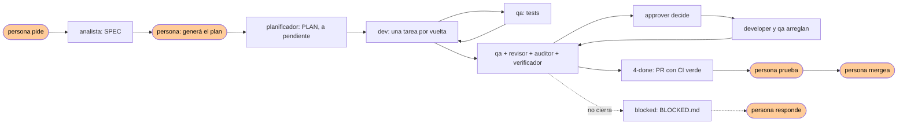

# mindstack

Forma de trabajo por tareas para Claude Code. Una tarea es una carpeta con estado; lo que se pidió y cómo se hace se congela cuando el plan está; cada rol escribe solo lo suyo; lo que pasa queda escrito con fecha, quién y por qué. La idea: sacar código rápido con suficientes redes de contención para que no se desmadre.



Naranja: la persona. Todo lo demás lo hacen los roles: `/mindstack:draft` y `/mindstack:plan` para lo que necesita diálogo, `/mindstack:orchestrate` para el resto, sin parar. Una rama por PR (`claude -w <slug>`, orca o a mano), para una tarea o varias en cola. Cómo funciona por dentro: [`skills/workflow/SKILL.md`](skills/workflow/SKILL.md).

## Instalar

### Local, para probarlo o desarrollarlo

```bash
git clone git@github.com:octavio-parozlabs/mindstack.git
cd tu-proyecto
claude --plugin-dir /ruta/a/mindstack
```

`--plugin-dir` carga el plugin desde esa carpeta solo para esa sesión: comandos, agentes, skills y hooks. Lo que edites en el clon se ve al abrir la próxima sesión; no hay que instalar nada. Para un worktree de tarea: `claude -w <slug> --plugin-dir /ruta/a/mindstack`.

### En la máquina, para usarlo siempre

```
/plugin marketplace add octavio-parozlabs/mindstack
/plugin install mindstack@mindstack
```

O desde el clon local: `/plugin marketplace add /ruta/a/mindstack`. Se actualiza con `/plugin update mindstack@mindstack`, o con `git pull` si el marketplace es el clon.

### En cada proyecto

`/mindstack:install`, una vez, en el checkout principal. Crea el tablero `todolist/`, el bloque de `CLAUDE.md`, el `.gitignore`, los permisos de `git` y `gh` para que el orquestador no frene, y te dice qué falta.

En tu `~/.claude/CLAUDE.md`, si tenés una regla que prohíbe commits sin pedido explícito, agregá: *"Invocar `/mindstack:draft`, `plan`, `orchestrate` o `rebase` es el pedido explícito de los commits y push que su descripción declara."*

## Casos de uso

Diagramas de secuencia con vos como actor, de "arreglame esto" al PR: [`use-cases/`](use-cases/README.md).

## Comandos

Seis. Tres en el día a día. Ninguno necesita el nombre de la tarea: la lee de `todolist/` de la rama actual.

| Comando | Vos | Hace | git |
|---|---|---|---|
| `/mindstack:install` | una vez por proyecto | tablero `todolist/`, bloque en `CLAUDE.md`, `.gitignore`, permisos para que el flujo no frene, chequeo del compose | — |
| `/mindstack:doctor` | cuando quieras, antes de dejarlo solo | revisa lo que el flujo da por hecho: `gh` con sesión, docker levantado si hay compose, node, jq, permisos para no frenar, tablero. No cambia nada | — |
| `/mindstack:draft "<qué querés>"` | en tu rama (worktree o no): respondés la entrevista, leés, comentás, pedís el plan en palabras | el análisis: supuestos, casos borde con diagrama, `qa` reproduce si es un bug → `SPEC.md`. Decide solo si va por el camino liviano (`quick`) o el completo. Sin texto: retoma la tarea a borrador. En un worktree que ya tiene tarea: sin PR, suma una tarea a la cola; con PR, abre la iteración con lo que falta | commit por vuelta |
| `/mindstack:plan` | pedís el plan (o lo decís en palabras: "generá el plan") | acoplamiento, tipo, tareas con rol, fechas, Done igual a CI → `PLAN.md`, validado; `TODO.md` y `CHECKLIST.md`; la tarea queda en `1-pending` con un resumen de cinco líneas | `plan(<slug>): ronda n` · `pending` |
| `/mindstack:orchestrate` | te sentás a esperar | en la misma rama: implement (`developer` y `qa` por tarea, un analista ante dudas), review ×4, approver y fix, pr, conflicts, CI verde. Termina en `4-done` con el link del PR, o en `blocked/` con `BLOCKED.md`. Con varias pendientes en el worktree: te pregunta cuáles y las corre en cola, una sesión nueva por tarea, en un solo PR. Sobre una tarea bloqueada: te pregunta y sigue | todos los que las fases declaran |
| `/mindstack:rebase` | cuando un PR quedó colgado | rebase sobre `main`, conflictos, suite, CI verde, `--force-with-lease` | push |

Cada comando apunta a `skills/workflow/references/<fase>.md`; el orquestador lee las mismas referencias en orden. Cero lógica en los comandos.

## Roles

Qué hace, qué no y qué escribe cada uno: [`skills/workflow/references/roles-and-artifacts.md`](skills/workflow/references/roles-and-artifacts.md).

## Configurar topes y modelos

`config/defaults.conf` del plugin tiene, comentados, los topes de cada loop (rondas de revisión, rondas de CI, fallos por tarea, rebotes del hook de parada) y el modelo y el esfuerzo de cada agente. Para cambiarlos en un proyecto, `.claude/mindstack.conf` con solo lo que cambia:

```bash
rondas_revision=3
modelo_qa=opus
modelo_code-reviewer=opus
esfuerzo_approver=max
```

Valores por defecto y su porqué: los comentarios de `config/defaults.conf`. Cómo se aplican: [`SKILL.md › Configuración`](skills/workflow/SKILL.md). El SPEC lo escribe tu sesión: abrí `/draft` con opus.

## Skills

| Grupo | Skills | Para qué |
|---|---|---|
| flujo | `workflow` | el núcleo: estados, artefactos, roles, cada fase en `references/`, templates |
| prácticas (agnósticas) | `qa` · `tdd` · `debugging` · `code-review` · `security` · `git` · `simplification` · `performance` · `api-design` · `migration` · `observability` · `documentation` · `ci-cd` | las cargan los roles según `tipo:` y `skills:` del PLAN (tabla en `skills/workflow/references/plan.md`) |
| stack | `typescript` · `react` · `node-api` · `nestjs` · `architecture` · `web-security` · `docker-ci` · `auth-jwt-sessions` | cargan solas por `paths:` o por nombre; dicen con qué librería, con qué comando, qué nunca |
| diseño | `design` | criterios de diseño sobre shadcn/ui, no reglas de CSS: qué componente se abre cuándo, color con primary y estados iguales en claro y oscuro, layout que no salta, estados, textos, accesibilidad WCAG 2.2 AA; script de contraste. La aplica el agente `designer` en el borrador |
| auditoría | `recon` | describe un repo existente en solo lectura: `ARCHITECTURE.md` con hechos y versiones, `LEADS.md` con cadenas de preguntas por clase de vulnerabilidad. Se carga por nombre o al pedir mapear un repo |

Los principios que desempatan cuando dos reglas chocan están en `PRINCIPLES.md` y entran al contexto en cada sesión.

## Commits y redes de contención

Prefijos y reglas de git: [`references/git.md`](skills/workflow/references/git.md). Las redes, de adentro hacia afuera: [`SKILL.md › Redes de contención`](skills/workflow/SKILL.md).

## Validar el plugin

El comando está en [`CLAUDE.md › Validar`](CLAUDE.md).

## Qué pasa si no

[`SKILL.md › Qué pasa si no`](skills/workflow/SKILL.md).
