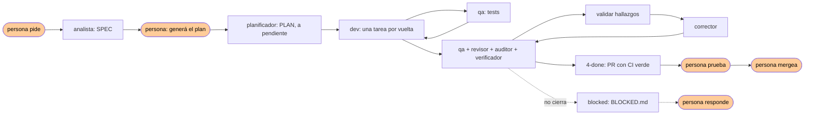

# mindstack

Forma de trabajo por tareas para Claude Code. Una tarea es una carpeta con estado; lo que se pidió y cómo se hace se congela cuando el plan está; cada rol escribe solo lo suyo; lo que pasa queda escrito con fecha, quién y por qué. La idea: sacar código rápido con suficientes redes de contención para que no se desmadre.



Naranja: la persona. Todo lo demás lo hacen los roles: `/mindstack:draft` y `/mindstack:plan` para lo que necesita diálogo, `/mindstack:orchestrate` para el resto, sin parar. El worktree es el PR: `claude -w <slug>` y todo pasa adentro, del borrador al PR, para una tarea o para varias en cola; si hay Compose, con su propio entorno en `localhost` y copia de tu DB. Nada se publica.

## Instalar

### Local, para probarlo o desarrollarlo

```bash
git clone git@github.com:octavio-parozlabs/mindstack.git
cd tu-proyecto
claude --plugin-dir /ruta/a/mindstack
```

`--plugin-dir` carga el plugin desde esa carpeta solo para esa sesión: comandos, agentes, skills y hooks. Lo que edites en el clon se ve al abrir la próxima sesión; no hay que instalar nada. Para un worktree de tarea: `claude -w <slug> --plugin-dir /ruta/a/mindstack`.

### En la máquina, para usarlo siempre

```
/plugin marketplace add octavio-parozlabs/mindstack
/plugin install mindstack@mindstack
```

O desde el clon local: `/plugin marketplace add /ruta/a/mindstack`. Se actualiza con `/plugin update mindstack@mindstack`, o con `git pull` si el marketplace es el clon.

Validar el clon: `node scripts/validate/skills.js && bash hooks/test.sh`.

### En cada proyecto

`/mindstack:install`, una vez, en el checkout principal. Crea el tablero `todolist/`, el bloque de `CLAUDE.md`, el `.gitignore`, los permisos de `git` y `gh` para que el orquestador no frene, y te dice qué falta.

En tu `~/.claude/CLAUDE.md`, si tenés una regla que prohíbe commits sin pedido explícito, agregá: *"Invocar `/mindstack:draft`, `plan`, `orchestrate` o `rebase` es el pedido explícito de los commits y push que su descripción declara."*

## Casos de uso

Diagramas de secuencia con vos como actor, de "arreglame esto" al PR: [`use-cases/`](use-cases/README.md). El caso 01 es el autónomo; el 02, comando por comando; el 03, qué pasa cuando el dev no puede decidir; el 04, revisión con hallazgos y conflicto; el 05, qué cambia por tipo de tarea.

## Una tarea es una carpeta

```
todolist/
├── 0-draft/           claude -w slug · /draft → comentás → /plan → comentás
├── 1-pending/          plan hecho → SPEC y PLAN congelados (/draft sin texto los reabre)
├── 2-in-progress/  fase implement, en worktree
├── 3-in-review/        fase review ↔ fase fix
├── 4-done/         lista para mergear: todo commiteado, PR abierto, CI verde
├── blocked/        necesita a la persona: BLOCKED.md dice por qué
├── backlog/        no es un estado: IDEAS.md (tuyas) · PROPUESTAS.md (de los agentes)
└── <estado>/<slug>/
    ├── SPEC.md            qué se pidió: hoy/propuesto, alcance, supuestos, casos borde CB-n con diagrama
    ├── PLAN.md            cómo se hace: fechas, estado final, acoplamiento, tareas con rol, Done
    ├── TODO.md            qué se hizo: las tareas del PLAN, las tacha el dev
    ├── CHECKLIST.md       qué tiene que ser cierto (CA-n, CB-n): la tacha solo el verificador
    ├── CHANGELOG.md       qué pasó: cambios, observaciones, propuestas, decisiones, deuda, revisión, conflictos, cierre
    ├── REVIEW-qa.md       hallazgos de QA contra los CB del SPEC
    ├── REVIEW-code.md   hallazgos del revisor de código
    ├── REVIEW-security.md hallazgos del auditor, zero trust
    ├── PR.md              body del PR
    ├── BLOCKED.md         solo en blocked/: motivos cortos, con opciones; lo único que leés
    └── wireframes/        si toca la interfaz: una pantalla por .wireloom; rendered/*.svg es lo que ves en el SPEC y en el PR
```

| Archivo | Quién | Cuándo cambia |
|---|---|---|
| `SPEC.md`, `wireframes/`, `PLAN.md` | analista (y `designer`), planificador, con la persona | solo en `0-draft/`. Después **nunca**: un hook lo bloquea y CI lo verifica |
| `TODO.md` | el dev tacha | en cada tarea |
| `CHECKLIST.md` | `verifier` tacha, con código, test y evidencia | en cada ronda de revisión |
| `CHANGELOG.md` | todos, cada uno su sección | siempre se agrega, nunca se reescribe |
| `REVIEW-*.md` | un rol cada uno | se reescribe por ronda. Solo hallazgos, con severidad |
| `backlog/IDEAS.md` | vos; ningún agente. Una fila por idea: Descripción, Prioridad, Fecha, Notas | cuando se te ocurre algo. `/mindstack:draft backlog: <unas palabras>` la convierte en tarea |
| `backlog/PROPUESTAS.md` | el orquestador, con lo que los agentes propusieron en su tarea (con dónde se vio, máx. 3 por tarea) | al llegar a done. Borrás lo que no te sirve |

## Comandos

Cinco. Tres en el día a día. Ninguno necesita el nombre de la tarea: la lee del worktree.

| Comando | Vos | Hace | git |
|---|---|---|---|
| `/mindstack:install` | una vez por proyecto | tablero `todolist/`, bloque en `CLAUDE.md`, `.gitignore`, permisos para que el flujo no frene, chequeo del compose | — |
| `/mindstack:draft "<qué querés>"` | en el worktree: respondés la entrevista, leés, comentás, pedís el plan en palabras | el análisis: supuestos, casos borde con diagrama, `qa` reproduce si es un bug → `SPEC.md`. Sin texto: retoma la tarea a borrador. En un worktree que ya tiene tarea: sin PR, suma una tarea a la cola; con PR, abre la tarea hija con lo que falta | commit por vuelta |
| `/mindstack:plan` | pedís el plan (o lo decís en palabras: "generá el plan") | acoplamiento, tipo, tareas con rol, fechas, Done igual a CI → `PLAN.md`, validado; `TODO.md` y `CHECKLIST.md`; la tarea queda en `1-pending` con un resumen de cinco líneas | commit |
| `/mindstack:orchestrate` | te sentás a esperar | en el mismo worktree: implement (`developer` y `qa` por tarea, consenso), review ×4, validar y fix, pr, conflicts, CI verde. Termina en `4-done` con el link del PR, o en `blocked/` con `BLOCKED.md`. Con varias pendientes en el worktree: te pregunta cuáles y las corre en cola, una sesión nueva por tarea, en un solo PR. Sobre una tarea bloqueada: te pregunta y sigue | todos los que las fases declaran |
| `/mindstack:rebase` | cuando un PR quedó colgado | rebase sobre `main`, conflictos, suite, CI verde, `--force-with-lease` | push |

Cada comando apunta a `skills/workflow/references/<fase>.md`; el orquestador lee las mismas referencias en orden. Cero lógica en los comandos.

## Roles

| Agente | Modelo | Hace | Escribe solo |
|---|---|---|---|
| `analyst` | opus | consenso: busca evidencia desde un ángulo (historial, código, principios); valida cada hallazgo crítico o alto antes de corregirlo | nada |
| `designer` | opus | en el borrador, si toca la interfaz: propone la sección UX/UI del SPEC con la skill `design` y las pantallas que ya existen, y devuelve las preguntas | `notes/ux.md` |
| `researcher` | opus | al planificar: compara librerías que ya resuelven una necesidad, con datos; lo propio es la última opción | nada |
| `developer` | opus | una tarea del TODO, sin commit, decisiones y deuda en el CHANGELOG. Senior: sin refactors grandes | código, `TODO.md`, `CHANGELOG.md` |
| `qa` | sonnet | en un fix, reproduce el bug antes del plan; tests de cada tarea; en revisión, cruza cada CB del SPEC contra los tests | tests, `REVIEW-qa.md`, `CHANGELOG.md` |
| `code-reviewer` | opus | lógica, legibilidad, arquitectura, rendimiento | `REVIEW-code.md` |
| `security-auditor` | opus | zero trust | `REVIEW-security.md` |
| `verifier` | opus | si está hecho: cada línea de la checklist con código, test que la nombra y test corrido | `CHECKLIST.md` |
| `fixer` | opus | aplica los hallazgos validados; no rechaza | código, `CHANGELOG.md` |
| `conflict-resolver` | opus | rebase, suite, push | lo que esté en conflicto, `CHANGELOG.md` |

El "escribe solo" lo garantiza un hook por agente (`hooks/write-scope.sh`), no el prompt. El dev no escribe tests ni reviews; QA no toca producción; los revisores no editan; nadie mergea.

Cuando el dev encuentra una ambigüedad que ni el SPEC, ni el PLAN, ni un principio resuelven, no adivina: tres analistas buscan en paralelo (lo decidido en tareas terminadas, patrones del código, principios). Si coinciden, se decide y queda en el CHANGELOG; si no, la tarea va a `blocked/` y te enterás al abrir `claude`.

## Skills

| Grupo | Skills | Para qué |
|---|---|---|
| flujo | `workflow` | el núcleo: estados, artefactos, roles, cada fase en `references/`, templates |
| prácticas (agnósticas) | `qa` · `tdd` · `debugging` · `code-review` · `security` · `git` · `simplification` · `performance` · `api-design` · `migration` · `observability` · `documentation` · `ci-cd` | las cargan los roles según `tipo:` y `skills:` del PLAN (tabla en `skills/workflow/references/plan.md`) |
| stack | `typescript` · `react` · `node-api` · `nestjs` · `architecture` · `web-security` · `docker-ci` · `auth-jwt-sessions` | cargan solas por `paths:` o por nombre; dicen con qué librería, con qué comando, qué nunca |
| diseño | `design` | criterios de diseño sobre shadcn/ui, no reglas de CSS: qué componente se abre cuándo, color con primary y estados iguales en claro y oscuro, layout que no salta, estados, textos, accesibilidad WCAG 2.2 AA; script de contraste. La aplica el agente `designer` en el borrador |
| auditoría | `recon` | describe un repo existente en solo lectura: `ARCHITECTURE.md` con hechos y versiones, `LEADS.md` con cadenas de preguntas por clase de vulnerabilidad. Se carga por nombre o al pedir mapear un repo |

Los principios que desempatan cuando dos reglas chocan están en `PRINCIPLES.md` y entran al contexto en cada sesión.

## Commits

```
0-draft        spec(slug): ronda n · plan(slug): ronda n      cada vuelta, commit
estados        plan(slug): pending | reopen | implement | in review | done | blocked | unblocked
implementar    nada: el código vive en el working tree del worktree
revisar        review(slug): round n                           solo los REVIEW-*.md y CHECKLIST.md
fix            nada
pr             plan(slug): done · feat|fix(slug): título       a 4-done, el único commit de código, UN push, PR
ci             fix(slug): CI-n                                 solo si CI falla
```

Lo commiteado es lo revisado. El flujo tiene libertad para llegar hasta el PR sin pedir permiso: `/mindstack:install` deja los permisos de `git` y `gh` en el proyecto.

## Redes de contención

1. El prompt de cada rol dice qué no hace.
2. `hooks/write-scope.sh` por agente: fuera de sus archivos, bloqueado.
3. `hooks/plan-immutable.sh` global: `SPEC.md`, `PLAN.md` y `wireframes/` fuera de `0-draft/`, bloqueado; `CHECKLIST.md` solo la tacha `verifier`.
4. `chmod a-w` local al pasar a pendiente.
5. `scripts/ci-plans-immutable.sh` en el CI del proyecto.
6. Cada hallazgo que bloquea lo valida otro agente antes de corregirse.
7. Cinco rondas de revisión como máximo; después, `blocked/`.
8. `hooks/orchestrate-stop.sh`: el orquestador no termina el turno fuera de `4-done` con CI verde o de `blocked/`.
9. `hooks/session-start.sh`: al abrir `claude`, las tareas bloqueadas de cualquier worktree y las mergeadas sin limpiar.
10. Nadie mergea.

## Validar el plugin

```bash
node scripts/validate/skills.js          # frontmatter de skills y agentes
node scripts/validate/reference-links.js # links entre references
bash hooks/test.sh                       # los hooks, caso por caso
node scripts/validate/mermaid.mjs .      # todos los diagramas parsean (instala mermaid en /tmp la primera vez)
```

Lo mismo corre en `.github/workflows/validate.yml`.

## Qué pasa si no

Está en `skills/workflow/SKILL.md`, al final: qué cuesta cada atajo (implementar sin SPEC, editar el PLAN, que el dev escriba sus tests, un solo revisor, deuda sin vencimiento, agente que mergea).
