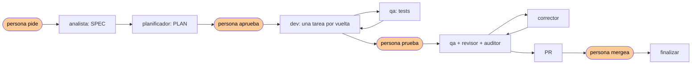

# mindstack

Forma de trabajo por tareas para Claude Code. Una tarea es una carpeta con estado; lo que se pidió y cómo se hace se congela al aprobar; cada rol escribe solo lo suyo; lo que pasa queda escrito con fecha, quién y por qué. La idea: sacar código rápido con suficientes redes de contención para que no se desmadre.



Naranja: la persona. Todo lo demás lo hacen los roles, de a uno (`/mindstack:<fase>`) o encadenados (`/mindstack:orchestrate`).

## Instalar

En la máquina, una vez:

```
/plugin marketplace add octavio-parozlabs/agent-skills
/plugin install mindstack@mindstack
```

O desde el clon local: `/plugin marketplace add /ruta/al/clon`. Para implementar hace falta además el plugin `ralph-wiggum` (el loop).

En cada proyecto: `/mindstack:install`. Crea el tablero `docs/plans/`, el bloque de `CLAUDE.md`, el `.gitignore`, y te dice qué falta.

En tu `~/.claude/CLAUDE.md`, si tenés una regla que prohíbe commits sin pedido explícito, agregá: *"Invocar `/mindstack:approve`, `implementar`, `revisar`, `corregir`, `pr`, `conflictos`, `finalizar` u `orquestar` es el pedido explícito de los commits y push que su descripción declara."*

## Una tarea es una carpeta

```
docs/plans/
├── 0-draft/           /analyze, /plan
├── 1-pending/          /approve → SPEC y PLAN congelados
├── 2-in-progress/  /implement, en worktree
├── 3-in-review/        /review ↔ /fix, /pr
├── 4-done/         /finalize, después del merge
└── <estado>/<slug>/
    ├── SPEC.md            qué se pidió: hoy/propuesto, alcance, supuestos, casos borde CB-n con diagrama
    ├── PLAN.md            cómo se hace: fechas, estado final, acoplamiento, tareas con rol, Done
    ├── TODO.md            qué se hizo: lo único que se tacha
    ├── CHANGELOG.md       qué pasó: cambios, observaciones, decisiones, deuda, revisión, conflictos, cierre
    ├── REVIEW-qa.md       hallazgos de QA contra los CB del SPEC
    ├── REVIEW-code.md   hallazgos del revisor de código
    ├── REVIEW-security.md hallazgos del auditor, zero trust
    └── PR.md              body del PR y su número
```

| Archivo | Quién | Cuándo cambia |
|---|---|---|
| `SPEC.md`, `PLAN.md` | analista, planificador, con la persona | solo en `0-draft/`. Después **nunca**: un hook lo bloquea y CI lo verifica |
| `TODO.md` | el dev tacha | en cada tarea |
| `CHANGELOG.md` | todos, cada uno su sección | siempre se agrega, nunca se reescribe |
| `REVIEW-*.md` | un rol cada uno | se reescribe por ronda. Solo hallazgos, con severidad |

## Comandos

| Comando | Hace | git |
|---|---|---|
| `/mindstack:install` | tablero, `CLAUDE.md`, `.gitignore` | — |
| `/mindstack:analyze <tema>` | entrevista, supuestos, un diagrama por caso borde → `SPEC.md` | commit por ronda |
| `/mindstack:plan <slug>` | acoplamiento, tajadas verticales, tareas con rol, fechas, Done → `PLAN.md` | commit por ronda |
| `/mindstack:approve <slug>` | congela, deriva `TODO.md`, mueve a `1-pending` | commit |
| `/mindstack:implement <slug>` | `ralph-loop`: una tarea por vuelta, `qa` después de cada una, consenso ante ambigüedades | commit del estado; el código queda sin commitear |
| `/mindstack:review <slug>` | `qa` + `code-reviewer` + `security-auditor` en paralelo → tres `REVIEW-*.md` | commit solo de los REVIEW |
| `/mindstack:fix <slug>` | `fixer`: fix, deuda con vencimiento, o rechazo con motivo; `qa` testea | sin commit |
| `/mindstack:pr <slug>` | **único commit del código**, `PR.md`, push, `gh pr create` | commit + push |
| `/mindstack:conflicts <slug\|#pr>` | `conflict-resolver`: rebase, suite, `--force-with-lease` | push |
| `/mindstack:finalize <slug>` | Cierre con fechas reales, mueve a `4-done` | commit |
| `/mindstack:orchestrate <slug\|tema>` | todo lo anterior en orden, parando donde hace falta la persona. Nunca mergea | todo |

Cada comando es cinco líneas que apuntan a `skills/workflow/references/<fase>.md`. El orquestador lee las mismas referencias: una sola fuente para el modo manual y el encadenado.

## Roles

| Agente | Modelo | Hace | Escribe solo |
|---|---|---|---|
| `analyst` | opus | consenso: busca evidencia desde un ángulo (historial, código, principios) | nada |
| `developer` | opus | una tarea del TODO, sin commit, decisiones y deuda en el CHANGELOG. Senior: sin refactors grandes | código, `TODO.md`, `CHANGELOG.md` |
| `qa` | sonnet | en un fix, reproduce el bug antes de aprobar; tests de cada tarea; en revisión, cruza cada CB del SPEC contra los tests | tests, `REVIEW-qa.md`, `CHANGELOG.md` |
| `code-reviewer` | opus | lógica, legibilidad, arquitectura, rendimiento | `REVIEW-code.md` |
| `security-auditor` | opus | zero trust | `REVIEW-security.md` |
| `fixer` | opus | cierra cada hallazgo | código, `CHANGELOG.md` |
| `conflict-resolver` | opus | rebase, suite, push | lo que esté en conflicto, `CHANGELOG.md` |

El "escribe solo" lo garantiza un hook por agente (`hooks/write-scope.sh`), no el prompt. El dev no escribe tests ni reviews; QA no toca producción; los revisores no editan; nadie mergea.

Cuando el dev encuentra una ambigüedad que ni el SPEC, ni el PLAN, ni un principio resuelven, no adivina: tres analistas buscan en paralelo (lo decidido en tareas finalizadas, patrones del código, principios). Si coinciden, se decide y queda en el CHANGELOG; si no, recién ahí la persona.

## Skills

| Grupo | Skills | Para qué |
|---|---|---|
| flujo | `workflow` | el núcleo: estados, artefactos, roles, cada fase en `references/`, templates |
| prácticas (agnósticas) | `tdd` · `debugging` · `code-review` · `security` · `git` · `simplification` · `performance` · `api-design` · `migration` · `observability` · `documentation` · `ci-cd` | las cargan los roles según `tipo:` y `skills:` del PLAN (tabla en `skills/workflow/references/plan.md`) |
| stack | `typescript` · `react` · `node-api` · `nestjs` · `architecture` · `web-security` · `docker-ci` · `auth-jwt-sessions` | cargan solas por `paths:` o por nombre; dicen con qué librería, con qué comando, qué nunca |

Los principios que desempatan cuando dos reglas chocan están en `references/PRINCIPLES.md` y entran al contexto en cada sesión.

## Commits

```
0-draft        spec(slug): ronda n · plan(slug): ronda n      cada vuelta, commit
estados        plan(slug): approve | implement | in review | PR | finalize
implementar    nada: el código vive en el working tree del worktree
revisar        review(slug): round n                           solo los REVIEW-*.md
fix            nada
pr             feat|fix(slug): título                          el único commit de código, después push y PR
```

Lo commiteado es lo revisado. El flujo tiene libertad para llegar hasta el PR sin pedir permiso: `/mindstack:install` deja los permisos de `git` y `gh` en el proyecto.

## Redes de contención

1. El prompt de cada rol dice qué no hace.
2. `hooks/write-scope.sh` por agente: fuera de sus archivos, bloqueado.
3. `hooks/plan-immutable.sh` global: `SPEC.md` y `PLAN.md` fuera de `0-draft/`, bloqueado.
4. `chmod a-w` local al aprobar.
5. `scripts/plans-immutable.sh` en el CI del proyecto.
6. Dos rondas de revisión como máximo; después, la persona.
7. Nadie mergea.

## Validar el plugin

```bash
node scripts/validate-skills.js          # frontmatter de skills y agentes
node scripts/validate-reference-links.js # links entre references
bash hooks/test.sh                       # los hooks, caso por caso
```

Lo mismo corre en `.github/workflows/validate.yml`.

## Qué pasa si no

Está en `skills/workflow/SKILL.md`, al final: qué cuesta cada atajo (implementar sin SPEC, editar el PLAN, que el dev escriba sus tests, un solo revisor, deuda sin vencimiento, agente que mergea).
