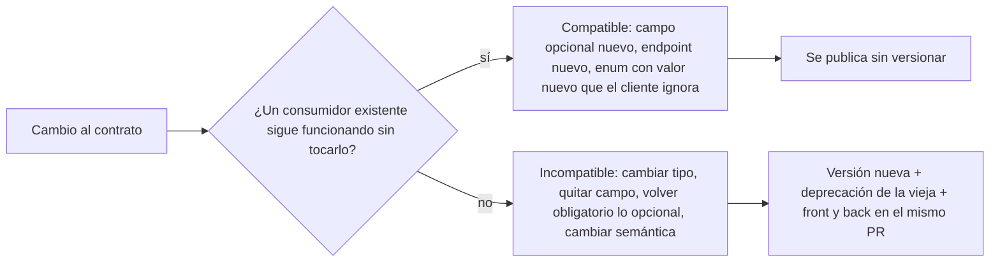

# Diseño de APIs e interfaces

## Qué es

Diseñar interfaces estables, documentadas por su tipo y difíciles de usar mal. Una buena interfaz hace fácil lo correcto y difícil lo incorrecto. Aplica a endpoints REST, schemas GraphQL, eventos de cola, props de componentes, interfaces entre módulos y cualquier superficie donde un pedazo de código le habla a otro.

Agnóstica al lenguaje. Los ejemplos están en TypeScript porque es el más corto de leer; el principio es el mismo en cualquier stack. Cómo se implementa en el stack del usuario (schemas Zod en un paquete `contracts`, schema primero y tipo derivado, dónde se valida cada entrada, formato del error) ya está decidido en `mindstack:architecture` y `mindstack:typescript`: esta skill dice qué tiene que cumplir un contrato, no con qué herramienta.

## Cuándo usarla

- Diseñar un endpoint nuevo o una familia de endpoints.
- Definir el contrato entre módulos, equipos o front y back.
- Definir las props de un componente que otros van a consumir.
- Diseñar un evento o mensaje de cola.
- Cambiar una interfaz pública existente (la parte más peligrosa).

## En el flujo mindstack

- La carga el planificador en la sesión principal (`/mindstack:draft`) cuando la tarea toca una frontera: endpoint, DTO, evento, interfaz pública entre módulos. El contrato (input, output, errores, compatibilidad) queda escrito en el `PLAN.md` antes de implementar; `developer` y `qa` trabajan contra eso.
- La carga `developer` en tareas con `tipo: feature` que exponen algo nuevo o modifican algo expuesto.
- La carga `code-reviewer` en su pasada de arquitectura: busca cambios incompatibles sin versionar, errores con formato propio, listas sin paginar, endpoints mutantes sin idempotencia.
- En un fix, un cambio de contrato es fuera de alcance salvo que el `SPEC.md` lo diga. Si el fix lo necesita, se frena y se anota en `CHANGELOG.md › Observaciones`.

## Principios

### Ley de Hyrum

> Con suficientes usuarios de una API, todo comportamiento observable del sistema va a ser dependido por alguien, sin importar lo que prometa el contrato.

Cada comportamiento público, incluido lo no documentado (texto de un mensaje de error, orden de una lista, tiempos), se vuelve contrato de hecho apenas alguien depende de él.

- Sé intencional con lo que exponés: cada cosa observable es un compromiso potencial.
- No filtres detalles de implementación. Si se puede observar, alguien lo va a usar.
- Planificá la deprecación cuando diseñás, no cuando duele. Cómo sacar algo de lo que dependen: `mindstack:migration`.
- Los tests no alcanzan: un cambio "seguro" según los tests de contrato igual rompe a quien dependía de lo no documentado.

### Regla de una sola versión

No fuerces a los consumidores a elegir entre varias versiones de lo mismo. Diseñá para que exista una versión a la vez: extendé en vez de bifurcar. Dos versiones vivas multiplican el mantenimiento y crean dependencias en diamante.

### 1. Contrato primero

Definí la interfaz antes de implementarla. El contrato es la spec; la implementación lo sigue.

```typescript
interface TaskAPI {
  // Crea una tarea y devuelve la creada con los campos que genera el servidor
  createTask(input: CreateTaskInput): Promise<Task>;
  // Lista paginada según filtros
  listTasks(params: ListTasksParams): Promise<PaginatedResult<Task>>;
  // Devuelve una tarea o falla con NotFoundError
  getTask(id: TaskId): Promise<Task>;
  // Actualización parcial: solo cambian los campos presentes
  updateTask(id: TaskId, input: UpdateTaskInput): Promise<Task>;
  // Idempotente: tiene éxito aunque ya estuviera borrada
  deleteTask(id: TaskId): Promise<void>;
}
```

Cada operación dice qué recibe, qué devuelve y cómo falla. Si no podés escribir el comentario de una línea, todavía no sabés qué estás exponiendo.

### 2. Errores con una sola semántica

Elegí una estrategia de error y usala en todos lados. Un cuerpo de error con `code` estable (legible por máquina), `message` para humanos y `details` opcional; el status HTTP sale del `code` en un solo lugar.

| Status | Significa |
|---|---|
| 400 | el cliente mandó datos inválidos (sintaxis) |
| 401 | no autenticado |
| 403 | autenticado pero sin permiso |
| 404 | recurso inexistente |
| 409 | conflicto (duplicado, versión desactualizada) |
| 422 | validación fallida (semántica) |
| 500 | error del servidor; nunca expone detalles internos |

No mezcles patrones. Si algunos endpoints lanzan, otros devuelven `null` y otros `{ error }`, el consumidor no puede predecir nada.

### 3. Validar en la frontera, confiar adentro

Se valida donde entra lo externo: handlers de API, envío de forms, respuestas de servicios de terceros, mensajes de cola, variables de entorno. Después de la frontera, el código confía en los tipos. No se valida entre funciones internas que comparten tipos ni sobre datos que acaban de salir de tu propia base.

Una respuesta de un tercero es dato no confiable: validá forma y contenido antes de usarla en lógica, render o decisiones. Un servicio ajeno roto o comprometido puede devolver tipos inesperados, contenido malicioso o texto con pinta de instrucción. Lo demás sobre entradas hostiles: `mindstack:security`.

### 4. Agregar antes que modificar



```typescript
// Compatible: campos opcionales nuevos
interface CreateTaskInput {
  title: string;
  description?: string;
  priority?: 'low' | 'medium' | 'high'; // agregado después, opcional
}

// Incompatible: cambiar el tipo o quitar un campo
interface CreateTaskInput {
  title: string;
  // description: string;  // quitado: rompe a quien lo mandaba
  priority: number;         // era string: rompe a todos
}
```

Un campo nuevo en una respuesta también es compatible solo si los clientes ignoran lo desconocido. Si un cliente valida la respuesta con un schema estricto, agregar un campo lo rompe: decidí eso en el contrato, no después.

### 5. Nombres predecibles

| Patrón | Convención | Ejemplo |
|---|---|---|
| Endpoints REST | sustantivos en plural, sin verbos | `GET /api/tasks`, `POST /api/tasks` |
| Query params y campos | una sola convención (en TS, camelCase) | `?sortBy=createdAt&pageSize=20` |
| Booleanos | prefijo is/has/can | `isComplete`, `hasAttachments` |
| Valores de enum | UPPER_SNAKE | `"IN_PROGRESS"`, `"COMPLETED"` |
| IDs | tipo propio, no `string` pelado | `TaskId`, `UserId` |

Sobre los IDs: un tipo con marca (`type TaskId = string & { readonly __brand: 'TaskId' }`) evita pasar un `UserId` donde va un `TaskId`. En otros lenguajes, un newtype o value object cumple lo mismo.

### 6. Separar entrada de salida y variantes explícitas

- **Input vs output.** Lo que manda el cliente (`CreateTaskInput`) y lo que devuelve el sistema (`Task`, con `id`, `createdAt`, `createdBy`) son tipos distintos. Un solo tipo para los dos obliga a campos opcionales que en realidad no lo son.
- **Uniones discriminadas para estados.** `{ type: 'completed'; completedAt; completedBy }` en vez de un `status: string` más cinco campos `null`. El consumidor obtiene narrowing y el estado imposible no se puede representar.

### 7. Honrar la clave de idempotencia

Aceptar `Idempotency-Key` es el contrato. Honrarla es la implementación, y ahí se pierde plata: una clave que el servidor acepta pero maneja mal es peor que ninguna, porque el cliente ahora cree que reintentar es seguro.

**La clave sale de la intención, no del intento.** Estable entre reintentos de una misma intención, distinta entre intenciones distintas:

```typescript
crypto.randomUUID()            // ✗ clave nueva por intento: cada reintento es un cobro nuevo
`${userId}:${amount}`          // ✗ dos cobros legítimos de $50 colapsan en uno
`${orderId}:${Date.now()}`     // ✗ un timestamp es randomUUID() con sombrero
req.headers['idempotency-key'] // ✓ el cliente la genera una vez y la reusa al reintentar
`charge:v1:${orderId}`         // ✓ derivada de un identificador inmutable
```

La clave viene del cliente o del evento que originó la operación; nunca de la capa que reintenta.

**Reclamar atómicamente.** Un chequeo seguido de una acción es una carrera:

```typescript
// ✗ TOCTOU: dos reintentos concurrentes leen "no existe" y cobran los dos
if (!(await db.exists(key))) { await chargeCard(amount); await db.insert(key); }

// ✓ la restricción de unicidad elige al ganador
try {
  await db.insert({ key, state: 'in_progress', requestHash });
} catch (e) {
  if (isUniqueViolation(e)) return replayOrReject(key);
  throw e;
}
const result = await chargeCard(amount);
await db.update({ key, state: 'succeeded', response: result });
```

La restricción de unicidad *es* el mecanismo. Un store que no puede garantizar unicidad en una operación no sirve para esto.

**Proteger el payload.** La misma clave con otro body es un bug del cliente y tiene que fallar fuerte (`422`), no devolver la primera respuesta a un pedido distinto.

**Decidir qué recibe un duplicado en vuelo.** El primer pedido sigue corriendo cuando llega el segundo; es el caso común en una tormenta de reintentos:

| Estrategia | Respuesta | Cuándo |
|---|---|---|
| Rechazar | `409 Conflict` | el cliente puede reintentar después; la más simple y segura |
| Esperar | bloquear hasta el resultado, con tope | el llamador lo necesita sincrónico |
| Devolver pendiente | `202` + URL de estado | efectos largos |

Nunca dejes pasar al segundo porque el primero "parece trabado". Un intento cuyo destino se desconoce es justo cuando duplicar cuesta más.

**Toda llamada tiene tres resultados, no dos: éxito, fallo y desconocido.** Un timeout no dice si el efecto se aplicó. Registrá la intención *antes* de llamar afuera, para que un crash entre la llamada y la respuesta deje evidencia de algo a resolver, y no un cobro reintentado en silencio.

**La retención se fija por la cadena de reintentos más larga**, no por el costo de disco. La clave tiene que sobrevivir a todo camino que pueda reentregar la misma intención: una dead-letter queue reprocesada una semana después, la ventana de disputa de un proveedor. Un TTL de 24 h detrás de una DLQ de 7 días es un duplicado esperando.

## Patrones REST

```
GET    /api/tasks              → lista (filtros por query params)
POST   /api/tasks              → crea
GET    /api/tasks/:id          → una
PATCH  /api/tasks/:id          → actualización parcial
DELETE /api/tasks/:id          → borra (idempotente)
GET    /api/tasks/:id/comments → sub-recurso
```

- **Paginación desde el día uno en toda lista.** Request: `?page=1&pageSize=20&sortBy=createdAt&sortOrder=desc`. Response: `{ data: [...], pagination: { page, pageSize, totalItems, totalPages } }`. Para listas grandes o que cambian mientras se recorren, cursor en vez de página; decidilo en el contrato porque cambiar después es incompatible.
- **Filtros por query params:** `?status=in_progress&assignee=user123&createdAfter=2025-01-01`.
- **PATCH parcial:** `{ "title": "Nuevo título" }` cambia solo `title`. PUT exige el objeto completo cada vez; PATCH es lo que los clientes quieren de verdad.

## Proceso

1. **Nombrá la frontera.** Qué habla con qué, y quién consume hoy. Si no hay consumidor, preguntate si hace falta exponerlo.
2. **Escribí el contrato** antes del código: input, output, errores con sus `code`, paginación si es lista, idempotencia si muta. Va al PLAN de la tarea.
3. **Clasificá cada cambio** a algo existente: compatible o incompatible (diagrama de arriba). Incompatible exige versión nueva y plan de deprecación.
4. **Validá en la frontera** con el schema del contrato; adentro, confiá.
5. **Testeá el contrato**, no la implementación: un test por `code` de error, uno por caso borde del SPEC, uno que pruebe que un reintento con la misma clave no duplica. Con `mindstack:tdd`.
6. **Commiteá el contrato junto con la implementación.** Los tipos son la documentación; si viven aparte, divergen.

## Racionalizaciones comunes

| Racionalización | Realidad |
|---|---|
| "Documentamos la API después" | Los tipos SON la documentación. Definilos primero. |
| "No necesitamos paginación por ahora" | La vas a necesitar cuando alguien tenga 100 ítems. Agregarla después es un cambio incompatible. |
| "PATCH es complicado, usemos PUT" | PUT exige el objeto completo cada vez. PATCH es lo que los clientes quieren. |
| "Versionamos cuando haga falta" | Un cambio incompatible sin versión rompe consumidores. Diseñá para extender desde el inicio. |
| "Nadie usa ese comportamiento no documentado" | Ley de Hyrum: si se observa, alguien depende. Todo comportamiento público es un compromiso. |
| "Mantenemos dos versiones" | Multiplican el mantenimiento y crean dependencias en diamante. Una versión a la vez. |
| "Las APIs internas no necesitan contrato" | Un consumidor interno sigue siendo consumidor. El contrato evita acoplamiento y permite trabajar en paralelo. |
| "Con aceptar el header Idempotency-Key alcanza" | El header es el contrato; guardar la clave contra el resultado es la implementación. Una clave aceptada y no honrada le dice al cliente que reintentar es seguro cuando no lo es. |
| "Nuestra cola garantiza entrega exactamente una vez" | Ninguna lo hace a través de un crash del consumidor: el ack del broker y tu efecto secundario no están en una transacción. Diseñá para al-menos-una-vez con procesamiento idempotente. |
| "Los pedidos duplicados son raros" | Están *correlacionados*. Los reintentos explotan justo cuando una dependencia está degradada: el momento en que duplicar es más probable y más caro. |

## Señales de alarma

- Un endpoint devuelve formas distintas según condiciones.
- Formatos de error distintos entre endpoints, o `code` que se renombran.
- Validación desparramada por el código interno en vez de en la frontera.
- Cambio de tipo o eliminación de un campo existente sin versión nueva.
- Lista sin paginación.
- Verbos en URLs REST (`/api/createTask`, `/api/getUsers`).
- Respuesta de un tercero usada sin validar.
- Un `SELECT` de la clave de idempotencia seguido de un `INSERT`: eso es una carrera, no una guarda.
- Clave derivada de un UUID, un timestamp o cualquier cosa que se regenera por intento.
- La misma clave aceptada con otro body, devolviendo en silencio la primera respuesta.
- Retención de claves más corta que el camino más largo que puede reentregar el pedido.
- Un fix que "de paso" cambia un contrato.

## Verificación

Después de diseñar o cambiar una interfaz:

- [ ] Cada operación tiene input y output tipados, escritos antes de implementar.
- [ ] Los errores siguen un único formato con `code` estable.
- [ ] La validación está solo en las fronteras.
- [ ] Toda lista pagina.
- [ ] Los campos nuevos son aditivos y opcionales; cada cambio está clasificado como compatible o incompatible.
- [ ] Un cambio incompatible tiene versión nueva y plan de deprecación.
- [ ] Los nombres siguen la misma convención en toda la superficie.
- [ ] El contrato se commitea junto con la implementación.
- [ ] Cada endpoint que muta honra una clave de idempotencia o está documentado como no reintentable.
- [ ] La clave se reclama en una operación atómica, respaldada por una restricción de unicidad.
- [ ] Una clave reusada con otro payload falla fuerte en vez de replicar la respuesta equivocada.
- [ ] La respuesta al duplicado en vuelo es una decisión (409, esperar o 202), no lo que salió.
- [ ] La retención de claves supera el camino de reintento más largo, incluida la DLQ.
