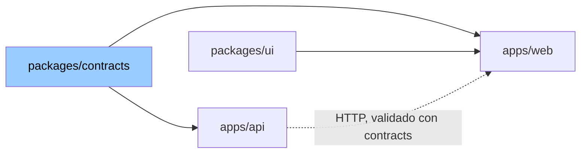

# Arquitectura

Decisiones de arquitectura que no dependen del lenguaje. Toda skill de stack (`typescript`, `react`, `node-api`, `nestjs`) las asume; lo que cambia por tecnología va en la skill del stack.

## 1. Un repo, varias apps, un paquete de contratos

Front y back viven en el mismo repo. Lo que comparten (tipos, schemas, DTOs, enums) vive en **un solo paquete** que los dos importan. Nadie duplica un tipo a mano.

```
repo/
├── apps/
│   ├── api/          backend: dominio, persistencia, endpoints
│   └── web/          frontend: UI, estado de pantalla, llamadas a la API
├── packages/
│   ├── contracts/    schemas y tipos compartidos. La única fuente de verdad del borde
│   └── ui/           componentes de UI compartidos (si hay más de una app de front)
└── package.json      workspaces
```



Las flechas son imports. `contracts` no importa de nadie. `api` y `web` no se importan entre sí: hablan por HTTP, y el contrato de ese HTTP está en `contracts`.

## 2. El contrato es un schema, no una interfaz

En `contracts` se escribe **el schema** (lo que valida en runtime) y el tipo **se deriva** de él. Nunca al revés, nunca los dos a mano.

| Lado | Qué hace con el schema |
|---|---|
| backend | valida el request al entrar, valida el response al salir (al menos en test) |
| frontend | valida el form antes de mandar, parsea el response al recibir |
| los dos | usan el tipo derivado para todo lo demás |

Por qué: una interfaz es una promesa que se rompe en runtime sin aviso. Un schema es la misma promesa, verificada en las dos puntas. Y como el tipo sale del schema, no pueden divergir.

Qué va en `contracts`:

- Schemas de request y response de cada endpoint.
- Entidades que cruzan el borde (`Order`, `User` como los ve el cliente, no como están en la DB).
- Enums y constantes compartidas (`OrderStatus`, `MAX_ITEMS_PER_ORDER`).
- La forma del error: `{ code, message, details? }`. Un solo formato para todos los endpoints.

Qué **no** va:

- Modelos de DB, ORM, migraciones. Eso es del backend.
- Componentes, hooks, estado de UI. Eso es del frontend.
- Lógica. `contracts` es declarativo: schemas, tipos, constantes. Si hay un `if`, va en otro lado.

## 3. Fronteras y dirección de dependencias

| Capa | Responsable de | Nunca |
|---|---|---|
| `contracts` | definir el borde | importar de apps, tener lógica |
| `api` | reglas de negocio, persistencia, auth, exponer endpoints | saber qué pantalla llama, devolver modelos de DB crudos |
| `web` | mostrar, capturar input, estado de la pantalla | reglas de negocio, calcular algo que la API ya calcula |
| `ui` | componentes sin conocimiento del dominio: un `Button`, no un `OrderButton` | importar de `contracts` ni de `web` |

Regla de oro: **la lógica de negocio vive en un solo lugar, el backend.** Si el front "recalcula el total para mostrarlo antes", ese cálculo se exporta desde `contracts` como función pura o la API expone un endpoint de preview. Dos implementaciones del mismo cálculo divergen siempre.

## 4. Validar en la frontera, confiar adentro

Todo lo que entra de afuera se valida en el punto de entrada, una vez, con el schema del contrato:

| Entrada | Dónde se valida |
|---|---|
| request HTTP | primer middleware o handler del endpoint. El body se parsea solo si el `Content-Type` declara lo que ese endpoint acepta; si no, `415` antes de validar nada (`../web-security/references/content-type.md`) |
| form del usuario | antes de mandar, con el mismo schema |
| respuesta de la API en el front | al recibir, con el schema de response |
| variables de entorno | al arrancar, en un módulo `config` |
| mensajes de cola, webhooks, archivos | al leer |

Después de la frontera, el código confía en los tipos. Nada de `if (!user.id)` en la capa de servicio: si llegó hasta ahí, tiene `id`.

## 5. Errores que cruzan el borde

Un solo formato, definido en `contracts`, con un `code` estable que el front puede switchear:

```json
{ "code": "ORDER_NOT_FOUND", "message": "Order 123 not found", "details": { "orderId": "123" } }
```

- `code` es parte del contrato: se agrega, no se renombra.
- `message` es para humanos y puede cambiar.
- El status HTTP sale del `code` en un solo lugar del backend.
- El front nunca parsea `message`.

## 6. Configuración

- Una app, un módulo `config`, leído de env, validado al arrancar. Falta una variable: no arranca, y dice cuál. El entorno se lee **ahí y solo ahí**: el resto del código importa `config`. Las decisiones completas (qué entra, qué no, nada por el modo del entorno, inmutable, tests) están en `../web-security/references/config.md`; lo fuerza el lint del stack.
- Sin secretos en el repo. `.env.example` commiteado con los nombres; `.env` ignorado.
- Lo que cambia entre entornos (URLs, flags) es config. Lo que no cambia es constante en el código.

## 7. Cuándo esto no aplica

- Un solo front sin backend propio (consume una API ajena): no hay `contracts`, el schema de la API ajena vive en el front.
- Backend que sirve a varios clientes de equipos distintos: `contracts` se publica como paquete versionado, no como workspace.
- Prototipo de una tarde: una carpeta, un archivo, y esto se ignora. Cuando crece, se reorganiza así.

## 8. Dos orígenes, y el resto es hostil

Premisa de red de toda plataforma: **el frontend vive en un subdominio (`app.ejemplo.com`) y la API en otro (`api.ejemplo.com`). Son los únicos dos que se hablan. Todo lo demás, incluidos los otros subdominios del mismo dominio, se trata como si ya estuviera comprometido.** Un `blog.ejemplo.com` en WordPress, un `docs.` en un SaaS de terceros, un `old.` que nadie apaga: cualquiera puede tener un XSS mañana, y ese XSS no tiene que poder ni leer la sesión, ni usarla, ni ejecutar en nuestra app.

Escalonado: cada capa asume que la anterior falló.

| Capa | Qué cierra | Regla |
|---|---|---|
| cookies host-only, `httpOnly`, `Secure`, `SameSite=Strict`, sin `Domain` | otro subdominio no **lee** la sesión; otro sitio no la **manda** | `../web-security/references/cookies.md` |
| `Origin` exacto exigido en todo request a la API; ausente o `null`, rechazado | otro subdominio (mismo sitio: `SameSite` no lo frena) no **usa** la sesión | `../web-security/references/origin.md` |
| CORS a un solo origen literal con credenciales, registrado después del chequeo de `Origin` | otro origen no **lee** la respuesta ni aunque el request llegara | `../web-security/references/cors.md` |
| CSP con nonce por request, nada inline, ni script ni estilo; nadie nos embebe en un iframe | un XSS en **nuestro** frontend no ejecuta; clickjacking imposible | `../web-security/references/csp.md` |
| headers complementarios: `X-Frame-Options`, HSTS con `includeSubDomains`, `nosniff`, COOP, CORP, `Origin-Agent-Cluster`, sin `Server` ni `X-Powered-By` | lo que CSP no cubre, y lo que cubre en browsers que no la entienden; un hermano en HTTP no escribe cookies del padre; `document.domain` no relaja nada | `../web-security/references/headers.md` |
| body solo con `Content-Type` explícito; forms solo donde se piden, con token CSRF | un `<form>` desde otro sitio no ejecuta nada aunque el chequeo de `Origin` fallara | `../web-security/references/content-type.md` |
| access de 10 minutos, refresh rotativo con detección de reuso | lo que igual se filtró vale poco y se nota | `../web-security/references/jwt.md` |

Consecuencias que no se negocian: `Origin` comparado **exacto** (esquema, host y puerto, igualdad de string), **nunca `null`**, **nunca ausente**, en todos los métodos; CORS con ese mismo valor literal y `credentials: true`; ningún `Domain=.ejemplo.com`; ningún `SameSite=None`; ningún comodín, sufijo ni `includes` en ninguna lista de orígenes; ningún token donde JS llegue. Son reglas de diseño seguro: no tienen "cuándo cambia" (`../web-security/references/origin.md` § No negociable). En dev la topología es la misma: `localhost:5173` y `localhost:3000` son dos orígenes del mismo sitio, igual que en prod. Lo único que cambia en local es el atributo `Secure` de las cookies, por config, y está acotado en `../web-security/references/cookies.md`.

Cuándo cambia: un segundo frontend legítimo (`admin.`) entra como segundo origen explícito en `../web-security/references/origin.md` y se audita como frontend. Un cliente que no es browser (app nativa, servicio) no usa cookies ni pasa por esta premisa: tiene su propio router y su propia autenticación.

## Decisiones cerradas

Lo que toda plataforma implementa igual (auth con JWT, cookies de sesión, quién puede llamar a la API, CSP) no se decide por proyecto: está en `../web-security/references/jwt.md`, `../web-security/references/cookies.md`, `../web-security/references/origin.md`, `../web-security/references/cors.md`, `../web-security/references/content-type.md`, `../web-security/references/csp.md` y `../web-security/references/headers.md`, con flujo, diagramas, config y tests. La skill `web-security` carga sola al tocar auth, cors, csp, headers, `app.ts` o config.

## Cómo lo usa un stack

Cada skill de stack asume esta skill y no la repite: su tabla "Con qué" y sus `references/` dicen **con qué** se implementa cada punto (qué validador de schemas, qué gestor de workspaces); esta skill dice **qué** y **por qué**. Un stack que contradice un punto de acá lo cambia por PR a esta skill, no en su tabla.
