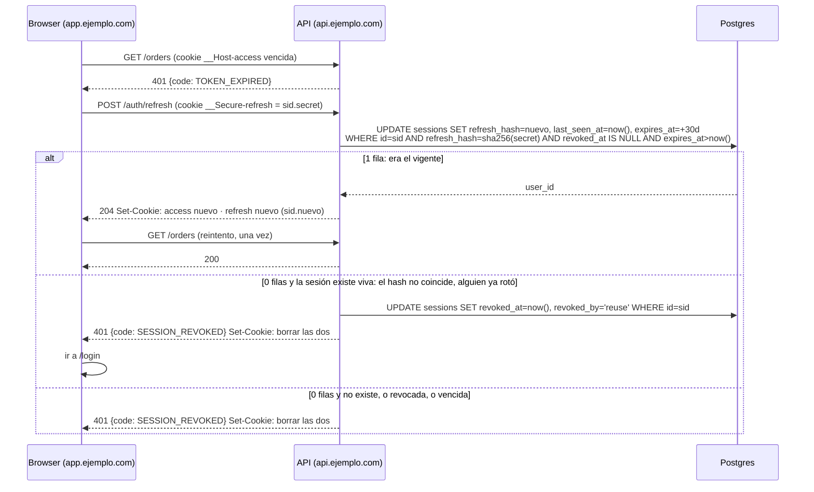
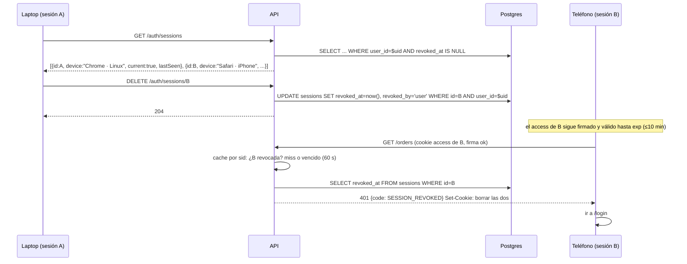
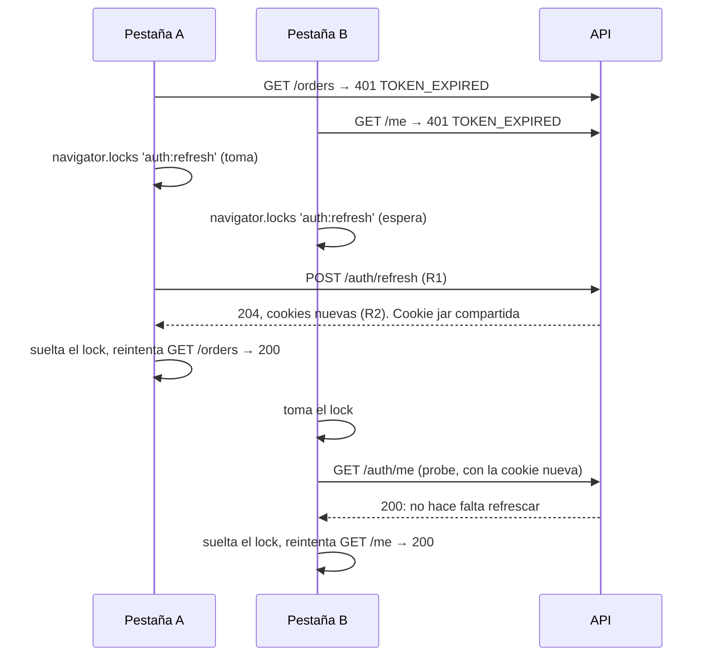

# Autenticación con JWT: access + refresh rotativo, sesiones por dispositivo en Postgres, SPA y API en subdominios

**Pre-plan, orientativo.** No se ejecuta tal cual: `/mindstack:plan` lo copia a `docs/plans/0-draft/` del proyecto, lo cruza con el repo y completa los `TODO`. Un proyecto con IAM externo no lo usa; lo de cookies, `Origin`, interceptor y pantalla de dispositivos sigue valiendo.

El flujo está cerrado en `../web-security/references/jwt.md`, `cookies.md` y `origin.md`; este pre-plan no lo rediscute. Lo que agrega: la arquitectura concreta (SPA en `app.ejemplo.com`, API en `api.ejemplo.com`), **la sesión como entidad que el usuario ve y cierra** (una fila por dispositivo, con qué dispositivo, desde dónde, desde cuándo), y dos decisiones que se apartan del core: una fila por sesión en vez de una por rotación, y revocación del access en menos de un minuto en vez de aceptar los 10. El diseño está en `notes/sessions.md`; la alternativa en Redis, descartada, en `notes/redis-rejected.md`. Lo que falta para salir de borrador está marcado `TODO`.

## Cómo funciona hoy y cómo va a funcionar

**Hoy**: `TODO` al correr `/mindstack:plan` en el proyecto. Si no hay auth, este bloque dice "sin sesión: todo endpoint es público". Si hay (sesión en memoria, token en `localStorage`, Bearer), va el diagrama de ese flujo para ver qué se reemplaza.

**Propuesto, login**: igual a `jwt.md` § Login, con una fila en `sessions` en vez de `refresh_tokens`, y con el dispositivo capturado: `User-Agent` parseado, IP del proxy confiable, fecha. El body devuelve el usuario; los tokens van en cookies `httpOnly` host-only de `api.ejemplo.com`.

**Propuesto, refresh con rotación y detección de reuso**. Un solo `UPDATE` con la condición adentro decide los tres casos; el row lock lo hace atómico:



Qué cambia respecto del core: la sesión es **una fila** que guarda el hash del refresh vigente; "reuso" es presentar cualquier otro. No se guardan los tokens usados, no hay fila por rotación. `expires_at` se corre en cada rotación: 30 días deslizantes. El access sigue siendo un JWT stateless con `sid` = `sessions.id`.

**Propuesto, cerrar una sesión desde otro dispositivo**. Es la feature que el usuario ve, y la razón de las dos desviaciones del core:



Si el `id` que se cierra es el de la sesión **actual** (la que hace el request), es un logout: la API revoca, borra las dos cookies y responde `204`; el front ve `current: true` en la fila que cerró y va a `/login` sin esperar un `401`. El refresh de B deja de servir en el acto (la fila está revocada). El access de B deja de servir en **menos de 60 segundos**: el middleware de auth, además de verificar la firma, consulta si la sesión del `sid` está revocada, con un cache en memoria por `sid` de 60 s. Una consulta por sesión por minuto, no por request. Sin Redis, sin deny list.

**Arquitectura de cookies**: `app.ejemplo.com` y `api.ejemplo.com` son el mismo sitio, distinto origen. Es el caso 2 de `cookies.md`: `SameSite=Strict`, cookies host-only de la API (sin `Domain`), CORS con `credentials: true` y `origin` exacto, `withCredentials: true` en axios. Ningún `SameSite=None`, ningún `Domain=.ejemplo.com`. `Strict` no frena a un subdominio hermano (mismo sitio): por eso `requireOrigin` es el primer middleware (`origin.md`, skill `architecture` §8).

## Duraciones y tiempo

Los números del plan, en un solo lugar. Cada uno es una constante en `config.ts` o en `cookies.ts`; ningún handler los escribe a mano.

| Qué | Valor | Dónde vive | Por qué ese |
|---|---|---|---|
| access token (`exp`) | **10 minutos** | `signAccess`, `setExpirationTime('10m')` | si se filtra vale 10 min; y es el tope de lo que un dispositivo cerrado sigue andando si fallara el cache |
| cookie `__Host-access` | `Max-Age=600` | `cookies.ts` | igual al token: el browser la descarta cuando el token ya no sirve |
| refresh token | **30 días deslizantes**: cada rotación corre `expires_at` a `now() + 30d` | `sessions.expires_at`, el `UPDATE` de rotación | "recordarme" sin que una sesión abandonada viva para siempre: 30 días sin usar y muere |
| cookie `__Secure-refresh` | `Max-Age=2592000`, se reemite en cada rotación | `cookies.ts` | igual a la ventana deslizante |
| ventana de gracia del refresh anterior | **10 s** después de rotar, el refresh anterior rota de nuevo en vez de revocar | `sessions.prev_hash`, `rotated_at`, el `UPDATE` de rotación | dos pestañas o dos procesos que refrescan a la vez no se revocan entre sí. Es el tiempo de una respuesta en vuelo, no una puerta |
| tolerancia de reloj en el servidor | 30 s al verificar `exp` | `verifyAccess`, `clockTolerance: 30` | dos instancias con reloj distinto no rechazan tokens válidos |
| cache de revocación | 60 s por `sid` | `session-cache.ts` | un dispositivo cerrado muere en menos de un minuto con una consulta por minuto |
| tope absoluto de sesión | ninguno | | fuera de alcance; es un `AND created_at >` en el `UPDATE` |
| purga de filas muertas | 90 días después de `revoked_at` o `expires_at` | job diario | historia para "inicios recientes" sin crecimiento infinito |

**Todo en UTC, en las dos puntas.** El usuario está en un país y el servidor en otro; si cada lado interpreta "vence a las 15:40" con su zona, uno de los dos se equivoca por horas. Reglas, que son las de `jwt.md` § Tiempo:

- El `exp` del JWT es epoch en segundos: no tiene zona por definición.
- La DB guarda `timestamptz`; la API corre con `TZ=UTC` y aun así nunca depende de eso: usa `now()` de Postgres y `Date.now()` de Node, que son epoch.
- La API responde fechas como ISO 8601 con `Z`: `"2026-10-22T18:40:00.000Z"`. Nunca `"2026-10-22 15:40"`.
- El front compara con `Date.now()` (epoch) y solo convierte a hora local para **mostrar**, en el componente, con `Intl.DateTimeFormat`.
- Los tests de api y web corren con `TZ=America/Argentina/Buenos_Aires` y con `TZ=Asia/Tokyo` y dan lo mismo.

**El front no sabe cuándo vence, y no hace falta.** El access está en una cookie `httpOnly`: no se puede leer, y no se lee. El front trabaja como si siempre tuviera acceso; el servidor dice `401 TOKEN_EXPIRED` cuando no, y el interceptor de respuesta refresca y reintenta una vez. Un mecanismo, un lado. Se descartó devolver `accessExpiresAt` en el body: ahorraba un round-trip cada 10 minutos por pestaña a cambio de estado duplicado en el front.

**Varias pestañas.** Las cookies son compartidas, el dedupe `refreshing ??=` es por pestaña. Sin más, dos pestañas que refrescan en el mismo instante presentan el mismo token y la segunda es "reuso": sesión revocada, usuario deslogueado al azar.



Si B igual llegara a mandar `R1` (cliente sin lock, app nativa con dos procesos), el servidor lo acepta y rota de nuevo mientras estén dentro de los **10 s** de gracia desde la rotación de A. Pasados, es reuso y revoca.

## Objetivo

Que un usuario con email y password tenga una sesión por dispositivo que sobrevive 30 días de uso sin que ningún token legible por JS exista en el browser; que vea en qué dispositivos está logueado, desde dónde y desde cuándo, y pueda cerrar cualquiera o todos los demás, con efecto inmediato sobre el refresh y de menos de un minuto sobre el access; que un refresh robado sirva una sola vez y deje a los dos afuera. Todo en Postgres, una fila por sesión, sin un segundo datastore.

## Estado final

- [ ] `POST /auth/login` responde `200 {user}`, sin ningún campo que contenga un token ni un vencimiento, y dos `Set-Cookie`: `__Host-access` (`Path=/`, `Max-Age=600`) y `__Secure-refresh` (`Path=/auth/refresh`, `Max-Age=2592000`), las dos con `HttpOnly; Secure; SameSite=Strict`, sin `Domain`. Test sobre el header literal.
- [ ] Con `WEB_ORIGIN=http://localhost:5173` las cookies salen sin `Secure` y sin prefijo; con `https://`, con los dos. Un test por caso.
- [ ] Login inserta una fila en `sessions` con `ua`, `device` (`{browser, os, type}`), `ip` e `id` igual al `sid` del access. Con `User-Agent` ausente, `device` es `{type: "unknown"}` y el login no falla.
- [ ] `GET /orders` con access vencido (`vi.setSystemTime` +11 min) responde `401 {code: TOKEN_EXPIRED}`, no `UNAUTHORIZED`.
- [ ] `POST /auth/refresh` con el refresh de login responde `204` con dos cookies nuevas; en `sessions`, `refresh_hash` cambió y `last_seen_at` y `expires_at` avanzaron.
- [ ] Presentar el refresh viejo después de rotar responde `401 {code: SESSION_REVOKED}`, `Set-Cookie` con `Max-Age=0` para las dos, y la fila queda con `revoked_at` y `revoked_by = 'reuse'`. El refresh nuevo tampoco sirve más.
- [ ] Dos `POST /auth/refresh` concurrentes con el mismo token: exactamente uno responde `204`, el otro `SESSION_REVOKED`. Nunca dos `204`.
- [ ] `GET /auth/sessions` lista las sesiones vivas del usuario con `id`, `device`, `ip`, `createdAt`, `lastSeenAt`, `current` (true en la que hace el request). Nunca el `refresh_hash`.
- [ ] `DELETE /auth/sessions/:id` de otra sesión propia responde `204`; el refresh de esa sesión responde `SESSION_REVOKED`, y un request con su access responde `SESSION_REVOKED` a más tardar 60 s después (test con `vi.advanceTimersByTime`).
- [ ] `DELETE /auth/sessions/:id` con el `id` de la sesión **actual** responde `204` con `Set-Cookie` `Max-Age=0` para las dos y la fila revocada con `revoked_by = 'user'`; en el front, cerrar la fila marcada `current` navega a `/login`.
- [ ] `DELETE /auth/sessions/:id` de una sesión de **otro** usuario responde `404`, no `403`: no revela que existe.
- [ ] `DELETE /auth/sessions` revoca todas menos la actual. `POST /auth/password` sin la password actual correcta responde `401` y no cambia nada; con ella, revoca todas, incluida la actual, y responde con cookies nuevas de una sesión nueva.
- [ ] `POST /auth/logout` responde `204`, borra las dos cookies y revoca la fila con `revoked_by = 'user'`.
- [ ] `GET /orders` sin `Origin`, con `Origin: null`, o con `Origin: https://evil.ejemplo.com` responde `403 FORBIDDEN` aunque las cookies sean válidas. El `GET`, no solo el `POST`.
- [ ] `POST /auth/login` con `Content-Type: text/plain` y body JSON válido → `415 UNSUPPORTED_MEDIA_TYPE` en JSON; sin `Content-Type` y con body → `415`; con `application/x-www-form-urlencoded` → `415`; con `application/json` y body roto → `400 INVALID_BODY`, no `500` (`content-type.md`).
- [ ] `GET /auth/me` devuelve los headers de `headers.md` (`X-Frame-Options: DENY`, `nosniff`, HSTS con `includeSubDomains`, COOP, CORP, `Cache-Control: no-store`) y no devuelve `X-Powered-By`. Un `404` lleva los mismos.
- [ ] Preflight `OPTIONS` desde `https://app.ejemplo.com` responde `Access-Control-Allow-Origin: https://app.ejemplo.com` y `Access-Control-Allow-Credentials: true`; desde otro origen, sin esos headers.
- [ ] La IP guardada es la del cliente real detrás de Caddy, y un `X-Forwarded-For` inventado en un request directo a la API no la pisa (test con `trust proxy` apuntando a la IP del proxy).
- [ ] Con Postgres caído, `POST /auth/refresh` y el check de sesión responden `503`, no `SESSION_REVOKED`: el front no desloguea por un incidente de infra.
- [ ] El job de purga borra filas con `revoked_at` o `expires_at` anteriores a 90 días y no toca las vivas. Test con filas sembradas.
- [ ] Presentar el refresh anterior 5 s después de rotar responde `204` y rota de nuevo (`prev_hash` avanza); 15 s después responde `SESSION_REVOKED` y la fila queda `revoked_by = 'reuse'`. `vi.setSystemTime` para los dos.
- [ ] En el front: diez requests que expiran a la vez disparan **un** refresh (MSW, contador = 1). Dos clientes con la misma cookie jar que expiran a la vez (simulan dos pestañas) producen **un** refresh y ningún `onSessionLost`. La pantalla de dispositivos lista, marca la actual, cierra una con confirmación, y al cerrar la actual navega a `/login`.
- [ ] Los tests de api y web pasan con `TZ=America/Argentina/Buenos_Aires` y con `TZ=Asia/Tokyo` (dos jobs en CI, o `cross-env` en el script). Un `expiresAt` que se compara en hora local falla en uno de los dos.
- [ ] Las cookies cumplen la tabla "Producción vs localhost" de `cookies.md` en los dos entornos: test del header literal por entorno.
- [ ] No hay `redis` en `docker-compose.yml` ni en `config.ts` por esta feature.
- [ ] `npm run coverage:diff` pasa.

## Fuera de alcance

- Login social / OAuth. Cambia la emisión, no el resto; plan aparte.
- 2FA.
- Geolocalización de la IP ("Buenos Aires, Argentina") y mail de "nuevo inicio de sesión". Son las dos cosas que la pantalla de dispositivos pide después; cada una es un plan chico.
- Nombre editable de dispositivo ("mi laptop del trabajo").
- Sesiones de administrador sobre otros usuarios (impersonación, "cerrar todas las sesiones de este usuario" desde un panel). El `revoked_by = 'admin'` queda previsto en el enum.
- Recuperación de password por mail. Cuando entre, al cambiar la password se llama a `revokeAll`, que este plan deja hecho.
- Roles y permisos. `FORBIDDEN` existe en el contrato; la autorización por recurso es de cada feature.
- CSP del frontend. Es `csp.md` y vive en el host de `app.`, no en la API. Plan aparte.
- Invalidación del access en menos de 60 s entre varias instancias de la API (pub/sub). Si 60 s no alcanza, es el momento de Redis; ver `notes/redis-rejected.md`.

## Acoplamiento

`TODO`: llenar con `graphify query` y `graphify path` en el proyecto. Lo que este cambio toca en cualquier repo con el layout del stack:

| Qué se toca | Quién lo usa (callers, imports) | Tiene test | Riesgo |
|---|---|---|---|
| migraciones: tabla `sessions` nueva, FK a `users` | el migrator del compose, CI | `TODO` | bajo: tabla nueva, nada existente cambia |
| `packages/contracts` (`ErrorCode`, `SessionDto`, schemas de `auth`) | api y web enteros importan `ErrorCode` | `TODO` | medio: agregar códigos no rompe, renombrar sí |
| `apps/api/src/config.ts` (`JWT_SECRET`, `WEB_ORIGIN`, `TRUSTED_PROXY`) | todo `apps/api` | `TODO` | bajo: campos nuevos con Zod, fallan al arrancar si faltan |
| `apps/api/src/app.ts` (`trust proxy`, `requireOrigin`, CORS, auth con check de sesión) | todos los routers | `TODO` | **alto** si hoy hay rutas sin auth que mañana la exigen: inventariar antes |
| `apps/web/src/api/http.ts` (interceptor) | todo fetch del front | `TODO` | **alto**: un bug acá desloguea a todos |
| `apps/web`: pantalla "Dispositivos" en ajustes de cuenta | nueva | no | bajo |
| `docker-compose.yml` | nada nuevo: Postgres ya está | sí, `docker compose config` | ninguno |

Decisión: **tests de caracterización antes de tocar**: `TODO`. Sí si `http.ts` o `app.ts` tienen riesgo alto sin test en el proyecto real; esos tests son la primera tarea.

## Tareas

Ordenadas. Cada una chica, con su verificación. Las de tests van al agente `tester`.

1. [ ] Migración `sessions` (`notes/sessions.md` § Tabla) con `prev_hash` y `rotated_at` para la gracia, y el índice parcial por `user_id`. Verificación: `migrate` corre en el compose y `\d sessions` muestra la tabla.
2. [ ] `config.ts`: `JWT_SECRET` (min 32 bytes), `WEB_ORIGIN`, `TRUSTED_PROXY` (IP o CIDR del Caddy). `.env.example` con los tres. Verificación: arrancar sin `JWT_SECRET` falla con mensaje claro.
3. [ ] `packages/contracts`: `ErrorCode` suma `UNAUTHORIZED`, `TOKEN_EXPIRED`, `SESSION_REVOKED`, `FORBIDDEN`, `UNSUPPORTED_MEDIA_TYPE`, `INVALID_BODY`, `CSRF_REQUIRED`. Schemas `LoginBody`, `UserDto`, `SessionDto` (sin hash, sin `ua` crudo; `createdAt` y `lastSeenAt` con `z.string().datetime({ offset: false })`: solo `Z`). Verificación: `npm run typecheck` en api y web.
4. [ ] `apps/api/src/auth/tokens.ts`: `signAccess`, `verifyAccess`, `newRefresh`, `hashRefresh` tal cual `jwt.md` § Con qué, con el formato `sid.secret` de `notes/sessions.md`. Verificación: unit tests (tester).
5. [ ] `apps/api/src/auth/device.ts`: `captureDevice(req)` → `{ ua, device, ip }` con `ua-parser-js` y `req.ip` bajo `trust proxy`. Verificación: tests con tres `User-Agent` reales y uno ausente; test del `X-Forwarded-For` falso (tester).
6. [ ] `apps/api/src/auth/sessions.repo.ts`: `create`, `rotate` (el `UPDATE ... RETURNING`), `revoke(sid, by)`, `revokeOthers(uid, sid)`, `revokeAll(uid)`, `listActive(uid)`, `isRevoked(sid)`, `purge(days)`. Único módulo que toca la tabla. Verificación: tests de integración contra el Postgres del compose: rotación, reuso, concurrencia (dos `rotate` en paralelo con `Promise.all`), DB caída → error propio que el handler mapea a `503` (tester).
7. [ ] `apps/api/src/auth/cookies.ts`: `ACCESS_COOKIE`, `REFRESH_COOKIE`, `clearSession` de `cookies.md`, con el `if` de `http://localhost` leído de `WEB_ORIGIN`. Verificación: test del header `Set-Cookie` literal en los dos modos.
8. [ ] `app.ts`: `app.set('trust proxy', config.TRUSTED_PROXY)`; `requireOrigin` de `origin.md` como **primer** middleware; `cors({ origin: config.WEB_ORIGIN, credentials: true })`; `requireContentType(['application/json'])` y `express.json({ type: 'application/json', limit: '100kb', strict: true })` de `content-type.md`, sin `urlencoded` global (este plan no tiene rutas de forms: `requireCsrf` queda escrito y sin montar hasta que haya uploads); `securityHeaders` de `headers.md` (helmet con la CSP mínima de API y `Cache-Control: no-store` en `/auth/*`); error handler que responde JSON para `415` y `400` de parseo; auth que lee la cookie de access, distingue `TOKEN_EXPIRED` de `UNAUTHORIZED`, y consulta `isRevoked(sid)` con el cache de 60 s de `notes/sessions.md`. Verificación: tests de `Origin`, de access vencido, y de "sesión revocada → `SESSION_REVOKED` antes de 60 s".
9. [ ] Endpoints `auth.router.ts`: `POST /auth/login`, `POST /auth/refresh`, `POST /auth/logout`, `GET /auth/me`, `GET /auth/sessions`, `DELETE /auth/sessions/:id` (si es la actual: logout), `DELETE /auth/sessions`, `POST /auth/password` (exige la password actual en el body: re-autenticación para una operación crítica; cambia y revoca todas). Rate limit en `login` y `refresh` (`seguridad.md`). Verificación: tests de contrato de cada uno (tester).
10. [ ] Job de purga: `purge(90)` diario. Dónde corre lo dice el proyecto (un `CMD` más del `Dockerfile` bajo `restart: "no"` disparado por cron del host, o el scheduler que ya tenga). Verificación: test del SQL con filas sembradas.
11. [ ] `apps/web/src/api/http.ts`: interceptor de respuesta de `jwt.md` con `refreshing ??=` y `refreshOnce()` bajo `navigator.locks` (`jwt.md` § Varias pestañas): la pestaña que esperó el lock hace un `GET /auth/me` de prueba y solo refresca si sigue en `401`. `onSessionLost` limpia TanStack Query y navega a `/login`. Boot: `GET /auth/me`. Verificación: tests con `msw` del dedupe por pestaña y entre pestañas (tester).
12. [ ] Tests de api y web con dos `TZ` (`cross-env TZ=... vitest run`, o matriz en `ci.yml`). Verificación: los dos verdes.
13. [ ] `apps/web`: pantalla "Dispositivos": lista de `GET /auth/sessions`, la actual marcada, botón "cerrar" por fila con confirmación ("vas a cerrar esta sesión" si es la actual), "cerrar las demás"; fechas con `Intl.DateTimeFormat` en la zona del browser. Cerrar la actual → `onSessionLost`. Verificación: test de componente con MSW (tester).
14. [ ] `npm run coverage:diff`, `npm run lint`, `npm test`.

## Done

```bash
npm run typecheck && npm run lint && npm test && npm run coverage:diff
```

Y todas las casillas de "Estado final" marcadas con evidencia (comando + salida) en `CHANGELOG.md`.

## Riesgos y vuelta atrás

| Riesgo | Cómo se detecta | Cómo se deshace |
|---|---|---|
| `trust proxy` mal configurado: la API confía en `X-Forwarded-For` de cualquiera | todas las sesiones muestran la IP del proxy, o un atacante elige la IP que se guarda | `TRUSTED_PROXY` con la IP exacta del Caddy; el test del `X-Forwarded-For` falso lo frena en CI |
| Postgres caído | `503` en `/auth/refresh` y en cualquier request cuyo cache de sesión venció; alerta por tasa de 503 en Loki | el access sigue valiendo lo que le quede de cache; el front reintenta. Sin DB nadie entra: levantarla. Es el mismo modo de falla que el resto de la API |
| Cache de 60 s con varias instancias: una sesión cerrada sigue viva hasta 60 s en cada instancia | es el diseño, no un bug; se documenta en la pantalla ("puede tardar hasta un minuto") | si el negocio exige instantáneo, pub/sub o Redis: `notes/redis-rejected.md` |
| Alguien con el `sid` (está en el access y en el refresh, los dos `httpOnly`) forja `sid.basura` y desloguea esa sesión | `revoked_by = 'reuse'` sin una rotación exitosa cercana para ese `sid`, en logs | es un logout forzado, no un acceso. Quien tiene el `sid` ya tiene las cookies y puede hacer peor. Aceptado |
| Dos refresh legítimos concurrentes que superan las dos capas (más de 10 s entre ellos con el mismo token: un cliente nativo que guardó el token viejo) | usuarios reportan "me desloguea solo"; `reuse` seguido de un `OK` de la misma sesión con segundos de diferencia | el cliente nativo tiene que persistir el refresh nuevo apenas llega. Si pasa en browser, revisar que `navigator.locks` esté activo y que el probe mire el `401` |
| `ua-parser-js` etiqueta mal un dispositivo | cosmético: "Chrome · Linux" en un Android raro | no se deshace; se guarda el `ua` crudo para re-parsear |
| CORS mal configurado en prod (`origin` de staging) | `TypeError: Failed to fetch` en consola del front | `WEB_ORIGIN` sale de `.env` de prod; test del preflight en CI |
| Cookies rechazadas por el browser (`__Host-` con `Domain`, sin `Secure`) | login responde 200 y el siguiente request va sin cookie | el prefijo es la detección; test del header literal lo frena antes |

## Changelog

Este archivo no se edita después de salir de `0-draft/`, salvo para tachar tareas y completar `pr:` y `entorno:` en el frontmatter. Lo que pasa durante la ejecución va a `CHANGELOG.md`.
