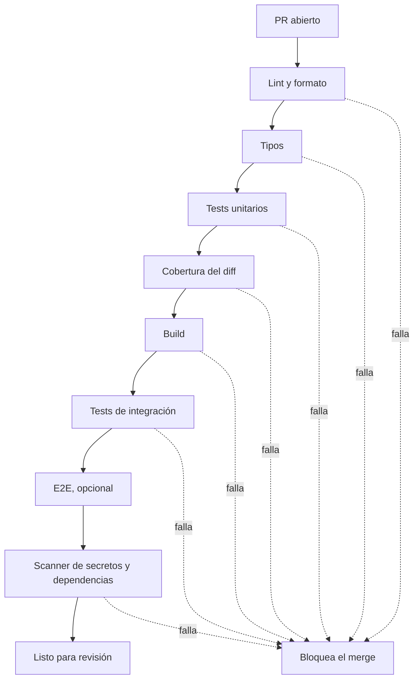
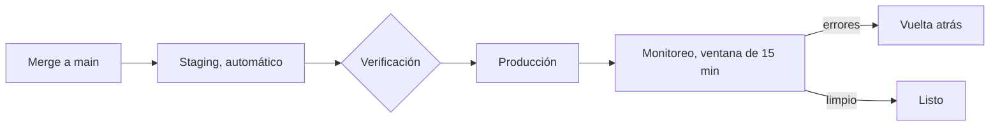

# CI/CD

## Qué es

El CI es el mecanismo que hace cumplir todas las otras skills. Una regla que no
tiene un check que rechace el PR es una sugerencia; el CI la convierte en
garantía, consistente en cada cambio, sin depender de que alguien se acuerde.

**Fallar temprano.** Un bug atrapado por el lint cuesta minutos; el mismo bug
en producción cuesta horas. Las verificaciones se mueven río arriba: análisis
estático antes que tests, tests antes que staging, staging antes que
producción.

**Más rápido es más seguro.** Lotes chicos y releases frecuentes bajan el
riesgo, no lo suben. Un despliegue con 3 cambios se debuggea; uno con 30, se
adivina. Desplegar seguido es lo que hace confiable al proceso de despliegue.

Esta skill es agnóstica: los ejemplos nombran GitHub Actions, npm o Playwright
porque hay que nombrar algo, pero cada etapa tiene su equivalente en cualquier
lenguaje y en cualquier proveedor (GitLab CI, Jenkins, Buildkite, CircleCI).
Las decisiones cerradas del stack del plugin (Node, Docker, actions pineadas
por SHA, Trivy, Dependabot, cobertura del diff al 100) viven en
`mindstack:docker-ci` y `mindstack:typescript`; acá no se repiten.

## Cuándo usarla

- Armar el pipeline de un proyecto nuevo.
- Agregar, cambiar o sacar un check automático.
- Configurar el despliegue: preview, staging, producción, vuelta atrás.
- Un cambio tiene que disparar verificación automática y no la dispara.
- Debuggear un fallo del CI.

## El pipeline de gates

Todo cambio pasa por estas etapas antes de poder mergearse:



| Etapa | Qué atrapa | Ejemplo ilustrativo |
|---|---|---|
| Lint y formato | estilo, imports muertos, patrones prohibidos | `eslint`, `ruff`, `golangci-lint` |
| Tipos | contratos rotos entre módulos | `tsc --noEmit`, `mypy`, `cargo check` |
| Tests unitarios | lógica rota | `vitest`, `pytest`, `go test` |
| Cobertura del diff | líneas nuevas sin test | reporte de cobertura comparado contra la base del PR |
| Build | el artefacto no se construye | `npm run build`, `docker build` |
| Integración | la app no habla con la DB o la API real | servicio efímero de DB en el job |
| E2E | el flujo del usuario está roto | `playwright`, `cypress`; opcional, suele ir aparte |
| Scanner | secretos commiteados, dependencias con CVE | `gitleaks`, `npm audit`, `pip-audit`, `trivy` |

**Ningún gate se saltea.** Si falla el lint, se arregla el lint, no se
desactiva la regla. Si falla un test, se arregla el código, no se saltea el
test. Si un gate es demasiado lento, se optimiza (más abajo), no se quita.

### Ejemplo mínimo (GitHub Actions, ilustrativo)

```yaml
on:
  pull_request:
    branches: [main]
  push:
    branches: [main]

jobs:
  quality:
    runs-on: ubuntu-latest
    steps:
      - uses: actions/checkout@<sha>
      - uses: actions/setup-node@<sha>
        with: { node-version-file: .nvmrc, cache: npm }
      - run: npm ci
      - run: npm run lint
      - run: npx tsc --noEmit
      - run: npm test -- --coverage
      - run: npm run build
      - run: npm audit --audit-level=high
```

El mismo esqueleto con otro runtime cambia los comandos, no las etapas. Para
integración, se levanta el servicio (DB, cola) como contenedor efímero del job
con health check y credenciales desde el gestor de secretos del CI, nunca
hardcodeadas aunque sean de test.

## Reproducible y rápido

Un pipeline que da resultados distintos en dos corridas no sirve como gate.

- **Versiones fijas.** Runtime desde el archivo de versión del repo
  (`.nvmrc`, `.python-version`, `.tool-versions`), dependencias desde el
  lockfile (`npm ci`, `pip install -r` con hashes, `cargo --locked`), acciones
  y imágenes pineadas (el detalle en `mindstack:docker-ci`).
- **Instalación limpia.** Nunca `install` que resuelva versiones en CI; eso es
  lo que hace que "en mi máquina anda".
- **Sin estado entre corridas** salvo la caché explícita.

Cuando el pipeline pasa de 10 minutos, en orden de impacto:

1. **Caché de dependencias** por hash del lockfile.
2. **Jobs en paralelo:** lint, tipos, tests y build son independientes; que
   corran a la vez.
3. **Correr solo lo que cambió:** filtros por path (un PR solo de docs no
   corre E2E).
4. **Matrices:** shardear la suite entre varios runners; también para probar
   varias versiones del runtime o del SO cuando el proyecto lo necesita.
5. **Sacar lo lento del camino crítico:** tests lentos a un job programado
   (nightly), no al gate del PR.
6. **Runners más grandes** para builds pesados, como último recurso.

## Fallos del CI de vuelta al agente

El valor del CI con agentes es el ciclo de realimentación. Cuando falla, el
error se pega tal cual al agente ("el CI falló con esto: [error]; arreglalo y
verificá localmente antes de volver a pushear") y:

| Fallo | Qué hace el agente |
|---|---|
| Lint | corre el autofix, revisa el diff y commitea |
| Tipos | lee la ubicación del error y arregla el tipo, no agrega un cast |
| Test | sigue `mindstack:debugging`: reproduce localmente, causa raíz, test de regresión |
| Build | revisa config y dependencias; suele ser una versión o un import |
| Scanner | rota el secreto si se filtró; actualiza o reemplaza la dependencia |

Un fallo que no se reproduce localmente es un problema de reproducibilidad
del pipeline, y eso se arregla primero.

## Despliegue

### Preview por PR

Cada PR levanta un entorno efímero con su URL para probar a mano. Se destruye
al cerrar el PR.

### Feature flags

Desacoplan desplegar de lanzar. Permiten mergear temprano código incompleto o
riesgoso y:

- **Enviar sin activar:** el código está en main, la funcionalidad apagada.
- **Volver atrás sin redesplegar:** se apaga el flag, no se revierte código.
- **Canary:** 1 % de usuarios, después 10 %, después todos.

Ciclo de vida: crear → activar en test → canary → 100 % → **sacar el flag y el
código muerto**. Un flag que vive para siempre es deuda; se le pone fecha de
limpieza al crearlo.

### Etapas



Producción se dispara a mano o automáticamente después de staging; en ambos
casos hay una ventana de monitoreo (tasa de errores, latencia, lo que mida
`mindstack:observability`) antes de dar el despliegue por cerrado.

### Vuelta atrás

Todo despliegue es reversible, y la reversión es un workflow que se dispara a
mano con la versión destino como parámetro, no un procedimiento en una wiki.
Se prueba antes de necesitarlo. Si el cambio incluye una migración de datos,
la vuelta atrás se diseña con `mindstack:migration` (expandir, migrar,
contraer): una migración destructiva no tiene vuelta.

## Entornos y secretos

```
.env.example         → commiteado, plantilla para desarrollo
.env                 → NO commiteado, desarrollo local
.env.test            → commiteado, sin secretos reales
Secretos de CI       → gestor de secretos del proveedor de CI
Secretos de prod     → plataforma de despliegue o vault
```

El CI nunca tiene secretos de producción. Los de test son distintos de los de
prod aunque sean "de mentira": las costumbres se forman con los de test. Un
secreto que tocó el repo se rota, no se borra del historial. El detalle de
qué se considera secreto y cómo se audita está en `mindstack:security`.

## Protección de rama

- Revisión requerida: al menos una aprobación antes del merge.
- Status checks requeridos: el CI tiene que pasar; un check que no es
  requerido no es un gate.
- Sin force-push a main.
- Auto-merge cuando todo pasó y está aprobado: el merge no es un paso humano.
- **Rol de build cop:** alguien responsable de que main esté verde. Cuando se
  rompe, el build cop arregla o revierte, no el autor del cambio; evita que el
  build roto se acumule mientras cada uno asume que otro lo mira.

## Dependencias

Un bot (Dependabot, Renovate) abre PRs semanales con las actualizaciones;
pasan por el mismo pipeline que cualquier PR. Un límite de PRs abiertos evita
el ruido. La configuración concreta para el stack del plugin está en
`mindstack:docker-ci`.

## En el flujo mindstack

- El `developer` carga esta skill en tareas con `tipo: ci` en el PLAN, o
  cuando el Done de una tarea pide un comando que el CI del proyecto todavía
  no corre: primero se agrega el step, después se implementa contra él.
- `scripts/ci-plans-immutable.sh` del plugin es un step del CI del proyecto que
  rechaza un PR que modifique SPEC o PLAN fuera de `0-draft/`; lo propone
  `/mindstack:install` cuando encuentra `.github/workflows/`.
- `code-reviewer` carga esta skill cuando el diff toca `.github/workflows/`
  o su equivalente en otro proveedor: un cambio al pipeline es un cambio al
  mecanismo que garantiza todo lo demás.
- Las reglas de ramas y commits que el pipeline asume están en
  `mindstack:git` y `mindstack:workflow`.

## Racionalizaciones comunes

| Racionalización | Realidad |
|---|---|
| "El CI es muy lento" | Se optimiza el pipeline, no se saltea. Cinco minutos de CI evitan horas de debugging. |
| "Este cambio es trivial, no necesita CI" | Los cambios triviales rompen builds. Y el CI es rápido para cambios triviales. |
| "El test es flaky, volvé a correrlo" | Un test flaky tapa bugs reales y le hace perder tiempo a todos. Se arregla o se cuarentena con fecha. |
| "Agregamos CI después" | Un proyecto sin CI acumula estados rotos. Se arma el día uno, aunque sea solo lint y tests. |
| "Con probar a mano alcanza" | Probar a mano no escala ni se repite. Se automatiza lo que se pueda. |
| "Desactivo el check un ratito para que pase" | Un check desactivado nunca vuelve. Se arregla la causa o se saca el check con un PR que lo explique. |

## Señales de alarma

- No hay pipeline, o el pipeline no corre en PRs.
- Fallos ignorados, silenciados o checks marcados como no requeridos.
- Tests desactivados o con `skip` para que el pipeline pase.
- Despliegue a producción sin pasar por staging.
- No hay mecanismo de vuelta atrás, o nunca se probó.
- Secretos en el código o en el archivo del pipeline.
- Versiones de runtime o dependencias que el CI resuelve en cada corrida.
- El pipeline tarda más de 10 minutos y nadie lo mide.
- "Pasa en mi máquina" como argumento para mergear.

## Verificación

Después de armar o modificar el CI:

- [ ] Están todos los gates: lint, tipos, tests, cobertura del diff, build,
      scanner de secretos y dependencias.
- [ ] Corre en cada PR y en cada push a main.
- [ ] Los fallos bloquean el merge: protección de rama con checks requeridos.
- [ ] Dos corridas sobre el mismo commit dan el mismo resultado.
- [ ] Los secretos están en el gestor de secretos, no en el repo.
- [ ] El despliegue tiene vuelta atrás, y se probó.
- [ ] El pipeline del PR tarda menos de 10 minutos.
- [ ] El error del CI llega al agente tal cual y el agente lo reproduce localmente.
