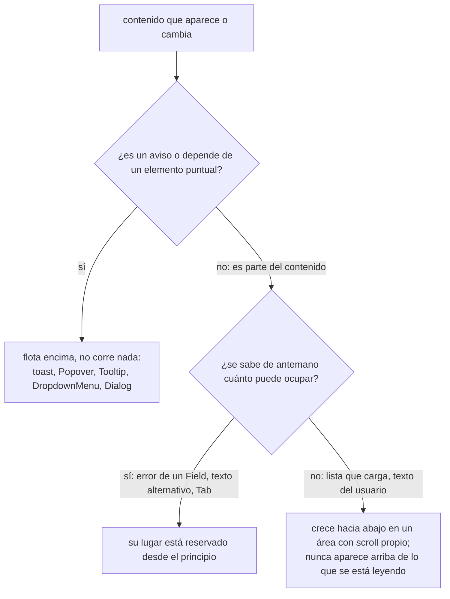
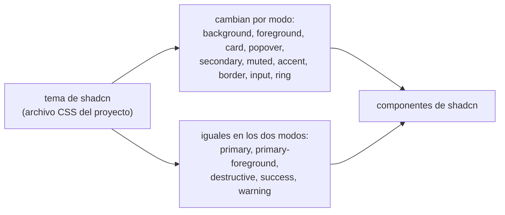

# Design: que se lea, que se use, que no salte

Esta skill dice **qué tiene que pasar** en la interfaz y cómo se comprueba. El sistema es shadcn/ui: sus roles de color y sus componentes son el vocabulario, y ningún criterio de acá contradice sus reglas. Lo que shadcn deja abierto (qué valores tiene el tema, cuándo se abre cada cosa, qué pasa mientras carga, qué dice cada botón) lo cierra esta skill.

| Quién | Hace |
|---|---|
| esta skill | criterios: qué ve la persona, qué se abre cuándo, qué no se mueve, cómo se verifica |
| agente `designer` | en `/mindstack:draft`, propone la sección UX/UI del SPEC aplicando esta skill al proyecto |
| skill `shadcn` (oficial, si está instalada) | cómo se compone cada componente en código |
| skill `react` | escribe los componentes; las decisiones de diseño las toma de acá o del SPEC |

Si dos criterios chocan, gana en este orden: **accesible**, **estable**, **sobrio**.

## Criterios

| Criterio | Por qué | Cómo se verifica | Detalle |
|---|---|---|---|
| Todo texto se lee contra su fondo, en los dos modos | lo que no se lee no existe | contraste medido: 4,5:1 texto, 3:1 texto grande, íconos, bordes de controles y foco | [color.md](references/color.md#contraste) |
| Un botón, un color: `primary` y los estados (`destructive`, éxito, aviso) son iguales en claro y oscuro; el modo solo cambia superficies, texto y bordes | un tema nuevo no es una paleta nueva que mantener | cada uno pasa contraste contra `background`, `card` y `popover` de los dos modos | [color.md](references/color.md#un-primary-para-los-dos-modos) |
| Los colores son sobrios: superficies neutras, un solo color de marca, nada saturado | una interfaz chillona cansa y compite con el contenido | croma dentro del tope | [color.md](references/color.md#sobriedad) |
| Cada interacción abre lo que corresponde: tarea con datos en Dialog, confirmación destructiva en AlertDialog, detalle o filtros en Sheet, aviso en toast | la persona aprende un patrón y lo encuentra igual en toda la app | la tabla de interacciones del SPEC usa estos nombres | [components.md](references/components.md) |
| Nada se mueve si la persona no lo movió | perder el lugar o tocar el botón equivocado porque otro apareció | posición de lo fijo antes y después de interactuar | [stability.md](references/stability.md) |
| Un Dialog o Sheet tiene el tamaño de su estado más grande | cambiar una opción adentro no lo redimensiona ni mueve sus botones | abrir, cambiar de Tab, elegir opciones, mostrar errores: título y botones quietos | [stability.md](references/stability.md#contenedores) |
| Cada pantalla tiene definidos cargando, vacío, error, sin permiso y con datos | quien implementa no inventa qué ve la persona cuando algo falla | cada estado se puede forzar y se ve | [states.md](references/states.md) |
| Todo se usa con teclado, con el foco siempre visible | no todos usan mouse | recorrido completo solo con teclado | [accessibility.md](references/accessibility.md#teclado-y-foco) |
| El color nunca es la única señal | daltonismo, pantallas malas | en escala de grises la pantalla dice lo mismo | [accessibility.md](references/accessibility.md#señales) |
| Los textos dicen qué pasa y qué hacer, con verbo concreto | "Continuar" o "Error" no ayudan | cada botón, título y mensaje está escrito en el SPEC | [states.md](references/states.md#textos) |

## Algo aparece o cambia: dónde va

## Colores por rol

Los componentes nombran colores por rol, nunca por valor; es la regla de shadcn y también la nuestra. Si algo necesita un color distinto en oscuro, falta un rol en el tema, no una excepción en el componente. Ojo con el nombre: en shadcn `accent` es el fondo tenue de hover y de ítem activo, **no** el color de marca; la marca es `primary`.

## Verificación

- [ ] Cada par del tema pasa `node ${CLAUDE_PLUGIN_ROOT}/skills/design/scripts/contrast.mjs` en los dos modos ([color.md](references/color.md#qué-pares-se-miden))
- [ ] `primary`, `destructive` y los estados agregados tienen el mismo valor en claro y oscuro
- [ ] Cada interacción usa el componente de [components.md](references/components.md); un desvío está justificado en el SPEC
- [ ] Abrir un Dialog, cambiar de Tab, elegir opciones, mostrar errores y enviar no mueve el título ni los botones
- [ ] Un botón enviando mide lo mismo que en reposo; un toast no corre el contenido
- [ ] Cada pantalla tiene sus cinco estados definidos y forzables
- [ ] Todo se alcanza y acciona con teclado; el foco se ve en los dos modos; al cerrar un Dialog el foco vuelve a quien lo abrió
- [ ] Con movimiento reducido activado, nada se desplaza ni hace zoom
- [ ] Ningún botón dice "Continuar", "OK" o "Enviar" a secas; ningún error dice solo "Error"
