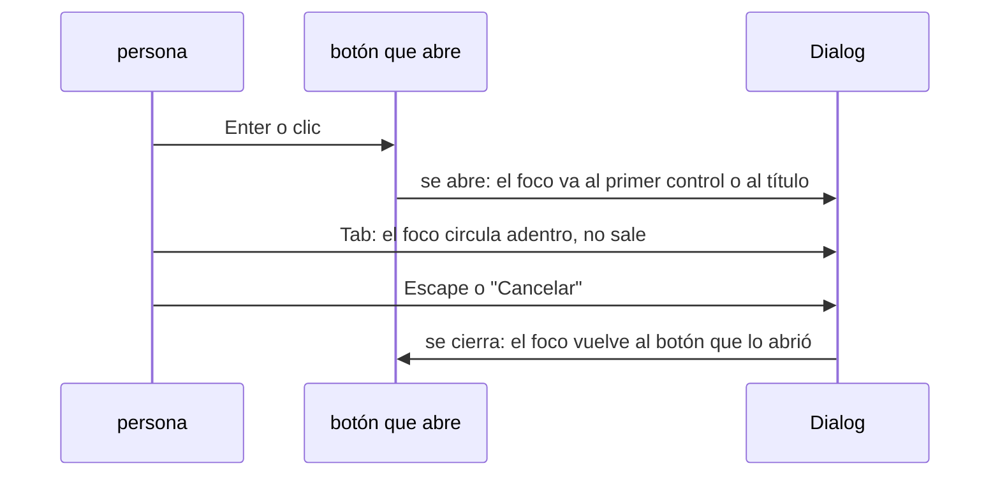

# Accesibilidad

Objetivo: WCAG 2.2 nivel AA. El contraste está en [color.md](color.md#contraste).

## Índice

- [Significado](#significado)
- [Teclado y foco](#teclado-y-foco)
- [Dialog, Sheet y Drawer](#dialog-sheet-y-drawer)
- [Señales](#señales)
- [Tamaño y zoom](#tamaño-y-zoom)
- [Cómo se verifica](#cómo-se-verifica)

## Significado

- Lo que ejecuta una acción es un botón; lo que lleva a otro lado es un link. Un lector de pantalla los anuncia distinto.
- Los títulos tienen jerarquía (uno principal, después secciones, sin saltear niveles), y se puede saltar directo al contenido principal.
- Un botón con solo un ícono tiene nombre ("Cerrar"); los íconos decorativos no se anuncian.
- Las imágenes que informan tienen descripción; las decorativas no.
- Los avisos que aparecen solos (guardado, error de validación) se anuncian sin robar el foco.

## Teclado y foco

- Todo lo que se hace con mouse se hace con teclado, en el orden en que se lee.
- El foco siempre se ve, en los dos modos, con 3:1 contra lo que lo rodea.
- El foco nunca queda tapado por un header fijo, un aviso o un panel.
- Los componentes compuestos (menú, pestañas, lista seleccionable) se recorren con flechas adentro y se sale con Tab, como describe el ARIA Authoring Practices Guide.
- Nada toma el foco solo al cargar, salvo un único campo principal en escritorio.

## Dialog, Sheet y Drawer

- Lo de atrás no se puede usar mientras está abierto.
- Siempre tiene título, aunque no se vea; el lector de pantalla lo anuncia al abrir. shadcn lo exige.
- Los componentes de shadcn ya resuelven foco, Escape y fondo inerte: el criterio es no romperlo (un Dialog armado a mano, un foco movido por código).

## Señales

- Un error se marca con color, ícono y texto.
- Los links dentro de un texto se distinguen por algo más que el color.
- Estados en etiquetas o gráficos: texto o forma además del color.

## Tamaño y zoom

- Lo que se toca mide al menos 24 × 24 px. Los controles de shadcn ya lo cumplen; el riesgo es achicarlos o poner íconos sueltos como botones.
- Con zoom al 200 % o a 320 px de ancho, nada se corta ni obliga a scroll horizontal.
- La persona puede agrandar el texto y hacer zoom; nunca se bloquea.

## Cómo se verifica

- axe (o el linter del stack) en cada pantalla: cero violaciones. Encuentra alrededor de un tercio de los problemas; el resto es manual.
- Cada flujo principal recorrido solo con teclado.
- Dialog y formularios pasados con lector de pantalla (VoiceOver o NVDA).
