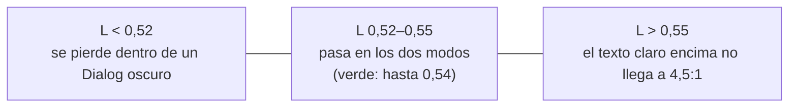

# Color

Los roles son los del tema de shadcn. Esta referencia dice qué valores cumplen los criterios y dónde el tema del proyecto se aparta del que shadcn trae por defecto. Cambiar valores del tema es el mecanismo que shadcn prevé: no se toca ningún componente.

## Índice

- [Contraste](#contraste)
- [Qué pares se miden](#qué-pares-se-miden)
- [Un primary para los dos modos](#un-primary-para-los-dos-modos)
- [Sobriedad](#sobriedad)
- [Dónde nos apartamos del tema por defecto](#dónde-nos-apartamos-del-tema-por-defecto)

## Contraste

| Qué | Mínimo |
|---|---|
| Texto | 4,5:1 |
| Texto grande (≥ 24 px, o ≥ 18,66 px en negrita) | 3:1 |
| Ícono que informa, borde de un control, indicador de foco | 3:1 |
| Botón `primary` o `destructive` contra la superficie donde está | 3:1 |
| Deshabilitado | sin mínimo, pero se distingue de un habilitado por algo más que el color |

Se mide, no se estima:

```bash
node ${CLAUDE_PLUGIN_ROOT}/skills/design/scripts/contrast.mjs \
  'oklch(0.985 0 0)|oklch(0.54 0.15 255)|4.5' \
  'oklch(0.54 0.15 255)|oklch(1 0 0)|3' \
  'oklch(0.54 0.15 255)|oklch(0.145 0 0)|3'
```

Cada argumento es `frente|fondo|mínimo`; acepta hex y OKLCH. Sale con 1 si algún par no llega.

## Qué pares se miden

En cada modo:

| Frente | Fondo | Mínimo |
|---|---|---|
| `foreground` | `background` | 4,5 |
| `card-foreground`, `popover-foreground` | `card`, `popover` | 4,5 |
| `muted-foreground` | `background`, `card`, `muted` | 4,5 |
| `secondary-foreground`, `accent-foreground` | `secondary`, `accent` | 4,5 |
| `primary-foreground` | `primary` | 4,5 |
| `primary`, `destructive`, `success`, `warning` | `background`, `card`, `popover` | 3 |
| `ring` | `background`, `card` | 3 |
| `input` (borde de los controles) | `background` | 3 |

## Un primary para los dos modos

El botón principal tiene que destacarse sobre el fondo claro (`oklch(1 0 0)`), sobre el oscuro (`0.145`) y sobre la `card` y el `popover` oscuros (`0.205`, donde viven los Dialog), con `primary-foreground` legible encima. Medido con los fondos de shadcn y croma 0,15:



- La banda casi no depende del tono, así que `primary`, `destructive`, `success` y `warning` viven todos ahí y son el mismo valor en `:root` y `.dark`.
- Sobre `muted`, `secondary` o `accent` oscuros (`0.269`) ningún valor de la banda llega a 3:1: un botón relleno no va sobre esas superficies.
- Si el proyecto cambia los fondos, se vuelve a medir.

## Sobriedad

- Superficies neutras: las del tema base de shadcn (croma 0) o con un tinte mínimo del tono de marca (croma ≤ 0,01).
- Un solo color de marca: `primary`. `destructive`, `success` y `warning` marcan estados, no decoran.
- Croma ≤ 0,15 en `primary` y estados; ≤ 0,04 en fondos tenues de estado (Alert, Badge).
- Los colores de gráficos (`chart-1`…`chart-5`) siguen el mismo tope y se distinguen también por forma o etiqueta.

## Dónde nos apartamos del tema por defecto

| Rol | shadcn por defecto | Criterio de acá | Por qué |
|---|---|---|---|
| `primary` | casi negro en claro, casi blanco en oscuro | color de marca en la banda, igual en los dos modos | un botón, un color |
| `destructive` | cambia entre modos, croma 0,245 | en la banda, igual en los dos modos, croma ≤ 0,15 | igual que `primary`, y sin rojo chillón |
| `success`, `warning` | no existen | se agregan como roles del tema, en la banda, iguales en los dos modos | los estados no se arman con colores sueltos |
| `ring` en claro | `0.708` a media opacidad: no llega a 3:1 sobre blanco | un valor que llegue a 3:1 (por ejemplo, el mismo `primary`) | el foco tiene que verse |
| `muted-foreground` en claro | `0.556`: 4,7:1 sobre `background`, 4,3:1 sobre `muted` | ≤ `0.54`, o no poner texto secundario sobre `muted` | el texto secundario también es texto |
| `input` (borde de los controles) | `0.922` en claro: 1,3:1 sobre blanco | ≤ `0.65` en claro y ≥ `0.50` en oscuro, para que el borde que identifica al control llegue a 3:1 | WCAG 1.4.11: un campo se tiene que reconocer como campo |

Todo lo demás (superficies, texto, bordes, radios) queda como lo trae shadcn salvo que el proyecto lo decida en su tema.
