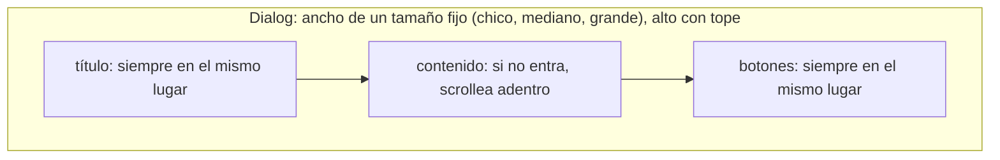

# Layout estable

Nada se mueve si la persona no lo movió. Abrir, elegir, escribir, cargar y mostrar errores cambian **contenido**, no **lugares**.

## Índice

- [Contenedores](#contenedores)
- [Lo que cambia adentro](#lo-que-cambia-adentro)
- [Lo que aparece](#lo-que-aparece)
- [Movimiento](#movimiento)
- [Cómo se verifica](#cómo-se-verifica)

## Contenedores

Un Dialog, un Sheet o un Drawer tiene el tamaño de su estado más grande, decidido al diseñarlo.



| Situación | Criterio |
|---|---|
| Ancho | uno de pocos tamaños fijos; nunca "lo que mida el contenido" |
| Alto | con tope; lo que no entra scrollea en el medio, título y botones quedan |
| Tabs o pasos | el contenedor mide lo que la Tab más grande; cambiar de Tab no cambia el tamaño |
| Una opción que muestra campos extra | el lugar de esos campos existe desde el principio |
| Contenido de largo desconocido | área de tamaño fijo con scroll; el contenedor no crece |
| Scroll de adentro | no se pasa a la página de atrás al llegar al final |

## Lo que cambia adentro

| Lo que cambia | Criterio |
|---|---|
| Error de un Field | su renglón está reservado; aparecer el texto no corre los campos de abajo |
| Botón que pasa a enviando | mismo tamaño; el Spinner entra sin empujar el texto ni agrandar el botón |
| Texto que alterna ("Mostrar" / "Ocultar") | el espacio es el del más largo |
| Números que cambian (contador, precio, reloj) | los dígitos tienen todos el mismo ancho |
| Ítem activo o en hover | se marca sin cambiar su tamaño |
| Datos que cargan | el Skeleton tiene la forma y el tamaño del contenido final |
| Imágenes y videos | su lugar tiene las medidas desde antes de que carguen |
| Texto corto, normal y muy largo | se recorta o hace salto de línea; nunca ensancha el contenedor ni lo desborda |
| Barra de scroll que aparece o desaparece | no corre el contenido |

## Lo que aparece

- toast, DropdownMenu, Tooltip, Popover y Dialog flotan encima: no ocupan lugar.
- Nada aparece **arriba** de lo que la persona está leyendo o por tocar. Lo que carga más, se agrega abajo.
- Un Alert que puede estar o no (aviso del sistema) tiene su lugar desde el primer momento, o flota.

## Movimiento

- Lo que se anima se desplaza o aparece; no cambia el tamaño de lo que tiene alrededor.
- Excepción: lo que la persona expandió a propósito (Accordion, Collapsible) corre lo de abajo, porque lo pidió.
- Toda animación se puede interrumpir, y si se interrumpe deja el estado final correcto.
- Con movimiento reducido activado en el sistema, nada se desplaza ni hace zoom; como mucho un fundido corto.

## Cómo se verifica

La métrica de layout shift (CLS) no alcanza: ignora lo que se mueve en el medio segundo después de un clic, que es justo "toqué una opción y el modal cambió". Se compara la posición de lo que tiene que quedarse quieto:

```ts
// Playwright: los botones del modal no se mueven al cambiar de pestaña ni al mostrar errores
const acciones = page.getByRole('dialog').getByRole('button', { name: 'Guardar' });
const antes = await acciones.boundingBox();
await page.getByRole('tab', { name: 'Avanzado' }).click();
await acciones.click(); // con errores de validación
expect(await acciones.boundingBox()).toEqual(antes);
```

Qué fijar por pantalla: título y botones de los Dialog y Sheet, botones de acción, el campo con foco, la primera fila visible de una lista.
