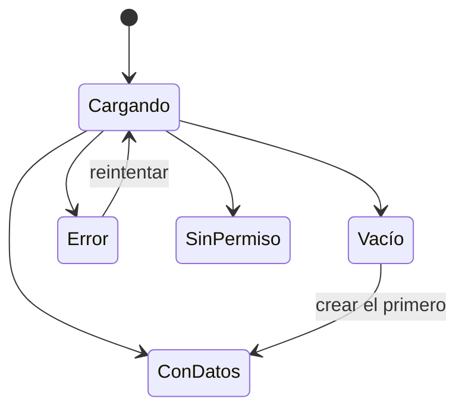

# Estados, formularios y textos

## Índice

- [Estados de una pantalla](#estados-de-una-pantalla)
- [Acciones](#acciones)
- [Formularios](#formularios)
- [Textos](#textos)

## Estados de una pantalla

Cada pantalla o componente con datos tiene cinco estados, y los cinco se diseñan:

| Estado | Criterio |
|---|---|
| Cargando | Skeleton con la forma de lo que viene; no un Spinner chico que después se convierte en una tabla |
| Vacío | Empty: por qué está vacío y qué hacer ("Todavía no hay pedidos. Crear pedido") |
| Error | Alert o Empty: qué falló y qué puede hacer la persona; ofrece reintentar si tiene sentido |
| Sin permiso | dice que no tiene acceso, sin revelar si el recurso existe más allá de lo que ya sabe |
| Con datos | soporta uno, muchos y el texto más largo posible |

## Acciones

- Una acción destructiva pide confirmación (AlertDialog) o deja deshacer durante unos segundos (toast con "Deshacer"). Nunca actúa al primer clic sin vuelta atrás.
- En la confirmación de algo destructivo, la opción por defecto es cancelar.
- Toda acción tiene respuesta visible: cargando mientras ocurre, y éxito o error al terminar.
- Lo que la persona eligió para ver (filtros, pestaña, página) sobrevive a recargar y se puede compartir con un link.
- Lo que navega se comporta como link: se abre en otra pestaña si la persona quiere.
- Salir con cambios sin guardar avisa antes.
- Lo que se hace con un gesto (arrastrar, deslizar) también se puede hacer con un clic y con teclado.

## Formularios

- Cada Field tiene un título visible; el texto de ejemplo adentro del control no es el título.
- El error aparece junto al campo, dice cómo arreglarlo, y al enviar con errores el foco va al primero.
- Lo obligatorio se dice en palabras, no solo con un asterisco o un color.
- El navegador puede autocompletar: email, contraseña, código de un solo uso, dirección.
- El teclado del celular es el del dato: numérico para números, con @ para emails.
- Se puede pegar en cualquier campo, incluida la contraseña.
- El botón de enviar está habilitado hasta que se envía; mientras envía, queda deshabilitado con un Spinner y el mismo tamaño.
- No se pide escribir dos veces lo que ya se puso en el mismo flujo.

## Textos

- Botones con verbo y objeto: "Guardar cambios", "Reintentar pago". No "Continuar", "OK", "Enviar" a secas.
- Los errores dicen qué hacer, sin disculparse ni culpar: "La tarjeta fue rechazada. Probá con otra o contactá a tu banco."
- Voz activa, segunda persona, los mismos términos en toda la app (si es "pedido", no es "orden" en otra pantalla).
- Fechas, números y monedas en el formato del idioma de la persona.
- Los estados de espera terminan en "…": "Guardando…".
- Todo texto que la persona lee se define en el SPEC, no lo inventa quien implementa.
