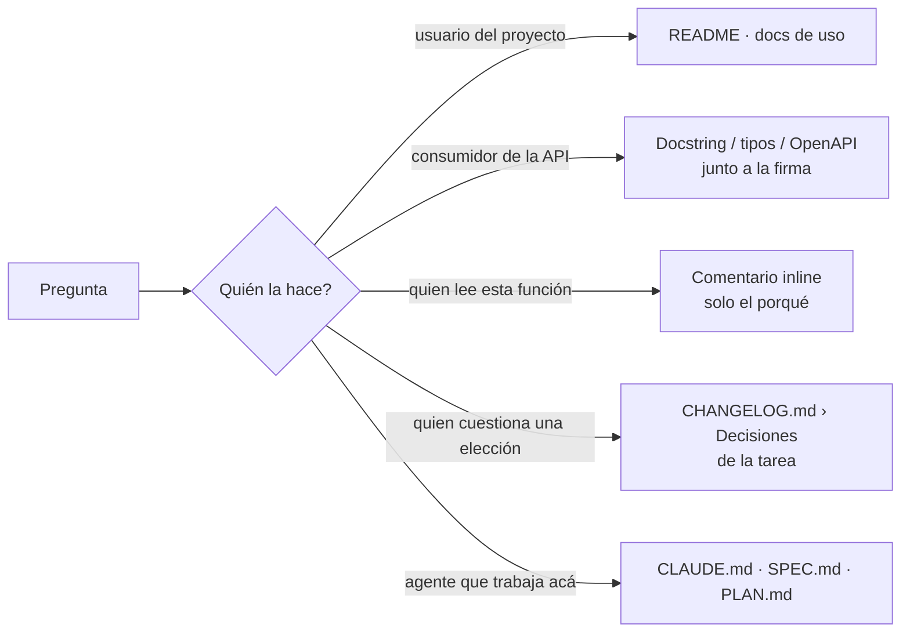

# Documentación

## Resumen

Documentá decisiones, no solo código. El código muestra *qué* se construyó; la
doc explica *por qué* se construyó así, qué restricciones había y qué
alternativas se descartaron. Eso es lo que necesita el que entra al repo en
seis meses, sea persona o agente.

Tres reglas que ordenan todo lo demás:

1. **Cerca del código.** La doc que vive lejos de lo que describe se desactualiza sin que nadie lo note.
2. **El porqué, no el qué.** Lo que el código ya dice no se repite; lo que el código no puede decir se escribe.
3. **Se verifica.** Un ejemplo que no se ejecuta es una promesa; uno que corre es una prueba.

## Cuándo usar

- Se cambia algo que un usuario o un dev externo necesita saber: README, doc de uso, firma de API pública.
- Se toma una decisión técnica que alguien va a cuestionar después.
- Un diff cambia comportamiento documentado.
- Hay que explicar lo mismo por tercera vez: eso es una doc que falta.
- Se incorpora gente (o agentes) al proyecto.

**Cuándo no:** código obvio, comentarios que repiten el código, prototipos descartables.

## Qué doc vive dónde



Cada pregunta tiene un solo lugar. Si la misma información está en dos, una de las dos va a mentir.

## Proceso

### 1. README que sirve

Un README se juzga con una prueba: alguien que no conoce el proyecto lo clona y lo corre sin preguntar. Cubre, en este orden:

```markdown
# Nombre

Un párrafo: qué hace y para quién.

## Arranque
1. Clonar
2. Instalar dependencias: `<comando>`
3. Configurar entorno: `cp .env.example .env`
4. Correr: `<comando>`

## Comandos
| Comando | Qué hace |
|---|---|
| `<dev>` | Servidor de desarrollo |
| `<test>` | Tests |
| `<build>` | Build de producción |

## Arquitectura
Estructura en tres líneas. Las decisiones están en el CHANGELOG de cada tarea.
```

Lo que no va: historia del proyecto, lista de features, badges que nadie mira. Si el README pasa de dos pantallas, lo que sobra se mueve a `docs/`.

### 2. Docs cerca del código

- La doc de un módulo va en el módulo (docstring, `README.md` de la carpeta), no en una wiki.
- La doc de una API pública va junto a la firma: tipos, parámetros, qué devuelve, qué lanza, un ejemplo.
- Un contrato HTTP se describe en su esquema (OpenAPI o equivalente), y el esquema es el que valida en runtime. Doc y validación son el mismo archivo o se desincronizan.

```
/**
 * Crea una tarea.
 *
 * @param input  título obligatorio, descripción opcional
 * @returns la tarea con id y timestamps del servidor
 * @throws ValidationError   título vacío o de más de 200 caracteres
 * @throws AuthenticationError  sin sesión
 *
 * @example
 *   const task = await createTask({ title: 'Comprar pan' });
 *   task.id // "task_abc123"
 */
```

El `@example` tiene que ser real: lo que escribirías en un test. Si no sabés qué poner, es que la API todavía no está clara.

### 3. Comentarios: el porqué, no el qué

```
// Mal: repite el código
// incrementa el contador
counter += 1;

// Bien: explica una intención que el código no muestra
// Ventana deslizante: se resetea en el borde de la ventana y no por
// cronograma fijo, para evitar ráfagas justo en el cambio de ventana.
if (now - windowStart > WINDOW_MS) { counter = 0; windowStart = now; }
```

Se comenta:

- Una restricción no evidente (orden de llamada, precondición, efecto en otro módulo).
- Un workaround, con el bug o ticket que lo justifica y cuándo se puede sacar.
- Una trampa conocida: "si se llama después de la hidratación, hay flash sin estilos".

No se comenta:

- Código que se explica solo. Si necesita comentario, primero probá renombrar.
- `TODO` de algo que se puede hacer ahora. Hacelo.
- Código comentado. Se borra; git tiene la historia.

### 4. Docs que se verifican

Una doc que nadie ejecuta se pudre. Lo que se puede verificar, se verifica:

- Los ejemplos de la doc se corren como tests (doctests, snippets compilados, ejemplos en la suite). Si el lenguaje no lo soporta nativamente, un test que importa el ejemplo alcanza.
- Los comandos del README se corren en CI, al menos el de arranque.
- Un esquema de API se contrasta contra las respuestas reales.
- Enlaces internos se chequean en CI.

Si una doc no se puede verificar y no se puede acotar, es candidata a borrarse.

### 5. Qué documentar y qué no

| Documentar | No documentar |
|---|---|
| Cómo arrancar y cómo correr tests | La historia de cómo llegó a ser así |
| El contrato de lo público: entradas, salidas, errores | El detalle de lo privado que cambia cada semana |
| El porqué de una decisión y la alternativa descartada | El qué, que ya está en el código |
| Restricciones y trampas no evidentes | Lo que el tipo o la firma ya dicen |
| Convenciones del proyecto (en `CLAUDE.md`) | Convenciones del lenguaje que cualquiera conoce |

### 6. Decisiones

En mindstack no hay ADRs como archivos aparte. Cada tarea tiene su
`CHANGELOG.md` (plantilla `skills/workflow/templates/CHANGELOG.md`, skill
`mindstack:workflow`) y ahí la sección **Decisiones** cumple ese rol:

| Fecha | Quién | Decisión | Alternativa descartada | Principio |
|---|---|---|---|---|

Va a Decisiones toda elección que alguien va a cuestionar después y todo giro respecto del PLAN: librería o framework, modelo de datos, estrategia de auth, estilo de API, infraestructura, cualquier cosa cara de revertir.

Una fila bien escrita conserva lo que valía del formato ADR, comprimido:

- **Decisión**: qué se eligió y el contexto que lo forzó, en una oración. "PostgreSQL con Prisma: datos relacionales, transacciones ACID y full-text sin agregar Elasticsearch."
- **Alternativa descartada**: la más seria, y por qué perdió. "MongoDB: los datos son relacionales, los joins manuales duplican." Sin esto la discusión vuelve de cero.
- **Principio**: el de `${CLAUDE_PLUGIN_ROOT}/references/PRINCIPLES.md` del plugin que la respalda. Si no encaja en ninguno, es una señal de que la decisión se merece una segunda mirada.
- **Consecuencias**: si la decisión impone algo a futuro (una habilidad que el equipo tiene que tener, un costo, una puerta que se cierra), va en la misma celda de Decisión o en una línea debajo de la fila.

Las filas no se editan ni se borran. Si una decisión cambia, se agrega otra fila que la reemplaza y nombra a la anterior. Las decisiones de tareas cerradas quedan en `docs/plans/4-done/*/CHANGELOG.md` y son lo primero que lee el analista cuando una decisión nueva se parece a una vieja.

### 7. Docs para agentes

- `CLAUDE.md`: convenciones del proyecto, para que el agente las siga sin que se las repitan.
- `SPEC.md` y `PLAN.md` de la tarea: al día, porque el agente construye lo que dicen.
- Decisiones del CHANGELOG: evitan que el agente vuelva a decidir lo ya decidido.
- Trampas inline: evitan que el agente caiga en lo que ya cayó alguien.

### 8. Revisión de prosa

Después del contenido técnico, revisá la prosa para quien la va a leer. Más claro nunca significa cambiar la decisión ni sus límites.

1. Marcá lo que tiene que sobrevivir: nombres, números y unidades, comandos, rutas, condiciones, trade-offs e incertidumbre. Contrastalo contra el código; lo que no podés sostener, señalalo.
2. Reemplazá introducciones de relleno, adjetivos de venta y resúmenes repetidos por la información concreta. No reemplaces una afirmación sin respaldo por un ejemplo inventado ni por una garantía más fuerte.
3. Compará con el original: restaurá cualquier salvedad perdida, verificá que los ejemplos sigan corriendo, y si queda una duda factual, decilo en vez de pulirla.

## En el flujo mindstack

- La carga `developer` cuando la tarea cambia algo que un usuario o un dev externo necesita saber: README, docs de uso, comentarios de API pública. La doc va en el mismo diff que el cambio, no en una tarea aparte.
- La carga `code-reviewer` cuando el diff cambia comportamiento documentado y la doc no acompaña: eso es un hallazgo, no una sugerencia.
- La decisión técnica va a `CHANGELOG.md › Decisiones` de la tarea, con alternativa descartada y principio. No a un ADR, no al README, no a un comentario.
- El changelog de release para humanos es de `mindstack:git`; el contrato de una API pública, de `mindstack:api-design`.

## Racionalizaciones comunes

| Racionalización | Realidad |
|---|---|
| "El código se documenta solo" | El código dice qué. No dice por qué, qué se descartó ni qué restricciones aplican. |
| "Documentamos cuando la API se estabilice" | La API se estabiliza más rápido cuando la documentás. La doc es el primer test del diseño. |
| "Nadie lee docs" | Los agentes sí. El que entra en seis meses sí. Vos en tres meses sí. |
| "Una fila de Decisiones es burocracia" | Dos minutos ahora contra dos horas de debate repetido después. |
| "Los comentarios se desactualizan" | Los del *qué* sí. Los del *porqué* no. Por eso solo escribís los segundos. |
| "Lo pongo en la wiki" | La wiki está lejos del código. En seis meses nadie sabe cuál de las dos versiones es la real. |

## Señales de alarma

- Decisión de arquitectura sin fila en Decisiones.
- API pública sin tipos ni docstring.
- README que no explica cómo correr el proyecto, o cuyo comando de arranque falla.
- Ejemplos en la doc que nadie ejecuta.
- Código comentado en vez de borrado.
- `TODO` con semanas de antigüedad.
- Doc que repite el código en vez de explicar la intención.
- La misma información en dos lugares con versiones distintas.
- Un diff que cambia comportamiento y no toca la doc que lo describe.

## Verificación

- [ ] Cada decisión que alguien va a cuestionar tiene fila en `CHANGELOG.md › Decisiones` con alternativa descartada y principio.
- [ ] El README cubre arranque, comandos y arquitectura, y el comando de arranque corre.
- [ ] Las funciones públicas documentan parámetros, retorno, errores y un ejemplo real.
- [ ] Los ejemplos de la doc se ejecutan en la suite o en CI.
- [ ] Las trampas conocidas están comentadas donde muerden.
- [ ] No queda código comentado ni `TODO` que se podía resolver ahora.
- [ ] `CLAUDE.md`, `SPEC.md` y `PLAN.md` reflejan el estado actual.
- [ ] La revisión de prosa no agregó garantías ni perdió salvedades.
