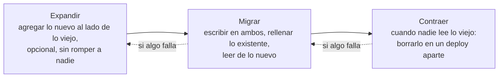

# Migración y deprecación

## Qué es

El código es un pasivo, no un activo. Cada línea cuesta: tests, parches de seguridad, dependencias que actualizar, alguien que la entienda a las 3 de la mañana. Deprecar es la disciplina de sacar lo que ya no paga su mantenimiento; migrar es mover a los consumidores (código, datos, personas) de lo viejo a lo nuevo sin que nada se rompa en el medio.

La mayoría de los equipos sabe construir. Pocos saben sacar. Esta skill cubre esa parte.

Los ejemplos están en pseudocódigo o SQL genérico y son ilustrativos. Las reglas son las mismas en cualquier lenguaje, base de datos o framework; las herramientas concretas (runner de migraciones, sistema de flags) las dice el repo.

## Cuándo usarla

- Reemplazar un sistema, una API, un servicio o una librería por otra
- Cambiar un esquema de datos en producción: renombrar, tipar distinto, borrar, mover entre tablas
- Actualizar una dependencia con cambios incompatibles
- Jubilar una feature que ya nadie necesita o consolidar dos implementaciones de lo mismo
- Sacar código muerto que nadie mantiene pero del que alguien depende
- Decidir si un sistema legado se mantiene o se migra
- Diseñar algo nuevo: la deprecación se planifica el día que se crea

**Cuándo no:** un cambio que se despliega y se revierte entero con un solo deploy, sin estado que persista. Eso es un cambio común; `mindstack:workflow` alcanza.

## Principios

- **Hyrum.** Con suficientes usuarios, todo comportamiento observable tiene a alguien que depende de él, incluidos los bugs y los efectos secundarios no documentados. Por eso deprecar exige migrar activamente, no anunciar y esperar.
- **Lo que no se puede revertir con un deploy manda.** El código se revierte; los datos escritos, los mensajes enviados y las respuestas que ya consumió un cliente, no. Toda la secuencia se ordena alrededor de eso.
- **Viejo y nuevo conviven en cada paso.** Durante un rollout corren las dos versiones a la vez. Cada estado intermedio tiene que ser válido para ambas.
- **Aditivo primero, destructivo último y solo.** Agregar es seguro en cualquier deploy. Borrar y renombrar van en su propio deploy, después, cuando nadie lee lo viejo.
- **Quien deprecará, migra.** Si sos dueño de lo que se saca, sos responsable de mover a tus consumidores o de darles una actualización compatible que no requiera migración. No se anuncia una fecha y se deja al resto solo.

## Proceso

### 1. Decidir si se deprecará

Antes de tocar nada, contestá por escrito:

1. ¿Sigue dando un valor que nada más da? Si sí, se mantiene.
2. ¿Cuántos consumidores dependen? Medilo con métricas, logs o análisis de dependencias, no con intuición.
3. ¿Existe reemplazo probado en producción? Si no, primero se construye. Nunca se depreca sin alternativa.
4. ¿Cuánto cuesta migrar a cada consumidor? Si se automatiza, hacelo. Si es manual y caro, compará contra el costo de mantener.
5. ¿Cuánto cuesta no deprecar? Riesgo de seguridad, horas, complejidad que frena a todos.

| Tipo | Cuándo | Mecanismo |
|---|---|---|
| **Consultiva** | Lo viejo es estable, migrar es opcional | Avisos, documentación, empujones. Cada consumidor migra a su ritmo. |
| **Obligatoria** | Lo viejo tiene problemas de seguridad, bloquea al resto o cuesta demasiado mantener | Fecha dura de retiro. Herramientas de migración, guía y soporte. |

Por defecto, consultiva. Una deprecación obligatoria sin herramientas ni guía es una amenaza, no un plan.

### 2. Anunciar y documentar

Un aviso de deprecación tiene estado, reemplazo, fecha o ausencia de fecha, motivo y guía con pasos concretos:

```markdown
## Deprecación: ServicioViejo

**Estado:** deprecado desde 2026-03-01
**Reemplazo:** ServicioNuevo
**Retiro:** consultivo, sin fecha todavía
**Motivo:** escala a mano y no tiene observabilidad; el nuevo resuelve ambas

### Guía de migración
1. Cambiar el import/cliente de `servicio-viejo` a `servicio-nuevo`
2. Actualizar la configuración (ejemplos abajo)
3. Correr el script de verificación y confirmar cero llamadas al viejo
```

Agregá avisos en tiempo de ejecución donde el lenguaje lo permita (anotaciones de deprecación, warnings al arrancar, cabeceras en respuestas HTTP) para que el consumidor se entere donde mira.

### 3. Migrar de a uno

Nunca todos a la vez. Por cada consumidor:

1. Listar todos los puntos de contacto con lo viejo (`grep`, grafo de dependencias, logs de uso)
2. Pasarlo al reemplazo
3. Verificar que el comportamiento coincide: tests de caracterización, comparación de salidas
4. Sacar las referencias a lo viejo
5. Confirmar que no hay regresión antes de pasar al siguiente

### 4. Retirar

Solo cuando el uso es cero y lo podés demostrar:

1. Verificar cero uso activo con datos (métricas, logs, análisis de dependencias), con una ventana de compatibilidad que cubra a los consumidores lentos (jobs mensuales, clientes móviles sin actualizar)
2. Borrar el código, los tests, la configuración y la documentación asociada
3. Borrar los avisos de deprecación: ya cumplieron
4. Dejar registrado qué se sacó y por qué, para quien lo busque en seis meses

## Patrones

### Expandir, migrar, contraer

El patrón central, sirve para esquemas de datos, contratos de API, formatos de mensajes y dependencias. Nunca se cambia algo en el lugar: se agrega lo nuevo al lado, se mueve, y recién después se saca lo viejo.



**Ejemplo: renombrar la columna `name` a `full_name`.**

1. **Expandir.** Agregar `full_name` nullable. Deploy. El código viejo la ignora; nada se rompe.
2. **Doble escritura.** La aplicación escribe `name` y `full_name` en cada alta y modificación. Deploy.
3. **Rellenar.** Copiar `name → full_name` en las filas existentes, en lotes, sin bloquear la tabla.
4. **Cambiar lecturas.** La aplicación lee `full_name`, sigue escribiendo las dos. Deploy y dejar reposar.
5. **Contraer.** Dejar de escribir `name`; en un deploy posterior y separado, borrar la columna.

Cada paso se despliega y se revierte solo: si el 4 falla, se revierte el código y `full_name` sigue poblándose. El mismo guion aplica a un campo de API (agregar el nuevo, aceptar ambos, responder ambos, retirar el viejo) y a un formato de evento.

Reglas del esquema:

- **Toda migración tiene un camino de vuelta probado.** Una migración sin `down` es un deploy sin rollback. Escribilo y corrélo antes de mergear.
- **Rellenar en lotes, fuera del camino caliente.** Un `UPDATE` sobre millones de filas bloquea la tabla: partilo y regulalo.
- **Índices grandes sin bloquear escrituras**, con el mecanismo concurrente que tenga tu base.
- **Desacoplar del código con un flag** cuando el corte es riesgoso.

### Estrangulador

Lo nuevo y lo viejo corren en paralelo y el tráfico se mueve de a poco: 0 %, 10 % (canario), 50 %, 100 %. Cuando lo viejo lleva un tiempo en 0 % sin incidentes, se saca. Sirve para servicios, módulos enteros y proveedores externos.

### Adaptador

Un adaptador traduce la interfaz vieja a la implementación nueva. Los consumidores siguen llamando como siempre mientras cambiás lo de atrás, y migran a la interfaz nueva a su ritmo.

```text
ServicioTareasLegado implementa ApiVieja
  obtener(id: número) -> TareaVieja
    tarea = nuevo.buscarPorId(texto(id))
    devolver aFormatoViejo(tarea)
```

### Feature flag

Un flag decide, por usuario, cuenta o porcentaje, si una llamada va a lo viejo o a lo nuevo. Permite encender de a poco, apagar en segundos sin deploy, y comparar ambos caminos con los mismos datos. Un flag es deuda con vencimiento: cuando el corte se consolida, el flag y el camino viejo se borran. Ver `mindstack:observability` para medir cada lado.

### Dependencias

Actualizar una dependencia mayor es una migración más: leé el changelog de rupturas, caracterizá lo que usás de ella, actualizá en una rama con la suite verde, y si el salto es grande hacelo en versiones intermedias. Una dependencia con vulnerabilidad conocida convierte la deprecación en obligatoria; `mindstack:security` dice cómo priorizarla.

## Código zombi

Código que nadie mantiene pero del que todos dependen. Señales: sin commits en seis meses con consumidores activos, sin dueño, tests que fallan y nadie arregla, dependencias con vulnerabilidades conocidas, documentación que menciona sistemas que ya no existen.

Respuesta: o se le asigna dueño y se mantiene, o se depreca con plan de migración concreto. No queda en el limbo.

## En el flujo mindstack

- El planificador la carga en `/mindstack:draft` cuando el `PLAN.md` tiene `tipo: migration`. En ese plan la sección "Riesgos y vuelta atrás" es obligatoria: por cada paso, qué se revierte, cómo y qué queda irreversible.
- Cada tarea del TODO deja el sistema funcionando con el código viejo y el nuevo conviviendo. Expandir y contraer son siempre tareas separadas, nunca la misma; contraer va después de que una tarea demostró uso cero de lo viejo.
- `qa` caracteriza el comportamiento actual antes de la primera tarea, con el mecanismo "caracterizar antes de tocar" de `mindstack:workflow` (`plan.md`). Esa suite es el Done de cada paso intermedio: lo migrado se comporta igual que lo que reemplaza.
- `developer` la carga en esas tareas; el camino de vuelta se escribe y se corre en la misma tarea que el camino de ida.

## Racionalizaciones comunes

| Racionalización | Realidad |
|---|---|
| "Todavía anda, ¿para qué sacarlo?" | Lo que anda y nadie mantiene acumula deuda de seguridad y complejidad en silencio. |
| "Alguien puede necesitarlo después" | Si hace falta, se vuelve a escribir. Guardarlo "por las dudas" cuesta más que reconstruirlo. |
| "La migración es muy cara" | Compará contra dos o tres años de mantenimiento. Casi siempre migrar es más barato. |
| "Lo deprecamos cuando termine el sistema nuevo" | Para entonces hay otras prioridades. Se planifica ahora. |
| "Los usuarios van a migrar solos" | No. Herramientas, guía e incentivos, o lo migrás vos. |
| "Mantenemos los dos indefinidamente" | Dos sistemas para lo mismo es el doble de tests, docs, onboarding y bugs. |
| "Renombrar la columna es una línea" | Durante el rollout corren las dos versiones; una va a pedir una columna que no existe. Expandir y contraer, nunca en el lugar. |
| "Agrego la nueva y borro la vieja en la misma migración" | Acopla un cambio seguro a uno destructivo. Borrar va en su deploy, cuando nadie referencia lo viejo. |
| "El rollback lo escribo si hace falta" | Sin camino de vuelta no hay rollback. Se escribe y se corre antes de mergear. |
| "El flag lo sacamos después" | Después es nunca. Un flag sin fecha de retiro es un segundo camino que nadie testea. |

## Señales de alarma

- Deprecar sin reemplazo disponible o sin medir el uso actual
- Anuncio de deprecación sin guía ni herramientas de migración
- Deprecación consultiva que lleva años sin avance
- Código zombi sin dueño y con consumidores activos
- Features nuevas sobre un sistema deprecado
- Retirar código sin demostrar cero consumidores
- Cambio de esquema y código que depende de él en el mismo deploy
- Columna o campo renombrado o borrado en el lugar en vez de expandir-contraer
- Migración mergeada sin camino de vuelta probado, o relleno que bloquea la tabla
- Flag de corte sin fecha de retiro

## Verificación

Al terminar una deprecación:

- [ ] El reemplazo está probado en producción y cubre todos los usos críticos
- [ ] Existe guía de migración con pasos y ejemplos concretos
- [ ] Todos los consumidores activos migraron, verificado con métricas o logs
- [ ] Código, tests, configuración y documentación de lo viejo están borrados
- [ ] No quedan referencias a lo deprecado en el repo
- [ ] Los avisos de deprecación están borrados

Al terminar una migración de datos o de contrato:

- [ ] Se desplegó en fases aditivas (expandir, migrar, contraer), nunca como un cambio en el lugar
- [ ] Código viejo y nuevo fueron válidos contra el esquema en cada deploy
- [ ] Cada migración tiene camino de vuelta probado; los rellenos corrieron en lotes regulados
- [ ] Los pasos destructivos salieron en su propio deploy, cuando nada referenciaba lo viejo
- [ ] Los flags de corte tienen fecha de retiro o ya se sacaron
