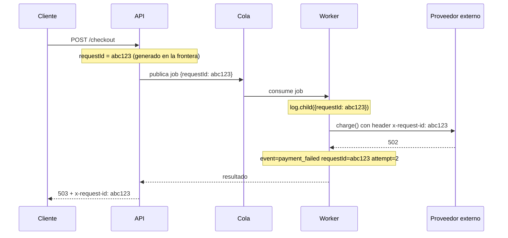

# Observabilidad e instrumentación

## Qué es

Código que no podés observar es código que no podés operar. Observabilidad es poder responder "¿qué está haciendo el sistema y por qué?" desde afuera, con la telemetría que el código emite. La instrumentación no es un agregado post-lanzamiento: se escribe junto con la feature, igual que los tests. Si una feature sale sin telemetría, el primer bug que reporta un usuario se convierte en arqueología en vez de en una consulta.

Agnóstica al lenguaje: los ejemplos de código son ilustrativos. OpenTelemetry aparece como referencia de conceptos (span, contexto, propagación), no como obligación; usá el SDK y el backend que ya tenga el repo.

## Cuándo usarla

- Al construir cualquier feature que va a correr en producción.
- Al agregar un servicio, endpoint, job de fondo, consumidor de cola o integración externa.
- Cuando un incidente tardó demasiado en diagnosticarse ("no pudimos saber qué pasó").
- Al definir o revisar reglas de alerta.
- Al revisar un PR que agrega I/O, reintentos, colas o llamadas entre servicios.

**No es para:**

- Diagnosticar una falla que está pasando ahora: `mindstack:debugging` (esta skill es lo que hace rápida a esa la próxima vez).
- Perfilar y optimizar una lentitud ya medida: `mindstack:performance`.

## Proceso

### 1. Definir "anda" antes de instrumentar

Telemetría sin pregunta es ruido. Antes de agregar nada, escribí 2 a 4 preguntas que va a hacer quien esté de guardia sobre esta feature:

```
FEATURE: reintento de pago en el checkout
PREGUNTAS DE GUARDIA:
1. ¿Qué fracción de pagos sale al primer intento vs después de reintentar?
2. Cuando un pago falla definitivamente, ¿por qué? (error del proveedor, timeout, validación)
3. ¿El proveedor de pagos está más lento que lo habitual?
→ Cada señal de abajo tiene que responder una de estas.
```

Si no podés nombrar las preguntas, no estás listo para instrumentar: vas a loguear todo y no aprender nada.

### 2. Elegir la señal correcta para cada pregunta

| Señal | Responde | Costo | Ejemplo |
|---|---|---|---|
| **Log estructurado** | "¿Qué pasó en este caso puntual?" | Por evento; crece con el tráfico | `payment_failed` con el código de error del proveedor |
| **Métrica** | "¿Cuán seguido / cuán rápido, en agregado?" | Fijo por serie; barato de consultar | p99 de latencia de las llamadas al proveedor |
| **Traza** | "¿Dónde se fue el tiempo entre servicios?" | Por request; normalmente muestreada | Un checkout lento, desglosado por salto |

Regla rápida: las métricas dicen **que** algo está mal, las trazas dicen **dónde**, los logs dicen **por qué**.

### 3. Logs estructurados

Loguear eventos, no prosa. Cada línea es un objeto (JSON) con un nombre de evento estable y campos consultables:

```typescript
// MAL: interpolación de strings. No se puede filtrar ni agrupar.
logger.info(`Pago ${id} falló para el usuario ${userId} tras ${n} reintentos`);

// BIEN: nombre de evento estable + campos estructurados
logger.warn({
  event: 'payment_failed',
  paymentId: id,
  provider: 'stripe',
  errorCode: err.code,
  attempt: n,
}, 'pago fallido');
```

**Niveles, usados de forma consistente:**

| Nivel | Significa | Acción de guardia |
|---|---|---|
| `error` | Invariante roto; alguien puede tener que actuar | Investigar |
| `warn` | Degradado pero manejado (reintento exitoso, fallback usado) | Mirar tendencia |
| `info` | Evento de negocio relevante (orden creada, job terminado) | Ninguna |
| `debug` | Detalle de diagnóstico | Apagado en producción |

**Los errores nunca se tragan ni se loguean sin contexto.** Un `catch` vacío o un `logger.error(err.message)` sin evento, sin id ni causa es el bug más caro de la guardia: el sistema falló y no dejó rastro. Si capturás un error, o lo manejás (y logueás en `warn` qué fallback aplicaste) o lo relanzás con causa. Nunca las dos cosas a medias.

**El id de correlación es obligatorio.** Generá (o aceptá) un id de request en la frontera del sistema y pegalo a cada log, cada span y cada llamada saliente. Sin eso no podés reconstruir una request entre logs intercalados:

```typescript
app.use((req, res, next) => {
  req.id = req.headers['x-request-id'] ?? crypto.randomUUID();
  req.log = logger.child({ requestId: req.id });
  res.setHeader('x-request-id', req.id);
  next();
});
```



Un `grep abc123` (o su equivalente en el agregador) devuelve la historia completa de esa request, de punta a punta.

**Si varios puntos de entrada escriben al mismo log, nombrá el punto de entrada.** El id de correlación identifica una corrida; no dice qué camino la inició. El mismo job disparado por un scheduler, por un endpoint de reproceso y por una corrida manual produce líneas indistinguibles. Estampá el punto de entrada donde arranca la corrida, al lado del id, y propagá los dos igual (cabeceras HTTP, metadata del mensaje en la cola). Un campo que solo correlaciona con el punto de entrada es una pista, no una atribución.

**Nunca loguear secretos, tokens, contraseñas ni datos personales completos.** Es regla dura de `mindstack:security`: la tubería de telemetría es una vía clásica de fuga. Allowlist de campos; nunca el body completo de una request o response, nunca cabeceras de autenticación. De una llamada externa se loguea metadata: endpoint, status, latencia, intento, identificadores saneados.

### 4. Métricas

Para servicios de request/response, instrumentá **RED** en cada endpoint y cada dependencia externa: **R**ate (requests/seg), **E**rrors (tasa de fallo), **D**uration (histograma de latencia, no promedio). Para recursos (colas, pools, hosts), **USE**: **U**tilización, **S**aturación, **E**rrores.

```typescript
const httpDuration = new Histogram({
  name: 'http_request_duration_seconds',
  labelNames: ['method', 'route', 'status_class'], // '5xx', no '503'
  buckets: [0.05, 0.1, 0.25, 0.5, 1, 2.5, 5],
});
```

**La cardinalidad es el modo de falla.** Cada combinación única de labels es una serie de tiempo aparte. Los labels salen de conjuntos chicos y fijos (plantilla de ruta, clase de status, nombre del proveedor). Nunca ids de usuario, URLs crudas, texto de error ni ningún valor sin cota: eso va en logs y trazas.

```
OK como label:    route="/api/tasks/:id"   status_class="5xx"   provider="stripe"
NUNCA como label: user_id, email, request_id, URL completa, mensaje de error
```

Promedios nunca, percentiles siempre: el promedio esconde al 1% de usuarios que la está pasando pésimo. Histogramas, y leer p50/p95/p99.

### 5. Trazas distribuidas

Una traza es el árbol de spans de una request a través de servicios; el contexto (id de traza, span padre) viaja en las cabeceras (`traceparent` en W3C) o en la metadata del mensaje. OpenTelemetry es el estándar neutral y su auto-instrumentación cubre HTTP, gRPC y clientes de base de datos casi sin código; si el repo ya usa otra cosa, el concepto es el mismo.

- Se inicializa al arrancar el servicio, antes del resto de los imports.
- Spans manuales solo alrededor de unidades de trabajo con sentido (`applyDiscounts`, `chargeProvider`), con los atributos por los que va a filtrar la guardia.
- El contexto cruza toda frontera asíncrona (cabeceras, metadata de cola) o la traza muere en el hueco.
- Muestreo bajo por defecto en la cabecera; 100% de los errores si el backend soporta muestreo de cola.
- Nada de secretos ni datos personales como atributos de span.

### 6. Alertas

Alertá sobre **síntomas que sienten los usuarios**, no sobre causas:

```
SÍNTOMA (despierta a alguien):        CAUSA (dashboard, no pager):
tasa de error > 1% por 5 min          CPU al 85%
p99 de latencia > 2 s                 se reinició un pod
antigüedad de la cola > 10 min        disco al 70%
```

Las alertas por causa saltan cuando no pasa nada y no ven las fallas que no previste. Las alertas por síntoma saltan exactamente cuando los usuarios sufren, sea cual sea la causa.

Reglas para cada alerta:

1. **Es accionable.** Si la respuesta es "ignorala, se arregla sola", borrá la alerta.
2. **Linkea a un runbook**, aunque sean tres líneas: qué significa, primera consulta a correr, a quién escalar.
3. **Umbral y duración justificados** por un SLO o datos históricos, no por una corazonada.
4. **Dos severidades nada más:** **page** (afecta usuarios, actuar ya) y **ticket** (degradación, actuar esta semana). Una tercera se vuelve ruido que entrena a ignorar todo.

**Runbook mínimo** (en `docs/runbooks/`, con el nombre de la alerta):

```markdown
# Runbook: tasa de error alta en /api/tasks
**Significa:** pool de conexiones a la base agotado, o un deploy malo.
**Primero mirar:** cantidad de conexiones activas vs límite del pool.
**Escalar a:** guardia de base de datos.
```

Agregá pasos solo cuando el primer chequeo no alcanza para decidir. Un runbook se actualiza al cerrar cada incidente en que se usó: uno desactualizado da falsa confianza.

### 7. Verificar la telemetría misma

La instrumentación es código; puede estar mal. Antes de dar por terminado, disparás los caminos y mirás la salida real:

- Forzá un error en staging → encontralo en los logs por `requestId`, con campos estructurados (no `[object Object]`).
- Mandá tráfico de prueba → las series de métricas aparecen con los labels esperados y valores razonables.
- Seguí una request entre servicios en la UI de trazas → sin spans rotos.
- Disparás cada alerta nueva una vez (bajando el umbral un rato) → llega al canal correcto y el link al runbook funciona.

La lista completa, con la compuerta previa al lanzamiento, está en [references/checklist.md](references/checklist.md).

## En el flujo mindstack

Quién la usa: el agente `developer`, cuando la tarea agrega un camino nuevo que puede fallar en producción (endpoint, job, integración externa); el agente `security-auditor`, en su pasada de "qué se loguea que no debería"; y el agente `code-reviewer`, cuando ve un `catch` que traga o un error sin contexto.

- **El "Estado final" del PLAN** incluye qué se loguea (evento y campos) y qué métrica mide que el camino anda. Sin eso, la tarea no está definida.
- **Lo que no se puede verificar** en staging (alerta no disparada, traza no seguida) va a `CHANGELOG.md › Deuda técnica`, con issue y vencimiento.
- Para la regla de datos sensibles, `mindstack:security`. Para el hallazgo de un `catch` que traga, `mindstack:code-review`. Para usar la telemetría cuando algo ya falló, `mindstack:debugging`.

## Racionalizaciones comunes

| Racionalización | Realidad |
|---|---|
| "Agrego logging cuando ande" | "Cuando ande" se vuelve "después del primer incidente", el momento más caro para descubrir que estás ciego. Instrumentá mientras construís. |
| "Más logs = más observabilidad" | El ruido sin estructura hace los incidentes más lentos, no más rápidos. Tres eventos consultables le ganan a trescientas líneas de prosa. |
| "console.log alcanza por ahora" | La salida sin estructura no se filtra, no se correlaciona ni dispara alertas. El logger estructurado cuesta cinco minutos una sola vez. |
| "Miramos los dashboards cuando algo se rompa" | Un dashboard armado sin preguntas muestra todo menos la respuesta. Arrancá por las preguntas de guardia. |
| "Alertamos todo lo importante y después afinamos" | Un pager ruidoso entrena a ignorarlo. El afinado nunca llega; el page real perdido, sí. |
| "El id de usuario como label facilita el debug" | También tira abajo el backend de métricas. Las búsquedas de alta cardinalidad van en logs y trazas. |
| "Tracing es demasiado para nuestros dos servicios" | Dos servicios ya son preguntas de latencia entre servicios que los logs no responden. La auto-instrumentación hace el costo trivial. |
| "Capturo el error para que no rompa" | Capturar sin loguear con contexto ni relanzar es esconder la falla. Se rompe igual, pero en silencio y más lejos. |

## Señales de alarma

- Un PR con reintentos, colas o llamadas externas y cero telemetría nueva.
- Un `catch` vacío, o que loguea `err.message` sin evento, sin id de correlación ni causa.
- Logs armados por interpolación de strings en vez de campos estructurados.
- Sin id de correlación: cada línea de log es huérfana.
- Un solo log alimentado por un scheduler, un webhook y corridas manuales, sin campo que diga cuál lo produjo.
- Métricas con labels de id de usuario, URL cruda o texto de error (bomba de cardinalidad).
- Latencia como promedio, sin percentiles.
- Alertas que saltan todos los días y se reconocen sin actuar.
- Alertas por causa (CPU, memoria) despertando gente mientras la tasa de error de usuarios no se monitorea.
- Secretos, tokens o bodies completos de request en los logs.
- "En mi máquina anda" como única evidencia de que una feature en producción está sana.

## Verificación

Después de instrumentar una feature, confirmá:

- [ ] Las preguntas de guardia están escritas y cada señal responde a una.
- [ ] Todo log es estructurado, con nombre de evento estable e id de correlación en cada línea.
- [ ] Todo log escrito por más de un punto de entrada lleva el campo de punto de entrada, fijado al inicio y propagado con el id, no inferido después.
- [ ] Ningún secreto, token ni dato personal sin redactar en ningún log (verificado en la salida real).
- [ ] Ningún `catch` traga: cada error capturado se maneja con log de contexto o se relanza con causa.
- [ ] Métricas RED para cada endpoint y dependencia externa nuevos, con labels acotados.
- [ ] La latencia es un histograma; p95/p99 consultables.
- [ ] Una request se sigue de punta a punta en la UI de trazas sin spans rotos.
- [ ] Cada alerta nueva es por síntoma, tiene runbook y se disparó una vez de prueba.
- [ ] Una falla inducida en staging se ubicó con telemetría sola, sin leer el código.
