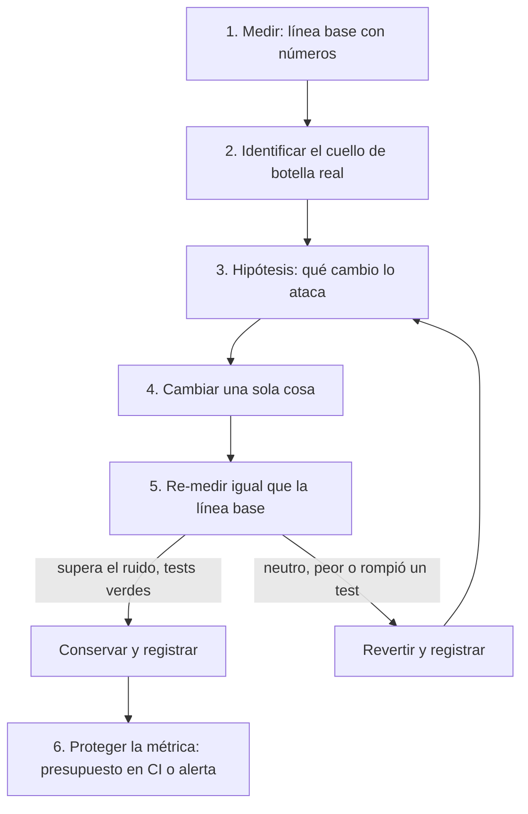

# Rendimiento

## Qué es

Medir antes de optimizar. Trabajar rendimiento sin medir es adivinar, y adivinar produce optimización prematura: complejidad que se paga para siempre a cambio de nada. Perfilá primero, encontrá el cuello de botella real, cambiá una sola cosa, medí de nuevo. Lo que no mejora la métrica más allá del ruido se revierte.

Agnóstica al lenguaje y al framework. Los ejemplos son ilustrativos: usá el profiler, el log de queries y las herramientas del stack del repo (lo dice la skill del stack). Lo específico de web está al final, en [Web](#web).

## Cuándo usarla

- El SPEC tiene requisitos de rendimiento: presupuesto de latencia, SLA de respuesta, tamaño máximo.
- Usuarios o monitoreo reportan lentitud.
- Sospechás que un cambio metió una regresión.
- Un perfil o un log de queries lentas muestra un cuello de botella.
- Una feature va a manejar volúmenes grandes de datos o de tráfico.
- Estás en la pasada de rendimiento de una revisión de código.

**Cuándo no:** sin evidencia de un problema, no optimices. La optimización prematura cuesta más complejidad de la que devuelve en rendimiento.

## El proceso



### 1. Medir

Dos fuentes que se complementan; usá las dos cuando existan:

- **Sintética** (benchmark, profiler, test de carga, `EXPLAIN ANALYZE`): condiciones controladas, reproducible. Sirve para detectar regresiones en CI y aislar un problema.
- **De campo** (APM, logs con timing, métricas de producción, p95/p99): lo que pasa de verdad con datos y hardware reales. Es la única que confirma que el fix mejoró lo que el usuario siente.

Una línea base es un número con sus condiciones: qué comando, qué datos, cuántas repeticiones, caché fría o caliente. Sin eso, el "después" no se puede comparar.

```
# Ilustrativo: timing alrededor de lo sospechoso
t0 = ahora()
resultado = db.consultar(...)
registrar("db-query", ahora() - t0)
```

**Por dónde empezar, según el síntoma:**

```
¿Qué está lento?
├── Un endpoint o una operación puntual
│   └── Perfilar esa ruta: queries (plan, cantidad), llamadas remotas, cómputo sincrónico
├── Todo a la vez
│   └── Recurso compartido: pool de conexiones, CPU, memoria, GC, disco
├── Intermitente
│   └── Contención de locks, pausas de GC, dependencia externa, tarea periódica
├── Empeora con el tiempo o con el volumen
│   └── Memoria que crece (fuga, caché sin cota), tabla sin índice, trabajo O(n²)
└── Carga inicial o interacción en la UI
    └── Ver sección Web
```

### 2. Identificar el cuello de botella

Los sospechosos habituales, por síntoma:

| Síntoma | Causa probable | Cómo confirmarlo |
|---|---|---|
| Respuesta lenta en una ruta | N+1, índice faltante o ignorado, query sin cota | Log de queries con timing; plan de la query |
| Todo lento a la vez | Pool de conexiones agotado, CPU o memoria saturadas | Tiempo esperando conexión vs ejecutando; sesiones idle en la base |
| Memoria que crece | Referencias que no se liberan, caché sin cota, payloads enormes | Snapshot de heap en dos momentos y comparar |
| Picos de CPU | Cómputo sincrónico pesado, regex con backtracking, serialización repetida | Perfil de CPU |
| Latencia alta con poca carga | Llamadas remotas en serie, sin caché de lo caro, saltos de red de más | Traza de la request por el stack |
| Lento solo bajo concurrencia | Locks, recurso serializado, cola que se llena | Perfil bajo carga; esperas de lock |

### 3. Hipótesis y 4. Cambiar una sola cosa

Escribí en una línea qué cambio ataca el cuello de botella y cuánto esperás que mueva la métrica. Después aplicá solo ese cambio. Tres optimizaciones juntas dan un número que no se puede atribuir a ninguna.

Los patrones de abajo son los habituales; cada uno tiene su fix desarrollado en [references/patterns.md](references/patterns.md). Abrí el que necesitás cuando llegás a ese código, no antes.

- **N+1.** Una query (o llamada remota) por fila es el cuello de botella de backend más común. Traé la relación en la misma query (join, include, batch) en vez de adentro del loop. [Patrón](references/patterns.md#n1).
- **Datos sin cota.** Todo endpoint de listado pagina, con límite y orden estable. Todo loop sobre datos externos tiene un techo. [Patrón](references/patterns.md#datos-sin-cota).
- **Queries que ignoran su índice.** "Agregá un índice" es la suposición; el plan de la query es la medición. Un scan secuencial donde esperabas índice, una estimación de filas errada por un orden de magnitud, o un `Sort` arriba del scan piden fixes distintos. Indexá por la forma de la query (igualdad primero, después rango u orden). Todo índice cobra en cada escritura; uno que no cambió el plan se revierte. [Patrón](references/patterns.md#queries-que-ignoran-su-índice).
- **Pool de conexiones agotado.** Firma: todo se pone lento a la vez, el tiempo se va esperando conexión, la base muestra sesiones idle. Un pool por proceso, dimensionado para que `instancias × máximo` quede bajo el techo de la base. Más grande no es más rápido: mueve la cola a la base, donde se ve menos. Con instancias sin cota (serverless, autoscaling), un proxy que multiplexe, no un `max` más alto. [Patrón](references/patterns.md#pool-de-conexiones-agotado).
- **Caché que falta (o que sobra).** Cacheá lo que es caro de producir y se lee mucho más de lo que cambia; cachear algo ya rápido agrega un salto de red y un bug de datos viejos a cambio de nada. Elegí la capa a propósito (en proceso, compartida, borde). Toda entrada que cambia la respuesta va en la clave (tenant, usuario, idioma, permisos, flags): una clave sin el usuario es cómo se le sirve a uno los datos de otro. Una sola estrategia de invalidación y la ventana de datos viejos aceptable escrita. Protegé las claves calientes de la estampida. Nunca cachees lo que tiene que estar fresco (saldos, permisos, stock al pagar). [Patrón](references/patterns.md#caché).
- **Memoria.** Listeners, timers y referencias que no se sueltan; cachés sin política de desalojo; cargar un archivo o una colección entera para procesarla de a una. Un caché sin cota es una fuga de memoria disfrazada de optimización. [Patrón](references/patterns.md#memoria).
- **Concurrencia.** Llamadas independientes hechas en serie; un lock global donde alcanza uno por clave; cómputo pesado y sincrónico en un camino que atiende requests. Paralelizá lo independiente con un límite de concurrencia; sacá lo pesado del camino caliente a una cola o un worker. [Patrón](references/patterns.md#concurrencia).

### 5. Re-medir: conservar o revertir

Un fix es una hipótesis hasta que lo re-medís. Este paso decide si sobrevive.

**Medí igual que la línea base:** mismo comando, mismas condiciones, mismo presupuesto (tiempo, cantidad de muestras o de requests). Una línea base con caché fría contra un resultado con caché caliente mide el caché, no tu cambio.

**Superá el ruido, no solo la media.** Repetí la medición y compará la diferencia contra la variación entre corridas. Un 3% de mejora adentro de ±5% de variación no es una mejora: es otra muestra.

Después, decidí sin excepciones:

| Resultado contra la línea base | Acción |
|---|---|
| Supera el umbral y los tests siguen verdes | **Conservar.** Los números de antes y después van en el commit. |
| Dentro del ruido (sin cambio medible) | **Revertir.** |
| Peor | **Revertir.** |
| Mejor, pero un test se puso rojo | **Revertir.** Es una regresión vestida de mejora. |

**"Neutro" es revertir, no conservar.** Es el paso que se saltea: el cambio ya está escrito, tirarlo parece desperdicio, y entra sin medir. El código que conservás lo mantenés para siempre; que se pague solo.

**La corrección manda sobre la métrica.** Una "optimización" que gana saltando trabajo que el producto necesitaba (una validación, un dato que debía estar fresco, un `await` que importaba) es una regresión, no una mejora.

**Registrá cada intento, incluso los revertidos.** Lo revertido no deja rastro en git, y por eso la misma idea muerta se vuelve a probar el trimestre que viene:

| Idea | Línea base → resultado | Veredicto | Por qué |
|---|---|---|---|
| Índice en `tasks(owner_id)` | p95 420 ms → 415 ms | revertido | Dentro del ruido (±20 ms). El plan no cambió: el `Sort` seguía ahí. |
| Índice compuesto `(owner_id, created_at)` | p95 420 ms → 60 ms | conservado | Index scan, sin `Sort`. |
| Caché de la config por request | p95 420 ms → 420 ms | revertido | La query ya tardaba 1 ms. |

### 6. Proteger la métrica

Protegé la métrica que el usuario siente, no todos los números disponibles: la misma p95, tiempo de carga o uso de memoria que justificó el fix.

- **Puerta sintética en CI:** un presupuesto (latencia máxima del benchmark, tamaño máximo del artefacto, cantidad máxima de queries por request). Repetí las mediciones ruidosas o compará medianas para que la puerta no sea un test inestable.
- **Monitoreo de campo:** alerta sobre un movimiento significativo del p75 o p95 en producción.

Cuando una de las dos salta, volvé al paso 1 y tomá una línea base nueva antes de proponer otro fix. Para instrumentar la métrica, `mindstack:observability`; para la puerta en el pipeline, `mindstack:ci-cd`.

## Web

Lo de arriba aplica igual a una app web; esto es lo que se suma cuando el cuello de botella está en el navegador. Detalle en [references/checklist.md](references/checklist.md#web).

| Métrica | Bien | A mejorar | Mal |
|---|---|---|---|
| LCP (pintado del contenido principal) | ≤ 2,5 s | ≤ 4,0 s | > 4,0 s |
| INP (respuesta a la interacción) | ≤ 200 ms | ≤ 500 ms | > 500 ms |
| CLS (saltos de layout) | ≤ 0,1 | ≤ 0,25 | > 0,25 |

- **Medir:** sintético con Lighthouse o el panel Performance del navegador; de campo con la librería `web-vitals` o CrUX. Las dos, como siempre.
- **Carga inicial lenta:** TTFB en la cascada de red (DNS, TLS, servidor), bundle grande, recursos que bloquean el render, imágenes sin optimizar.
- **Interacción lenta:** tareas largas (> 50 ms) en el hilo principal, re-renders innecesarios, layout thrashing.
- **Patrones:** imágenes con dimensiones, formato moderno y prioridad; división del bundle por ruta; referencias estables para evitar re-renders, con memoización solo donde el perfil la justifica. Fixes en [references/patterns.md](references/patterns.md#web).
- **Presupuestos típicos:** bundle inicial < 200 KB comprimido, Lighthouse ≥ 90, Core Web Vitals en "Bien".

## En el flujo mindstack

Quién la usa: el agente `developer`, cuando el `PLAN.md` tiene `tipo: performance`; y el agente `code-reviewer`, en su pasada de rendimiento.

- **Una tarea de performance es una tarea propia, con su SPEC.** El criterio de aceptación es la métrica actual y la objetivo, verificables ("p95 de `GET /tasks` de 420 ms a < 100 ms con 10k filas"). Medir antes y medir después son tareas del plan, no un detalle del Done.
- **Los intentos revertidos** van a `CHANGELOG.md › Decisiones` con el número que los descartó. Un problema de rendimiento ajeno a la tarea va a `CHANGELOG.md › Observaciones`: es otra tarea.
- **En revisión, un hallazgo de rendimiento sin medición es "A verificar", no hallazgo.** El revisor detecta por patrón (N+1, sin cota, trabajo repetido) y cuantifica cuando puede ("~50 ms por ítem de la lista"); si no puede cuantificar ni señalar una entrada concreta que lo dispare, va a "A verificar". Formato y severidades en `mindstack:code-review`.
- **Un cambio de rendimiento no cambia comportamiento.** Si para medir necesitás un test que caracterice lo que hoy hace, `mindstack:tdd`. Si la mejora pide un índice, una tabla nueva o un cambio de esquema, `mindstack:migration`. Si la optimización agrega piezas que después no se justifican, `mindstack:simplification`.

## Racionalizaciones comunes

| Racionalización | Realidad |
|---|---|
| "Lo optimizamos después" | La deuda de rendimiento se acumula. Los antipatrones obvios (N+1, sin cota) se arreglan ahora; las micro-optimizaciones se difieren. |
| "En mi máquina es rápido" | Tu máquina no es la del usuario. Medí con datos y hardware representativos. |
| "Esta optimización es obvia" | Si no mediste, no sabés. Perfilá primero. |
| "El framework se encarga del rendimiento" | Un framework evita algunas cosas; no arregla un N+1 ni una query sin índice. |
| "La query es lenta, agregá un índice" | Leé el plan primero. Capaz el índice ya existe y no se usa, y cada índice cobra en cada escritura para siempre. |
| "Cacheálo y listo" | Cachear algo barato no compra nada y agrega un bug de datos viejos. Se cachea lo caro que se lee mucho más de lo que se escribe. |
| "Nos quedamos sin conexiones, subí el pool" | Un pool más grande que lo que la base puede atender mueve la cola a un lugar menos visible. Buscá qué retiene conexiones. |
| "No ayudó mucho, pero tampoco molesta" | Lo neutro se revierte. Pagás su mantenimiento para siempre y no recibiste nada. |
| "Ya lo escribimos, dejémoslo" | Costo hundido. A la medición no le importa cuánto tardaste en escribirlo. |
| "La mejora es obvia, no hace falta re-medir" | Entonces re-medir es barato y lo prueba. Las mejoras sin medir son cómo entra la complejidad neutra. |
| "Los usuarios no notan 100 ms" | Notan más de lo que creés; 100 ms mueven conversión. Y 100 ms en cada capa son segundos. |

## Señales de alarma

- Optimizar sin un perfil o una medición que lo justifique.
- N+1 en código nuevo que trae datos.
- Un índice agregado sin plan de la query antes y después.
- Una clave de caché que omite una entrada de la que depende la respuesta (tenant, usuario, idioma).
- Un caché sin ventana de datos viejos declarada ni estrategia de invalidación.
- Un caché sin cota ni política de desalojo.
- Pool de conexiones agrandado como respuesta a quedarse sin conexiones, sin buscar qué las retiene.
- Endpoints de listado sin paginación.
- Llamadas independientes hechas en serie en un camino caliente.
- Cómputo pesado y sincrónico adentro de un handler de requests.
- Optimizaciones conservadas sin una re-medición que las justifique.
- Varias optimizaciones en una sola medición, sin poder atribuir el resultado a ninguna.
- Una "mejora" que necesitó cambiar, saltear o borrar un test.
- La misma optimización fallida intentada dos veces porque nadie registró la primera.
- Sin monitoreo de rendimiento en producción.

## Verificación

Después de cualquier cambio de rendimiento:

- [ ] Existen mediciones de antes y después, con números concretos.
- [ ] El después se midió igual que la línea base (mismo comando, mismas condiciones).
- [ ] La mejora supera la variación entre corridas, no solo la media.
- [ ] Lo que no superó la línea base se revirtió, no quedó como neutro.
- [ ] Todos los intentos están registrados, conservados y revertidos por igual.
- [ ] El cuello de botella específico está identificado y es lo que se atacó.
- [ ] No hay N+1 en el código nuevo que trae datos.
- [ ] Todo índice nuevo está justificado por un plan antes y después, con su costo de escritura considerado.
- [ ] Todo caché nuevo dice con qué clave y cómo se invalida, y tiene cota.
- [ ] La métrica que justificó el fix tiene un presupuesto en CI o un monitor que detecte la regresión.
- [ ] La suite sigue verde: la optimización no cambió comportamiento.
- [ ] En el flujo mindstack: la métrica objetivo del SPEC se alcanzó y está en el `CHANGELOG.md`.
