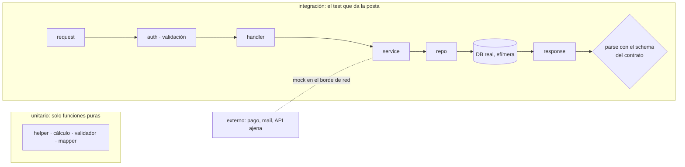
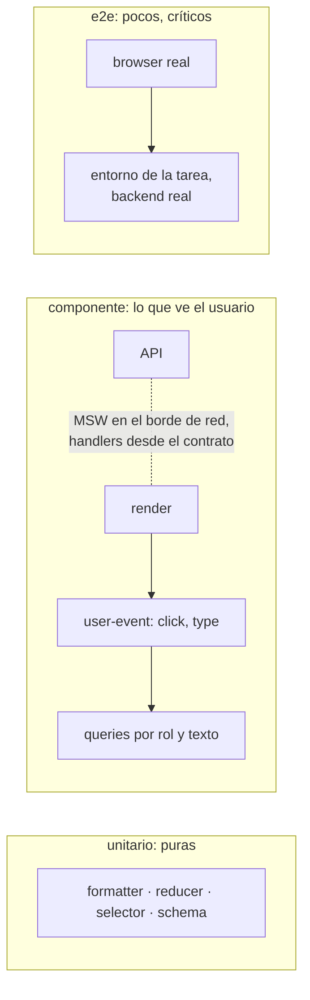
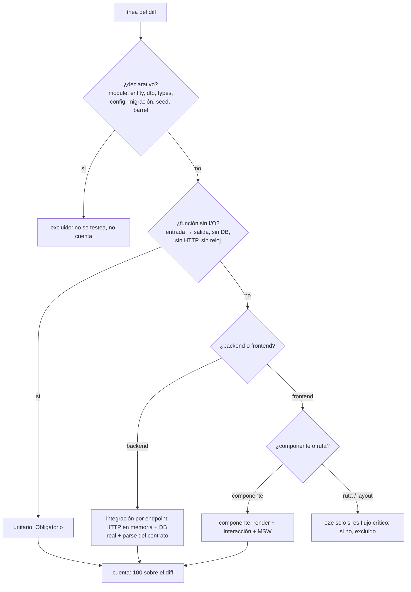
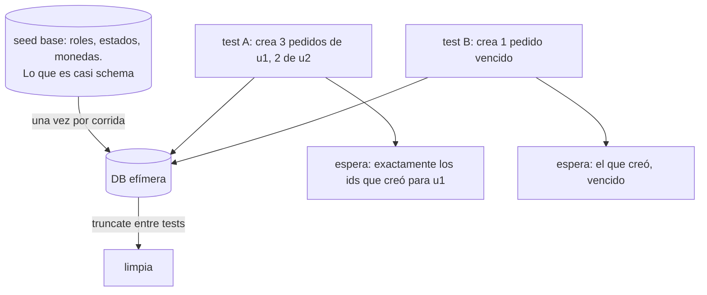
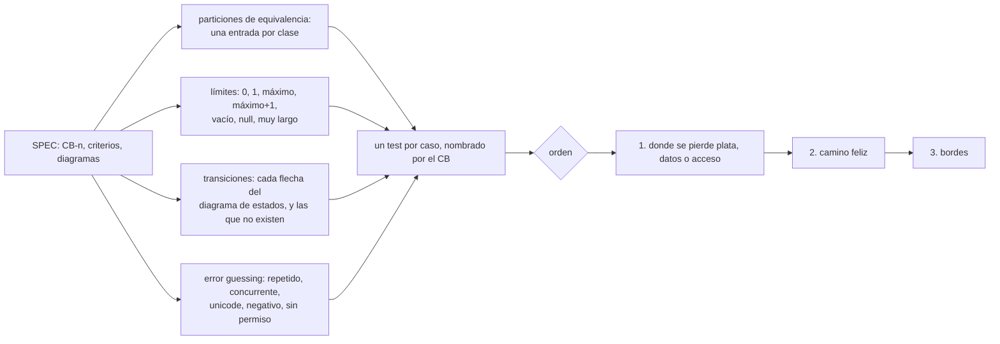
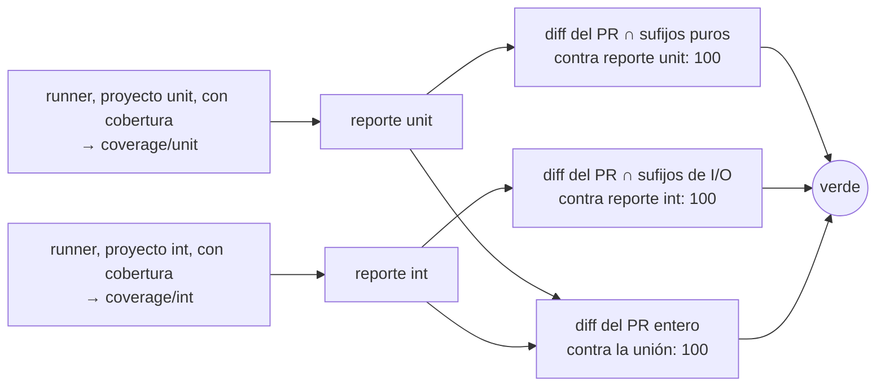

# QA: qué se prueba, en qué capa, con qué datos

Caja negra: se conoce el contrato (SPEC, schemas, firmas), no la implementación. Asume `mindstack:tdd` (cómo se escribe un test) y la skill del stack (con qué). Acá: qué tipo de test corresponde, qué está prohibido y de dónde salen los datos y los casos.

## Backend



| Tipo | Se puede | No se puede |
|---|---|---|
| unitario | función sin I/O: entrada → salida | si necesita un mock, no es pura: va a integración |
| integración | endpoint entero en memoria, DB real, mock solo de lo externo, response validado con el schema del contrato (ese `parse` es el test de contrato) | mockear repo, service u ORM; SQLite en lugar de la DB de producción; levantar el server por puerto; e2e como gate |

## Frontend



| Tipo | Se puede | No se puede |
|---|---|---|
| unitario | igual que backend | hooks con estado probados "aislados" |
| componente | render + interacción + lo visible y accesible; MSW responde lo que el test define | shallow render; mockear hijos o módulos `api/`; snapshots; asertar estado interno |
| e2e | login, el flujo principal, pagar: 3 a 5 | el gate de CI; cubrir bordes (eso es integración del back) |

## Qué test para qué línea



| Regla | Cagada que evita |
|---|---|
| Si para testear algo hace falta un mock de algo propio (repo, service, use case), ese test no existe: sube a integración | un "unitario" del controller con todo mockeado pasa, cubre y no prueba nada |
| El diff no se mueve de archivo ni se renombra para cambiar su cobertura | sacar lógica a un helper para que el unitario "alcance" en vez de escribir el de integración |

## Nombres

El nombre del código fuente no decide la cobertura. Decide dos cosas más chicas: qué se excluye por declarativo y qué tipo de test le toca. El nombre del **test** sí decide: es lo que separa los proyectos del runner.

| Test | Capa | Qué puede importar | Qué no |
|---|---|---|---|
| `*.unit.test.ts` | unitario | helpers, mappers, dominio puro, types, contratos | módulos de I/O (`.controller`, `.use-case`, `.repository`, `.adapter`, `app`), el driver de DB, mocks de módulos propios |
| `*.int.test.ts` | integración | `app`, factories, contratos, cliente HTTP en memoria | mocks de rutas propias (`./`, `@/`) |
| `*.component.test.tsx` | componente | el componente, MSW, Testing Library | módulos `api/`, hijos mockeados |
| e2e en su carpeta | e2e | el browser | nada del código |

| Sufijo del fuente | Qué es | Cobertura | Test |
|---|---|---|---|
| `.module`, `main`, `*.config`, migraciones, `.seed`, barrels, `generated/` | wiring | excluido | ninguno |
| `.entity`, `.dto`, `.types`, `.interface`, `.enum`, `.constant`, `.schema` | forma | excluido | contrato, si es schema |
| `.helper`, `.util`, `.mapper`, dominio sin sufijo | entrada → salida | cuenta | unitario |
| `.controller`, `.use-case`, `.repository`, `.adapter` | el camino del request | cuenta | integración |
| `.tsx` componente | lo que ve el usuario | cuenta | componente |
| rutas, layouts, páginas | wiring del router | excluido | e2e, pocos |

Sin sufijo = cuenta. Solo lo excluido necesita sufijo. La lista de sufijos de I/O es una sola, en la config de CI del stack (`mindstack:typescript`, `../typescript/references/ci.md`); `.service` entra ahí si en el proyecto los services tocan I/O.

## Datos



| Regla | Por qué |
|---|---|
| El test es dueño de sus datos: factories, y el expected se deriva de lo que creó | la población cambia; el test no |
| Nunca una cantidad contra datos que el test no creó | `toHaveLength(7)` es un test del dump, no del endpoint |
| Sobre datos compartidos se afirma propiedad: todos cumplen el filtro, el orden es el pedido, es subconjunto | vale con cualquier población |
| Seed base solo tablas de referencia. Si hay duda, factory | un dump "completo" acopla todos los tests a un estado que nadie controla |
| Edge cases salen de factories con el caso raro (`seedOrder({ total: 0 })`) | no se busca un registro raro: se fabrica |
| DB real y efímera por corrida; truncate entre tests; serial | rollback se rompe si el código abre su transacción; paralelo pide schema por worker, cuando mida |

```ts
// mal: depende de la población
expect(res.body.items).toHaveLength(7);

// bien: dueño de los datos
const mine = [await seedOrder({ userId: u1 }), await seedOrder({ userId: u1 })];
await seedOrder({ userId: u2 });
const res = await request(app).get(`/orders?userId=${u1}`);
expect(res.body.items.map(o => o.id).sort()).toEqual(mine.map(o => o.id).sort());

// bien: propiedad, sobre datos compartidos
expect(res.body.items.every(o => o.status === 'open')).toBe(true);
expect(res.body.items).toEqual([...res.body.items].sort(byCreatedAtDesc));
```

## De dónde salen los casos



El oráculo es el contrato: schema de response, criterio de aceptación, diagrama del SPEC. Si solo la implementación dice cuál es la salida correcta, falta SPEC y va a Observaciones.

## Reproducir un bug

Escalera, de lo más atómico a lo menos; quedarse en el primer nivel que reproduce: **unitario** (una función con la entrada que falla) → **integración** (el endpoint con su DB) → **e2e** (el sistema levantado) → **manual**. Un síntoma visto en pantalla con causa en una función se reproduce unitario.

## Olores que invalidan un test

| Olor | Qué pasa |
|---|---|
| pasa sin `expect`, o con `expect(true)` | no prueba nada |
| mockea lo que dice probar | prueba el mock |
| asserta implementación (llamó a X con Y) | pasa cuando cambia el comportamiento, rompe cuando cambia la forma |
| cantidad contra población | rompe con el próximo seed |
| `skip`, `only`, timing, orden entre tests | suite que miente |
| lee el cuerpo de la función para decidir qué testear | ya no es caja negra |

## Cobertura: dos corridas, tres gates



El reporter no distingue unitario de integración: anota líneas ejecutadas. Son dos reportes porque "¿el controller lo cubrió integración?" solo se responde si el de unitarios no está mezclado adentro. Un unitario que ejecute el controller no le sirve a C2.

```
candidatas = líneas agregadas o modificadas por el PR
             ∩ archivos que coverage.include deja adentro
             ∩ líneas ejecutables
%          = candidatas ejecutadas por algún test del reporte / candidatas
```

| Fijo en config, no en el PR | Por qué |
|---|---|
| `coverage.include` explícito sobre `src/**` | un archivo nuevo sin test aparece al 0, no desaparece |
| `coverage.exclude` con los sufijos declarativos | única válvula; cambiarla es un diff visible |
| las dos listas de sufijos para C1 y C2, en el script de `coverage:diff` | una sola fuente |
| 100 en los tres | 70 deja 30% del diff sin dueño |

El total del paquete no es gate: informativo, sube solo porque cada PR deja al 100 lo que tocó.

## Lo que rechaza la máquina

La skill dice por qué. Esto es lo que dice que no, sin que nadie se acuerde:

| Cagada | Quién la frena |
|---|---|
| "unitario" del controller con todo mockeado | lint: `*.unit.test.ts` no importa módulos de I/O ni usa `vi.mock` |
| unitario que toca la DB "porque andaba" | setup del proyecto unit: sin `DATABASE_URL`, el driver lanza |
| integración que mockea el repo | lint: `vi.mock` de ruta propia en `*.int.test.ts` |
| cubrir un controller con un unitario | C2: las líneas de I/O tienen que estar en el reporte de integración |
| mover lógica a un helper para que alcance | el diff cuenta líneas movidas como nuevas, y C2 sigue exigiendo el controller |
| diff al 70 | C3: 100 o rojo |

## Niveles

| No negociable | Cerrado, cambia por PR con motivo | Ajustable |
|---|---|---|
| caja negra; DB real en integración; expected derivado de lo que el test creó; response validado con el contrato; unitario sin mocks de módulos propios; 100 sobre el diff en los tres gates; dos reportes de cobertura | truncate (vs rollback); serial (vs schema por worker); contrato dentro de integración (vs suite aparte); `.use-case` en la lista de I/O (vs fakes en memoria como unitario) | cuántos e2e; qué entra en el seed base; qué sufijos tiene cada lista |
