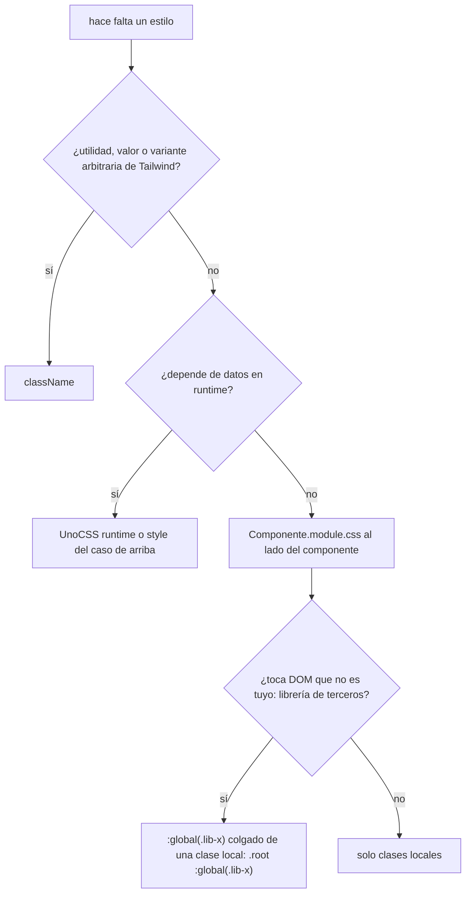
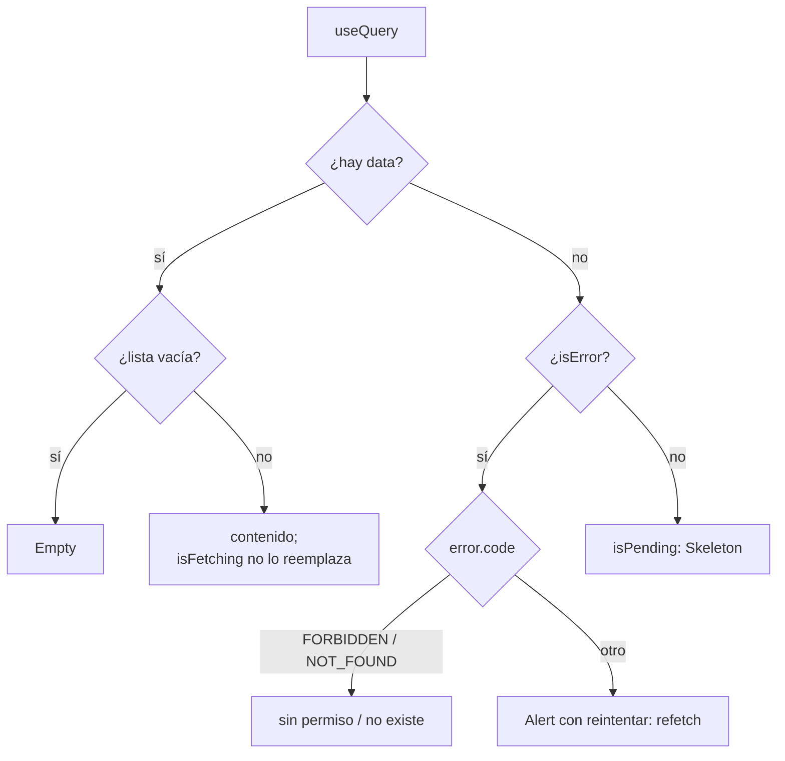
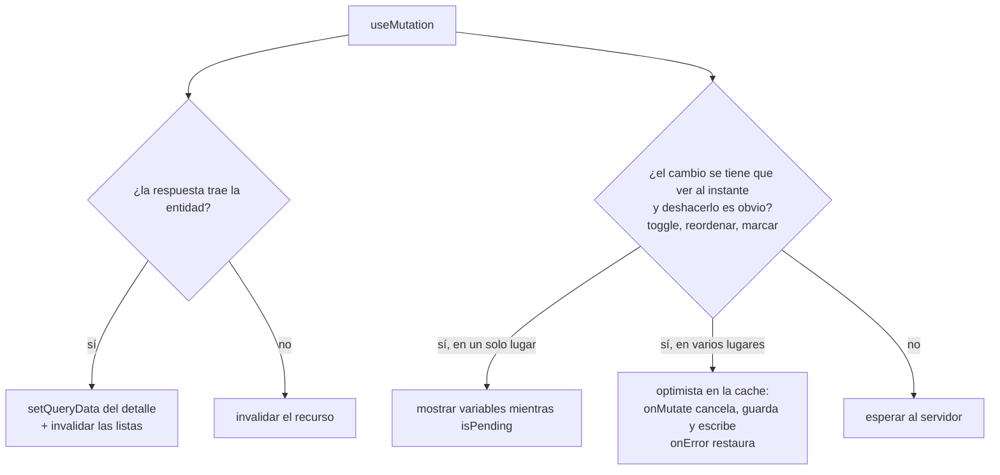

# Frontend

React. Estilos con Tailwind; lo dinámico en runtime con UnoCSS. Componentes de shadcn/ui copiados en `packages/ui`. HTTP con una instancia de axios. Datos con TanStack Query, Table y Virtual. Forms y respuestas validadas con los schemas de `contracts`. HTML de datos sanitizado con DOMPurify.

## Estilos: Tailwind vs UnoCSS

Tailwind genera CSS **en build** escaneando el código fuente. Una clase construida en runtime (`bg-${color}-500`) no existe en el CSS final. Para eso está UnoCSS runtime, que genera la clase en el browser cuando aparece.

Ojo con la CSP: el runtime inyecta `<style>` en el browser, y la política del core no aplica estilos inline sin nonce (`../../web-security/references/csp.md`, "Librerías que inyectan `<style>`"). Antes de usarlo en un proyecto, verificar en Playwright con la política en enforce que tome el nonce. Si no lo toma, no entra: la clase dinámica va por `style={{}}`, que React setea por CSSOM y CSP no bloquea, y esa es la única excepción al "nunca `style={}`" de abajo.

| Caso | Usar | Ejemplo |
|---|---|---|
| clase fija o elegida entre un set conocido | Tailwind | `className="p-4 bg-slate-100"`, `isActive ? 'bg-blue-500' : 'bg-gray-200'` |
| clase que depende de datos en runtime: color que elige el usuario, tema de un tenant, valor de un CMS | UnoCSS runtime | `className={\`bg-[${tenant.brandColor}]\`}` con `@unocss/runtime` cargado |
| variantes de un componente | `cva` (class-variance-authority, viene con shadcn) + Tailwind | `button({ variant: 'destructive', size: 'sm' })` |
| merge de clases desde props | `cn()` de shadcn (clsx + tailwind-merge) | `cn('p-4', className)` |

Nunca:

- `style={{ color: x }}` cuando hay utilidad. Inline rompe el sistema de diseño y no se puede overridear.
- styled-components, Emotion, Sass. Un sistema de estilos, no tres.
- CSS escrito cuando Tailwind lo resuelve. Ver "CSS que no queda de otra" abajo.
- Concatenar strings para armar clases de Tailwind. No las genera y falla en silencio.

## CSS que no queda de otra

Tailwind primero, siempre. Antes de escribir CSS: utilidad, valor arbitrario (`w-[37px]`, `[mask-type:luminance]`), variante arbitraria (`[&>svg]:size-4`, `has-[:checked]:bg-blue-50`), `@theme` para un token. Recién si nada de eso alcanza (keyframes de varios pasos, el DOM de una librería de terceros que no acepta `className`, un pseudo-elemento con contenido generado complejo), va CSS, y aislado al componente que afecta. Principio: "Los namespaces son buena idea" (`../../../PRINCIPLES.md`).



| Regla | Por qué |
|---|---|
| Un CSS module por componente, mismo nombre, misma carpeta: `Canvas.tsx` + `Canvas.module.css`. Lo importa solo ese componente | si otro lo importa, el estilo ya no es de un componente y el aislamiento es mentira |
| Todo selector arranca en una clase local (`.root`, `.node`). Nunca un tag suelto (`div`, `svg`) ni `*` arriba de todo | un selector por tag en un module sigue siendo local de nombre pero pega en cualquier hijo, incluidos componentes ajenos |
| `:global(...)` solo anidado bajo una clase local: `.root :global(.elk-edge)` | un `:global` suelto es CSS global con otra extensión |
| Sin colores, espacios ni fuentes a mano: `var(--color-…)` de los tokens de `@theme` | el CSS module no tiene que inventar otro sistema de diseño |
| El único `.css` global es el entry de Tailwind (`@import "tailwindcss"`, `@theme`, reset mínimo) | todo lo demás global es estilo que nadie sabe a quién afecta |
| Arriba del archivo, un comentario: qué no pudo Tailwind | el revisor y el próximo que lo lea saben por qué existe; si Tailwind ya lo puede, se borra |

```css
/* Canvas.module.css: el DOM del layout lo genera la librería sin className; Tailwind no llega */
.root :global(.edge-label) { font-size: var(--text-xs); color: var(--color-muted-foreground); }
@keyframes pulse-node { 0%, 100% { opacity: 1 } 40% { opacity: .4 } 60% { opacity: .7 } }
.nodeActive { animation: pulse-node 1.2s var(--ease-out) infinite; }
```

```js
// eslint.config.js: un .css que no es module ni el entry no se importa
'no-restricted-imports': ['error', { patterns: [
  { regex: '\\.(?<!module\\.)css$', message: 'CSS aislado: Componente.module.css, y solo si Tailwind no alcanza' },
] }],
```

El entry (`src/styles.css`) se importa una vez en `main.tsx` con `// eslint-disable-next-line no-restricted-imports`. Los `.css` compilan a archivos del bundle, así que la CSP los cubre con `'self'` igual que a Tailwind.

## Componentes: shadcn/ui

- Se instalan con `npx shadcn@latest add button` **en `packages/ui`**, no en la app. Quedan como código propio.
- Se modifican ahí. Un `Button` que necesita una variante nueva: se agrega al `cva` del `Button`, no se envuelve en otro componente.
- `packages/ui` no conoce el dominio: exporta `Button`, `Dialog`, `DataTable`. `OrderTable` vive en `apps/web/src/orders/`.
- No instalar otra librería de componentes "para una cosa". Si shadcn no lo tiene, se arma con Radix (que shadcn ya trae) y Tailwind.

## HTTP: axios, una instancia

`fetch` no se usa. Una instancia de axios creada una vez y exportada como constante; todo request pasa por ella.

```ts
// apps/web/src/api/http.ts
import axios from 'axios';
import { ErrorResponseSchema } from '@acme/contracts';
import { config } from '@/config';          // el único que lee import.meta.env (../../typescript/references/config.md)
import { ApiError } from './api-error';

export const http = axios.create({
  baseURL: config.VITE_API_URL,
  timeout: 10_000,
  withCredentials: true,
});

http.interceptors.request.use((req) => {
  req.headers['X-Request-Id'] = crypto.randomUUID();
  return req;
});

http.interceptors.response.use(
  (res) => res,
  (error) => {
    const parsed = ErrorResponseSchema.safeParse(error.response?.data);
    throw parsed.success
      ? new ApiError(parsed.data, error.response.status)
      : new ApiError({ code: 'INTERNAL', message: error.message }, error.response?.status ?? 0);
  },
);
```

| Regla | Por qué |
|---|---|
| Un solo `axios.create` en `api/http.ts`. Ningún componente ni hook importa `axios` directo | base URL, timeout, credenciales, headers y manejo de errores en un lugar. Cambiar la auth es tocar un archivo |
| Los interceptors traducen el error HTTP al `ErrorResponse` del contrato y lo lanzan como `ApiError` tipado | el que llama hace `catch (e) { if (e instanceof ApiError && e.code === 'NOT_FOUND') }`, nunca mira `e.response.data` |
| Un módulo por recurso en `api/`: `orders.ts` exporta `createOrder(input): Promise<Order>`, usa `http` y parsea la respuesta con el schema | los componentes llaman funciones con tipos, no URLs |
| `AbortSignal` de TanStack Query se pasa al request: `http.get(url, { signal })` | al desmontar o cambiar de página, el request se cancela |

## Datos: TanStack

Tres librerías de TanStack, cada una para un problema. No se reemplazan por `useEffect` + `useState`.

| Problema | Librería | Nunca |
|---|---|---|
| traer, cachear y refrescar datos de la API | `@tanstack/react-query` | `useEffect(() => { fetch... })`, estado de servidor en un store global |
| tablas: sort, filtro, paginación, selección, columnas | `@tanstack/react-table` | implementar sort y paginación a mano, otra librería de tablas |
| listas largas (cientos o miles de filas) | `@tanstack/react-virtual` | renderizar 5000 filas y "después vemos" |

- Estado de servidor (viene de la API) con Query. Estado de UI (modal abierto, tab activa, fila seleccionada) con `useState` o un store chico. No mezclar.
- Una tabla que muestra datos de la API usa Table sobre los datos de Query; la paginación server-side pasa `page` y `sort` por la `queryKey`.
- Lista con más de ~100 ítems visibles a la vez: Virtual. Antes, no hace falta. Scroll infinito: `useInfiniteQuery` + Virtual, con `maxPages` si la lista no tiene fin.

Lo que sigue usa la API de Query v5 (`queryOptions`, `isPending`, `gcTime`, `skipToken`).

### Keys y opciones: un lugar por recurso

El módulo del recurso en `api/` exporta, además de las funciones, sus queries. Nadie escribe una `queryKey` a mano.

```ts
// apps/web/src/api/orders.ts
import { queryOptions, keepPreviousData } from '@tanstack/react-query';

export const orderQueries = {
  all: () => ['orders'] as const,
  list: (filters: OrderFilters) =>
    queryOptions({
      queryKey: [...orderQueries.all(), 'list', filters],
      queryFn: ({ signal }) => listOrders(filters, signal),
      placeholderData: keepPreviousData,
    }),
  detail: (id: string) =>
    queryOptions({
      queryKey: [...orderQueries.all(), 'detail', id],
      queryFn: ({ signal }) => getOrder(id, signal),
    }),
};

// uso: useQuery(orderQueries.detail(id)) · queryClient.prefetchQuery(orderQueries.detail(id))
// invalidar todo el recurso: queryClient.invalidateQueries({ queryKey: orderQueries.all() })
```

| Regla | Por qué |
|---|---|
| Keys y `queryFn` solo desde `<recurso>Queries`; el componente llama `useQuery(orderQueries.detail(id))` directo, sin hook propio salvo que componga algo | la misma key en todos lados; `getQueryData(orderQueries.detail(id).queryKey)` sale tipado |
| La key lleva toda variable que usa la `queryFn`, y va de lo general a lo particular: recurso, tipo, parámetros | sin la variable, la cache devuelve datos de otros parámetros; con el orden, invalidar `['orders']` alcanza a listas y detalles |
| Los filtros van como objeto en la key, no como string armado | Query hashea el objeto de forma estable; el string se arma distinto en dos lugares |
| `@tanstack/eslint-plugin-query` con `recommended` | `exhaustive-deps` marca la variable que falta en la key |
| Los datos de una query no se copian a `useState`; lo derivado se calcula en render o con `select` | la copia queda vieja en el próximo refetch. Excepción: valores iniciales de un form, con `values` de react-hook-form |

### Valores por defecto

```ts
// apps/web/src/api/query-client.ts
import { QueryClient, QueryCache } from '@tanstack/react-query';
import { toast } from 'sonner';
import { ApiError } from './api-error';

const isClientError = (e: unknown) => e instanceof ApiError && e.status >= 400 && e.status < 500;

export const queryClient = new QueryClient({
  defaultOptions: {
    queries: {
      staleTime: 30_000,
      retry: (failures, error) => !isClientError(error) && failures < 2,
    },
    mutations: { retry: false },
  },
  queryCache: new QueryCache({
    // solo falla de refetch: hay datos en pantalla y el error no tiene dónde mostrarse
    onError: (error, query) => {
      if (query.state.data !== undefined) toast.error('No se pudieron actualizar los datos');
    },
  }),
});
```

| Regla | Por qué |
|---|---|
| `staleTime` global de 30 s; por recurso se sube (catálogos, config: minutos o `Infinity` con invalidación) o se baja a 0 (lo que cambia solo) | con el 0 por defecto, cada componente que monta vuelve a pedir: requests duplicados y parpadeo |
| `refetchOnWindowFocus` queda en `true` | al volver a la pestaña, lo viejo se refresca y la pantalla no miente; con `staleTime` no hay tormenta de requests |
| Sin reintento en 4xx; hasta 2 en 5xx y red | un 400 o 404 no cambia por reintentar, solo demora el error |
| Las mutaciones no se reintentan solas | no son idempotentes: un reintento puede crear dos pedidos |
| Un `QueryClient` por app, a nivel módulo; Devtools solo en desarrollo, lazy | crearlo dentro de un componente pierde la cache en cada render |
| El 401 lo resuelve el interceptor de axios (`../../web-security/references/jwt.md`), no cada query | un solo lugar refresca o saca la sesión |

### Estados en pantalla

Cómo se ve cada estado lo dice `mindstack:design` (`../../design/references/states.md`). Esto es de qué flag sale cada uno:



| Regla | Por qué |
|---|---|
| Se pregunta primero por `data`, después por `error`, al final por `isPending` | un refetch que falla no borra lo que la persona estaba viendo |
| Skeleton solo con `isPending` (sin datos). Un refetch en segundo plano (`isFetching`) deja el contenido; a lo sumo un indicador que no mueve nada | reemplazar la tabla por un Skeleton en cada refetch es un salto de layout |
| Paginación y filtros con `placeholderData: keepPreviousData`; `isPlaceholderData` deshabilita "siguiente" | la tabla mantiene las filas mientras llega la página nueva, sin colapsar y volver a crecer |
| `useQuery` con flags por defecto. `useSuspenseQuery` solo si la ruta ya tiene Suspense y error boundary con `QueryErrorResetBoundary`; nunca los dos modelos en la misma pantalla | un modelo de carga por pantalla, y el reintento resetea la query |

### Mutaciones



| Regla | Por qué |
|---|---|
| `onSettled: () => queryClient.invalidateQueries(...)` con `return` | la mutación sigue en `isPending` hasta que llegan los datos nuevos: el botón no termina antes que la lista |
| Se invalida el recurso por prefijo y lo que depende de él (crear un pedido invalida `orderQueries.all()` y el contador del cliente) | lo que se ve en otra parte de la pantalla no queda viejo |
| Nunca optimista en pagos, borrados sin deshacer ni nada que el servidor rechaza por regla de negocio | mostrar éxito y después revertir es peor que esperar un segundo |
| Lógica de cache en la definición de `useMutation`; efectos de pantalla (toast, navegar, cerrar el Dialog) en `mutate(vars, { onSuccess })` | si el componente se desmonta, la cache igual se actualiza y el toast no aparece en una pantalla que ya no está |
| El botón que dispara la mutación se deshabilita con `isPending` | no hay doble submit |
| Nadie llama `refetch()` de otra query para "actualizar después de guardar" | eso es invalidar, y la mutación sabe qué |

### Cuándo pedir antes

| Caso | Criterio |
|---|---|
| ruta con datos | si el router tiene loaders, `queryClient.ensureQueryData(...)` en el loader: los datos llegan antes del render, sin cascada |
| link al detalle que probablemente se abra | `prefetchQuery` en hover o foco |
| query que depende de otra | `queryFn: userId ? () => … : skipToken`; si no dependen, en paralelo (`useQueries` o dos `useQuery`), nunca encadenadas de más |
| datos que cambian solos | evento de WebSocket que invalida o hace `setQueryData`; si no hay socket, `refetchInterval`, que se frena con la pestaña en segundo plano |

### Sesión y cache

- Logout o sesión perdida: `queryClient.clear()`. Los datos de un usuario no sobreviven al siguiente.
- La cache no se persiste en `localStorage` (`persistQueryClient`) si tiene datos personales: queda en el disco de una máquina compartida.

## Editores de código y texto rico

Un `<textarea>` alcanza para texto plano corto. Cuando se queda corto, hay una sola opción:

| Caso | Usar | Nunca |
|---|---|---|
| editar código, JSON, YAML, SQL, expresiones, templates: cualquier cosa con sintaxis | Monaco Editor (`@monaco-editor/react`) | `<textarea>` con `font-family: monospace`, CodeMirror, Ace |
| texto plano, una o pocas líneas | `<input>` / `<textarea>` de shadcn | Monaco para un campo de descripción |

Reglas:

- Monaco se carga **lazy**: `React.lazy` o `dynamic` con el componente que lo envuelve. Pesa varios MB y no va en el bundle inicial.
- Un solo wrapper en `packages/ui`: `CodeEditor` con `language`, `value`, `onChange`, `readOnly`. Las apps no importan `@monaco-editor/react` directo.
- Si el contenido tiene schema (un JSON de config), se valida con Zod al guardar, no se confía en que "Monaco lo marcó verde".
- Diff de dos versiones: `DiffEditor` del mismo paquete, no una librería aparte.

## Forms

| Regla | Por qué |
|---|---|
| `react-hook-form` + `zodResolver(CreateOrderRequest)`. El schema viene de `contracts`, no se escribe otro | el front valida lo mismo que el back, campo por campo, antes de mandar |
| El submit llama a la función de `api/`, dentro de un `useMutation` | loading, error y refetch resueltos; el componente solo muestra |
| Errores de la API se leen por `code` del `ApiError`, nunca por `message` | `message` cambia; `code` es contrato |

## Seguridad en el front

Lo mínimo, siempre. El resto en `../../typescript/references/security.md`.

- Todo HTML que venga de datos (un comentario, una descripción de producto, un CMS) pasa por `DOMPurify.sanitize()` antes de `dangerouslySetInnerHTML`. Sin excepción.
- Mejor todavía: no renderizar HTML de datos. Texto plano en JSX ya escapa solo.
- Tokens de sesión en cookies `httpOnly`, no en `localStorage`. `withCredentials: true` en axios.
- Sin secretos en el bundle. `VITE_*` es público: solo URLs y flags.

## Lógica

- Sin lógica de negocio. El total lo calcula la API o una función pura de `contracts`. Dos implementaciones divergen.
- `lodash-es` para datos: `groupBy`, `sortBy`, `debounce`. Import por función: `import { debounce } from 'lodash-es'`.

## Estructura

```
apps/web/src/
├── api/               http.ts (instancia axios), query-client.ts, cliente tipado y queries por recurso: orders.ts, users.ts
├── orders/            feature: componentes, hooks, estado de esa pantalla
│   ├── OrderList.tsx
│   ├── OrderList.component.test.tsx
│   └── useOrders.ts
├── app/ o routes/     según el router
└── lib/               cn(), config del cliente, helpers sin dominio
```

## Tests

- Componentes: Testing Library, por comportamiento visible ("muestra el error del cupón"), no por implementación (`state.error === ...`).
- Un `QueryClient` nuevo por test con `retry: false`, nunca el de la app: la cache no pasa de un test a otro y un error no tarda en aparecer.
- API mockeada en la frontera con MSW, usando los schemas de `contracts` para generar respuestas válidas. No mockear `http` ni los módulos de `api/`: MSW intercepta por debajo de axios.
- Sin snapshot tests de componentes enteros. Rompen con cualquier cambio y nadie los lee.
