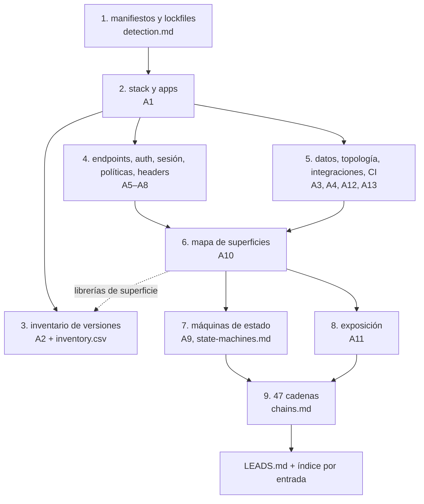
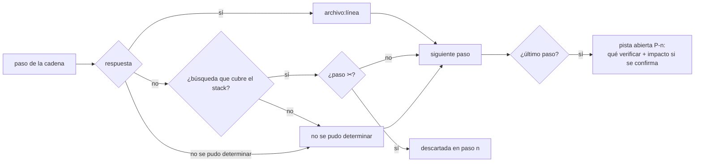

# Recon: cómo está hecho, y dónde mirar

`architecture` y `web-security` dicen cómo **tiene que ser** un sistema. Esta skill dice cómo **es** uno que ya existe, para que una auditoría arranque de un mapa y no de un `grep` suelto. Separa dos cosas que se mezclan siempre:

- **Hechos** (`ARCHITECTURE.md`): qué hay, dónde, en qué versión. Nunca dice "vulnerable".
- **Pistas** (`LEADS.md`): por cada clase de vulnerabilidad, una cadena de preguntas contestada con esos hechos. Corta en el primer "no" que descarta y lo deja escrito; lo que llega al final es dónde mirar y cómo verificarlo. Sin severidad.

Lo que se descartó queda tan escrito como lo que se abrió: una clase sin cadena es una clase que nadie miró.

## Reglas

| Regla | Por qué |
|---|---|
| Solo lectura: Read, Grep, Glob, `git ls-files`, `git log`. No se ejecuta la app, no se mandan requests, no se instalan dependencias, no se corren scanners | es reconocimiento de caja blanca; lo dinámico es otra fase |
| Todo hecho lleva `archivo:línea` | explícito antes que implícito: un hecho sin evidencia no entra |
| Lo que no se encontró se escribe `no detectada` (código) o `no encontrada en el repo` (infra, config, servicios gestionados). Nunca "no tiene" | ante la ambigüedad, no adivinar: puede vivir fuera del repo |
| `ARCHITECTURE.md` no opina: ni "inseguro", ni "debería", ni severidad | los hechos sirven igual para una auditoría que para un onboarding |
| Un "no" en una cadena necesita la búsqueda que lo respalda (patrones y rutas). Sin búsqueda, o con una que no cubre el stack detectado, es `no se pudo determinar` | un descarte sin evidencia es una clase que nadie miró |
| Las pistas no llevan severidad; pueden decir **impacto si se confirma** en palabras | la severidad la pone quien verifica |
| No se inventan versiones, fuentes de datos, transiciones ni flujos | lo que el código no muestra no está |
| Solo se escribe en `recon/` en la raíz del repo auditado | no se toca código de otro |

## Proceso



1. **Detectar el stack** por manifiestos y lockfiles, uno por app si es monorepo. La tabla está en [references/detection.md](references/detection.md#manifiestos-y-lockfiles). Con el framework de cada app se sabe cómo declara rutas, auth y parsers.
2. **Escribir `ARCHITECTURE.md`** sección por sección, siguiendo [references/architecture.md](references/architecture.md). Las secciones A1–A13 son fijas; una sección que no aplica dice `no aplica: <por qué>`.
3. **Inventario de versiones** (A2): versión resuelta del lockfile, `purl` por fila, transitivas en `inventory.csv`. Reglas en [references/architecture.md](references/architecture.md#a2-inventario-de-versiones).
4. **Mapa de superficies** (A10): cada categoría con su búsqueda por ecosistema en [references/detection.md](references/detection.md#superficies-por-categoría). Cada librería que aparece acá entra también en A2.
5. **Máquinas de estado** (A9): un diagrama por entidad con estado mutable, derivado de lo que el código escribe. Método en [references/state-machines.md](references/state-machines.md).
6. **Recorrer las 47 cadenas** de [references/chains.md](references/chains.md), en sus diez grupos, contestando cada paso con secciones de `ARCHITECTURE.md`. Si un paso pide un hecho que no está, primero se agrega a `ARCHITECTURE.md`, después se contesta.
7. **Índice por entrada** al final de `LEADS.md`: endpoint o entrada → pistas abiertas que la tocan.

## Salidas

```
recon/
├── ARCHITECTURE.md   hechos: A1–A13           templates/ARCHITECTURE.md
├── inventory.csv     todas las piezas, también transitivas   templates/inventory.csv
└── LEADS.md          47 cadenas + índice por entrada         templates/LEADS.md
```

| Archivo | Lleva | No lleva |
|---|---|---|
| `ARCHITECTURE.md` | hechos con `archivo:línea`, diagramas, tablas | juicios, severidad, "debería" |
| `inventory.csv` | una fila por pieza y versión, con `purl` | CVEs (buscarlos es otra fase) |
| `LEADS.md` | cada clase como `descartada en paso n`, `pista abierta P-n` o `no aplica`, con evidencia; índice por entrada | severidad, payloads de explotación más allá de "qué verificar" |

## Cómo se contesta un paso



- `sí`: `archivo:línea` y la cita mínima que lo muestra.
- `no`: qué patrones se buscaron y en qué rutas. La búsqueda tiene que ser la del ecosistema detectado (`detection.md`).
- `no se pudo determinar`: por qué (infra fuera del repo, código generado, dinámica que no se puede seguir leyendo). La cadena sigue: nunca descarta.
- Los pasos sin ✂ no cortan: suman contexto o impacto.

## Casos borde

| Caso | Qué se hace | Dónde |
|---|---|---|
| Monorepo con varias apps | cada app su fila en A1, su caja en A4, sus endpoints agrupados en A5 | [architecture.md](references/architecture.md#a1-stack) |
| Auth global con exenciones (`@Public()`, `permitAll()`) | la columna Auth dice el efecto real por ruta: `pública (exención archivo:línea)` | [architecture.md](references/architecture.md#a5-endpoints) |
| Rutas por convención (file-based, decoradores, server actions) | entran en A5 igual que las registradas | [detection.md](references/detection.md#rutas-y-auth-por-framework) |
| SQL crudo parametrizado | va a A3 como crudo parametrizado; solo el interpolado contesta "sí" | [detection.md](references/detection.md#sql-y-nosql) |
| Política, proxy o cache fuera del repo | `no encontrada en el repo`; las cadenas que la necesitan quedan `no se pudo determinar` | [architecture.md](references/architecture.md#a4-topología) |
| IdP externo | el IdP es actor en los diagramas de A6, con tipo de flujo | [architecture.md](references/architecture.md#a6-autenticación-y-sesión) |
| Sink sin fuente rastreable | va a A10 igual; la cadena dice `sink sin fuente rastreada` | [chains.md](references/chains.md#navegador) |
| Falta una mitad (solo API, solo front) | `no aplica: <por qué>`; el front lista los endpoints externos que llama | [architecture.md](references/architecture.md#a5-endpoints) |
| Versión no resoluble (sin lockfile, `latest`, servicio gestionado) | se pone lo que se ve y se abre pista; dos versiones de la misma pieza, dos filas | [architecture.md](references/architecture.md#a2-inventario-de-versiones) |
| IP del cliente detrás de proxy | A8 dice qué valor termina siendo la IP y con qué `trust proxy` | [architecture.md](references/architecture.md#a8-headers-en-los-que-se-confía) |
| Estado implícito (booleanos, timestamps, varios escritores) | A9 deriva los estados de lo que se escribe y lista cada escritor | [state-machines.md](references/state-machines.md#estado-implícito) |
| Multi-tenancy sin `tenantId` | A3 nombra la frontera real (`orgId`, schema, base por cliente) o dice que no hay | [architecture.md](references/architecture.md#a3-datos) |
| Una entrada abre varias clases | cada cadena por separado; el índice por entrada las junta | [chains.md](references/chains.md#índice-por-entrada) |

## Con qué se une

`recon` no compara contra decisiones de diseño. Las salidas son la entrada de lo que viene después:

- **Auditoría de seguridad**: las pistas de `LEADS.md` se verifican con `mindstack:security` (vulnerabilidades, severidad `SEC-n`) y, si el proyecto es web, se comparan contra las decisiones cerradas de `mindstack:web-security`.
- **CVEs**: `inventory.csv` se consulta en OSV/NVD por `purl`.
- **Lógica de negocio y tests**: A9 sirve a `mindstack:qa` para derivar casos de transiciones inválidas.

## Verificación

- [ ] `recon/ARCHITECTURE.md` tiene A1–A13, cada una con contenido o `no aplica: <por qué>`
- [ ] Todo hecho tiene `archivo:línea`; nada dice "vulnerable", "inseguro" ni "debería"
- [ ] A2 coincide con el lockfile, cada fila tiene `purl`, las librerías de A10 están; `inventory.csv` tiene las transitivas
- [ ] A5 tiene todas las rutas del framework detectado, incluidas las de convención, con Auth y Autorización efectivas
- [ ] A9 tiene un diagrama por entidad con estado mutable, con acción y guardia en cada transición
- [ ] `LEADS.md` tiene las 47 clases; ninguna falta
- [ ] Cada `descartada` tiene la búsqueda que la respalda; cada `pista abierta` dice qué verificar
- [ ] El índice por entrada lista todas las pistas abiertas
- [ ] Nada se escribió fuera de `recon/`
