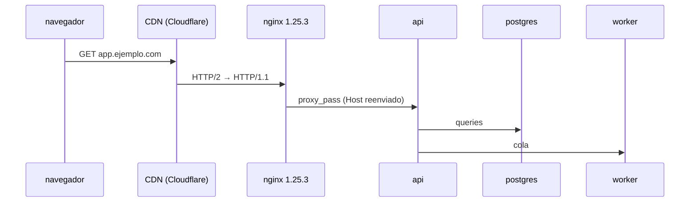
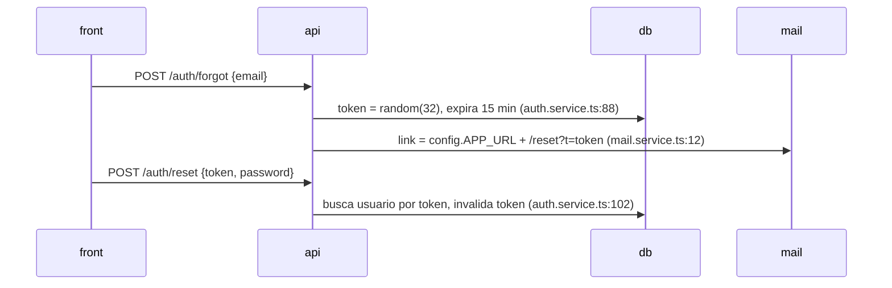

# ARCHITECTURE.md: qué va en cada sección

Trece secciones fijas, en este orden. Cada una dice qué se responde, de dónde sale y con qué forma. Todo hecho lleva `archivo:línea`; lo que no se encontró dice `no detectada` o `no encontrada en el repo`; una sección que no aplica dice `no aplica: <por qué>`. Ninguna sección opina. Las búsquedas por ecosistema están en [detection.md](detection.md).

## Índice

- [A1 Stack](#a1-stack)
- [A2 Inventario de versiones](#a2-inventario-de-versiones)
- [A3 Datos](#a3-datos)
- [A4 Topología](#a4-topología)
- [A5 Endpoints](#a5-endpoints)
- [A6 Autenticación y sesión](#a6-autenticación-y-sesión)
- [A7 Políticas](#a7-políticas)
- [A8 Headers en los que se confía](#a8-headers-en-los-que-se-confía)
- [A9 Máquinas de estado](#a9-máquinas-de-estado)
- [A10 Mapa de superficies](#a10-mapa-de-superficies)
- [A11 Exposición](#a11-exposición)
- [A12 Cadena de suministro e infra en el repo](#a12-cadena-de-suministro-e-infra-en-el-repo)
- [A13 Integraciones](#a13-integraciones)

## A1 Stack

Qué framework y tecnología usa cada pieza: front, back, workers, servicios, CLIs. Una fila por app; en un monorepo, una fila por cada carpeta con su propio manifiesto o entrypoint.

| App | Ruta | Rol | Lenguaje | Framework | Renderizado | Entrypoint |
|---|---|---|---|---|---|---|
| web | `apps/web` | front | TypeScript | React 18 + Vite | SPA | `apps/web/src/main.tsx:1` |
| api | `apps/api` | back | TypeScript | NestJS 10 | — | `apps/api/src/main.ts:1` |
| worker | `services/worker` | cola | TypeScript | BullMQ | — | `services/worker/src/index.ts:1` |

- **Renderizado**: SPA, SSR, SSG, server components, plantillas del server. Cambia dónde están los sinks y de dónde salen los datos que llegan al HTML.
- Si falta una mitad (solo API, o un front que habla con una API que no está en el repo), se dice en esta tabla y el resto de las secciones lo respeta.

## A2 Inventario de versiones

Es arquitectura, no pista: la entrada directa para buscar CVEs. Cada fila tiene que poder consultarse tal cual en OSV o NVD.

| Capa | Pieza | Ecosistema | Versión resuelta | Declarada | Fuente `archivo:línea` | Directa/transitiva | `purl` |
|---|---|---|---|---|---|---|---|
| runtime | node | — | 20.11.1 | `.nvmrc` | `.nvmrc:1` | — | — |
| framework back | express | npm | 4.18.2 | `^4.18.0` | `package-lock.json:812` | directa | `pkg:npm/express@4.18.2` |
| template | ejs | npm | 3.1.9 | `^3.1.0` | `package-lock.json:1520` | directa | `pkg:npm/ejs@3.1.9` |
| base de datos | postgres | docker | 15.4 | `postgres:15.4` | `docker-compose.yml:12` | — | `pkg:docker/postgres@15.4` |
| imagen base | node | docker | 20-alpine (sin digest) | `node:20-alpine` | `Dockerfile:1` | — | `pkg:docker/node@20-alpine` |
| CI | actions/checkout | github-actions | v4 | `@v4` | `.github/workflows/ci.yml:9` | — | `pkg:githubactions/actions/checkout@v4` |

**Capas que entran, todas:** runtimes y lenguaje, frameworks de front y back, ORM y drivers, motor de base de datos, cache y colas, imágenes Docker base y de servicios, proxy y servidor web, SDKs de terceros (IdP, pagos, storage, mail, LLM), **cada librería que aparece en A10** (templates, XML, serialización, headless, websockets, JWT, GraphQL, merge profundo, parsers de query, upload, cripto), paquetes del sistema instalados en el `Dockerfile` (`apk add`, `apt-get install`), acciones de CI.

**Reglas:**

- La versión resuelta sale del lockfile ([detection.md](detection.md#manifiestos-y-lockfiles)), nunca del rango del manifiesto.
- Sin lockfile: `no resuelta: rango ^x.y`. Imagen con `latest` o tag flotante (`node:20`): se pone el tag tal cual. Servicio gestionado (RDS, Atlas, Supabase) o pieza que no está en el repo: `no encontrada en el repo`. En los tres casos, además, una pista en `LEADS.md` (grupo Cadena de suministro).
- Dos versiones de la misma pieza (dos lockfiles, dos apps): dos filas.
- `ARCHITECTURE.md` lleva las directas y las piezas de infra; `inventory.csv` lleva **todas**, transitivas incluidas, con las mismas columnas. En `ARCHITECTURE.md` va el conteo de transitivas por ecosistema.
- Tipos de `purl` por ecosistema: [detection.md](detection.md#manifiestos-y-lockfiles).

## A3 Datos

- **Motores**: cada base, cache y cola, con dónde se configura la conexión.
- **ORM y drivers**: cuál, y **cómo se usa**: query builder, SQL crudo parametrizado, SQL crudo interpolado, filtros armados con objetos del request. Un conteo por forma, con los `archivo:línea` del crudo. Seguro vs inseguro por ORM: [detection.md](detection.md#sql-y-nosql).
- **Contraseñas**: algoritmo y parámetros (`bcrypt` costo 12, `argon2id`, `md5` sin sal, texto plano), con `archivo:línea` del hash y de la comparación.
- **Campos sensibles por modelo**: `passwordHash`, tokens, `role`, `isAdmin`, `verified`, `balance`, `ownerId`, `tenantId`, datos personales. Una tabla modelo → campos.
- **Largo de columnas** de los campos que se validan antes de guardar (email, username): si la validación y la columna difieren, el valor se trunca después de validado.
- **Multi-tenancy**: cuál es la frontera de aislamiento (un campo como `tenantId`/`orgId`/`accountId`/`workspaceId`, un schema por cliente, una base por cliente) y cómo se aplica: filtro en cada query, scope global del ORM, middleware que elige la conexión, o ninguno. De dónde sale el tenant del request. Si no hay, `no hay multi-tenancy` con la búsqueda que lo respalda.

## A4 Topología

Un diagrama de secuencia de cómo se hablan las piezas, de punta a punta, con lo que hay delante de la app:

- **Orígenes y dominios**: qué origen sirve el front, cuál la API, cuáles más (admin, docs, CDN de assets).
- **Cadena de proxies, CDN y caches**: cada salto con producto y versión (A2), si hay downgrade de HTTP/2 a HTTP/1, si el proxy reenvía `Host` o rutea por él, si cachea y con qué reglas. Fuente: config de nginx, Caddy, Traefik, `vercel.json`, `netlify.toml`, Terraform, k8s ingress. Si no está en el repo: `no encontrada en el repo`, y las cadenas de cache, smuggling y Host header quedan `no se pudo determinar` desde el paso que la necesita.
- **Servicios internos** y sus puertos (`docker-compose`, k8s services): cuáles puede alcanzar el back. Si corre en una nube, si la metadata (`169.254.169.254`) es alcanzable según la config que haya.

## A5 Endpoints

Tabla bruta, una fila por ruta y método, agrupada por app:

| Método | Ruta | Handler `archivo:línea` | Auth | Autorización | Params con id | `Content-Type` aceptado | Campos del body |
|---|---|---|---|---|---|---|---|
| GET | `/api/orders/:id` | `orders.controller.ts:31` | `jwtGuard` (global) | ninguna detectada | `:id` | — | — |
| POST | `/api/cart/items` | `cart.controller.ts:12` | `jwtGuard` (global) | `cart.userId === user.id` (`cart.service.ts:40`) | — | json, urlencoded (parser global) | `productId`, `quantity` |
| POST | `/api/auth/login` | `auth.controller.ts:20` | pública (exención `@Public()` `auth.controller.ts:19`) | — | — | json | `email`, `password` |

- **Auth** es el efecto real por ruta, no el registro: con guard global y exenciones, la exenta dice `pública (exención archivo:línea)`. Si el guard se registra por método, cada método su fila.
- **Autorización** es la verificación por recurso o por rol encontrada en el código, con `archivo:línea`; si no hay, `ninguna detectada`.
- **Params con id**: cualquier identificador de recurso o de usuario en path, query, body o cookie (`:id`, `userId`, `username`, GUIDs).
- **Campos del body**: los que el handler lee, o `body completo` si pasa el body entero al modelo.
- Entran también: rutas por convención (file-based, decoradores, server actions, loaders), canales y eventos de websocket, operaciones GraphQL (queries, mutations, subscriptions) con su guarda, webhooks entrantes, y versiones viejas de la API que siguen montadas. Cómo se declaran por framework: [detection.md](detection.md#rutas-y-auth-por-framework).
- **Métodos seguros que escriben**: debajo de la tabla, las rutas GET, HEAD u OPTIONS cuyo handler escribe en la base, manda mails, encola jobs o cambia la sesión, con el `archivo:línea` de la escritura; y las rutas registradas para cualquier método (`app.all`, `@RequestMapping` sin `method`, vistas de Django sin decorador de método). Si no hay: `no detectadas` con la búsqueda.
- Si el repo es solo front: una tabla de **endpoints externos llamados**, con el `archivo:línea` del cliente.

## A6 Autenticación y sesión

Un diagrama de secuencia por flujo que exista: registro, login, 2FA, refresh, logout, reset de contraseña, cambio de contraseña, cambio de email, verificación de email, "recordarme", vinculación de cuentas. Si hay IdP (Auth0, Cognito, Keycloak, Firebase Auth, Clerk, Supabase Auth, Okta, Azure AD), el IdP es un actor y se nombra el flujo: authorization code con PKCE, implicit, client credentials, SAML.

Además del diagrama, por cada flujo:

| Pregunta | Ejemplo de respuesta |
|---|---|
| ¿dónde vive el token en el front? | cookie `HttpOnly` / `localStorage` / memoria |
| ¿formato de la cookie de sesión y de "recordarme"? | id opaco / JWT / `base64(user:md5(pass))` |
| ¿dónde se guarda la sesión? | Redis / tabla `sessions` / sin estado |
| ¿se regenera el id al loguear? | sí `auth.ts:40` / no detectada |
| ¿el logout la invalida en el server? | sí / solo borra la cookie |
| ¿expira? | inactividad 30 min, absoluta 7 días / no detectada |
| ¿cambiar contraseña invalida las otras sesiones? | sí / no detectada |
| ¿el login responde distinto si el usuario existe? | mismo mensaje, pero early return antes del hash `auth.ts:55` |
| ¿de dónde sale el usuario en reset, 2FA y cambio de contraseña? | del token / de la sesión / del body |
| ¿cómo se marca la sesión pendiente de MFA: en la misma escritura que la autentica o en dos? | una escritura `auth.ts:60` / dos: `session.userId` en `auth.ts:58`, `session.mfaPending` en `auth.ts:63` |
| ¿el contador de intentos de MFA se incrementa de forma atómica? | `UPDATE … SET attempts = attempts + 1` / lee, suma y guarda |

## A7 Políticas

Valor literal y dónde se define, para cada una:

| Política | Qué se registra |
|---|---|
| CORS | origen permitido (literal, lista, regex, función, reflejo), `credentials`, métodos, headers, `maxAge` |
| CSP | header completo, o `no encontrada en el repo`; si va por `<meta>` |
| Framing | `frame-ancestors`, `X-Frame-Options`, frame busting en JS |
| Parsers de body | cuáles están registrados, globales o por ruta, qué `type` aceptan; si un parser acepta cualquier `Content-Type` |
| Límites | tamaño de body, de uploads, de paginación |
| Rate limits | dónde, por qué clave (IP, usuario), qué store (memoria, Redis), qué endpoints cubre |
| Cookies | cada cookie con `HttpOnly`, `Secure`, `SameSite`, `Domain`, `Path`, `Max-Age` |
| Method override | `_method`, `X-HTTP-Method-Override`, `methodOverride()` |
| Cache | qué cachea, con qué key, `Vary`; `Cache-Control` en respuestas con datos privados |
| Headers de seguridad | HSTS, `nosniff`, `Referrer-Policy`, COOP, CORP, `X-Powered-By` |

Si una política vive fuera del código (nginx, Caddy, `vercel.json`, `netlify.toml`, `next.config.*`, CDN), se busca ahí; si no está en ningún lado del repo, `no encontrada en el repo`.

## A8 Headers en los que se confía

Una tabla por header del request que el código lee:

| Header | Dónde se lee | Para qué | ¿Se valida? |
|---|---|---|---|
| `X-Forwarded-For` | `rate-limit.ts:8` vía `req.ip` | clave del rate limit | `trust proxy: true` (`app.ts:12`) |
| `Host` | `mail.service.ts:12` | URL base del link de reset | no detectada |
| `X-User-Id` | `auth.middleware.ts:30` | identidad del usuario | no detectada |

- Headers a buscar: `Host`, `X-Forwarded-For`, `X-Forwarded-Host`, `X-Forwarded-Proto`, `Forwarded`, `X-Host`, `X-Real-IP`, `X-Original-URL`, `X-Rewrite-URL`, `X-HTTP-Method-Override`, `Origin`, `Referer`, `User-Agent`, y headers propios (`X-User-Id`, `X-Role`, `X-Custom-IP-Authorization`).
- **IP del cliente**: qué valor termina siendo la IP. Sin `trust proxy`: la del balanceador (todos comparten contador). Con `trust proxy: true` o leyendo el primer valor de `X-Forwarded-For`: un valor que el cliente puede falsificar. Con `trust proxy` en la cantidad de saltos reales: la IP pública. Si la cantidad de saltos depende de infra que no está en el repo: `no se pudo determinar`.
- **URL base de los mails** (recuperación, verificación, invitación): de la config o del request.
- **Redirects**: qué `Location` arma el back con datos del request.
- **Ruteo**: si el proxy rutea por `Host` a upstreams internos.
- Qué headers se guardan, se loguean o entran en una query.

## A9 Máquinas de estado

Un `stateDiagram` por entidad con estado mutable, más la tabla de recursos consumibles y la de valores que el back toma del cliente para calcular. Método completo, estado implícito y forma: [state-machines.md](state-machines.md).

## A10 Mapa de superficies

Por categoría, cada archivo que la toca, con `archivo:línea` y una línea de qué hace. Es el inventario de "lugares raros": no dice si son vulnerables. Cada librería que aparece acá entra en A2. Qué buscar por ecosistema: [detection.md](detection.md#superficies-por-categoría).

| Categoría | Qué se registra por hallazgo |
|---|---|
| Sinks de HTML | sink, de dónde viene el dato si se puede seguir |
| Sinks del DOM | sink; en listeners de `message`, si chequea `event.origin` y cómo |
| SQL/NoSQL crudo | forma (parametrizado o interpolado), de dónde viene el valor |
| Procesos | función, si usa shell, de dónde vienen los argumentos |
| Disco | lectura o escritura, de dónde sale la ruta, cómo se sanea |
| Uploads | dónde se guarda, con qué nombre, si se sirve y desde qué origen, qué lo procesa, intérpretes en el server |
| Requests salientes | cliente, de dónde sale el destino, si sigue redirects, esquemas aceptados, cómo se valida |
| Redirects | de dónde sale el destino, si acepta absolutas |
| Mails | qué se manda, template, URL base, headers con input |
| XML | parser, si resuelve entidades o DTD, de dónde viene el XML |
| Deserialización | formato, de dónde viene el dato, si va firmado |
| Templates | motor, qué campos del usuario se renderizan, si se compila desde string, sandbox |
| Headless y conversores | herramienta, qué contenido recibe |
| Merge profundo | función, de dónde vienen las claves |
| Mass assignment | dónde se pasa el body entero a un modelo |
| JWT | dónde se emite y se verifica, librería, algoritmos, de dónde sale la clave |
| GraphQL | schema, resolvers con y sin guarda, introspección, límites, si acepta GET |
| WebSockets | handshake, eventos, si reenvía mensajes a otros usuarios |
| Cripto | algoritmo y modo, origen de la aleatoriedad, comparaciones de secretos |
| Regex | regex armadas con input, o con backtracking catastrófico sobre input |
| Exports | CSV/Excel con datos del usuario |
| Logs | qué se loguea de requests, tokens, datos personales |
| LLM | modelo, tools y permisos, qué contenido de terceros entra, a dónde va la salida |

## A11 Exposición

| Qué | Qué se registra |
|---|---|
| Variables públicas | `NEXT_PUBLIC_*`, `VITE_*`, `REACT_APP_*`, `PUBLIC_*`, `NUXT_PUBLIC_*`: nombre y qué contienen (sin copiar valores secretos) |
| Modo debug | cómo se activa, por qué variable, si se apaga por entorno |
| Documentación de API | Swagger/OpenAPI, introspección GraphQL, Redoc: ruta y si se apaga por entorno |
| Endpoints de debug | `/actuator`, `/debug`, `/metrics`, `/health` con datos, `phpinfo`, `__debug__` |
| TRACE | habilitado o no, en app y proxy |
| Estático | qué directorio se sirve; si incluye la raíz del repo (`.git`, `.env`, backups `~`/`.bak`/`.old`) |
| Directory listing | `autoindex on`, `serve-index`, `Options +Indexes` |
| Source maps | si se generan y se publican en producción |
| Errores | si devuelven stack traces o mensajes del motor |
| Versiones expuestas | `X-Powered-By`, `Server`, meta `generator` |
| Comentarios | comentarios con datos en HTML o en el bundle |
| Credenciales por defecto | seeds, fixtures o migraciones que crean usuarios con contraseña fija |
| Rutas ocultas | feature flags o variables que habilitan rutas de admin o debug |

## A12 Cadena de suministro e infra en el repo

| Qué | Qué se registra |
|---|---|
| Workflows de CI | triggers (`pull_request_target`, `workflow_run`), si hacen checkout del código del PR, acciones pineadas a SHA o a tag, secretos usados y a qué jobs llegan, `permissions` del `GITHUB_TOKEN` |
| Instalación | scripts `preinstall`/`postinstall`/`prepare` propios y de dependencias, si están bloqueados; cantidad de lockfiles por raíz |
| Contenedores | usuario (`USER`), puertos publicados, volúmenes, socket de Docker montado, `ARG`/`ENV` con secretos, imagen base con digest o sin |
| IaC | Terraform, k8s, CloudFormation, Pulumi: buckets públicos, `privileged`, `hostNetwork`, roles amplios, security groups abiertos |

## A13 Integraciones

Una fila por tercero: pagos, mails, storage, analytics, IdP, LLM, webhooks salientes y entrantes, scripts del front.

| Tercero | Para qué | Qué datos le salen | Credencial y dónde está | Webhook entrante: firma y replay |
|---|---|---|---|---|
| Stripe | cobros | email, monto | `STRIPE_KEY` en env (`config.ts:20`) | firma verificada (`webhooks.ts:14`), sin protección de replay detectada |
| Google Analytics | métricas | URL, user id | — | — |

Los scripts de terceros que carga el front van con su origen y si llevan `integrity` (SRI).
