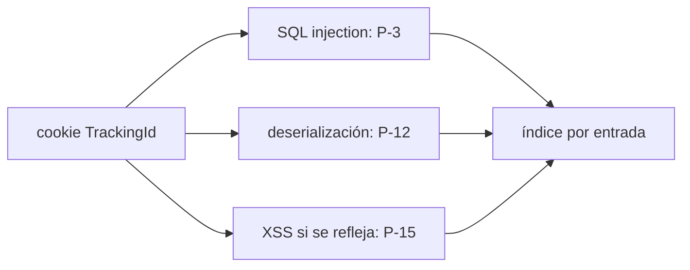

# Cadenas de preguntas por clase

46 cadenas en diez grupos. Cada una se recorre en orden y se contesta con hechos de `ARCHITECTURE.md` (la sección entre paréntesis); si el hecho no está, primero se agrega allá. Las búsquedas que respaldan un "no" están en [detection.md](detection.md).

## Índice

- [Reglas](#reglas)
- [Forma en LEADS.md](#forma-en-leadsmd)
- [Inyección del lado del server](#inyección-del-lado-del-server)
- [Navegador](#navegador)
- [Autenticación y sesión](#autenticación-y-sesión)
- [Control de acceso](#control-de-acceso)
- [El server hace requests o confía en el request](#el-server-hace-requests-o-confía-en-el-request)
- [Archivos](#archivos)
- [Infraestructura y protocolo](#infraestructura-y-protocolo)
- [Datos y lógica](#datos-y-lógica)
- [Exposición](#exposición)
- [Cadena de suministro e IA](#cadena-de-suministro-e-ia)
- [Índice por entrada](#índice-por-entrada)

## Reglas

- Cada paso se contesta `sí`, `no` o `no se pudo determinar`, con evidencia: `archivo:línea` si es sí; **qué se buscó y dónde** si es no. Un "no" sin búsqueda, o con una búsqueda de otro ecosistema, es `no se pudo determinar`.
- Un `no` en un paso marcado ✂ descarta la clase: la cadena termina ahí y queda `descartada en paso n`.
- Los pasos sin ✂ no cortan: suman contexto o impacto. "Basta uno de…" quiere decir que la pista queda abierta si cualquiera de esos pasos da sí.
- `no se pudo determinar` nunca descarta: la cadena sigue, y si llega al final es pista abierta con el motivo.
- Una clase que no aplica al repo (XSS sin front, websockets sin servidor de websockets) es `no aplica: <por qué>`, distinto de descartada.
- Una pista abierta dice **qué verificar** (la prueba concreta, sin payloads de explotación completos) y puede decir **impacto si se confirma** en palabras. Nunca severidad.
- Las 46 clases aparecen en `LEADS.md`, siempre, en este orden. Una clase nueva es una fila nueva en su grupo.

## Forma en LEADS.md

```markdown
### SQL injection — pista abierta P-1

| Paso | Pregunta | Respuesta | Evidencia |
|---|---|---|---|
| 1 ✂ | ¿consultas crudas con interpolación? | sí | `routes/login.ts:34` `sequelize.query(\`... '${req.body.email}' ...\`)` |
| 2 ✂ | ¿valor controlable? | sí | `POST /rest/user/login` body `email` (A5) |
| 3 | ¿contraseñas hasheadas? | sí, md5 sin sal | `models/user.ts:41` |

Verificar: login con un `email` que cierre la comilla y agregue una condición siempre verdadera.
Impacto si se confirma: login como cualquier usuario; lectura de hashes md5.

### XXE — descartada en paso 1

| 1 ✂ | ¿algo parsea XML? | no | buscado: `xml2js|libxmljs|fast-xml-parser|xmldom|sax|DOMParser`, `Content-Type` con `xml`, uploads `svg|docx|xlsx` en `src/**`, `apps/**`: sin resultados |
```

## Inyección del lado del server

| Clase | Cadena |
|---|---|
| SQL injection | ✂ ¿hay consultas SQL crudas con interpolación o concatenación? (A3, A10) → ✂ ¿el valor interpolado es controlable por el usuario, sea por body, query, cookie o header (rastreo hasta A5 o A8)? → impacto: ¿las contraseñas se guardan hasheadas, con qué algoritmo? (A3) |
| NoSQL injection | ✂ ¿hay base documental (Mongo, etc.)? → ¿hay consultas con string interpolado o `$where`/`mapReduce` con JS? → ¿un valor del body JSON llega como objeto a un filtro (`find({user: req.body.user})` acepta `{"$ne": null}`)? → ¿se castea a string o se valida con schema antes? — basta uno de los pasos 2 o 3 sin el 4 |
| OS command injection | ✂ ¿el back ejecuta procesos? (A10) → ¿usa shell (string a `exec`, `shell: true`, `system`) o argumentos como array? → ✂ ¿algún argumento sale del request, de un header, de un nombre de archivo subido o de la base (dato que escribió un usuario)? |
| SSTI | ✂ ¿usa motores de templates? cuáles y qué versión (A2) → ✂ ¿el template mismo (no solo sus variables) se arma, se compila o se elige con datos del usuario (descripción de producto, nombre en un mail, campo editable que se renderiza)? → ¿el motor tiene sandbox? ¿hay tags de debug habilitados? |
| XXE | ✂ ¿algo parsea XML (`application/xml`, SOAP, SAML, SVG, `docx`/`xlsx` subidos, XML armado por el server con datos del usuario)? → qué parser y versión (A2) → ¿resuelve entidades externas o carga DTD, o está deshabilitado explícitamente? → ¿el server inserta datos del usuario en un XML que después parsea (XInclude)? Acá termina: el resto es a mano |
| Server-side parameter pollution | ✂ ¿el back arma URLs o queries hacia una API interna con input del usuario? (A10) → ✂ ¿lo codifica (`encodeURIComponent`, builder de query) o un `#`/`&`/`?` del usuario puede truncarla o agregar parámetros? |
| Prototype pollution | ✂ ¿hay JS en el back o en el front? → ✂ ¿hay merge profundo o set por path con datos del request? (A10) → ¿filtra `__proto__`, `constructor`, `prototype`, y el filtro es recursivo? → ¿el parser de query permite objetos anidados con prototipo (`qs` con `allowPrototypes`)? → ¿la librería tiene CVE de prototype pollution? (A2) → server: ¿hay gadgets como `child_process` con objetos de opciones (`fork`, `execSync`) o propiedades leídas sin `hasOwnProperty` (`isAdmin`, `role`)? → front: ¿versión de jQuery o lodash con gadgets conocidos? |
| Deserialización insegura | ✂ ¿hay serialización de objetos? (A10: formato y lenguaje) → ¿qué guarda, incluye roles o permisos? → ✂ ¿el dato serializado llega desde el cliente (cookie, body, header, cola alimentada por terceros)? → ¿va firmado y se verifica antes de deserializar? → ¿hay librerías con gadgets conocidos en el classpath o en las dependencias (A2)? → PHP: ¿se compara con `==` sobre datos deserializados (type juggling)? ¿hay funciones de archivo que aceptan `phar://`? |
| Otras inyecciones | ¿input en respuestas HTTP como header (CRLF, response splitting)? → ¿input en headers de un mail (`To`, `Subject`, `Reply-To`)? → ¿input en LDAP o XPath? → ¿input en exports CSV/Excel sin neutralizar fórmulas? → ¿input sin sanear en logs (CRLF, log forging)? — cada "sí" con fuente controlable es una pista |

## Navegador

| Clase | Cadena |
|---|---|
| XSS | ✂ ¿hay sinks de HTML? (A10) → ¿el sink recibe datos del back sin escapar? → ¿se toman query params, fragmento o `postMessage`, se guardan (storage, estado, URL) y llegan a un sink? → ¿hay campos stored que se renderizan en el panel de admin? → ¿`href`/`src` con URL del usuario sin validar el esquema (`javascript:`)? → ¿los uploads se sirven desde el mismo origen con tipo ejecutable (HTML, SVG)? → contexto de impacto: ¿la cookie de sesión es `HttpOnly`? ¿el token vive en `localStorage`? ¿hay CSP? |
| DOM-based | ✂ ¿hay sinks del DOM? (A10) → ¿algún listener de `message` no chequea `event.origin`, o lo chequea con `indexOf`/`includes`? → ¿`eval`/`Function`/`setTimeout(string)` con datos de URL, storage o mensajes? → ¿`location.href`/`window.open` con un parámetro (open redirect del lado del cliente)? → ¿se escribe `document.cookie` con datos de la URL? → ¿hay patrones `window.x \|\| {}` donde el HTML del usuario puede crear `x` (clobbering)? |
| CSRF | ✂ ¿la sesión viaja en una cookie? → ¿qué `SameSite` tiene? (A7) → ¿qué `Content-Type` acepta el back? (A5, A7) → ¿es laxo: con `urlencoded` o `text/plain` y body JSON, lo parsea igual? → ¿hay method override, o alguna ruta GET que cambia estado? → si alguno de los anteriores: ✂ ¿hay token CSRF? → ¿se valida en todos los métodos, y también cuando falta? → ¿está atado a la sesión, o a una cookie que el atacante puede setear (double submit)? → ¿GraphQL acepta mutaciones por GET o `urlencoded`? |
| Clickjacking | ✂ ¿puede ser iframeado (sin `frame-ancestors` ni `X-Frame-Options`, o con valores permisivos)? → ¿la whitelist de terceros es literal o con comodines? → ¿el frame busting es solo JS (se saltea con `sandbox`)? → ¿hay acciones sensibles de un clic, o que se pueden prellenar por query params? |
| CORS | ✂ ¿tiene política de CORS? → ✂ ¿refleja el `Origin` (`origin: true`, función que devuelve el origin, regex, sufijo, `includes`)? → ¿acepta `null`? → ¿confía en subdominios o en orígenes `http://`? → ¿con `credentials: true`? |
| Open redirect | ✂ ¿hay redirects con destino variable? (A10) → ✂ ¿el destino sale de un parámetro del usuario? → ¿acepta URL absoluta, o solo rutas relativas? ¿la validación se saltea con `//host`, `\\host`, `https:host`, `@`? → ¿encadena con SSRF (un fetch que sigue redirects) o con OAuth (`redirect_uri` permisivo)? |
| Scripts de terceros | ✂ ¿el front carga scripts de otros orígenes (CDN, analytics, chat, pagos)? → ¿con `integrity` (SRI) o versión fija? → ¿se cargan en páginas con datos sensibles o con la sesión? → ¿la CSP los limita? |

## Autenticación y sesión

| Clase | Cadena |
|---|---|
| Login | ✂ ¿hay login propio? (A6) → ¿la respuesta difiere si el usuario existe: mensaje, status, largo o tiempo (early return antes de comparar el hash)? → ¿acepta varias credenciales en un request (array en el JSON)? → ¿la cookie de "recordarme" es derivable (`base64(user:md5(pass))`) o es un token aleatorio guardado en el server? → ¿el bloqueo por intentos se puede usar para bloquear cuentas ajenas? → ¿hay credenciales por defecto en seeds o fixtures que llegan a producción? |
| Fuerza bruta | ¿login con rate limit? → ¿reset, OTP, 2FA, verificación de código, cambio de contraseña y GraphQL con rate limit? (todo lo que verifica una credencial) → si hay: ¿por qué clave limita (IP, usuario, ambos)? → ¿de qué header sale la IP, y detrás de proxy se queda con la IP pública real, con la del proxy o con el primer `X-Forwarded-For`? (A8) → ¿el contador es compartido entre instancias? → ¿cuenta requests HTTP o intentos (aliases y batching de GraphQL)? |
| 2FA / MFA | ✂ ¿hay segundo factor? → ¿la sesión después de la contraseña ya da acceso a algo antes del segundo factor? → ¿el usuario a verificar sale de la sesión, o de una cookie o parámetro que el cliente controla? → ¿el código es corto, sin límite de intentos o sin expiración? → ¿se puede saltear el paso entrando directo a una ruta? |
| Reset y cambio de contraseña | ¿el token de recuperación está atado a un usuario, o hay tokens compartidos o reutilizables? → ¿es predecible (`Math.random`, timestamp, secuencial, corto)? → ¿expira y es de un solo uso? → ¿el POST final valida el token, y el usuario sale del token o del body? → ¿el link del mail se arma con datos del request? (Host header injection) → cambio de contraseña: ¿pide la actual? ¿el usuario sale de la sesión o del body? ¿responde distinto según la actual sea correcta (oráculo)? → ¿invalida las otras sesiones? → cambio de email: ¿se verifica el nuevo antes de usarlo? |
| Sesión | ✂ ¿hay sesión con estado (cookie de sesión o refresh token)? → ¿se regenera el id al loguear (fixation)? → ¿el logout la invalida en el server? → ¿expira por inactividad y en absoluto? → ¿se invalidan las demás al cambiar la contraseña o los privilegios? → ¿el id es aleatorio y largo? |
| JWT | ✂ ¿usa JWT? (A6) → librería y versión (A2) → ¿verifica la firma, o solo decodifica? → ¿el algoritmo está fijado en la verificación, o acepta el que diga el header (`none`, confusión RS256/HS256)? → ¿confía en material del header (`kid` en un path o query, `jku`/`x5u` a una URL, `jwk` embebido)? → ¿la clave pública está publicada? ¿el secreto HS es débil, hardcodeado o está en el repo? → ¿valida `exp`, `iss`, `aud`? → ¿hay revocación, o un token robado vale hasta que vence? — se profundiza a mano |
| OAuth / OIDC / SAML | ✂ ¿hay login o vinculación de cuentas por un IdP? (A6) → ¿flujo implicit o code con PKCE? → ¿se manda y se verifica `state` (y `nonce` en OIDC)? → ¿`redirect_uri` exacto, o con prefijo o comodín? → ¿el back verifica el token con el IdP, o confía en el email o id que le pasa el front? → ¿la vinculación de cuentas tiene `state` (si no, CSRF)? → ¿registro dinámico de clientes con URLs (`logo_uri`, `jwks_uri`) que el server busca (SSRF)? → SAML: ¿se verifica la firma de la aserción y no solo del sobre? ¿parser XML endurecido? (XXE) |

## Control de acceso

| Clase | Cadena |
|---|---|
| Control de acceso / IDOR | ✂ ¿hay endpoints con id de recurso o con usuario en el request? (A5) → ¿alguno sin autorización por recurso detectada? → ¿alguno sin auth? → ¿el guard está registrado por método (protege `GET` y no `POST` a la misma ruta)? → ¿el framework o el proxy respetan `X-Original-URL`/`X-Rewrite-URL`? → ¿la normalización de rutas permite saltear el guard (barra final, mayúsculas, sufijo `.anything`, `..;/`)? → ¿el rol sale de una cookie o un parámetro del cliente? → ¿se autoriza por IP o por un header interno? → ¿hay rutas de admin visibles en el bundle o en `robots.txt` y protegidas solo por no conocerse? → ¿hay archivos con ids secuenciales servidos sin auth? → ¿versiones viejas de la API (`/v1`) sin los controles nuevos? |
| Mass assignment | ✂ ¿algún create o update pasa el body completo al modelo? (A10) → ✂ ¿sin allowlist ni DTO? → ¿el modelo tiene campos sensibles (`role`, `isAdmin`, `roleid`, `verified`, `ownerId`, `tenantId`, `balance`)? (A3) |
| Multi-tenancy | ✂ ¿hay varios tenants en la misma base? (A3) → ¿el filtro por tenant está en cada query, en un scope global o en ningún lado? → ¿el `tenantId` sale de la sesión, o de un parámetro o header del cliente? → ¿caches, colas, archivos y búsquedas también separan por tenant? |
| GraphQL | ✂ ¿tiene API GraphQL? (A5, A2) → ¿la introspección está activa? ¿cómo se apaga: por config o por regex (se saltea con un salto de línea)? (A11) → ¿la autorización está en cada resolver, o solo en el endpoint? → ¿hay mutaciones sensibles sin guarda? → ¿los tipos exponen campos sensibles (`password`, `token`)? → ¿hay límites de profundidad, complejidad, aliases y batching? → ¿acepta GET o `urlencoded`? (CSRF) |

## El server hace requests o confía en el request

| Clase | Cadena |
|---|---|
| SSRF | ✂ ¿el back hace requests salientes? (A10) → ¿el destino sale de una URL, host o path que manda el front? → ¿sale de un header (`Host`, `X-Forwarded-Host`, `Referer` que visita un analytics)? → ¿hay headless o conversor que procesa contenido del usuario? → ¿cómo se valida el destino: `startsWith`/regex sobre el string, o parseando y resolviendo la IP? → ¿el cliente sigue redirects (se encadena con open redirect)? → ¿acepta `file://` u otros esquemas? → ¿qué hay alcanzable desde el back (servicios internos de A4, metadata de la nube)? |
| Host header injection | ✂ ¿el back lee `Host` u otro header de override para armar una URL o decidir algo? (A8) → ¿esa URL va en un mail (recuperación, verificación, invitación)? → ¿va en un redirect, en un link absoluto o en un `<script src>`? → ¿la respuesta que la refleja se cachea? (web cache poisoning) → ¿se autoriza por `Host` (admin "solo local" con `Host: localhost`)? → ¿el proxy rutea por `Host` a upstreams internos (SSRF por ruteo)? → ¿se valida contra la URL base de config? → ¿el `Host` se guarda, se loguea o entra en una query? |
| Confianza en headers | ✂ ¿el back lee headers del request para decidir algo? (A8) → ¿cuáles y para qué: IP, link, redirect, permiso, origen, ruteo, método? → ¿se validan contra config o allowlist, o se confía ciegamente? → ¿se guardan o se loguean sin sanear? |
| Webhooks entrantes | ✂ ¿el back recibe webhooks? (A13) → ¿verifica la firma, con comparación de tiempo constante? → ¿protege contra replay (timestamp, id de evento ya procesado)? → ¿el handler es idempotente? |

## Archivos

| Clase | Cadena |
|---|---|
| Path traversal | ✂ ¿el back lee o escribe archivos con ruta variable? (A10) → ✂ ¿el usuario controla el nombre o la ruta? → ¿cómo se sanea: strip de `../` no recursivo, chequeo de prefijo sin resolver la ruta, chequeo de extensión, o resolución + raíz permitida? → ¿hay `include`/`require` dinámico (LFI)? |
| Subida de archivos | ✂ ¿acepta subida de archivos? (A10) → ¿el nombre que manda el cliente llega a la ruta y admite directorios? → ¿puede pisar un archivo existente? → ¿se guarda en el webroot o en una carpeta servida estática, y desde qué origen se sirve? → ¿hay intérprete para ese tipo y el tipo se valida solo por extensión o `Content-Type`? → ¿se procesa el archivo (ImageMagick, SVG → XXE, conversión, descompresión de zip con zip-slip, zip bombs)? → ¿límite de tamaño y de cantidad? — impacto si se confirma: pisar archivos del sistema o ejecutar código en el server |

## Infraestructura y protocolo

| Clase | Cadena |
|---|---|
| Web cache poisoning | ✂ ¿hay cache o CDN? (A4, A7) → ¿la respuesta refleja algún header o parámetro que no entra en la cache key (`X-Forwarded-Host`, `X-Forwarded-Proto`, puerto del `Host`, `utm_*`)? → ¿se cachean respuestas que dependen de cookies o headers sin `Vary`? → ¿el back acepta GET con body (fat GET) o parámetros duplicados que la cache y el back leen distinto (`;`)? |
| Web cache deception | ✂ ¿hay cache o CDN? → ¿qué cachea: por extensión, directorio o nombre exacto? → ✂ ¿el router es laxo: `/my-account/x.js` responde igual que `/my-account`, corta en `;` o `%23`, normaliza `..%2f`? → ¿los endpoints con datos privados mandan `Cache-Control: no-store`/`private`? |
| HTTP request smuggling | ✂ ¿hay más de un salto HTTP (CDN → proxy → app)? (A4) → ¿qué producto y versión en cada salto? (A2) → ¿hay downgrade de HTTP/2 a HTTP/1? → ¿la app reusa conexiones con el proxy? Acá termina: el resto es dinámico |
| WebSockets | ✂ ¿usa websockets? → ¿qué eventos expone? (A5) → ¿el handshake valida `Origin` o exige un token (si no, cross-site websocket hijacking)? → ¿cada evento verifica autorización, o solo el handshake? → ¿el handshake confía en `X-Forwarded-For` para bloquear? → ¿los mensajes de un usuario se muestran a otros (XSS)? |

## Datos y lógica

| Clase | Cadena |
|---|---|
| Lógica de negocio | ✂ ¿hay entidades con estado mutable? (A9) → ¿cada acción verifica el estado actual antes de mutar? → ¿hay transiciones a estados inválidos (editar un carrito pagado)? → ¿se puede saltear un paso del flujo y el server asume un default (rol por defecto admin)? → ¿el back confía en precio, cantidad, descuento o total que manda el cliente? → ¿acepta negativos, cero, decimales raros o desbordes? → ¿se pueden apilar cupones o descuentos? → ¿hay privilegios por dominio de email, y el email se verifica antes? → ¿se valida un valor y después se trunca en la base (columna de 255)? → ¿hay endpoints de doble uso (el mismo handler para el propio usuario y para otro, que se distingue por un parámetro omitible)? → ¿tipos inconsistentes (string vs número, array vs escalar) cambian el camino? |
| Race conditions | ✂ ¿hay recursos que se verifican y después se consumen (cupón de un uso, saldo, stock, intentos, código de un uso)? (A9) → ¿la verificación y el consumo están en la misma transacción, con lock o con update condicional? → ¿hay pasos de un flujo que se pueden pedir en paralelo (dos resets, dos checkouts)? → ¿algún token se genera por timestamp (dos pedidos simultáneos reciben el mismo)? |
| Criptografía | ✂ ¿el código usa cripto propia (hash, cifrado, firmas, tokens)? (A10) → ¿algoritmos o modos débiles (`md5`/`sha1` para contraseñas, `ECB`, `DES`, IV fijo)? → ¿`Math.random`/`random` para tokens? → ¿compara tokens o HMAC sin tiempo constante? → ¿algún error o respuesta refleja un valor descifrado (oráculo)? → ¿claves en el repo o derivadas de algo predecible? |
| DoS de aplicación | ¿límite de tamaño de body y de uploads? → ¿paginación con tope, o `?limit=1000000`? → ¿regex con backtracking catastrófico aplicadas a input, o regex armadas con input? → ¿operaciones caras (export, búsqueda, hash) sin rate limit? → ¿GraphQL sin límites de profundidad o complejidad? → ¿descompresión sin límite? |

## Exposición

| Clase | Cadena |
|---|---|
| Information disclosure | ¿variables de entorno públicas con datos que no deberían ser públicos? → ¿modo debug activo, o se apaga por entorno? ¿por qué variable? → ¿documentación de API o introspección en producción? → ¿endpoints de debug, health o métricas con datos? → ¿TRACE habilitado? → ¿el estático sirve `.git`, backups o la raíz del repo? → ¿directory listing? → ¿source maps en producción? → ¿stack traces en errores? → ¿versiones en headers? → ¿comentarios con datos en HTML o bundle? (A11) |
| Secretos en el repo | ¿hay claves, tokens o contraseñas en el código, en tests, en fixtures o en `.env` commiteados? → ¿y en el historial de git (`git log -p`), aunque ya no estén? → ¿en los workflows de CI o en imágenes Docker (`ARG`/`ENV` con secretos)? — un secreto que llegó al remoto está comprometido |
| Datos sensibles en respuestas y logs | ¿alguna respuesta devuelve el objeto completo del modelo (`passwordHash`, tokens de reset, datos de otros)? → ¿se filtra por allowlist de campos o por denylist? → ¿qué se loguea: tokens, contraseñas, headers completos, datos personales? → ¿se mandan datos personales a terceros (analytics, LLM)? (A13) |

## Cadena de suministro e IA

| Clase | Cadena |
|---|---|
| Cadena de suministro y CI | ¿algún workflow usa `pull_request_target` o `workflow_run` y hace checkout del código del PR? → ¿acciones sin pinear a SHA? → ¿secretos disponibles para PRs de forks? → ¿permisos del `GITHUB_TOKEN` amplios? → ¿dependencias con scripts de instalación? ¿nombres sospechosos (typosquat)? ¿más de un lockfile? → ¿el contenedor corre como root, publica puertos internos, monta el socket de Docker? → ¿IaC con buckets públicos, `privileged` o roles amplios? (A12) |
| LLM / agentes | ✂ ¿integra un LLM? (A10, A13) → ¿qué tools o APIs puede llamar, y con qué permisos (los del usuario o los del sistema)? → ¿entra al contexto contenido de terceros (reviews, mails, páginas, archivos subidos) que puede traer instrucciones (prompt injection indirecta)? → ¿la salida llega a un sink (HTML, SQL, shell, fetch, path)? → ¿el system prompt se usa como frontera de permisos? → ¿entran al contexto secretos o datos de otros usuarios? |

## Índice por entrada

Al final de `LEADS.md`, una tabla de cada entrada (endpoint, cookie, header, campo, evento) con las pistas abiertas que la tocan. Una misma puerta suele abrir varias clases a la vez: el login es SQL injection, enumeración y fuerza bruta; una cookie es SQL injection y deserialización. El índice las junta para que se verifiquen en la misma pasada. Una pista no se omite porque otra ya abrió la misma entrada.



| Entrada | Pistas |
|---|---|
| `POST /rest/user/login` | P-1 SQL injection · P-7 login · P-9 fuerza bruta |
| cookie `TrackingId` | P-3 SQL injection · P-12 deserialización |
