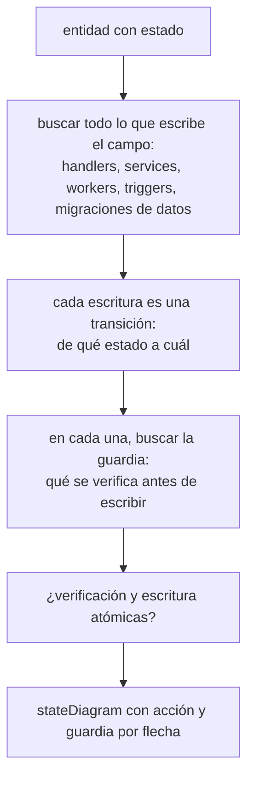
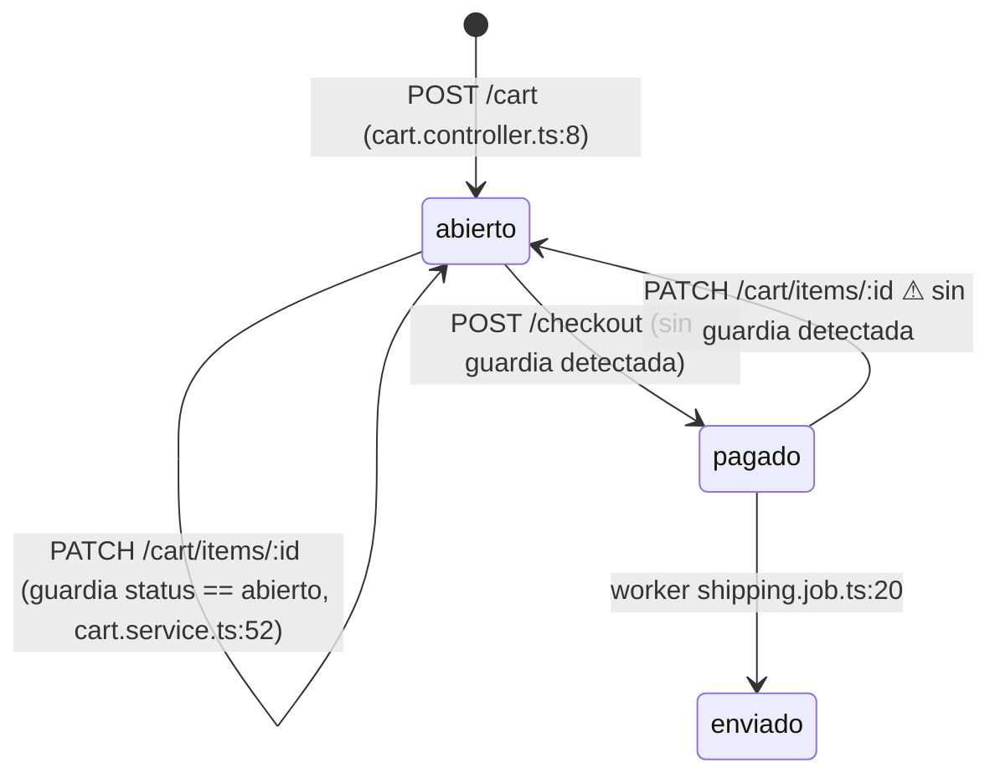
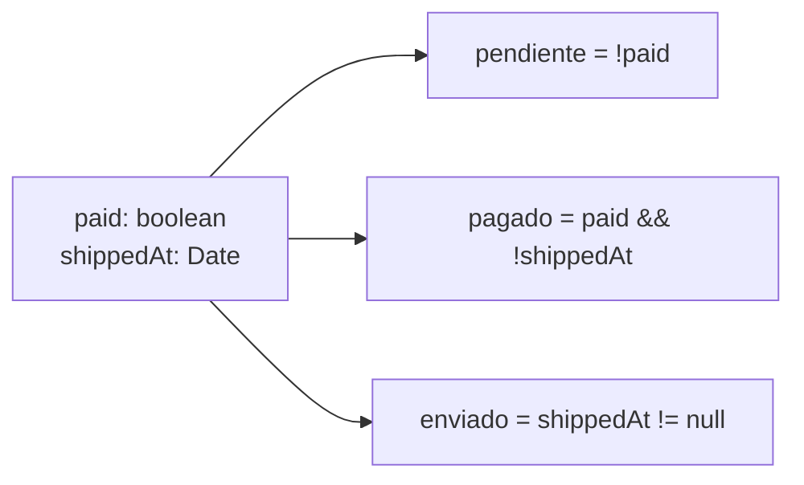

# Máquinas de estado (A9)

La lógica de negocio se rompe en las transiciones: una acción que corre en un estado en el que no debería (editar un carrito pagado, cancelar un pedido enviado, reusar un cupón consumido). Para verlas hay que dibujar lo que el código **hace**, no lo que el dominio supone. Esta referencia dice cómo.

## Qué entidades

Toda entidad con estado mutable: tiene un campo que cambia a lo largo de su vida y del que depende qué se puede hacer con ella. Se buscan:

| Señal | Ejemplos |
|---|---|
| Enum o string de estado | `status`, `state`, `stage`, `phase`, `step` |
| Booleanos de ciclo de vida | `paid`, `shipped`, `verified`, `active`, `locked`, `deleted`, `approved` |
| Timestamps de evento | `paidAt`, `cancelledAt`, `verifiedAt`, `deletedAt` (soft delete) |
| Contadores con tope | `attempts`, `uses`, `remaining`, `balance`, `stock` |
| Flujos de varios pasos | wizard de registro, checkout, selector de rol, 2FA |

Las búsquedas por ecosistema (enums del ORM, máquinas de estado declaradas con XState o `aasm`) están en [detection.md](detection.md#estado-y-transiciones).

## Método

1. **Todas las escrituras del campo.** Asignaciones directas, `update`/`save` con el campo, queries crudas, triggers de base, workers y jobs. Cada lugar es un escritor.
2. **Cada escritura es una transición.** El estado de origen sale de la guardia (si chequea `status === 'abierto'`, el origen es `abierto`); si no hay guardia, el origen es **cualquier estado**, y se dibuja una flecha desde cada estado.
3. **La guardia**: qué se verifica antes de escribir, con `archivo:línea`. Si no hay, `sin guardia detectada`.
4. **Atomicidad**: si la verificación y la escritura están en la misma transacción, con lock, o con un update condicional (`UPDATE … WHERE status = 'abierto'`). Si no, dos requests concurrentes pasan la guardia.
5. **Mutaciones de hijos**: editar ítems de un carrito es una transición del carrito aunque escriba otra tabla. Se dibuja como un lazo sobre el estado del padre, con su guardia.

## Forma

- Cada flecha: la acción (endpoint, job, trigger) con `archivo:línea`, y la guardia o `sin guardia detectada`.
- Las flechas `⚠` no se inventan: aparecen porque un escritor no mira el estado. Son las que después alimentan la cadena de lógica de negocio.
- Debajo del diagrama, una tabla por transición con la columna **Atómica** (sí, con qué; o no).

## Estado implícito

Cuando el estado no es un enum, se deriva de lo que se escribe:

- Los estados son las combinaciones que el código distingue en sus `if`. No se inventan combinaciones que el código no mira.
- Si dos escritores tocan el mismo campo con guardias distintas, van las dos flechas.
- Si el estado vive en varias tablas o servicios (un pedido en la API y su envío en un worker), un solo diagrama con los dos escritores, y se dice dónde vive cada parte.

## Recursos consumibles

Tabla aparte, porque el fallo típico no es una flecha sino un límite que se pasa:

| Recurso | Dónde se verifica | Dónde se consume | Atómico |
|---|---|---|---|
| cupón de un uso | `coupons.service.ts:30` | `coupons.service.ts:41` | no: lee, verifica y después escribe |
| saldo | `wallet.service.ts:12` | `wallet.service.ts:12` | sí: `UPDATE … SET balance = balance - ? WHERE balance >= ?` |

## Valores que vienen del cliente

Tabla de valores que el back usa para calcular y toma del request en vez de recalcularlos: precio, cantidad, descuento, total, moneda, rol, plan. Con `archivo:línea` y si se validan (rango, signo, tope).
