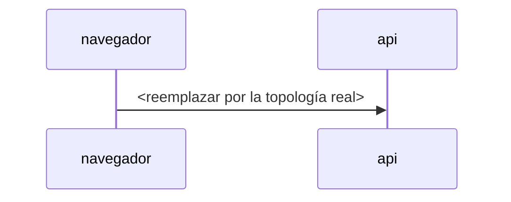

# ARCHITECTURE: <proyecto>

<!-- Lo escribe la skill recon. Qué va en cada sección: skills/recon/references/architecture.md.
Solo hechos con archivo:línea. Lo que no está: "no detectada" (código) o "no encontrada en el repo" (infra, config, servicios).
Una sección que no aplica: "no aplica: <por qué>". Sin juicios ni severidad: eso va en LEADS.md. -->

Fecha: AAAA-MM-DD · Commit: `<sha>` · Pistas: [LEADS.md](LEADS.md) · Inventario completo: [inventory.csv](inventory.csv)

## A1 Stack

| App | Ruta | Rol | Lenguaje | Framework | Renderizado | Entrypoint |
|---|---|---|---|---|---|---|

## A2 Inventario de versiones

| Capa | Pieza | Ecosistema | Versión resuelta | Declarada | Fuente `archivo:línea` | Directa/transitiva | `purl` |
|---|---|---|---|---|---|---|---|

Transitivas por ecosistema: <conteo>, completas en `inventory.csv`.

## A3 Datos

Motores:

ORM y forma de uso (query builder / crudo parametrizado / crudo interpolado / filtros con objetos del request):

Contraseñas (algoritmo, parámetros, `archivo:línea` del hash y de la comparación):

| Modelo | Campos sensibles | Largo de columnas validadas |
|---|---|---|

Multi-tenancy (frontera, cómo se aplica, de dónde sale el tenant):

## A4 Topología

Orígenes y dominios:

Cadena de proxies, CDN y caches (producto, versión, downgrade HTTP/2, ruteo por `Host`, reglas de cache):

Servicios internos y puertos alcanzables desde el back:

## A5 Endpoints

| Método | Ruta | Handler `archivo:línea` | Auth | Autorización | Params con id | `Content-Type` aceptado | Campos del body |
|---|---|---|---|---|---|---|---|

WebSockets, GraphQL, server actions, webhooks entrantes, versiones viejas de la API:

## A6 Autenticación y sesión

<!-- Un diagrama de secuencia por flujo que exista: registro, login, 2FA, refresh, logout, reset, cambio de contraseña, cambio de email, verificación, "recordarme", vinculación de cuentas. -->

| Pregunta | Respuesta |
|---|---|
| ¿dónde vive el token en el front? | |
| ¿formato de la cookie de sesión y de "recordarme"? | |
| ¿dónde se guarda la sesión? | |
| ¿se regenera el id al loguear? | |
| ¿el logout la invalida en el server? | |
| ¿expira? | |
| ¿cambiar contraseña invalida las otras sesiones? | |
| ¿el login responde distinto si el usuario existe? | |
| ¿de dónde sale el usuario en reset, 2FA y cambio de contraseña? | |

## A7 Políticas

| Política | Valor | Dónde se define |
|---|---|---|
| CORS | | |
| CSP | | |
| Framing | | |
| Parsers de body | | |
| Límites | | |
| Rate limits | | |
| Cookies | | |
| Method override | | |
| Cache | | |
| Headers de seguridad | | |

## A8 Headers en los que se confía

| Header | Dónde se lee | Para qué | ¿Se valida? |
|---|---|---|---|

IP del cliente (qué valor termina siendo, con qué `trust proxy`):

URL base de los mails:

## A9 Máquinas de estado

<!-- Un stateDiagram por entidad con estado mutable: acción archivo:línea y guardia (o "sin guardia detectada") en cada flecha. Método: skills/recon/references/state-machines.md -->

| Recurso consumible | Dónde se verifica | Dónde se consume | Atómico |
|---|---|---|---|

| Valor que viene del cliente | Dónde se usa | ¿Se valida? |
|---|---|---|

## A10 Mapa de superficies

<!-- Una tabla por categoría con hallazgos; las categorías sin hallazgos van al final con la búsqueda hecha. -->

| Categoría | `archivo:línea` | Qué hace |
|---|---|---|

## A11 Exposición

| Qué | Hecho | Fuente |
|---|---|---|

## A12 Cadena de suministro e infra en el repo

| Qué | Hecho | Fuente |
|---|---|---|

## A13 Integraciones

| Tercero | Para qué | Qué datos le salen | Credencial y dónde está | Webhook entrante: firma y replay |
|---|---|---|---|---|

Scripts de terceros en el front (origen, SRI):
