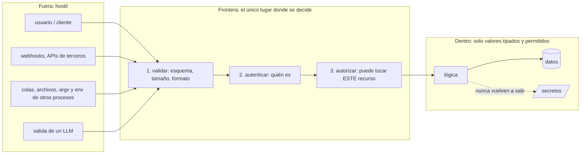

# Seguridad

## Qué es

Seguridad como restricción sobre cada línea que toca datos de afuera, identidad, secretos o sistemas externos. No es una fase ni un checklist al final: es la pregunta "¿qué pasa si esto viene de alguien que me quiere romper?" hecha en el momento de escribir o revisar.

Parte de **zero trust**, sin excepciones:

- **Toda entrada es hostil** hasta que se valida en la frontera. La confianza la define quién *escribió* el valor, no por qué canal llegó: el `argv` de otro proceso, un nombre de archivo en un volumen compartido, un mensaje de una cola o la salida de un LLM son tan hostiles como un formulario.
- **Todo permiso se verifica en cada acceso.** Autenticar dice quién es; autorizar dice si puede tocar *este* recurso. Lo segundo no se asume por la ruta, el rol ni el frontend.
- **Todo dato sensible se asume expuesto** si no se demuestra lo contrario: en logs, en errores, en respuestas, en backups, en el contexto de un modelo.
- **La probabilidad la decide quien ataca.** No se baja severidad por "poco probable", "es interno" o "nadie lo va a intentar". Los scanners automáticos lo intentan.

Esta skill es agnóstica al lenguaje y al framework. Lo específico de web (CORS, cookies, CSP, headers de respuesta, CSRF) tiene el detalle en `mindstack:web-security`; acá se nombra solo lo que aplica a cualquier sistema.

## Cuándo usarla

- Al escribir o revisar cualquier cosa que reciba datos de afuera: endpoints, formularios, archivos, mensajes, webhooks, CLI, variables de entorno.
- Al implementar o tocar autenticación, sesiones, tokens, roles o permisos.
- Al guardar, transmitir o loguear datos personales, de pago o credenciales.
- Al integrar un servicio externo, un LLM o una dependencia nueva.
- Al escribir una operación con efectos que se puede reintentar: cobros, envíos, borrados, escrituras.
- Como `security-auditor` en `/mindstack:orchestrate (fase review)`.

## Frontera de confianza

Antes de endurecer, cinco minutos pensando como atacante. Si no podés nombrar las fronteras de una feature, no estás listo para asegurarla.



1. **Mapeá las fronteras.** Por dónde entra cada dato que no escribiste vos. Cada una es superficie de ataque.
2. **Nombrá los activos.** Qué vale la pena robar o romper: credenciales, datos personales, plata, acciones de admin.
3. **Pasá STRIDE por cada frontera**, como lente rápido:

| Amenaza | Pregunta | Mitigación típica |
|---|---|---|
| Suplantación | ¿alguien puede hacerse pasar por un usuario o servicio? | autenticación, verificación de firma |
| Manipulación | ¿se puede alterar un dato en tránsito o en reposo? | integridad, queries parametrizadas, transporte cifrado |
| Repudio | ¿se puede negar una acción después? | log de eventos de seguridad |
| Fuga de información | ¿puede salir un dato que no debería? | cifrado, allowlist de campos, errores genéricos |
| Denegación de servicio | ¿se puede saturar? | rate limiting, tope de tamaño, timeouts |
| Elevación de privilegio | ¿puede un usuario ganar derechos que no tiene? | autorización por recurso, mínimo privilegio |

4. **Escribí casos de abuso al lado de los casos de uso.** "¿Cómo lo rompería?" es el primer test de cada feature.

## Las seis superficies

Las reglas están acá; una implementación concreta de cada una está en [references/patterns.md](references/patterns.md). Abrí la sección cuando llegás a ese código, no antes.

### 1. Entrada

- Validá en la frontera con un esquema: forma permitida, longitudes, enums, formatos. Rechazá con error estructurado; lo que sigue usa solo el valor parseado y tipado, nunca el crudo.
- Allowlist, no denylist. Lo que no está permitido explícitamente, se rechaza.
- Nunca construyas SQL, NoSQL, comandos de shell, paths ni HTML concatenando entrada. Parametrizá; codificá a la salida con el escape del framework.
- Archivos: allowlist de tipo, tope de tamaño, verificación de contenido (magic bytes) cuando importa. La extensión no prueba nada.
- URLs que el usuario influye (webhooks, "importar desde URL", previews): allowlist de esquema y host, resolver **todas** las direcciones y rechazar cualquier rango privado o reservado (loopback, link-local, metadata de la nube), sin redirecciones. Quedan carreras DNS: para superficies de alto riesgo, fijá la IP resuelta.
- Borrado, movimiento o sobreescritura con un path derivado de datos: la validez de forma no es autorización. Exigí las tres: destino resuelto (symlinks incluidos) bajo una raíz permitida, al menos un nivel por debajo de esa raíz, y evidencia de propiedad leída antes de operar. Si se rechaza, logueá y pará; nunca caer a un path por defecto más amplio.
- La salida de un LLM es entrada hostil: nunca a `eval`, una query, un shell, el DOM ni un path. Parseá contra un esquema, validá, codificá. El system prompt no es una frontera: los permisos se aplican en código.

Patrones: [Inyección](references/patterns.md#inyección), [Validación por esquema](references/patterns.md#validación-por-esquema), [Archivos](references/patterns.md#archivos-subidos), [SSRF](references/patterns.md#ssrf-fetch-de-urls-ajenas), [Paths derivados](references/patterns.md#operaciones-destructivas-sobre-paths-derivados), [Salida de LLM](references/patterns.md#salida-de-un-llm).

### 2. Identidad y permisos

- Autenticación en cada endpoint protegido; autorización en cada acceso a un recurso: el usuario autenticado tiene que ser dueño o tener permiso sobre *ese* id. Un id en la URL que muestra lo de otro usuario (IDOR) es el fallo más común y el más fácil de probar.
- Contraseñas con bcrypt (≥ 12 rondas), scrypt o argon2. Nunca en texto plano, nunca con un hash rápido.
- Tokens: firma, expiración y emisor verificados en cada uso. Tokens de reset: de un solo uso, con vida corta.
- Rate limiting general en la API y estricto en autenticación (del orden de 10 intentos por 15 minutos). Con más de una instancia, un contador en memoria vale `max × instancias` o nunca dispara en serverless: contador en un store compartido.
- Mínimo privilegio para claves de API, roles y cuentas de servicio.
- Cambiar un flujo de auth, agregar un rol o elevar permisos se pregunta a la persona antes de hacerlo.

Patrones: [Autenticación](references/patterns.md#autenticación), [Control de acceso](references/patterns.md#control-de-acceso-idor), [Rate limiting](references/patterns.md#rate-limiting).

### 3. Secretos

- Vienen del entorno o de un gestor de secretos. Nunca del código, de un test, de un fixture ni de un commit.
- `.env.example` con placeholders se commitea; `.env*` reales y material de claves van en `.gitignore`. Antes de commitear, grep al diff staged.
- **Un secreto que llegó a un remoto está comprometido desde ese momento.** Primero rotar, después limpiar historia. Borrar la línea no alcanza.

Patrón: [Secretos](references/patterns.md#secretos).

### 4. Datos sensibles

- Antes de guardar un dato personal: ¿hace falta? El dato que no se guarda no se filtra ni se tiene que borrar. Clasificá cada campo al agregarlo (no personal, personal, sensible) y tratalo según la clase.
- Nunca en logs: contraseñas, tokens, números de tarjeta completos, datos de salud. Nunca en errores al usuario: stack traces, queries, rutas internas. Error genérico afuera, detalle en el log del servidor.
- Quitá campos sensibles (`passwordHash`, tokens de reset) de cualquier respuesta, por allowlist de campos, no por denylist.
- Cifrado en tránsito siempre; en reposo cuando la clase lo exige. Backups cifrados.
- Retención definida y un camino de borrado que funcione de verdad: incluyendo backups, caches, índices y copias en analytics. "Borrar mi cuenta" que solo cambia un flag es un hallazgo.
- Mandar datos personales a un vendor (analytics, ads, LLM) es compartir: requiere consentimiento y acuerdo de procesamiento.
- Guardar una categoría nueva de dato sensible se pregunta a la persona antes.

Patrones: [Exposición de datos](references/patterns.md#exposición-de-datos), [Clasificación](references/patterns.md#clasificación-de-datos).

### 5. Dependencias

- Una dependencia nueva es código ajeno corriendo con tus permisos. Antes de agregarla: ¿hace falta? ¿quién la mantiene, cuándo fue el último release, cuántas transitivas trae, el nombre es el correcto o un typosquat?
- Versión pineada en el lockfile; instalación reproducible desde ese lockfile en CI; un solo lockfile por raíz. Scripts de instalación bloqueados hasta revisarlos.
- La auditoría nativa del gestor corre antes de cada release. Crítica y alta se triagean por **alcanzabilidad** (¿el código vulnerable se ejecuta en runtime, build, test o deploy?) y disponibilidad de fix. Nunca una remediación forzada automática. Cada diferimiento con motivo y fecha de revisión.
- La auditoría solo conoce advisories publicados: no detecta un paquete recién malicioso. Revisá el diff del lockfile junto con la dependencia nueva.

Patrón: [Triaje de dependencias](references/patterns.md#triaje-de-auditoría-de-dependencias).

### 6. Concurrencia e idempotencia

- Toda operación con efecto (cobrar, enviar, crear, borrar) que se puede reintentar necesita una clave de idempotencia o una verificación de estado antes de repetir. Un timeout después de un cobro hecho que reintenta y cobra dos veces es pérdida de plata: crítica.
- Leer-decidir-escribir sin transacción ni lock es una carrera: dos requests simultáneos pasan la verificación y los dos escriben. Verificá y escribí en la misma transacción, o con una condición atómica.
- Verificar un path o un permiso y después operar sobre el *nombre* deja una ventana (check/use). Donde un proceso ajeno puede cambiar el estado entre medio, operá sobre el descriptor o garantizá que no cambie.

Patrón: [Idempotencia y carreras](references/patterns.md#idempotencia-y-carreras).

## Formato de salida: REVIEW-security.md

Cuando esta skill audita (como `security-auditor` o a pedido), el resultado es un solo archivo con **solo hallazgos**. Sin elogios, sin "considerá", sin nits de estilo. Tabla vacía = nada que objetar.

```markdown
| ID | Severidad | Archivo:línea | Qué falla, con qué entrada | CB | Fix en una línea |
|---|---|---|---|---|---|
| SEC-1 | crítica | `pagos.service.ts:42` | reintento tras timeout vuelve a cobrar; payload `{orden: 7}` enviado dos veces | CB-3 | clave de idempotencia por orden antes de llamar al gateway |
| SEC-2 | alta | `tareas.controller.ts:18` | `GET /tareas/:id` devuelve la tarea de otro usuario; `id=9` con sesión del usuario 2 | — | verificar `tarea.ownerId === sesion.userId` antes de responder |
```

- **ID**: `SEC-n`, correlativo en la ronda.
- **Severidad**: `crítica` (pérdida de datos, plata o acceso) · `alta` (explotable por un usuario autenticado) · `media` (requiere condiciones) · `baja` (defensa en profundidad). Crítica y alta bloquean el PR.
- **Qué falla, con qué entrada**: la entrada hostil concreta: el payload, el id, el header, el nombre de archivo. Sin entrada concreta no es hallazgo, va a "A verificar".
- **CB**: el caso borde del SPEC que lo cubre, si existe.
- **Fix en una línea**: qué cambiar, no una disertación.
- Máximo 15 hallazgos. Lo que parece fallo y no se confirmó va bajo `## A verificar`, una línea cada uno; no cuenta ni bloquea.
- Termina con el conteo por severidad.

La plantilla con frontmatter está en `skills/workflow/templates/REVIEW.md`.

## En el flujo mindstack

- La usa el agente `security-auditor` en `/mindstack:orchestrate (fase review) <slug>`, en el mismo turno y en paralelo con `qa` y `code-reviewer`. Cada uno escribe solo su archivo; el hook bloquea los demás.
- Un hallazgo fuera del alcance del SPEC (ya estaba roto antes del cambio) va igual, marcado "preexistente" en *Qué falla*. Seguridad vieja no se ignora por vieja.
- Crítica y alta no pueden quedar como deuda: se corrigen o se discuten con la persona. Media y baja pueden ser deuda con vencimiento.
- El corrector cierra cada hallazgo en `/mindstack:orchestrate (fase fix)`: corregido, deuda o rechazado con motivo, en `CHANGELOG › Revisión`. El auditor no edita código.
- La revisión general (lógica, legibilidad, arquitectura) la hace `mindstack:code-review`; acá solo seguridad.

## Racionalizaciones comunes

| Racionalización | Realidad |
|---|---|
| "Es una herramienta interna" | Las internas también se comprometen. El atacante elige el eslabón más débil. |
| "Lo aseguramos después" | Endurecer después cuesta diez veces más. Se hace ahora. |
| "Nadie va a intentar explotar esto" | Los scanners automáticos lo van a encontrar. Oscuridad no es seguridad. |
| "El framework se encarga" | El framework da herramientas, no garantías. Hay que usarlas bien. |
| "Es un prototipo" | Los prototipos llegan a producción. |
| "Es poco probable" | La probabilidad la decide quien ataca. No baja la severidad. |
| "Viene de un proceso nuestro, es confiable" | La confianza es de quien escribió el valor, no del canal. Un `argv` ajeno es un formulario. |
| "Es solo texto del modelo" | Ese texto puede ser SQL, un script o un comando. Entrada hostil. |
| "La auditoría pasó, la dependencia es segura" | Solo conoce advisories publicados. No ve un paquete recién malicioso ni un script de instalación sin revisar. |
| "Guardalo, capaz lo usamos después" | Dato que no tenés no se filtra, no se subpoena, no hay que borrarlo. "Capaz" es alcance de brecha. |
| "Las bajas de datos las hacemos a mano" | A mano se olvidan backups, caches y analytics. Si el esquema no encuentra el dato, no podés borrarlo. |
| "Un reintento no hace daño" | Un reintento sin idempotencia cobra dos veces. |

## Señales de alarma

- Entrada que llega a una query, un comando, un path o HTML sin pasar por un esquema.
- Un handler protegido solo por "esta ruta no la conoce nadie" o por una verificación en el cliente.
- Un id en la URL o el body sin verificación de que el usuario puede tocar ese recurso.
- Borrado, movimiento o sobreescritura cuyo destino viene de un payload, una config o el `argv` de otro proceso, guardado solo por una verificación de forma.
- Secretos en el código, en tests, en fixtures o en el historial.
- Stack traces, queries o rutas internas en respuestas de error.
- Contraseñas, tokens o datos de tarjeta en logs.
- Rate limiting ausente en autenticación, o en memoria con más de una instancia.
- El servidor hace fetch de una URL del usuario sin allowlist.
- Salida de un LLM a `eval`, una query, un shell o el DOM; secretos o datos de otros tenants en el contexto del modelo.
- Dependencia nueva sin justificación, sin pinear, con scripts de instalación aprobados a ciegas, o más de un lockfile en la raíz.
- Operación con efecto que se reintenta sin clave de idempotencia; leer-decidir-escribir sin transacción.
- Dato personal sin propósito, sin retención ni camino de borrado; "borrar cuenta" que solo cambia un flag.

## Verificación

Antes de dar por cerrado código con impacto en seguridad, y como pasada final del auditor:

- [ ] Toda entrada externa validada por esquema en la frontera; lo de adentro usa solo el valor tipado
- [ ] Ninguna query, comando, path ni HTML construido por concatenación de entrada
- [ ] Autenticación y autorización por recurso en cada endpoint protegido; IDOR probado con un id ajeno
- [ ] Sin secretos en código, tests, fixtures ni historial; si uno llegó a un remoto, está rotado
- [ ] Errores genéricos hacia afuera; nada sensible en logs ni respuestas
- [ ] Rate limiting en autenticación, con store compartido si hay más de una instancia
- [ ] Fetch de URLs ajenas contra allowlist y sin rangos privados
- [ ] Operaciones destructivas sobre paths: symlinks resueltos, raíz permitida, profundidad mínima, propiedad verificada antes
- [ ] Salida de LLM parseada y validada antes de cualquier uso
- [ ] Auditoría de dependencias sin críticas ni altas alcanzables sin mitigar; lockfile único y reproducible; scripts de instalación revisados
- [ ] Operaciones con efecto idempotentes ante reintento; verificaciones y escrituras en la misma transacción
- [ ] Datos personales clasificados, con propósito, retención y borrado real (backups, caches, índices)
- [ ] Si es web: headers, cookies, CORS y CSP verificados con `mindstack:web-security`
- [ ] Si se auditó: `REVIEW-security.md` con solo hallazgos `SEC-n`, entrada concreta y fix por fila, máximo 15, conteo por severidad al final

La checklist completa por superficie está en [references/checklist.md](references/checklist.md).
