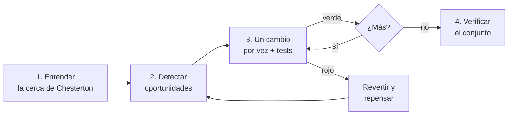

# Simplificación

## Qué es

Reducir la complejidad del código preservando exactamente lo que hace. La meta no es menos líneas: es código que se lee, entiende, modifica y depura más rápido. Cada simplificación tiene que pasar una prueba simple: "¿alguien nuevo en el equipo entiende esto más rápido que el original?"

Los ejemplos de abajo están en TypeScript y Python y son ilustrativos. Los patrones (anidamiento, nombres, duplicación, abstracciones sin uso) son los mismos en cualquier lenguaje.

## Cuándo usarla

- Una funcionalidad ya anda y los tests pasan, pero la implementación quedó más pesada de lo necesario
- Una revisión marcó problemas de legibilidad o complejidad
- Encontrás lógica muy anidada, funciones largas o nombres que no dicen nada
- Código escrito bajo presión de tiempo que ahora hay que mantener
- Lógica relacionada desparramada en varios archivos que conviene consolidar
- Después de un merge que trajo duplicación o inconsistencia

**Cuándo no:**

- El código ya está limpio: no simplifiques por simplificar
- Todavía no entendés qué hace: primero comprender, después tocar
- Es código crítico en rendimiento y la versión "más simple" es medible más lenta
- Vas a reescribir el módulo entero: simplificar código descartable es tiempo perdido

## Los cinco principios

### 1. Preservar el comportamiento exacto

No cambiás lo que hace el código, solo cómo lo expresa. Entradas, salidas, efectos secundarios, errores y casos borde quedan idénticos. Si no estás seguro de que una simplificación preserva el comportamiento, no la hagas.

```
ANTES DE CADA CAMBIO:
→ ¿Produce la misma salida para toda entrada?
→ ¿Mantiene el mismo comportamiento ante errores?
→ ¿Preserva los mismos efectos secundarios y en el mismo orden?
→ ¿Pasan todos los tests existentes sin modificarlos?
```

### 2. Seguir las convenciones del proyecto

Simplificar es hacer el código más consistente con el repo, no imponer preferencias externas. Antes de tocar:

```
1. Leé CLAUDE.md y las convenciones del proyecto
2. Mirá cómo el código vecino resuelve patrones parecidos
3. Respetá el estilo del proyecto en:
   - orden de imports y sistema de módulos
   - forma de declarar funciones
   - nombres
   - manejo de errores
   - profundidad de las anotaciones de tipos
```

Una simplificación que rompe la consistencia del proyecto no es simplificación: es ruido.

### 3. Claridad antes que ingenio

El código explícito le gana al compacto cuando el compacto exige una pausa mental para leerlo.

```typescript
// CONFUSO: cadena de ternarios
const label = isNew ? 'Nuevo' : isUpdated ? 'Actualizado' : isArchived ? 'Archivado' : 'Activo';

// CLARO: mapeo legible
function getStatusLabel(item: Item): string {
  if (item.isNew) return 'Nuevo';
  if (item.isUpdated) return 'Actualizado';
  if (item.isArchived) return 'Archivado';
  return 'Activo';
}
```

```typescript
// CONFUSO: reduce con lógica inline
const result = items.reduce((acc, item) => ({
  ...acc,
  [item.id]: { ...acc[item.id], count: (acc[item.id]?.count ?? 0) + 1 }
}), {});

// CLARO: paso intermedio con nombre
const countById = new Map<string, number>();
for (const item of items) {
  countById.set(item.id, (countById.get(item.id) ?? 0) + 1);
}
```

### 4. Mantener el equilibrio

Simplificar tiene su modo de falla: sobre-simplificar. Trampas a vigilar:

- **Inlinear de más**: sacar un helper que le daba nombre a un concepto hace más difícil leer el punto de llamada
- **Mezclar lógica no relacionada**: dos funciones simples fusionadas en una compleja no es más simple
- **Borrar abstracciones "innecesarias"**: algunas existen por extensibilidad o testeabilidad, no por capricho
- **Optimizar el conteo de líneas**: menos líneas no es la meta; entender más rápido sí

### 5. Acotar a lo que cambió

Por defecto se simplifica el código recién modificado. Nada de refactors de pasada en código ajeno a la tarea salvo que te pidan ampliar el alcance. Una simplificación sin alcance ensucia el diff y arriesga regresiones donde nadie estaba mirando.

## El proceso



### Paso 1: Entender antes de tocar (la cerca de Chesterton)

Antes de cambiar o borrar algo, entendé por qué existe. Si ves una cerca cruzando el camino y no sabés por qué está, no la tires: primero averiguá la razón, después decidí si todavía aplica.

```
ANTES DE SIMPLIFICAR, RESPONDÉ:
- ¿Cuál es la responsabilidad de este código?
- ¿Quién lo llama? ¿A qué llama?
- ¿Cuáles son los casos borde y los caminos de error?
- ¿Hay tests que definan el comportamiento esperado?
- ¿Por qué pudo haberse escrito así? (¿rendimiento? ¿límite de la plataforma? ¿historia?)
- git blame: ¿cuál fue el contexto original?
```

Si no podés responder esto, no estás listo para simplificar. Leé más contexto.

### Paso 2: Detectar oportunidades

Buscá estos patrones; cada uno es una señal concreta, no una sensación.

**Complejidad estructural:**

| Patrón | Señal | Simplificación |
|---|---|---|
| Anidamiento profundo (3+ niveles) | El flujo de control no se sigue | Guard clauses o extraer a funciones |
| Funciones largas (50+ líneas) | Varias responsabilidades | Partir en funciones chicas con nombres descriptivos |
| Ternarios anidados | Hay que mantener una pila mental para leerlos | if/else, switch o tabla de búsqueda |
| Flags booleanos como parámetros | `doThing(true, false, true)` | Objeto de opciones o funciones separadas |
| Condicionales repetidos | El mismo `if` en varios lados | Extraer a un predicado con buen nombre |

**Nombres y legibilidad:**

| Patrón | Señal | Simplificación |
|---|---|---|
| Nombres genéricos | `data`, `result`, `temp`, `val`, `item` | Renombrar por el contenido: `userProfile`, `validationErrors` |
| Abreviaturas | `usr`, `cfg`, `btn`, `evt` | Palabra completa salvo abreviatura universal (`id`, `url`, `api`) |
| Nombres engañosos | Una función `get` que además muta estado | Renombrar según lo que hace de verdad |
| Comentarios que explican el "qué" | `// incrementa el contador` arriba de `count++` | Borrarlos: el código ya lo dice |
| Comentarios que explican el "por qué" | `// Reintenta porque la API falla bajo carga` | Dejarlos: cargan intención que el código no expresa |

**Redundancia:**

| Patrón | Señal | Simplificación |
|---|---|---|
| Lógica duplicada | Las mismas 5+ líneas en varios lugares | Extraer a una función compartida |
| Código muerto | Ramas inalcanzables, variables sin uso, bloques comentados | Borrar (después de confirmar que está muerto) |
| Abstracciones innecesarias | Wrapper que no agrega nada | Inlinear y llamar a la función de abajo |
| Patrones sobre-diseñados | Factory de factories, strategy con una sola estrategia | Reemplazar por el camino directo |
| Aserciones de tipo redundantes | Castear a un tipo que ya se infiere | Sacar la aserción |

### Paso 3: Aplicar los cambios de a uno

Una simplificación por vez. Tests después de cada una. **El refactor va separado del feature o del fix.** Un PR que refactoriza y agrega una funcionalidad son dos PRs: partilo.

```
POR CADA SIMPLIFICACIÓN:
1. Hacé el cambio
2. Corré la suite
3. Verde → commit (o seguí con la próxima)
4. Rojo → revertí y repensá
```

No agrupes varias simplificaciones en un cambio sin testear: si algo se rompe, tenés que saber cuál fue.

**La regla de las 500:** si un refactor toca más de 500 líneas, invertí en automatización (codemods, scripts, transformaciones de AST) en vez de editar a mano. A esa escala la edición manual es propensa a errores y agotadora de revisar.

### Paso 4: Verificar el conjunto

Terminadas las simplificaciones, mirá el todo:

```
COMPARÁ ANTES Y DESPUÉS:
- ¿La versión simplificada es de verdad más fácil de entender?
- ¿Metiste algún patrón nuevo inconsistente con el repo?
- ¿El diff está limpio y se puede revisar?
- ¿Un compañero lo aprobaría?
```

Si lo "simplificado" es más difícil de entender o revisar, revertí. No toda simplificación sale bien.

## Ejemplos de patrones frecuentes

```typescript
// Wrapper async innecesario
async function getUser(id: string): Promise<User> { return await userService.findById(id); }
function getUser(id: string): Promise<User> { return userService.findById(id); }

// Asignación condicional verbosa
let displayName: string;
if (user.nickname) { displayName = user.nickname; } else { displayName = user.fullName; }
const displayName = user.nickname || user.fullName;

// Construcción manual de un array
const activeUsers: User[] = [];
for (const user of users) { if (user.isActive) activeUsers.push(user); }
const activeUsers = users.filter((user) => user.isActive);

// Booleano redundante
function isValid(input: string): boolean {
  if (input.length > 0 && input.length < 100) { return true; }
  return false;
}
function isValid(input: string): boolean { return input.length > 0 && input.length < 100; }
```

```python
# Diccionario construido a mano
result = {}
for item in items:
    result[item.id] = item.name
result = {item.id: item.name for item in items}

# Condicionales anidados → retorno temprano
def process(data):
    if data is None:
        raise TypeError("Data is None")
    if not data.is_valid():
        raise ValueError("Invalid data")
    if not data.has_permission():
        raise PermissionError("No permission")
    return do_work(data)
```

Prop drilling, inyección de dependencias, capas de indirección: son decisiones de diseño, no simplificaciones mecánicas. Marcalo como observación; no lo refactorices de pasada.

## En el flujo mindstack

Quién la carga: el agente `developer` cuando el `PLAN.md` de la tarea tiene `tipo: refactor`; y el agente `fixer` al cerrar hallazgos de legibilidad del `code-reviewer` en `/mindstack:orchestrate (fase fix)`.

- **Un refactor es una tarea propia, con su SPEC.** En una tarea normal, un refactor grande que aparece en el camino va a `CHANGELOG.md › Deuda técnica`, con vencimiento; no se hace de paso.
- **Sin cambiar comportamiento.** `qa` corre la suite antes y después del refactor. Cualquier diferencia es un bug del refactor, no un test a ajustar.
- **Un hallazgo de legibilidad** se cierra como fix (esta skill), deuda o rechazo con motivo, en `CHANGELOG.md › Revisión`. Lo que no está en el hallazgo no se toca.
- Para los tests que protegen cada paso, `mindstack:tdd`. Para el hallazgo que lo origina, `mindstack:code-review`. Para la rama y los commits por paso, `mindstack:git`.

## Racionalizaciones comunes

| Racionalización | Realidad |
|---|---|
| "Anda, no hay que tocarlo" | Código que anda pero no se lee va a ser difícil de arreglar cuando se rompa. Simplificar ahora ahorra tiempo en cada cambio futuro. |
| "Menos líneas siempre es más simple" | Un ternario anidado de una línea no es más simple que un if/else de cinco. Simple es lo que se entiende rápido, no lo corto. |
| "Ya que estoy, simplifico esto otro" | Sin alcance el diff se ensucia y arriesgás regresiones en código que no pensabas tocar. Quedate en la tarea. |
| "Los tipos lo documentan solos" | Los tipos documentan estructura, no intención. Una función bien nombrada explica el *por qué* mejor de lo que una firma explica el *qué*. |
| "Esta abstracción puede servir después" | No preserves abstracciones especulativas. Si no se usa ahora, es complejidad sin valor. Sacala y volvé a agregarla cuando haga falta. |
| "El autor original tendría una razón" | Puede ser. Mirá git blame: la cerca de Chesterton. Pero la complejidad acumulada muchas veces no tiene razón: es el residuo de iterar bajo presión. |
| "Refactorizo mientras agrego el feature" | Separá el refactor del feature. Un cambio mezclado es más difícil de revisar, revertir y entender en el historial. |

## Señales de alarma

- Una simplificación que necesita modificar tests para pasar (casi seguro cambiaste comportamiento)
- Código "simplificado" más largo y más difícil de seguir que el original
- Renombrar por gusto propio en vez de por las convenciones del proyecto
- Sacar manejo de errores porque "queda más limpio"
- Simplificar código que no entendés del todo
- Agrupar muchas simplificaciones en un commit grande imposible de revisar
- Refactorizar fuera del alcance de la tarea sin que lo pidan

## Verificación

Al terminar una pasada de simplificación:

- [ ] Todos los tests existentes pasan sin modificarlos
- [ ] El build pasa sin warnings nuevos
- [ ] Linter y formateador pasan (sin regresiones de estilo)
- [ ] Cada simplificación es un cambio incremental y revisable
- [ ] El diff está limpio: nada ajeno mezclado
- [ ] El código sigue las convenciones del proyecto (contrastado con CLAUDE.md o equivalente)
- [ ] No se sacó ni debilitó manejo de errores
- [ ] No quedó código muerto (imports sin uso, ramas inalcanzables)
- [ ] Un compañero o agente revisor lo aprobaría como mejora neta
