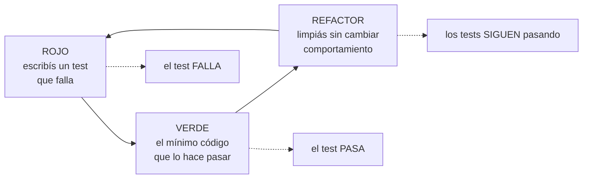
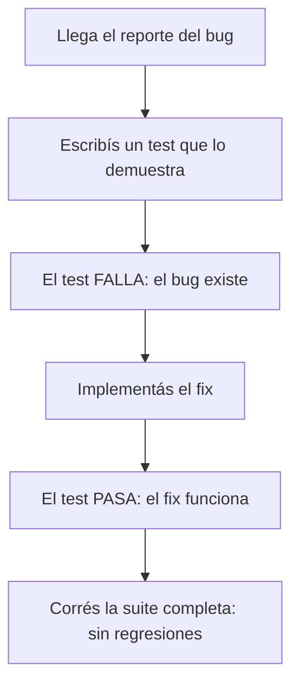

# TDD

## Qué es

Escribís un test que falla antes de escribir el código que lo hace pasar. Para un bug, lo reproducís con un test antes de intentar arreglarlo. Los tests son la prueba: "parece que anda" no es terminado. Un código con buenos tests es la ventaja de un agente; uno sin tests es una deuda que alguien va a pagar a las 3 de la mañana.

Los ejemplos de abajo están en TypeScript y son ilustrativos. El ciclo es el mismo en cualquier lenguaje; el runner, las aserciones y el comando de cobertura los dice la skill del stack (`mindstack:typescript`, etc.).

## Cuándo usarla

- Al implementar lógica o comportamiento nuevo
- Al arreglar un bug (patrón Probalo)
- Al modificar algo que ya funciona
- Al agregar manejo de casos borde
- En cualquier cambio que pueda romper lo que hoy anda

**Cuándo no:** cambios de configuración pura, documentación o contenido estático sin impacto en el comportamiento.

## En el flujo mindstack

- El desarrollador no escribe tests. Los escribe el agente `qa`, que no vio cómo se pensó el código y por eso lo testea sin sesgo.
- `qa` testea contra el `SPEC.md` de la tarea, no contra el código. Si difieren, el test falla y lo dice; no se acomoda el test al código.
- Cada test que cubre un caso borde lo nombra con su id: `it('CB-3: timeout con cobro hecho no reintenta')`. En revisión, `qa` cruza cada `CB-n` del SPEC contra los tests y abre un hallazgo por cada uno sin test o con un test que no lo reproduce.
- Un bug que no es de la tarea no se arregla ni se testea como si fuera correcto: va a `CHANGELOG.md › Observaciones`.

## Primero descubrí el stack

El ciclo es universal; los comandos no. Antes del primer test, averiguá cómo testea *este* repo y usá sus comandos en cada paso rojo, verde y de verificación:

- **Lenguaje y build:** `package.json`, `pom.xml`/`build.gradle`, `pyproject.toml`, `go.mod`, `Cargo.toml`, `Gemfile`, un `Makefile`
- **Wrappers versionados:** `./gradlew`, `./mvnw`, `make test` o un script del repo antes que herramientas globales
- **Framework de tests y configuración:** y cómo se corre un test puntual vs la suite completa
- **Convenciones existentes:** dónde viven los tests, cómo se nombran, qué patrón siguen los vecinos
- **Comandos documentados:** README, CONTRIBUTING y los workflows de CI muestran lo que de verdad gatea el merge

Durante el ciclo corré el comando de test puntual; antes de terminar, la suite completa. Nunca asumas un default como `npm test`: un proyecto Gradle, Cargo o pytest tiene su equivalente.

## El ciclo rojo-verde-refactor



### Paso 1: ROJO, un test que falla

Primero el test. Tiene que fallar. Un test que pasa de entrada no prueba nada.

```typescript
// ROJO: falla porque createTask todavía no existe
describe('TaskService', () => {
  it('crea una tarea con título y estado por defecto', async () => {
    const task = await taskService.createTask({ title: 'Comprar pan' });

    expect(task.id).toBeDefined();
    expect(task.title).toBe('Comprar pan');
    expect(task.status).toBe('pending');
    expect(task.createdAt).toBeInstanceOf(Date);
  });
});
```

### Paso 2: VERDE, hacelo pasar

El mínimo código que hace pasar el test. Sin sobreingeniería:

```typescript
// VERDE: implementación mínima
export async function createTask(input: { title: string }): Promise<Task> {
  const task = {
    id: generateId(),
    title: input.title,
    status: 'pending' as const,
    createdAt: new Date(),
  };
  await db.tasks.insert(task);
  return task;
}
```

### Paso 3: REFACTOR, limpiá

Con los tests en verde, mejorá el código sin cambiar el comportamiento:

- Extraé lógica compartida
- Mejorá nombres
- Sacá duplicación
- Optimizá si hace falta

Corré los tests después de cada paso de refactor.

## Patrón Probalo (bugs)

Cuando llega un bug, **no empieces por arreglarlo.** Empezá por un test que lo reproduzca.



**Ejemplo:**

```typescript
// Bug: "completar una tarea no actualiza completedAt"

// Paso 1: el test de reproducción (tiene que FALLAR)
it('setea completedAt al completar la tarea', async () => {
  const task = await taskService.createTask({ title: 'Test' });
  const completed = await taskService.completeTask(task.id);

  expect(completed.status).toBe('completed');
  expect(completed.completedAt).toBeInstanceOf(Date); // falla → bug confirmado
});

// Paso 2: el fix
export async function completeTask(id: string): Promise<Task> {
  return db.tasks.update(id, {
    status: 'completed',
    completedAt: new Date(), // esto faltaba
  });
}

// Paso 3: el test pasa → bug arreglado, regresión cubierta
```

Si el test de reproducción lo escribe alguien que no conoce el fix (en mindstack, `qa`), es más robusto: no está escrito para que el fix pase sino para que el bug se vea. Para diagnosticar el bug cuando no es obvio dónde está, `mindstack:debugging`.

## La pirámide de tests

La mayoría de los tests tienen que ser chicos y rápidos; cada nivel hacia arriba, menos.

```
          ╱╲
         ╱  ╲         E2E (~5%)
        ╱    ╲        flujos completos de usuario, navegador real
       ╱──────╲
      ╱        ╲      Integración (~15%)
     ╱          ╲     interacción entre componentes, bordes de API
    ╱────────────╲
   ╱              ╲   Unitarios (~80%)
  ╱                ╲  lógica pura, aislada, milisegundos cada uno
 ╱──────────────────╲
```

**Regla de Beyoncé:** si te gustaba, le tenías que haber puesto un test. Las migraciones, los refactors y los cambios de infraestructura no son responsables de atrapar tus bugs; tus tests lo son.

### Tamaños (por recursos)

| Tamaño | Restricciones | Velocidad | Ejemplo |
|---|---|---|---|
| **Chico** | un proceso, sin I/O, sin red, sin base de datos | milisegundos | funciones puras, transformaciones |
| **Mediano** | varios procesos, solo localhost, sin servicios externos | segundos | API contra DB de test, componentes |
| **Grande** | varias máquinas, servicios externos | minutos | E2E, benchmarks, integración en staging |

Los chicos tienen que ser la enorme mayoría: rápidos, confiables y fáciles de depurar cuando fallan.

### Guía de decisión

```
¿Es lógica pura sin efectos secundarios?
  → unitario (chico)

¿Cruza un borde (API, base de datos, filesystem)?
  → integración (mediano)

¿Es un flujo crítico que tiene que andar de punta a punta?
  → E2E (grande), solo para los caminos críticos
```

## Cómo escribir buenos tests

### Estado, no interacciones

Afirmá sobre el *resultado* de la operación, no sobre qué métodos se llamaron por dentro. Los tests que verifican secuencias de llamadas se rompen al refactorizar aunque el comportamiento no cambie.

```typescript
// Bien: qué hace (estado)
it('devuelve las tareas ordenadas por creación, más nuevas primero', async () => {
  const tasks = await listTasks({ sortBy: 'createdAt', sortOrder: 'desc' });
  expect(tasks[0].createdAt.getTime())
    .toBeGreaterThan(tasks[1].createdAt.getTime());
});

// Mal: cómo lo hace (interacción)
it('llama a db.query con ORDER BY created_at DESC', async () => {
  await listTasks({ sortBy: 'createdAt', sortOrder: 'desc' });
  expect(db.query).toHaveBeenCalledWith(
    expect.stringContaining('ORDER BY created_at DESC')
  );
});
```

### DAMP antes que DRY

En producción, DRY suele tener razón. En tests, mejor **DAMP** (frases descriptivas y con sentido): cada test cuenta la historia completa sin que el lector tenga que rastrear helpers compartidos. Repetir en tests está bien si cada uno se entiende solo.

```typescript
it('rechaza tareas con título vacío', () => {
  const input = { title: '', assignee: 'user-1' };
  expect(() => createTask(input)).toThrow('Title is required');
});

it('recorta espacios del título', () => {
  const input = { title: '  Comprar pan  ', assignee: 'user-1' };
  const task = createTask(input);
  expect(task.title).toBe('Comprar pan');
});
```

### Implementaciones reales antes que mocks

Usá el doble más simple que alcance. Cuanto más código real corre el test, más confianza da.

```
Orden de preferencia:
1. Implementación real → máxima confianza, atrapa bugs reales
2. Fake               → versión en memoria de una dependencia (DB en memoria)
3. Stub               → devuelve datos fijos, sin comportamiento
4. Mock (interacción) → verifica llamadas; con moderación
```

**Mock solo cuando** la implementación real es lenta, no determinista o tiene efectos que no controlás (APIs externas, envío de mails). Mockear de más da tests que pasan mientras producción se rompe.

### Preparar, actuar, afirmar

```typescript
it('marca vencida una tarea cuando pasó la fecha límite', () => {
  // Preparar
  const task = createTask({ title: 'Test', deadline: new Date('2025-01-01') });

  // Actuar
  const result = checkOverdue(task, new Date('2025-01-02'));

  // Afirmar
  expect(result.isOverdue).toBe(true);
});
```

### Una afirmación por concepto

```typescript
// Bien: cada test verifica un comportamiento
it('rechaza títulos vacíos', () => { ... });
it('recorta espacios del título', () => { ... });
it('CB-2: rechaza títulos de más de 255 caracteres', () => { ... });

// Mal: todo en uno
it('valida títulos', () => {
  expect(() => createTask({ title: '' })).toThrow();
  expect(createTask({ title: '  hola  ' }).title).toBe('hola');
  expect(() => createTask({ title: 'a'.repeat(256) })).toThrow();
});
```

### Nombres que describen

```typescript
// Bien: se lee como especificación
describe('TaskService.completeTask', () => {
  it('pone el estado en completed y registra la fecha', ...);
  it('tira NotFoundError si la tarea no existe', ...);
  it('CB-4: es idempotente, completar una tarea completada no hace nada', ...);
});

// Mal: nombres vagos
describe('TaskService', () => {
  it('anda', ...);
  it('maneja errores', ...);
  it('test 3', ...);
});
```

## Antipatrones

| Antipatrón | Problema | Fix |
|---|---|---|
| Testear detalles de implementación | se rompen al refactorizar aunque el comportamiento no cambie | testear entradas y salidas, no la estructura interna |
| Tests flaky (timing, orden) | erosionan la confianza en la suite | aserciones deterministas, estado aislado |
| Testear el framework | tiempo perdido en comportamiento ajeno | testear solo TU código |
| Abuso de snapshots | snapshots enormes que nadie revisa y se rompen con cualquier cambio | pocos snapshots, y revisar cada cambio |
| Sin aislamiento | pasan solos, fallan juntos | cada test arma y desarma su estado |
| Mockear todo | los tests pasan, producción se rompe | real > fake > stub > mock; mock solo en bordes lentos o no deterministas |
| Test sin `expect`, o con `expect(true)` | pasa siempre, no prueba nada | afirmar sobre el resultado concreto |
| `skip` / `only` commiteado | la suite miente sobre lo que cubre | borrarlos antes de commitear |

## Racionalizaciones comunes

| Racionalización | Realidad |
|---|---|
| "Escribo los tests después, cuando ande" | No los vas a escribir. Y los tests escritos después testean la implementación, no el comportamiento. |
| "Es demasiado simple para testear" | Lo simple se complica. El test documenta qué se espera. |
| "Los tests me frenan" | Te frenan ahora. Te aceleran cada vez que toques ese código después. |
| "Lo probé a mano" | Lo manual no persiste. El cambio de mañana lo rompe y nadie se entera. |
| "El código se explica solo" | Los tests SON la especificación: dicen qué debería hacer, no qué hace. |
| "Es un prototipo" | Los prototipos llegan a producción. |
| "El SPEC dice una cosa pero el código hace otra, ajusto el test" | No. El test sigue al SPEC. Si difieren, el test falla y lo decís. |
| "Corro los tests de nuevo para estar seguro" | Después de una corrida limpia, repetir el mismo comando sin cambiar código no suma nada. Se corre de nuevo después de editar, no por tranquilidad. |

## Señales de alarma

- Código sin tests que lo acompañen
- Usar un comando de test por defecto (`npm test`) sin mirar qué usa este repo
- Tests que pasan en la primera corrida (capaz no prueban lo que creés)
- "Pasan todos los tests" sin haber corrido ninguno
- Fix de bug sin test de reproducción
- Tests que prueban el framework en lugar de la aplicación
- Nombres de test que no describen el comportamiento esperado
- Un `CB-n` del SPEC sin un test que lo nombre
- Tests saltados o deshabilitados para que la suite pase
- Correr el mismo comando dos veces seguidas sin cambiar nada en el medio

## Verificación

Al terminar cualquier implementación:

- [ ] Cada comportamiento nuevo tiene su test
- [ ] La suite completa pasa, con el comando propio del repo (`npm test`, `./gradlew test`, `pytest`, `go test ./...`, ...)
- [ ] Cada fix de bug incluye un test de reproducción que fallaba antes del fix
- [ ] Cada `CB-n` del SPEC que la tarea toca tiene un test que lo nombra
- [ ] Los nombres de test describen el comportamiento verificado
- [ ] No hay tests saltados ni deshabilitados
- [ ] La cobertura no bajó (si se mide)

Correlos. Un test que no corriste no existe. Después de una corrida limpia, no repitas el comando si el código no cambió.
