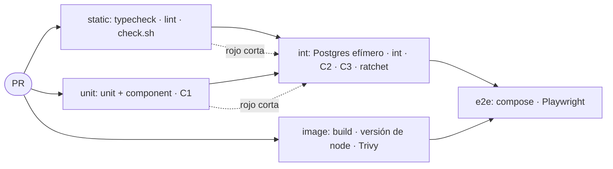

# CI en TypeScript

Con qué se implementa `../../docker-ci/references/ci.md` en este stack. Las decisiones están ahí; acá solo las herramientas.

| Decisión del core | Acá |
|---|---|
| cobertura del diff | `@vitest/coverage-v8` genera un reporte Cobertura **por proyecto** (`unit`, `int`); `diff-cover` los cruza con el `git diff` contra la base del PR en tres gates (`mindstack:qa`, "Cobertura: dos corridas, tres gates"). Es Python, `ubuntu-latest` ya lo trae; no entra al `package.json` |
| cobertura total, solo sube | `thresholds.autoUpdate` de Vitest reescribe los umbrales en `vitest.config.ts` cuando suben. Ese cambio se commitea con el PR que lo produjo |
| tamaño de archivo | ESLint `max-lines`, ya en `eslint.config.js` |
| secretos | `gitleaks`, en `../../workflow/references/git.md` |
| imagen | `docker build -f apps/api/Dockerfile -t api:ci .` (`../../node-api/examples/Dockerfile`: base en un stage, tag exacto + digest) |
| actions por SHA | `uses: owner/action@<sha>  # vX.Y.Z`. Dependabot `github-actions` lo mueve (`../../workflow/examples/github/dependabot.yml`) |
| runtime verificado | `.nvmrc` con la versión exacta, la misma del `FROM`. `setup-node` con `node-version-file`. `node --version` comparado con `.nvmrc` en el runner y dentro de la imagen. Trivy sobre `api:ci`, `HIGH,CRITICAL` con fix disponible falla |

```ts
// vitest.config.ts en la raíz: un proyecto por app y por capa. El nombre del test decide la capa
// (mindstack:qa, "Nombres"): *.unit.test.ts, *.int.test.ts, *.component.test.tsx.
export default defineConfig({
  test: {
    projects: [
      { extends: './apps/api/vitest.config.ts', test: { name: 'api:unit', include: ['apps/api/src/**/*.unit.test.ts'], setupFiles: ['./apps/api/test/unit.setup.ts'] } },
      { extends: './apps/api/vitest.config.ts', test: { name: 'api:int', include: ['apps/api/src/**/*.int.test.ts'], setupFiles: ['./apps/api/test/int.setup.ts'], fileParallelism: false } },
      { extends: './apps/web/vitest.config.ts', test: { name: 'web:unit', include: ['apps/web/src/**/*.unit.test.ts'] } },
      { extends: './apps/web/vitest.config.ts', test: { name: 'web:component', include: ['apps/web/src/**/*.component.test.tsx'] } },
    ],
    coverage: {
      provider: 'v8',
      reporter: ['text', 'cobertura'],          // cobertura.xml es lo que lee diff-cover
      include: ['apps/*/src/**', 'packages/*/src/**'],   // explícito: un archivo nuevo sin test aparece al 0
      exclude: [                                  // única válvula; cambiarla es un diff visible en el PR
        '**/*.test.{ts,tsx}', '**/test/**',
        '**/*.module.ts', '**/*.entity.ts', '**/*.dto.ts', '**/*.types.ts', '**/*.interface.ts', '**/*.enum.ts', '**/*.constant.ts', '**/*.schema.ts',
        '**/main.ts', '**/*.config.ts', '**/migrations/**', '**/*.seed.ts', '**/index.ts', '**/generated/**',
        'apps/web/src/app/**',                    // rutas y layouts: wiring del router
      ],
      thresholds: {
        lines: 60, branches: 60, functions: 60, statements: 60,   // poner la cobertura actual
        autoUpdate: true,                                           // vitest sube los números solo; nunca bajan
      },
    },
  },
});
```

```ts
// apps/api/test/unit.setup.ts: un unitario que toque I/O falla acá, no "anda de casualidad"
delete process.env.DATABASE_URL;
globalThis.fetch = () => { throw new Error('unitario sin red: va en *.int.test.ts'); };

// apps/api/test/int.setup.ts: DB real y efímera, limpia entre tests
import { beforeEach } from 'vitest';
import { truncateAll } from './db';
if (!process.env.DATABASE_URL) throw new Error('integración sin DATABASE_URL');
beforeEach(truncateAll);
```

```js
// eslint.config.js: la capa equivocada falla en el editor, antes de correr nada
{
  files: ['**/*.unit.test.{ts,tsx}'],
  rules: {
    'no-restricted-imports': ['error', { patterns: [
      { group: ['**/*.controller', '**/*.repository', '**/*.adapter', '**/app'], message: 'Capa de I/O: va en *.int.test.ts' },
      { group: ['pg', 'postgres', 'drizzle-orm', 'typeorm', 'supertest'], message: 'Unitario sin I/O' },
    ] }],
    'no-restricted-syntax': ['error', { selector: "CallExpression[callee.object.name='vi'][callee.property.name='mock']", message: 'Unitario sin mocks de módulos' }],
  },
},
{
  files: ['**/*.int.test.ts'],
  rules: {
    'no-restricted-syntax': ['error', { selector: "CallExpression[callee.object.name='vi'][callee.property.name='mock'] > Literal[value=/^[.@]/]", message: 'Integración no mockea módulos propios' }],
  },
},
```

```bash
# scripts/coverage-diff.sh [unit|int]: sin argumento corre las dos fases. Las dos listas de sufijos viven acá y solo acá.
set -eu
base=${COVERAGE_BASE:-origin/main}
LOGIC='**/*.helper.ts **/*.util.ts **/*.mapper.ts **/*.use-case.ts **/*.guard.ts **/domain/**'
IO='**/*.controller.ts **/*.repository.ts **/*.adapter.ts'
phase=${1:-all}
if [ "$phase" != int ]; then
  vitest run --project '*:unit' --project '*:component' --coverage --coverage.reportsDirectory=coverage/unit
  diff-cover coverage/unit/cobertura-coverage.xml --compare-branch="$base" --include $LOGIC --fail-under=100   # C1
fi
if [ "$phase" != unit ]; then
  vitest run --project '*:int' --coverage --coverage.reportsDirectory=coverage/int
  diff-cover coverage/int/cobertura-coverage.xml  --compare-branch="$base" --include $IO --fail-under=100      # C2
  diff-cover coverage/unit/cobertura-coverage.xml coverage/int/cobertura-coverage.xml --compare-branch="$base" --fail-under=100   # C3
fi
```

```json
{
  "scripts": {
    "typecheck": "tsc --noEmit",
    "lint": "eslint . && biome format .",
    "format": "biome format --write .",
    "test": "vitest run",
    "test:unit": "vitest run --project '*:unit' --project '*:component'",
    "coverage:diff": "bash scripts/coverage-diff.sh"
  }
}
```

```bash
npm i -D typescript eslint @eslint/js typescript-eslint @vitest/eslint-plugin eslint-config-prettier @biomejs/biome vitest @vitest/coverage-v8
```

`lint` incluye `biome format .` sin `--write`: falla si algo no está formateado. `eslint-config-prettier` se queda aunque no haya Prettier: su único trabajo es apagar las reglas de formato de ESLint, que es lo que hace falta con cualquier formateador.

`coverage:diff` es el comando que el core pide: lo corre el Done del plan (`../../workflow/SKILL.md`) y el job de CI. Los tres gates van al 100; `.service` entra en `IO` si en el proyecto los services tocan I/O, en `LOGIC` si no. Un use case se cubre en unit con fakes de sus ports (`mindstack:qa`, "Backend"). El job de CI llama a `coverage:diff` en lugar de `diff-cover` suelto.

## El pipeline



Tres jobs arrancan a la vez porque no se necesitan: lo estático, los tests rápidos y la imagen. `int` espera a los dos primeros: sin typecheck verde no vale la pena levantar una DB, y C3 necesita el reporte de `unit`. `e2e` espera a `int` y a la imagen. Un rojo en cualquier job corta lo que depende de él; el PR entero tarda lo que tarda el camino `unit → int → e2e`, no la suma.

| Job | `needs` | Qué falla acá |
|---|---|---|
| `static` | | tipos, lint (max-lines, capa equivocada), `check.sh`, versión de node ≠ `.nvmrc` |
| `unit` | | un unitario o componente; C1: línea de lógica sin test unitario |
| `image` | | `docker build`; node de la imagen ≠ `.nvmrc`; CVE HIGH/CRITICAL con fix |
| `int` | `static`, `unit` | integración; C2: línea de I/O sin test de integración; C3: diff al 100; ratchet global |
| `e2e` | `int`, `image` | más de 5 archivos e2e; un flujo crítico roto |

```yaml
# .github/workflows/ci.yml, esqueleto. Actions por SHA con el tag en comentario (skill docker-ci).
on: [pull_request]
jobs:
  static:
    steps: [checkout, setup-node, "test $(node --version) = v$(cat .nvmrc)", npm ci, npm run typecheck, npm run lint, bash mindstack/scripts/check.sh]
  unit:
    steps: [checkout fetch-depth 0, setup-node, npm ci, pip install diff-cover, bash scripts/coverage-diff.sh unit, upload-artifact coverage/unit]
  image:
    steps: [checkout, docker build -t api:ci, "test $(docker run api:ci node --version) = v$(cat .nvmrc)", trivy HIGH,CRITICAL exit-code 1]
  int:
    needs: [static, unit]
    services: { db: { image: "postgres:17@sha256:<digest>" } }
    steps: [checkout fetch-depth 0, setup-node, npm ci, npm run migrate && npm run seed:base, download-artifact coverage/unit, bash scripts/coverage-diff.sh int, npx vitest run --coverage]
  e2e:
    needs: [int, image]
    steps: [checkout, setup-node, npm ci, "test $(ls apps/web/e2e/*.spec.ts | wc -l) -le 5", docker compose up -d --wait, npx playwright test]
```

`COVERAGE_BASE: origin/${{ github.base_ref }}` en `unit` e `int`. Los steps de imagen son `../../docker-ci/references/docker-runtime-verified.md`: sin el check de versión, `setup-node` puede usar una versión vieja del tool cache; sin Trivy, Dependabot abre el PR de la imagen nueva pero nadie dice qué CVE corrige.

```js
// eslint.config.js
rules: {
  'max-lines': ['error', { max: 300, skipBlankLines: true, skipComments: true }],
}
```

## Dónde lo ve Claude

- `max-lines` y los thresholds corren en el `Stop hook` (`npm run lint` y `vitest run`). Claude no termina el turno con un archivo de 400 líneas ni con la cobertura global bajando. Para que vea los thresholds hace falta `--coverage` en `../examples/hooks/stop-check.sh`, que suma unos segundos; si no, los ve en CI.
- La cobertura del diff corre en CI y en `npm run coverage:diff`. El reporte `text` de Vitest lista archivo por archivo qué líneas faltan.
