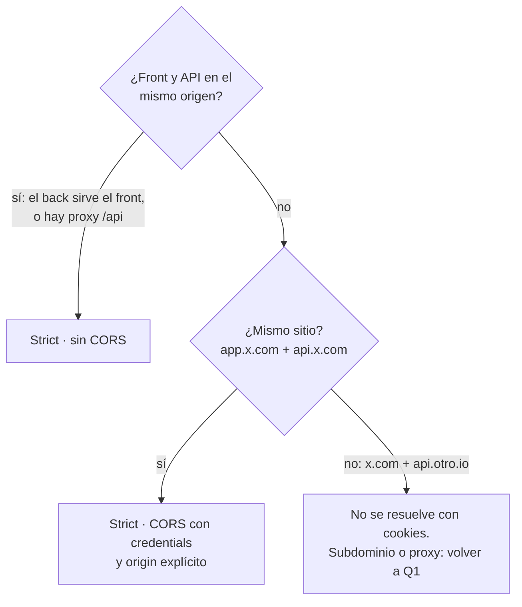

# Cookies de sesión

Decisión cerrada: **los tokens van en cookies `httpOnly` con los atributos más estrictos que la arquitectura permita**, y si la arquitectura no permite los estrictos, se cambia la arquitectura, no los atributos. Qué tokens y cómo se emiten: `jwt.md`.

## Los atributos

| Atributo | Valor | Por qué | Cuándo cambia |
|---|---|---|---|
| `HttpOnly` | `true` | JS no la lee. Un XSS no se lleva la sesión | nunca para tokens. Una cookie legible por JS solo para cosas que JS necesita leer (tema, idioma), y nunca con datos sensibles |
| `Secure` | `true` | solo viaja por HTTPS. Chrome y Firefox tratan `http://localhost` como contexto seguro y la aceptan igual | **un solo `if`, y sale de config, no de `NODE_ENV`**: cuando `WEB_ORIGIN` empieza con `http://localhost`, `secure: false` y los nombres sin prefijo `__Host-`/`__Secure-` (el browser rechaza el prefijo sin `Secure`). Es para Safari, para herramientas que no tratan localhost como seguro, y para levantar el proyecto local sin certificados. Staging con `https://` en `WEB_ORIGIN` queda estricto diga lo que diga `NODE_ENV` |
| `SameSite` | `Strict` | no viaja en requests iniciados desde otro sitio: CSRF cubierto para `fetch`/`axios` desde la app | `Lax` solo si la API recibe **navegaciones** desde afuera: callback de OAuth, link de descarga en un mail. `None` nunca (ver abajo) |
| `Path` | access: `/`. refresh: `/auth/refresh` | el refresh solo viaja al endpoint que lo usa. Menos requests lo llevan, menos logs lo ven | fijo |
| `Domain` | **sin setear** (host-only) | la cookie vale solo para el host que la emitió | setearlo la comparte con **todos** los subdominios, incluido el que mañana hostea algo de terceros. Evitar |
| `Max-Age` | igual a la vida del token: 600 y 2592000 | sin `Max-Age` es "cookie de sesión", pero los browsers restauran sesiones: termina durando más que el token | fijo |
| Prefijo de nombre | `__Host-access`, `__Secure-refresh` | el browser **rechaza** la cookie si falta `Secure`, o si `__Host-` tiene `Domain` o `Path` distinto de `/`. Es un chequeo gratis contra config mal hecha | `__Host-` solo sirve con `Path=/`; por eso el refresh lleva `__Secure-`. En local sin `Secure` van sin prefijo: el browser los rechaza igual |

Qué **no**:

- `localStorage` / `sessionStorage` para tokens. Cualquier script en la página los lee: un XSS, una dependencia del bundle comprometida, una extensión del browser.
- `SameSite=None`. Requiere cookies de terceros, que Safari, Firefox y Chrome bloquean o van a bloquear. "Funciona en mi Chrome" no es que funciona.
- Cookies firmadas (`cookie-parser` con secret, `signed: true`). El JWT ya está firmado y el refresh es aleatorio; firmar la cookie no agrega nada.
- Un `Domain=.ejemplo.com` "para que la sesión sirva en todos los subdominios". Cada app con su cookie; si dos apps comparten sesión, comparten API.

## Qué arquitectura hay

El atributo que depende de la arquitectura es `SameSite`, y de rebote si hace falta CORS. "Sitio" es eTLD+1: `app.ejemplo.com` y `api.ejemplo.com` son el **mismo sitio**, distinto origen. `ejemplo.com` y `ejemplo-api.io` son sitios distintos. El puerto no cuenta: `localhost:5173` y `localhost:3000` son el mismo sitio.



Tres casos, y el tercero no es un caso: es un error de infraestructura que se arregla antes de escribir auth.

| Caso | `SameSite` | CORS | Qué hay que configurar |
|---|---|---|---|
| **Mismo origen.** El back sirve el bundle, o el front tiene un proxy a `/api` (Vite en dev, nginx/Vercel rewrites en prod) | `Strict` | no | el proxy. Nada más |
| **Mismo sitio, distinto origen.** `app.ejemplo.com` y `api.ejemplo.com` | `Strict` | sí, con `credentials: true` y `origin` **exacto** desde config | CORS en la API, `withCredentials: true` en axios (ya está en `../../react/references/frontend.md`) |
| **Sitios distintos.** `miapp.vercel.app` y `miapi.railway.app` | no hay valor que sirva | | un dominio propio con subdominios para los dos, o un proxy en el front. Es el único arreglo |

Con la premisa de `../../architecture/SKILL.md` §8 el caso es siempre el segundo, en prod y en dev. Y una cosa que `Strict` **no** cubre: `blog.ejemplo.com` es el mismo sitio que `api.ejemplo.com`, así que un `fetch` desde el blog lleva la cookie. Eso lo cierra `origin.md`.

Con `Strict`, el primer request después de llegar desde un link externo (mail, Slack) es una navegación al **front**, que no lleva cookie de la API; los `fetch` que la página hace después son same-site y sí la llevan. Solo molesta cuando la navegación externa apunta directo a la **API**: ahí va `Lax`, y solo en esa cookie.

## Producción vs localhost

En local no hay HTTPS, y es la única diferencia que se admite. Todo lo demás es idéntico, a propósito: lo que se prueba en local tiene que ser lo que corre en prod. La diferencia sale de **un** valor de config, `WEB_ORIGIN`, y de ningún otro lado.

| | Producción (`WEB_ORIGIN=https://app.ejemplo.com`) | Localhost (`WEB_ORIGIN=http://localhost:5173`) | Por qué difiere |
|---|---|---|---|
| `Secure` | `true` | `false` | sin HTTPS, Safari y varias herramientas descartan la cookie. Chrome y Firefox la aceptarían igual en `localhost`; el `if` es por los demás |
| nombres | `__Host-access`, `__Secure-refresh` | `access`, `refresh` | el browser rechaza los prefijos sin `Secure`. Caen con él, no por decisión aparte |
| `HttpOnly` | `true` | `true` | |
| `SameSite` | `Strict` | `Strict` | `localhost:5173` y `localhost:3000` son el mismo sitio: la topología de prod |
| `Path` | access `/`, refresh `/auth/refresh` | igual | |
| `Domain` | sin setear | sin setear | |
| `Max-Age` | 600 y 2592000 | igual | |
| CORS `origin` | `https://app.ejemplo.com` | `http://localhost:5173` | el mismo valor de config, sin comodines |
| `requireOrigin` (`origin.md`) | activo | activo | nunca un `if (dev) skip` |
| esquema de la API | `https://api.ejemplo.com` | `http://localhost:3000` | |
| cómo se decide | `config.WEB_ORIGIN.startsWith('http://localhost')` | igual | nunca `NODE_ENV`: un staging con `NODE_ENV=development` y `https://` queda estricto |

Lo que **no** se hace en local: `SameSite=None`, `Domain`, apagar `HttpOnly` "para ver la cookie en devtools" (se ve igual en la pestaña Application), apagar CORS. Si algo de eso hace falta para que local funcione, el problema es otro y se arregla ese.

## CSRF y los subdominios hermanos

`SameSite=Strict` impide que `otro-sitio.com` dispare un request con la cookie. No impide que lo haga `blog.ejemplo.com`: es el mismo sitio. La segunda capa, que cubre los dos casos, es exigir `Origin` exacto en **todo** request, incluidos los `GET`, y rechazar `Origin` ausente o `null`. Está en `origin.md`, con el middleware, el orden en que se registra y los tests. Para JSON no hay token CSRF: el `Origin` lo manda el browser y no se puede falsificar, y un `fetch` JSON desde otro sitio dispara preflight. Para `urlencoded` y `multipart`, que un `<form>` manda sin preflight, el token CSRF es obligatorio en el endpoint que los acepte: `content-type.md`.

## Con qué (Node)

Las opciones son las mismas en Express (`res.cookie`), Fastify (`@fastify/cookie`, `reply.setCookie`) y Hono (`setCookie`). Un solo módulo las define; ningún handler escribe `httpOnly: true` a mano.

```ts
// apps/api/src/auth/cookies.ts
import { config } from '@/config';

// El único if: local por http. Mira WEB_ORIGIN, nunca NODE_ENV. Sin Secure el browser rechaza los prefijos, así que caen juntos.
const local = config.WEB_ORIGIN.startsWith('http://localhost');
if (local) logger.warn('cookies sin Secure ni prefijos: WEB_ORIGIN es http://localhost');

const base = { httpOnly: true, secure: !local, sameSite: 'strict' } as const;

export const ACCESS_COOKIE = {
  name: local ? 'access' : '__Host-access',
  options: { ...base, path: '/', maxAge: 10 * 60 },
} as const;

export const REFRESH_COOKIE = {
  name: local ? 'refresh' : '__Secure-refresh',
  options: { ...base, path: '/auth/refresh', maxAge: 30 * 24 * 60 * 60 },
} as const;

// Borrar exige los mismos path/domain que al setear. Si no, el browser no la encuentra y la cookie queda.
export function clearSession(res: Response) {
  res.clearCookie(ACCESS_COOKIE.name, { ...ACCESS_COOKIE.options, maxAge: undefined });
  res.clearCookie(REFRESH_COOKIE.name, { ...REFRESH_COOKIE.options, maxAge: undefined });
}
```

`maxAge` en Express es en milisegundos: `maxAge: 10 * 60 * 1000`. Fastify y Hono usan segundos. Mirar el framework antes de copiar.

CORS, para el caso "mismo sitio, distinto origen", que con `../../architecture/SKILL.md` §8 es siempre: `cors.md`. Un literal de config, `credentials: true`, después de `requireOrigin`.

Proxy en dev para que todo sea mismo origen:

```ts
// apps/web/vite.config.ts
export default defineConfig({
  server: { proxy: { '/api': { target: 'http://localhost:3000', changeOrigin: true } } },
});
```

Y `VITE_API_URL=/api`. En prod, lo mismo con nginx (`location /api { proxy_pass ... }`) o rewrites de la plataforma.

## Qué pasa si no

| Atajo | Consecuencia |
|---|---|
| `secure: process.env.NODE_ENV === 'production'` | un staging con `NODE_ENV=development` manda la sesión por HTTP. El `if` permitido mira `WEB_ORIGIN`: staging tiene `https://` y queda estricto. Y el prefijo `__Host-` hace que el browser rechace la cookie en prod si alguien lo olvidó |
| `SameSite=None` porque "están en dominios distintos" | funciona en el Chrome del dev, falla en Safari y en modo incógnito. Soporte lo reporta como "a veces no me deja entrar" |
| `origin: true` en CORS con `credentials: true` | cualquier sitio puede hacer requests autenticados en nombre del usuario. Es apagar CSRF |
| `Domain=.ejemplo.com` | `blog.ejemplo.com` en WordPress con un plugin viejo lee la sesión de la app |
| `clearCookie` sin `path` | el logout "no anda": la cookie sigue ahí porque el browser no encontró cuál borrar |
| refresh con `Path=/` | el refresh viaja en cada request: cada log de acceso, cada proxy y cada CDN lo ven |

## Qué pedirle a Claude

> "Antes de setear cualquier cookie, leé `cookies.md`. Decime en qué caso de la tabla de arquitectura estamos y qué `SameSite` y CORS corresponden, antes de escribir código."

## Tests que tienen que existir

- El header `Set-Cookie` del login contiene, literal, `HttpOnly`, `Secure`, `SameSite=Strict` y el `Path` de cada cookie. Es un `expect(header).toMatch(...)`, no un mock.
- Con `WEB_ORIGIN=http://localhost:5173`, el `Set-Cookie` del login no lleva `Secure` y los nombres son `access` y `refresh`; con `https://`, lleva `Secure` y los prefijos. Los dos casos en el mismo archivo de test, cambiando solo la config.
- Los tests de `Origin` (ausente, `null`, otro subdominio, también en `GET`) están en `origin.md`.
- `GET /orders` sin cookie devuelve `UNAUTHORIZED`.
- Logout devuelve `Set-Cookie` con `Max-Age=0` y el mismo `Path` de cada cookie.

## Fuentes

- [MDN, `Set-Cookie`](https://developer.mozilla.org/en-US/docs/Web/HTTP/Headers/Set-Cookie): atributos, prefijos `__Host-` y `__Secure-`, y qué rechaza el browser.
- [MDN, SameSite cookies](https://developer.mozilla.org/en-US/docs/Web/HTTP/Headers/Set-Cookie/SameSite): `Strict`, `Lax`, `None` y qué requests llevan la cookie.
- [web.dev, Understanding "same-site" and "same-origin"](https://web.dev/articles/same-site-same-origin): por qué `app.` y `api.` son el mismo sitio.
- [OWASP, Session Management Cheat Sheet, Cookies](https://cheatsheetseries.owasp.org/cheatsheets/Session_Management_Cheat_Sheet.html#cookies): `Secure`, `HttpOnly`, `SameSite`, `Domain` y `Path`.
- [Chromium, localhost como contexto seguro](https://www.chromium.org/Home/chromium-security/prefer-secure-origins-for-powerful-new-features/): por qué Chrome acepta `Secure` en `http://localhost`.
