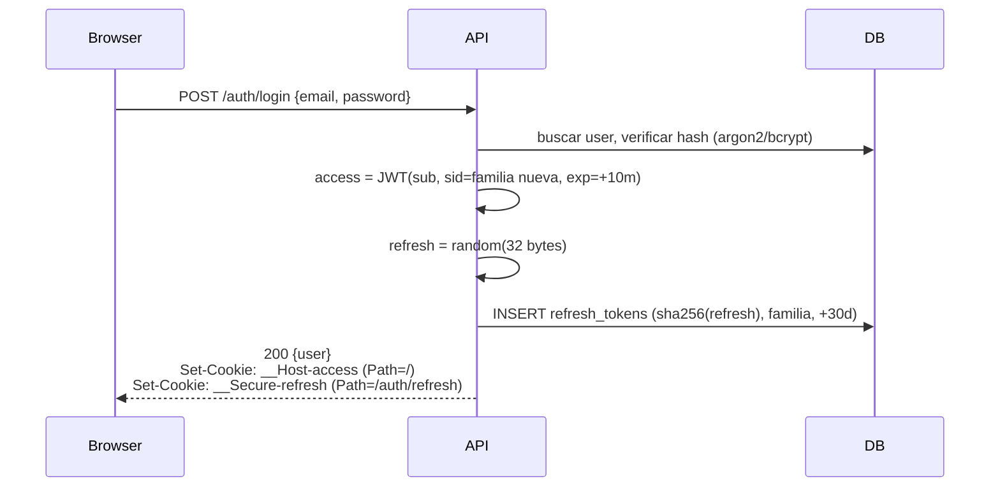
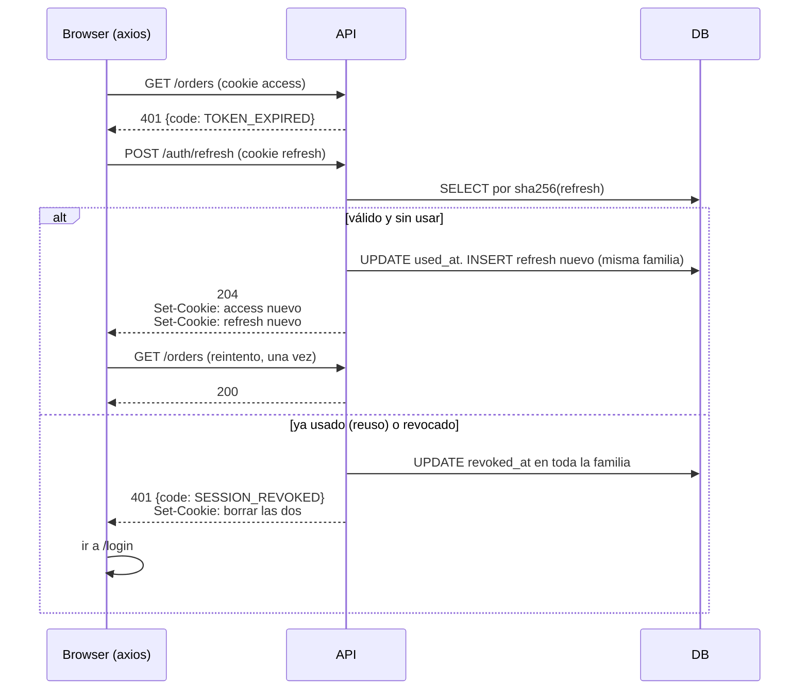

# Autenticación con JWT

Decisión cerrada para cualquier plataforma con login propio: **dos tokens, los dos en cookies `httpOnly`, refresh con rotación y detección de reuso**. Dónde viven las cookies y con qué atributos: `cookies.md`. Quién puede llamar a la API: `origin.md`. Este doc es el flujo.

Si el proyecto usa un proveedor externo (Auth0, Clerk, Cognito, Supabase Auth), el proveedor reemplaza la emisión; lo demás (cookies, refresh en el front, errores) sigue igual.

Para implementarlo o auditarlo hay un pre-plan con las decisiones tomadas: sesiones por dispositivo que el usuario ve y cierra, una fila por sesión, revocación del access en menos de un minuto: `../../auth-jwt-sessions/`. Orientativo; las reglas de este archivo no. Dos de sus decisiones proponen cambios a este archivo (la tabla y el "se aceptan los 10 minutos"): están en su `CHANGELOG.md`, Observaciones.

## Las decisiones

| Decisión | Valor | Por qué |
|---|---|---|
| Dos tokens | access + refresh | el access es stateless y barato de verificar; el refresh es revocable. Uno solo obliga a elegir entre "no se puede cerrar sesión" y "cada request pega a la DB" |
| Access token | JWT firmado, **10 minutos**, claims `sub`, `sid`, `exp`, `iat` | corto: si se filtra, vale 10 minutos. Sin PII ni roles adentro: el claim queda viejo apenas cambia el dato |
| Refresh token | **string aleatorio opaco** (32 bytes), 30 días deslizantes, guardado en DB **hasheado** | tiene que estar en DB para revocarlo, así que no hace falta que sea JWT. Hasheado: un dump de la DB no sirve para iniciar sesión |
| Rotación | cada `/auth/refresh` emite un refresh nuevo y marca el anterior como usado | un refresh robado sirve una sola vez, y se nota |
| Detección de reuso | usar un refresh ya rotado revoca **toda la familia** (todos los refresh de esa sesión) | si el ladrón y el usuario tienen el mismo token, no se sabe cuál es cuál; se cierran los dos y el usuario vuelve a loguearse |
| Dónde viven | cookies `httpOnly`. Access con `Path=/`, refresh con `Path=/auth/refresh` | JS no los puede leer: un XSS no se lleva la sesión. El refresh solo viaja al endpoint que lo usa |
| Firma | HS256 con secreto de 32+ bytes en `config` | un solo servicio verifica. Asimétrico (`EdDSA` o `RS256`) solo cuando otro servicio tiene que verificar sin tener el secreto |
| Logout | borra las dos cookies y revoca la familia | el access sigue siendo válido hasta `exp`. Son 10 minutos; se acepta |
| Cambio de password o "cerrar en todos lados" | revoca todas las familias del usuario | el access de 10 minutos acota el daño; no hace falta deny list |
| Tolerancia de reloj | 30 segundos al verificar `exp` | dos servidores con reloj distinto rechazan tokens válidos sin tolerancia |
| El front no sabe cuándo vence | asume que tiene acceso; `401 TOKEN_EXPIRED` dispara refresh y reintento. Nada de fechas de vencimiento en el body ni en cookies legibles | el access está en una cookie `httpOnly` y no hace falta leerlo: un round-trip de más cada 10 minutos por pestaña no justifica estado duplicado en el front |
| Varias pestañas | `navigator.locks` serializa el refresh entre pestañas, y la que esperó reintenta su request antes de refrescar. En el servidor, el refresh anterior sigue rotando (no revoca) durante **10 s** después de la rotación | las cookies son compartidas y el dedupe es por pestaña: dos pestañas que refrescan a la vez presentan el mismo token y la segunda sería "reuso". Sin esto, el usuario se desloguea solo al cambiar de pestaña |
| Tiempo | UTC en todo lo que cruza el borde; epoch en las comparaciones; hora local solo al mostrar | el usuario y el servidor están en países distintos. Un `"15:40"` sin zona vence a horas distintas según quién lo lea |

Qué **no** se hace:

- Tokens en `localStorage` o `sessionStorage`. Cualquier XSS los lee. Ver `cookies.md`.
- Access token largo (horas, días). Si hace falta "recordarme", es el refresh el que dura.
- `Authorization: Bearer` desde el browser. Obliga a guardar el token donde JS llega. Se usa solo desde clientes que no son browser (app nativa, servicio a servicio).
- Deny list de access tokens. Agregar solo si el negocio exige revocación instantánea; cuesta un lookup por request.

## Tabla `refresh_tokens`

```sql
CREATE TABLE refresh_tokens (
  id          uuid PRIMARY KEY,
  user_id     uuid NOT NULL REFERENCES users(id),
  family_id   uuid NOT NULL,          -- una por login/dispositivo
  token_hash  text NOT NULL UNIQUE,   -- sha256 del token, nunca el token
  expires_at  timestamptz NOT NULL,
  used_at     timestamptz,            -- rotado: no vale más
  revoked_at  timestamptz             -- logout, reuso, cambio de password
);
CREATE INDEX ON refresh_tokens (family_id);
CREATE INDEX ON refresh_tokens (user_id);
```

`sid` en el access token es `family_id`: identifica la sesión sin tocar la DB.

## Flujos

### Login



El body devuelve el usuario, no los tokens ni sus vencimientos. El browser guarda las cookies solo; el front no ve ningún token.

### Request, expiración y refresh



El interceptor de axios distingue `TOKEN_EXPIRED` (refrescar y reintentar una vez) de `UNAUTHORIZED` y `SESSION_REVOKED` (ir al login). Varios requests que fallan a la vez comparten **un solo** refresh en vuelo. Vale para diez y para mil: el front dispara requests concurrentes todo el tiempo, y cuando el access vence, vence para todos a la vez. Todos los que reciben `TOKEN_EXPIRED` esperan la misma promesa y reintentan con la cookie nueva; los que arrancan mientras el refresh está en vuelo y también fallan, entran a la misma espera. Nunca dos `POST /auth/refresh` en vuelo desde la misma pestaña: el segundo presentaría un refresh ya rotado y revocaría la familia.

### Por qué la familia

Ladrón y usuario tienen el mismo refresh `R1`. El primero que lo usa recibe `R2`; `R1` queda usado. Cuando el segundo presenta `R1`, la API ve "token usado" y revoca `R1`, `R2` y todo lo de esa familia. Los dos quedan afuera; el usuario legítimo se loguea de nuevo y el ladrón no puede. Sin familia, el ladrón que refrescó primero se queda con una sesión viva de 30 días.

## El front no sabe cuándo vence, y no hace falta

El access está en una cookie `httpOnly`: el front no puede leer su `exp`. Y no lo necesita. Trabaja como si siempre tuviera acceso; cuando no lo tiene, el servidor se lo dice con `401 TOKEN_EXPIRED` y el interceptor de respuesta refresca y reintenta una vez. Un solo mecanismo, en un solo lado. Lo que se descartó: devolver `accessExpiresAt` en el body y refrescar antes de que venza. Ahorra un round-trip cada 10 minutos por pestaña a cambio de una fecha que el front tiene que guardar, invalidar y comparar. No vale la redundancia.

## Varias pestañas

Las cookies son compartidas entre pestañas; el `refreshing ??=` del interceptor es por pestaña. Dos pestañas que reciben `TOKEN_EXPIRED` en el mismo instante (las dos hacen refetch al recuperar el foco) mandan el mismo refresh antes de que la respuesta de la otra llegue. Sin más, la segunda es "reuso" y revoca la sesión: el usuario se desloguea solo. Dos capas:

```ts
// apps/web/src/api/http.ts: el refresh, serializado entre pestañas. La que esperó no refresca: reintenta, porque la cookie ya es nueva.
async function refreshOnce(): Promise<void> {
  await navigator.locks.request('auth:refresh', async () => {
    const probe = await http.get('/auth/me', { validateStatus: () => true, _noRefresh: true } as RetriableConfig);
    if (probe.status !== 401) return;                      // otra pestaña ya refrescó mientras esperábamos el lock
    await http.post('/auth/refresh', undefined, { _noRefresh: true } as RetriableConfig);
  });
}
// en el interceptor de respuesta: refreshing ??= refreshOnce().finally(() => (refreshing = null));
```

`navigator.locks` está en todo browser soportado (Safari desde 15.4). El `probe` cuesta un `GET /auth/me` solo en la pestaña que esperó; la primera no lo paga porque el lock estaba libre.

En el servidor, la segunda capa cubre a los clientes que no comparten cookies (app nativa con dos procesos, un cliente sin lock): el refresh **anterior** sigue rotando, no revoca, durante 10 segundos después de la rotación. Pasados los 10 s, presentarlo es reuso. La ventana es el tiempo de una respuesta en vuelo, no una puerta: un token robado que se usa 10 s tarde sigue cerrando la familia. Cómo se guarda (`prev_hash`, `rotated_at`) está en el pre-plan `../../auth-jwt-sessions/notes/sessions.md`.

## Tiempo: UTC en las dos puntas

El usuario está en un país y el servidor en otro. Si alguno de los dos interpreta una fecha con su zona, uno se equivoca por horas y la sesión "vence antes" o "no vence nunca".

| Dónde | Regla |
|---|---|
| JWT `exp`, `iat` | epoch en segundos: no tienen zona por definición. `jose` lo hace solo |
| DB | `timestamptz`, siempre. `now()` de Postgres, nunca una fecha armada en la app como string |
| API, al responder | ISO 8601 con `Z`: `toISOString()`. Nunca `"2026-10-22 15:40"`, nunca un offset distinto de `Z` |
| API, al comparar | `Date.now()` y epoch. `TZ=UTC` en el contenedor por prolijidad, pero el código no depende de eso |
| contrato | `z.string().datetime({ offset: false })`: rechaza una fecha sin `Z` o con offset |
| front, al comparar | `Date.parse(lastSeenAt) - Date.now()` cuando haga falta ("hace 3 minutos"). Epoch contra epoch |
| front, al mostrar | `Intl.DateTimeFormat(undefined, { dateStyle, timeStyle })`: la zona del browser, solo en el componente |
| tests | la suite corre con dos `TZ` distintas (`cross-env TZ=America/Argentina/Buenos_Aires vitest run` y `TZ=Asia/Tokyo`). Lo que se compara en hora local falla en una de las dos |

## Códigos de error del contrato

Agregar a `ErrorCode` en `packages/contracts`:

| `code` | Cuándo | Qué hace el front |
|---|---|---|
| `UNAUTHORIZED` | sin cookie, firma inválida, usuario inexistente | ir a login |
| `TOKEN_EXPIRED` | access vencido, nada más | `POST /auth/refresh` y reintentar una vez |
| `SESSION_REVOKED` | refresh usado, revocado o vencido | limpiar estado y ir a login |
| `FORBIDDEN` | autenticado pero sin permiso sobre **este** recurso | mostrar error, no ir a login |

## Con qué (Node)

Librería: `jose` (ESM, sin dependencias, WebCrypto). Refresh y hash con `node:crypto`. Atributos de cookie: `cookies.md`.

```ts
// apps/api/src/auth/tokens.ts
import { SignJWT, jwtVerify } from 'jose';
import { createHash, randomBytes } from 'node:crypto';
import { config } from '@/config';

const secret = new TextEncoder().encode(config.JWT_SECRET); // 32+ bytes, validado en config

export async function signAccess(userId: string, sessionId: string): Promise<string> {
  return new SignJWT({ sid: sessionId })
    .setProtectedHeader({ alg: 'HS256' })
    .setSubject(userId)
    .setIssuedAt()
    .setExpirationTime('10m')
    .sign(secret);
}

export async function verifyAccess(token: string): Promise<{ userId: string; sessionId: string }> {
  const { payload } = await jwtVerify(token, secret, { clockTolerance: 30 });
  if (typeof payload.sub !== 'string' || typeof payload.sid !== 'string') throw new UnauthorizedError('malformed token');
  return { userId: payload.sub, sessionId: payload.sid };
}

export function newRefresh(): { token: string; hash: string } {
  const token = randomBytes(32).toString('base64url');
  return { token, hash: hashRefresh(token) };
}

export function hashRefresh(token: string): string {
  return createHash('sha256').update(token).digest('hex');
}
```

```ts
// apps/api/src/auth/auth.service.ts (la parte que importa)
export async function rotate(presented: string, now = new Date()) {
  const row = await repo.findByHash(hashRefresh(presented));
  if (!row || row.revoked_at || row.expires_at < now) throw new SessionRevokedError();
  if (row.used_at) {
    await repo.revokeFamily(row.family_id); // reuso: alguien más ya lo usó
    throw new SessionRevokedError();
  }
  const next = newRefresh();
  await repo.transaction(async (tx) => {
    await tx.markUsed(row.id, now);
    await tx.insert({ userId: row.user_id, familyId: row.family_id, hash: next.hash, expiresAt: addDays(now, 30) });
  });
  return { access: await signAccess(row.user_id, row.family_id), refresh: next.token };
}
```

`markUsed` e `insert` van en la misma transacción: si falla a la mitad, el usuario no queda con un token usado y ninguno nuevo.

```ts
// apps/web/src/api/http.ts: agregar al interceptor de respuesta
let refreshing: Promise<void> | null = null;

http.interceptors.response.use(undefined, async (error) => {
  const code = ErrorResponseSchema.safeParse(error.response?.data).data?.code;
  const original = error.config as RetriableConfig; // AxiosRequestConfig + _retried: flag propio, axios no lo tipa
  if (code === 'TOKEN_EXPIRED' && !original._retried) {
    original._retried = true;
    refreshing ??= http.post('/auth/refresh').then(() => undefined).finally(() => (refreshing = null));
    await refreshing;
    return http(original);
  }
  if (code === 'UNAUTHORIZED' || code === 'SESSION_REVOKED') onSessionLost(); // limpia TanStack Query y navega a /login
  throw toApiError(error);
});
```

`refreshing ??=` es lo que hace que diez requests expirados a la vez disparen un solo refresh. Sin eso, el segundo refresh presenta un token ya rotado y revoca la familia: el usuario se desloguea solo "al azar".

## Qué pasa si no

| Atajo | Consecuencia |
|---|---|
| un solo token largo en `localStorage` | cualquier XSS, incluida una dependencia comprometida, se lleva sesiones de días |
| refresh sin rotación | un refresh filtrado es una sesión permanente que nadie detecta |
| rotación sin familia | el ladrón que refresca primero gana; el usuario legítimo es el que se desloguea |
| refresh en texto plano en DB | un dump de la DB es un dump de sesiones |
| refresh sin dedupe en el front | la app desloguea sola cuando dos requests expiran juntos |
| roles dentro del access token | cambiar el rol tarda hasta 10 minutos en aplicar, o más si el token es más largo |

## Qué pedirle a Claude

> "Implementá login, refresh y logout según `jwt.md` y `cookies.md`. Tests: login setea dos cookies con los atributos del doc; refresh rota; reuso revoca la familia; logout borra cookies."

## Tests que tienen que existir

- Login responde con `Set-Cookie` para las dos, con `HttpOnly`, `Secure`, `SameSite` y `Path` correctos. Se verifica el header, no el estado.
- `POST /auth/refresh` con el refresh de login devuelve cookies nuevas y el viejo deja de servir.
- Presentar el refresh viejo después de rotar devuelve `SESSION_REVOKED` **y** el nuevo también deja de servir.
- Request con access vencido (`vi.setSystemTime` + 11 minutos) devuelve `TOKEN_EXPIRED`, no `UNAUTHORIZED`.
- Logout: `Set-Cookie` con `Max-Age=0` para las dos y el refresh revocado en DB.
- En el front: diez requests que reciben `TOKEN_EXPIRED` a la vez producen **un** `POST /auth/refresh` (MSW con contador de llamadas) y los diez reintentos salen después de que ese refresh terminó.
- Login y refresh no devuelven ningún campo con un token ni con un vencimiento: el body es `{ user }` y `204`.
- Dos pestañas (dos instancias del cliente con la misma cookie jar en el test) que reciben `TOKEN_EXPIRED` a la vez producen **un** `POST /auth/refresh` y ninguna termina en `/login`.
- Presentar el refresh anterior 5 s después de rotar responde `204` y rota de nuevo; 15 s después responde `SESSION_REVOKED` y revoca la familia.
- Api y web: la suite entera pasa con `TZ=America/Argentina/Buenos_Aires` y con `TZ=Asia/Tokyo`.

## Fuentes

- [RFC 9700, OAuth 2.0 Security Best Current Practice, §4.14 Refresh Token Protection](https://www.rfc-editor.org/rfc/rfc9700#section-4.14): rotación y detección de reuso que revoca la familia.
- [OWASP, Session Management Cheat Sheet](https://cheatsheetseries.owasp.org/cheatsheets/Session_Management_Cheat_Sheet.html): duración, renovación y revocación de sesiones.
- [RFC 7519, JSON Web Token](https://www.rfc-editor.org/rfc/rfc7519): `exp`, `iat` y `sub` como epoch sin zona.
- [MDN, Web Locks API](https://developer.mozilla.org/en-US/docs/Web/API/Web_Locks_API): `navigator.locks` para serializar el refresh entre pestañas.
- [jose](https://github.com/panva/jose): `SignJWT`, `jwtVerify`, `clockTolerance`.
