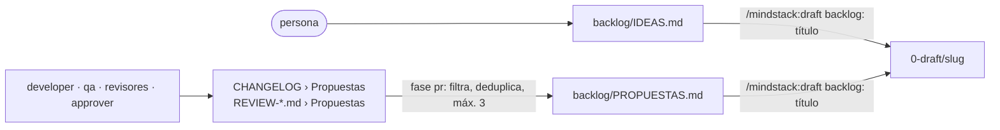
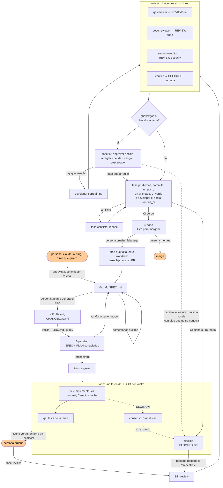
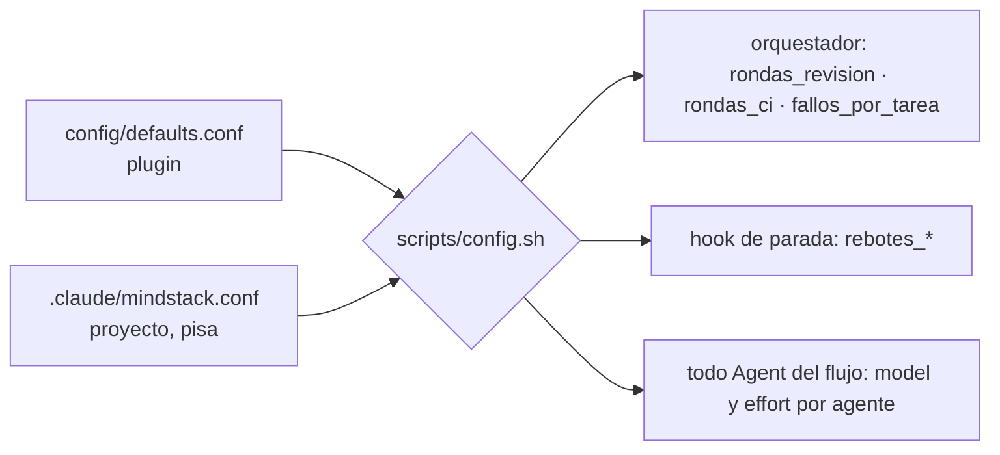

# Flujo: de la idea al merge

El núcleo del plugin. No depende del lenguaje ni del stack: vale para una API, una app web o un script. Lo que cambia por stack (qué runner, qué linter, qué comando de cobertura) lo dice la skill del stack; acá los comandos se nombran por su rol.

La persona pide, responde la entrevista, aprueba, prueba y mergea. Los roles hacen el resto, cada uno lo suyo, y dejan escrito qué hicieron, qué vieron, qué decidieron y qué dejaron. La idea es sacar código rápido con suficientes redes de contención para que no se desmadre: artefactos congelados, roles separados, hallazgos con dueño, deuda con vencimiento.

## Una tarea es una carpeta

```
todolist/
├── 0-draft/          se está escribiendo: /draft, comentarios, /plan (o "generá el plan")
├── 1-pending/         plan hecho, SPEC y PLAN congelados, esperando el worktree
├── 2-in-progress/ el loop corre en su worktree
├── 3-in-review/       cuatro revisores, approver, correcciones
├── 4-done/        lista para mergear: todo commiteado, PR abierto, CI verde
├── blocked/       necesita a la persona: BLOCKED.md dice por qué
├── backlog/       no es un estado: IDEAS.md (de la persona) y PROPUESTAS.md (de los agentes)
└── <estado>/<slug>/
    ├── SPEC.md          qué se pidió: hoy/propuesto, alcance, supuestos, casos borde CB-n con diagrama, criterios
    ├── PLAN.md          cómo se hace: fechas, estado final, acoplamiento, tareas con rol, Done
    ├── TODO.md          qué se hizo: las tareas del PLAN, las tacha el dev
    ├── CHECKLIST.md     qué tiene que ser cierto: CA-n, CB-n, Estado final; la tacha solo el verifier
    ├── CHANGELOG.md     qué pasó: cambios, observaciones, propuestas, decisiones, deuda, revisión, conflictos, cierre
    ├── REVIEW-qa.md     hallazgos de QA contra los CB del SPEC
    ├── REVIEW-code.md hallazgos del revisor de código
    ├── REVIEW-security.md hallazgos del auditor, zero trust
    ├── PR.md            body del PR
    ├── BLOCKED.md       solo en blocked/: motivos cortos, con opciones
    ├── wireframes/      si toca la interfaz: SCR-n en .wireloom (los leen los agentes) y rendered/*.svg (los ves vos, linkeados en el SPEC)
    └── notes/           lo que se investigó para decidir. Libre
```

La carpeta donde está es su estado, y moverla es `git mv`. Se ve en `ls`, en GitHub y en cualquier editor. No hay otro estado: no hay campo que pueda desincronizarse de la carpeta. Cada movimiento es un commit propio con fecha y autor.

| Carpeta | Quién la mueve ahí | Comando |
|---|---|---|
| `0-draft/` | el analista la crea | `/mindstack:draft "qué quiero"` |
| `1-pending/` | el planificador, al terminar el plan | `/mindstack:plan`, o "generá el plan" en la conversación |
| `2-in-progress/` | el orquestador, al arrancar el loop | `/mindstack:orchestrate` |
| `3-in-review/` | el orquestador, en la primera ronda de revisión | el mismo `/mindstack:orchestrate` |
| `4-done/` | el orquestador, en la fase pr, antes del único push; el turno termina con CI verde | el mismo `/mindstack:orchestrate` |
| `blocked/` | el orquestador, cuando algo necesita a la persona (`references/orchestrate.md › Bloquear`) | `/mindstack:orchestrate` la retoma |

Una tarea hija (`/mindstack:draft "<qué falta>" (en el worktree)`) pasa por las mismas carpetas, en la rama del padre, y actualiza su PR en vez de abrir otro. El PR se encuentra con `gh pr view` desde la rama; la carpeta entera viaja con el repo, así que al mergear llega a `main` ya en `4-done/` con toda su memoria.

## Qué tarea es

**El worktree es el PR.** Todo pasa adentro de `claude -w <slug>`, del borrador al PR: el slug lo elegís vos al abrirlo, y es el nombre de la primera tarea, de la rama (`worktree-<slug>`) y del worktree. Un worktree, una rama, un PR. Lo normal es una tarea por worktree, y ningún comando lleva su nombre: trabajan sobre las tareas de `todolist/` del directorio en que están, sin mirar cómo se llama la rama ni si es un worktree (`claude -w`, orca o a mano da igual). Si escribís varias en el mismo worktree (`/draft`, plan, `/draft` otra, plan), son una cola: `/orchestrate` las corre en orden, cada una en una sesión nueva, y viajan juntas en el mismo PR (`references/orchestrate.md › Cola`). Para rapidez, sin dependencias: un worktree por tarea, en paralelo.

En la rama default (`main`) no se corre ningún comando del flujo: el PR necesita otra rama. Al abrir `claude`, el aviso de sesión lista las tareas bloqueadas en cualquier worktree y las mergeadas cuyo worktree y entorno siguen vivos, con el comando para limpiarlos.

## Qué se congela y qué se escribe

| Archivo | Lo escribe | Cuándo cambia | Qué responde |
|---|---|---|---|
| `SPEC.md` y `wireframes/` | analista con la persona; `designer` propone los wireframes; en un fix, `qa` aporta la reproducción | solo en `0-draft/`. Después, **nunca**: el hook `plan-immutable.sh` lo bloquea y CI lo verifica. Para cambiarlo, `/draft` sin texto lo vuelve a borrador | ¿qué se pidió y cómo sabemos que está? |
| `PLAN.md` | planificador con la persona | solo en `0-draft/`. Después, **nunca** | ¿cómo se hace, en qué orden, con qué Done? |
| `TODO.md` | el planificador lo deriva al pasar a pendiente; el dev tacha | en cada tarea terminada | ¿qué se hizo? |
| `CHECKLIST.md` | el planificador la deriva de los `CA-n`, `CB-n` y Estado final; solo `verifier` tacha | en cada ronda de revisión | ¿está todo lo pedido, con código, test y evidencia? |
| `CHANGELOG.md` | todos los roles, cada uno su sección | en cada paso. Solo se agrega, nunca se reescribe | ¿qué pasó, qué se vio, qué se decidió y por qué, qué se dejó? |
| `REVIEW-*.md` | un rol cada uno | se reescribe entero por ronda | ¿qué está mal? (solo eso) |
| `backlog/IDEAS.md` | solo la persona; ningún agente (hook). Tabla: Descripción, Prioridad, Fecha, Notas | cuando se le ocurre algo; `/draft backlog:` saca la fila | ¿qué quiero hacer algún día? |
| `backlog/PROPUESTAS.md` | el orquestador en la fase pr, filtrando `CHANGELOG › Propuestas` y `REVIEW-*.md › Propuestas` | al llegar a done; la persona borra lo que no le sirve | ¿qué vieron los agentes que sumaría? |

Por qué el PLAN no se tacha: si el contrato cambia debajo del loop, "está hecho" deja de significar algo. El avance va al TODO; los giros van a Decisiones con fecha, quién y principio. Así la persona sabe en todo momento por qué se tomó un camino distinto al planeado.

Por qué el backlog son dos archivos: una idea tuya es una intención; una propuesta de agente es una hipótesis con evidencia ("en CB-3 soporte no puede forzar el reintento"). Mezcladas, no sabés cuál pediste vos. Los agentes hacen y proponen, pero no escriben el backlog: proponen en su tarea y el orquestador filtra (con dónde se vio, sin repetidas, tres por tarea), para que no sea un cajón que nadie lee.



Si la persona pregunta qué del backlog conviene hacer: leé las dos listas y, de cada candidata, la tarea de origen. Ordená primero por peso: cuántas tareas distintas la vieron (la de origen más sus `Visto también`); una necesidad que aparece en cuatro tareas ya costó cuatro veces. Después, qué tan cerca está de lo que se viene haciendo (las últimas tareas de `4-done/`), tamaño y antigüedad; las ideas de la persona pesan más que una propuesta vista una sola vez, y su columna Prioridad manda: una idea 🔥 alta va primero salvo que una propuesta tenga mucho peso. Respondé con tres, una línea cada una con el porqué, y el comando para empezar la primera. No se escribe nada.

Por qué un changelog por tarea: la memoria de un agente termina con su sesión. QA ve un bug ajeno y no lo arregla: Observaciones. El dev elige una librería sobre otra: Decisiones, con la descartada y el principio. El approver deja un hallazgo como deuda o acepta un riesgo: Deuda técnica, con origen, vencimiento e issue. Sin eso, cada rol que entra empieza de cero y la persona que mergea no sabe qué se dejó afuera.

## El flujo entero



Naranja es la persona: pide, pide el plan, prueba, desempata, mergea. Todo lo demás lo hacen los roles. `/mindstack:orchestrate` recorre este grafo solo y termina únicamente en `4-done` con CI verde o en `blocked/`; un hook de parada no lo deja terminar en otro lado. "Probar" no lo frena. Los casos de uso con diagramas de secuencia están en `use-cases/` del plugin.

## Roles

Cada rol tiene un permiso que le impide hacer el trabajo de otro. No es desconfianza: es lo que saca el sesgo (el que implementa testea lo que pensó, no lo que el código hace) y hace que un fallo quede en un solo lugar.

| Rol | Escribe |
|---|---|
| **analista** | `SPEC.md` |
| **planificador** | `PLAN.md`, `TODO.md`, `CHANGELOG.md` vacío |
| **investigador** | nada |
| **desarrollador** | código, `TODO.md`, `CHANGELOG.md` |
| **qa** | tests, `REVIEW-qa.md`, `CHANGELOG.md` |
| **code-reviewer** | `REVIEW-code.md` |
| **security-auditor** | `REVIEW-security.md` |
| **verifier** | `CHECKLIST.md` (solo tacha) |
| **approver** | `CHANGELOG.md`: decide cada hallazgo, no edita código |
| **conflict-resolver** | lo que esté en conflicto, `CHANGELOG.md` |
| **orquestador** | nada propio |

Qué hace y qué no cada uno: `references/roles-and-artifacts.md` (sección "Qué hace y qué no cada rol"); modelo y herramientas, en `agents/*.md` del plugin.

Las prácticas (`qa`, `tdd`, `debugging`, `code-review`, `security`, `git`, `simplification`, `performance`, `api-design`, `migration`, `observability`, `documentation`, `ci-cd`) no son roles: son conocimiento que un rol carga según la tarea. El `PLAN.md` dice en `tipo:` qué clase de tarea es y en `skills:` cuáles van; la tabla está en `references/plan.md`.

## Configuración: topes y modelos

Las iteraciones que tienen tope y el modelo y el esfuerzo de cada agente están en `config/defaults.conf` del plugin, comentados. Un proyecto pisa lo que quiera en `.claude/mindstack.conf` (mismo formato, solo las líneas que cambian). `bash ${CLAUDE_PLUGIN_ROOT}/scripts/config.sh` imprime los valores efectivos; con una clave, solo esa.



- **Modelos:** están solo ahí; los `agents/*.md` no tienen `model:`. Quien lanza un `Agent` (`/draft`, `/plan`, `/orchestrate`) le pasa siempre `model` = `modelo_<agente>`, y `effort` = `esfuerzo_<agente>` si tiene valor. Sin eso, el agente correría con el modelo de la sesión.
- **Lo que no se configura:** el `maxTurns` de cada agente. Es frontmatter de Claude Code y el `Agent` no lo pisa: cambiarlo es cambiar `agents/<rol>.md` del plugin. Si un agente se queda sin turnos, devuelve lo que tiene y cuenta como un fallo (`fallos_por_tarea`).

## Redes de contención, de adentro hacia afuera

1. El prompt del rol dice qué no hace.
2. `hooks/write-scope.sh` en cada agente: Edit/Write fuera de sus archivos → bloqueado.
3. `hooks/plan-immutable.sh` global: Edit/Write/Bash sobre `SPEC.md`, `PLAN.md` o `wireframes/` fuera de `0-draft/` → bloqueado.
4. `chmod a-w` local al pasar a pendiente: frena un `>` distraído.
5. `scripts/ci-plans-immutable.sh` en el CI del proyecto: un PR que modifique SPEC, PLAN o wireframes fuera de `0-draft/` no entra.
6. `CHECKLIST.md` la tacha solo `verifier`, con código, test y evidencia: sin todas las líneas, no hay PR.
7. Cada hallazgo que bloquea lo valida otro agente antes de corregirse; si no coinciden, consenso; si no hay acuerdo, `blocked/`.
8. Cinco rondas de revisión como máximo; después, `blocked/`.
9. El código no se commitea hasta que la revisión pasa: lo commiteado es lo revisado.
10. `4-done` es CI verde; el orquestador itera con el log hasta tres veces.
11. `hooks/orchestrate-stop.sh`: el orquestador no termina el turno fuera de `4-done` con CI verde o de `blocked/`.
12. Nadie mergea.

## El detalle, por referencia

| Referencia | Qué tiene | Cuándo leerla |
|---|---|---|
| `references/analyze.md` | la entrevista, supuestos con confianza, casos borde, mapa de capacidades, qué va al SPEC | `/draft (analyze)` |
| `references/plan.md` | acoplamiento, caracterizar, tajadas verticales, tareas con rol, Done, fechas, empates | `/draft (plan)` |
| `references/implement.md` | precondiciones, el loop de subagentes por tarea, sus reglas, seguir a review sin cortar | `fase implement` |
| `references/consensus.md` | el protocolo `DECISION:` → tres analistas → `blocked/` si no coinciden | el dev encuentra una ambigüedad; un hallazgo refutado |
| `references/review.md` | cuatro agentes en un turno (con `verifier`), rondas, veredicto | `fase review` |
| `references/fix.md` | el approver decide cada hallazgo; developer y qa arreglan lo que mandó; deuda con origen y vencimiento | `fase fix` |
| `references/pr.md` | llegar a `4-done`: Cierre, commits, un solo push, `gh pr create`, CI verde | `fase pr` |
| `references/conflicts.md` | rebase, dos intenciones, suite, `--force-with-lease` | `fase conflicts` |
| `references/orchestrate.md` | el modelo de uso (N worktrees, un orquestador cada uno), detección de estado, las dos salidas, bloquear y retomar, el hook de parada | `/orchestrate` |
| `references/iterate.md` | la tarea hija: iterar sobre un PR que probaste, mismo worktree, mismo PR | `/draft "qué falta" (en el worktree)`, probaste y falta algo |
| `references/roles-and-artifacts.md` | diagramas de clases: artefactos y roles; quién invoca a quién y cuándo; qué itera cada fase y hasta cuándo; skills externas | al escribir o cambiar un agente, al preguntarse quién llama a quién |
| `references/worktree.md` | qué arma el hook `WorktreeCreate` y por qué | al abrir una sesión, al tocar el hook |
| `references/environment.md` | el entorno local por tarea: `env-up.sh`, puertos por slug, copia de la DB, dónde queda la URL, por qué no se publica | al probar una tarea, al tocar `env-up.sh` o el compose |
| `references/git.md` | ramas, commits, prefijos, `.gitignore` | al tocar ramas, commits, `.gitignore` |
| `templates/` | `SPEC.md`, `PLAN.md`, `TODO.md`, `CHECKLIST.md`, `CHANGELOG.md`, `REVIEW.md`, `PR.md`, `BLOCKED.md`, `CLAUDE.md`, `gitignore` | cada comando que crea un archivo |

## Qué pasa si no

| Atajo | Lo que cuesta |
|---|---|
| Implementar sin SPEC | el dev decide el alcance. Lo que la persona quería y no dijo no existe; lo que no quería, sí |
| Arreglar un bug sin reproducirlo antes | nadie sabe si existía, si se arregló, ni si vuelve. Un fix entra con el test que fallaba antes; si solo reproduce a mano, igual se aprueba con esa evidencia y el test llega al nivel de la causa raíz |
| Un SPEC sin casos borde con diagrama | QA no sabe qué reproducir y testea el camino feliz. Lo que rompe en producción es siempre un borde |
| Commitear el código por tarea, antes de la revisión | el historial muestra como terminado lo que nadie miró. El worktree aislado guarda el trabajo; el commit llega cuando los revisores y el verificador dijeron que está |
| Parar a pedir permiso en cada `git mv` | el flujo no termina solo. Los comandos declaran sus commits y `/install` deja los permisos |
| Pedir el plan sin haber leído el SPEC | el plan se congela con el SPEC: lo que el SPEC no dice, no se hace. Se vuelve con `/draft` sin texto, pero es una vuelta |
| Editar el PLAN durante la ejecución | el Done cambia debajo del loop. "Está hecho" deja de significar algo |
| El dev escribe sus tests | los tests prueban lo que el dev pensó. Lo que no pensó no tiene test, y es justo lo que rompe |
| Un solo revisor para todo | mira todo por encima. Tres con un encargo cada uno encuentran lo suyo |
| Revisar solo cómo está hecho y no si está hecho | pasan lint, tests y revisión, y falta una validación que nadie escribió. La checklist con `CA-n` y el `verifier` lo cierran |
| Que el que corrige decida si el hallazgo es real | rechaza lo que le cuesta y aplica lo que no entiende. Valida otro agente; si no coinciden, consenso |
| Que el orquestador pregunte o se rinda en silencio | la tarea queda en review y nadie la mira. Lo que necesita a la persona va a `blocked/` y el aviso de sesión lo muestra |
| Hallazgos positivos en la revisión | ruido. "Está bien" no genera ninguna acción; un archivo de revisión vacío ya lo dice |
| Deuda sin issue ni vencimiento | olvido para siempre. Cada vencimiento vencido es una alarma que alguien ve |
| Adivinar una ambigüedad para no interrumpir | código que nadie pidió, descubierto en revisión, que cuesta una ronda entera |
| Preguntar cada ambigüedad a la persona | veinte interrupciones por tarea. El consenso resuelve las que ya tienen respuesta en el repo |
| Sin tope de rondas | dos modelos discutiendo un `media` hasta que se acaba el presupuesto |
| Un refactor "de paso" | la tarea crece, el diff no se puede revisar, y el refactor queda a medias. Es otra tarea con su SPEC |
| Trabajar en el checkout principal | la tarea en curso y "una cosita" comparten `git status`. Uno commitea lo del otro. Las tareas viven en su worktree |
| Entregar el PR con CI rojo | un link a trabajo a medias. CI es parte de la tarea: se itera con el log hasta que pasa, o se dice por qué no |
| Agente que mergea | se pierde el único punto donde una persona ve el cambio entero y lee el changelog |
