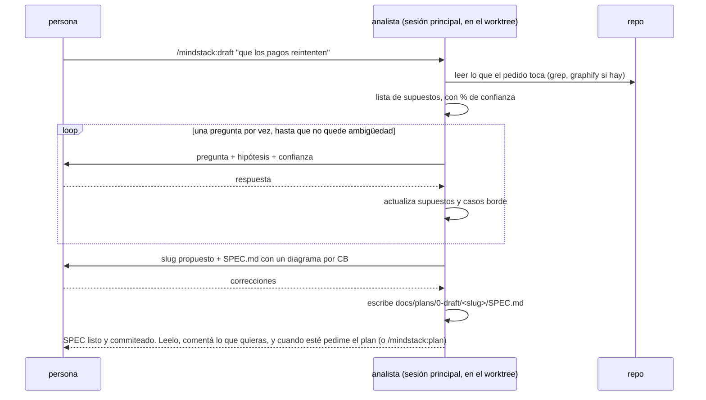
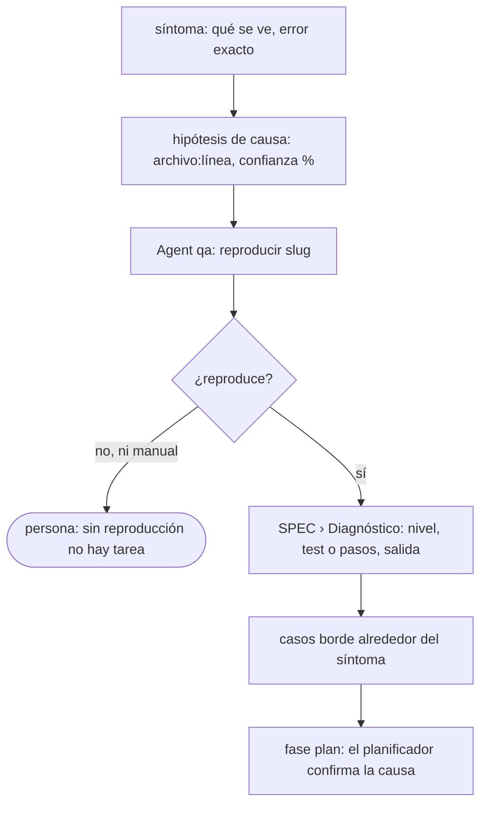

# Analizar: del pedido vago al SPEC

Lo corre `/mindstack:draft "<qué querés>"` en el worktree de la tarea, en diálogo con la persona. Termina con `docs/plans/0-draft/<slug>/SPEC.md` y nada más: ni plan, ni código. Después el diálogo sigue en la misma conversación: los comentarios sueltos de la persona corrigen el SPEC (commit por vuelta), y cuando pide el plan, en palabras ("generá el plan") o con `/mindstack:plan`, se pasa a `plan.md`. El analista no lo dispara solo.



## Antes de preguntar

1. Leé el repo donde el pedido pega: entrypoints, el módulo que se nombra, sus callers. Con `graphify query "qué depende de <módulo>"` si existe `graphify-out/graph.json`; con `grep` si no. Diez minutos de lectura ahorran cinco preguntas.
2. Escribí tus supuestos antes de la primera pregunta, cada uno con confianza:

```
ASUMO:
1. (90%) es una app web, no móvil
2. (60%) "reintentar" es automático, sin intervención del usuario
3. (40%) el proveedor de pagos devuelve idempotency keys
→ Pregunto solo los que están debajo de 80%.
```

Lo que está arriba de 80% se afirma y se deja corregir; lo que está abajo se pregunta.

## Cómo se entrevista

- **Una pregunta por vez.** Con la hipótesis que tenés y por qué importa la respuesta. "¿El reintento es automático? Creo que sí (60%) porque el pedido dice 'que reintenten'; cambia si hace falta un botón en la web."
- **Opciones cerradas cuando se puede.** Tres opciones con consecuencia cada una valen más que una pregunta abierta.
- **Parar cuando no queda ambigüedad que cambie el SPEC.** No cuando se acaban las preguntas posibles. Si una respuesta no cambiaría ni el alcance ni un caso borde, no se pregunta.
- **Cada respuesta genera o descarta casos borde.** Anotalos al momento, numerados. Un caso borde es una entrada o situación donde el camino feliz no alcanza: vacío, duplicado, timeout, concurrencia, permiso, cantidad cero o enorme, estado intermedio.
- **Pedido grande.** Si el pedido junta varias capacidades que se prueban por separado (identidad + facturación + notificaciones), antes del SPEC proponé un mapa: una tabla `módulo | responsabilidad | depende de` y un orden. La persona lo aprueba y se hace un SPEC por módulo, en orden de dependencia, cada uno con su slug y `padre:` en el PLAN apuntando al primero. Un pedido normal no pasa por acá.

## Si es un fix

Para arreglar algo, entender el problema es localizarlo. El analista baja a archivo, pero como hipótesis; la confirmación es del planificador y la prueba es de `qa`.



1. **Síntoma antes que causa.** Qué se ve, dónde, el error textual. Si la persona ya trae la causa, se anota como hipótesis igual.
2. **Hipótesis con evidencia.** Leé el flujo donde pega (grep, graphify, logs si hay). `archivo:línea`, por qué, confianza en %. Lo que miraste y descartaste también se anota.
3. **Encargá la reproducción a `qa`** con `Agent` (`subagent_type: qa`, prompt `reproducir <slug>` más el síntoma y el punto de entrada: endpoint, función exportada o pantalla). **No le pases la hipótesis de causa**: QA trabaja en caja negra y una reproducción que sabe dónde está el bug prueba la hipótesis, no el síntoma. QA sube por la escalera unitario → integración → e2e → manual y se queda en el primer nivel que reproduce. Deja `notes/repro.md` y el working tree limpio; no commitea.
4. **Sin reproducción no hay plan.** `REPRO: NO` termina la entrevista: la persona decide si consigue más datos o cierra la tarea. `REPRO: manual` alcanza para aprobar; el test automático llega como tarea 1 del plan, al nivel de la causa raíz confirmada.
5. Los casos borde de un fix son las variantes del síntoma: misma entrada con otro estado, el camino vecino que no debe cambiar, la condición de carrera si la hay.

## Qué va al SPEC

Plantilla: `../templates/SPEC.md`. Lo que no se negocia:

| Sección | Regla |
|---|---|
| Pedido original | textual, sin interpretar |
| Cómo funciona hoy | un diagrama, no prosa. Secuencia, flowchart o stateDiagram según la forma del problema |
| Qué se hace | un párrafo y el diagrama propuesto, del mismo tipo que el de "hoy" |
| Qué no se hace | lo que la persona dijo que no, y lo que vos ves que alguien va a querer meter |
| Supuestos | los que quedaron arriba de 80% sin confirmar |
| Diagnóstico | solo en un fix: síntoma, reproducción (de `qa`, con nivel), causa probable con confianza, descartado |
| Casos borde | **uno por sección, `CB-n`, cada uno con diagrama.** Es la red para QA: el tester no habló con la persona y tiene que reproducir el caso solo con esto |
| Criterios de aceptación | verificables por comando o test, cada uno citando los CB que cubre |
| Preguntas abiertas | lo que no cerró. Si al pedir el plan queda alguna, es riesgo del plan |

Diagramas: si dudás entre texto y diagrama, diagrama. Si el diagrama no se entiende sin el texto, rehacelo.

## Commits

Cada vuelta de la entrevista que cambia el SPEC termina en un commit: `spec(<slug>): ronda n` (la primera crea la carpeta). Una vuelta es: la persona dice algo, el SPEC cambia, commit. Cinco correcciones son cinco commits; no se junta todo al final. Es un borrador y se commitea igual: el historial de `0-draft/` es el historial de cómo se entendió el pedido, y permite retomar en otra sesión sin perder nada. En un fix, `notes/repro.md` entra en el mismo commit que la ronda que lo pidió.

## Si es una iteración sobre un PR

La tarea ya tiene PR y lo que se pide es un cambio sobre lo hecho: no se toca su SPEC. Se abre una tarea hija con `/mindstack:draft "<qué falta>" (en el worktree)` (`skills/workflow/references/iterate.md`), que corre este mismo análisis acotado a lo que falta, con `padre:` y la misma rama.

## Slug

Es el nombre del worktree: lo eligió la persona al abrirlo (`claude -w reintento-pagos`) y es también el nombre de la carpeta y de la rama (`worktree-<slug>`). No se inventa ni se renombra. Si la persona pregunta cómo nombrarlo: kebab-case, tres palabras máximo, del objetivo y no de la solución (`reintento-pagos`, no `backoff-exponencial`).

## Qué no

- Decidir cómo se implementa. Eso es el PLAN. Si la persona lo pregunta, "va en el plan".
- Un SPEC con un solo caso borde. Si no encontraste más, no buscaste.
- Dejar una ronda sin commit. Sin commit no hay historial del borrador.
- Generar el plan solo. El SPEC es el contrato con la persona; el plan se genera cuando ella lo pide, en palabras. Terminá diciendo que el SPEC quedó en `0-draft/` y que el siguiente paso es `/mindstack:draft` (fase plan) cuando la persona lo lea.
