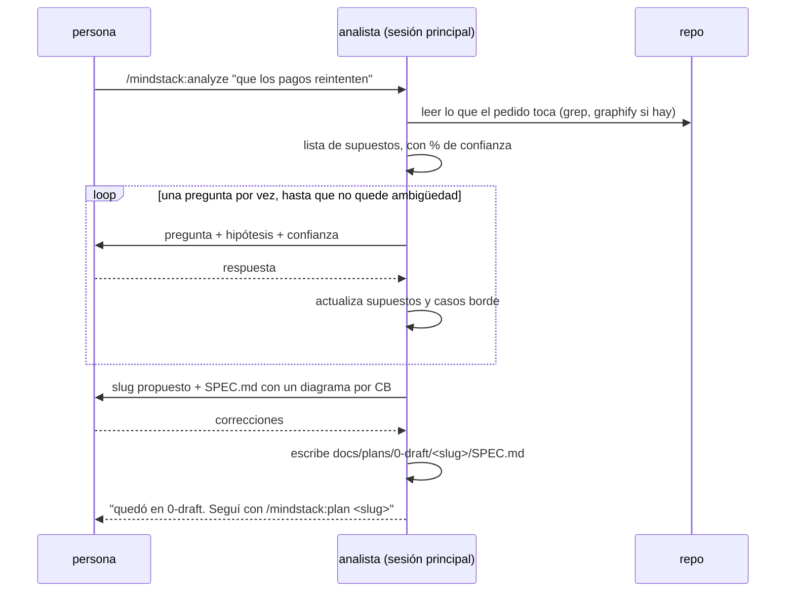

# Analizar: del pedido vago al SPEC

Lo corre `/mindstack:analyze <tema>` en la sesión principal, en diálogo con la persona. Termina con `docs/plans/0-draft/<slug>/SPEC.md` y nada más: ni plan, ni código.



## Antes de preguntar

1. Leé el repo donde el pedido pega: entrypoints, el módulo que se nombra, sus callers. Con `graphify query "qué depende de <módulo>"` si existe `graphify-out/graph.json`; con `grep` si no. Diez minutos de lectura ahorran cinco preguntas.
2. Escribí tus supuestos antes de la primera pregunta, cada uno con confianza:

```
ASUMO:
1. (90%) es una app web, no móvil
2. (60%) "reintentar" es automático, sin intervención del usuario
3. (40%) el proveedor de pagos devuelve idempotency keys
→ Pregunto solo los que están debajo de 80%.
```

Lo que está arriba de 80% se afirma y se deja corregir; lo que está abajo se pregunta.

## Cómo se entrevista

- **Una pregunta por vez.** Con la hipótesis que tenés y por qué importa la respuesta. "¿El reintento es automático? Creo que sí (60%) porque el pedido dice 'que reintenten'; cambia si hace falta un botón en la web."
- **Opciones cerradas cuando se puede.** Tres opciones con consecuencia cada una valen más que una pregunta abierta.
- **Parar cuando no queda ambigüedad que cambie el SPEC.** No cuando se acaban las preguntas posibles. Si una respuesta no cambiaría ni el alcance ni un caso borde, no se pregunta.
- **Cada respuesta genera o descarta casos borde.** Anotalos al momento, numerados. Un caso borde es una entrada o situación donde el camino feliz no alcanza: vacío, duplicado, timeout, concurrencia, permiso, cantidad cero o enorme, estado intermedio.
- **Pedido grande.** Si el pedido junta varias capacidades que se prueban por separado (identidad + facturación + notificaciones), antes del SPEC proponé un mapa: una tabla `módulo | responsabilidad | depende de` y un orden. La persona lo aprueba y se hace un SPEC por módulo, en orden de dependencia, cada uno con su slug y `padre:` en el PLAN apuntando al primero. Un pedido normal no pasa por acá.

## Qué va al SPEC

Plantilla: `../templates/SPEC.md`. Lo que no se negocia:

| Sección | Regla |
|---|---|
| Pedido original | textual, sin interpretar |
| Cómo funciona hoy | un diagrama, no prosa. Secuencia, flowchart o stateDiagram según la forma del problema |
| Qué se hace | un párrafo y el diagrama propuesto, del mismo tipo que el de "hoy" |
| Qué no se hace | lo que la persona dijo que no, y lo que vos ves que alguien va a querer meter |
| Supuestos | los que quedaron arriba de 80% sin confirmar |
| Casos borde | **uno por sección, `CB-n`, cada uno con diagrama.** Es la red para QA: el tester no habló con la persona y tiene que reproducir el caso solo con esto |
| Criterios de aceptación | verificables por comando o test, cada uno citando los CB que cubre |
| Preguntas abiertas | lo que no cerró. Si al aprobar queda alguna, es riesgo del plan |

Diagramas: si dudás entre texto y diagrama, diagrama. Si el diagrama no se entiende sin el texto, rehacelo.

## Slug

Kebab-case, tres palabras máximo, del objetivo y no de la solución: `reintento-pagos`, no `backoff-exponencial`. Es el nombre de la carpeta, de la rama (`worktree-<slug>`) y del worktree; no se renombra.

## Qué no

- Decidir cómo se implementa. Eso es el PLAN. Si la persona lo pregunta, "va en el plan".
- Un SPEC con un solo caso borde. Si no encontraste más, no buscaste.
- Avanzar a `/mindstack:plan` solo. Terminá diciendo que el SPEC quedó en `0-draft/` y que el siguiente paso es `/mindstack:plan <slug>` cuando la persona lo lea.
