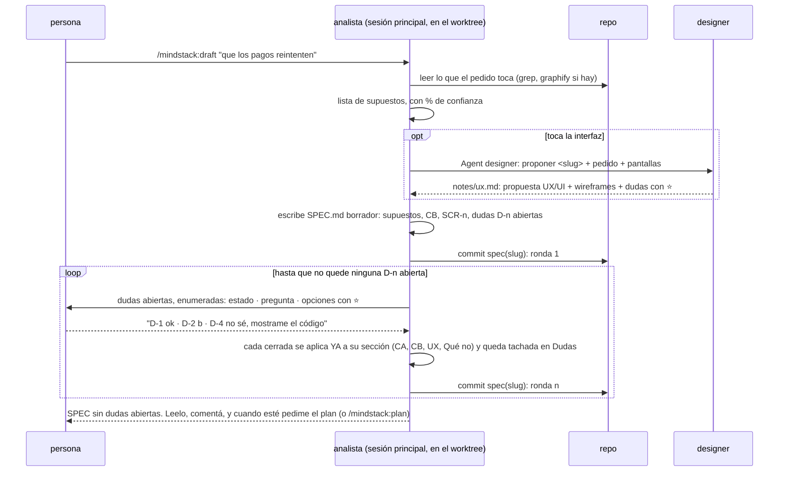
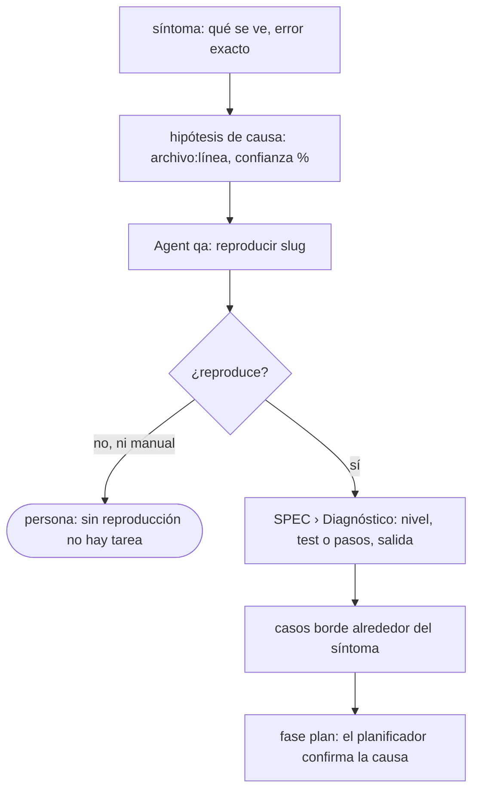

# Analizar: del pedido vago al SPEC

Lo corre `/mindstack:draft "<qué querés>"` en el worktree de la tarea, en diálogo con la persona. Termina con `todolist/0-draft/<slug>/SPEC.md` y nada más: ni plan, ni código. Después el diálogo sigue en la misma conversación: los comentarios sueltos de la persona corrigen el SPEC (commit por vuelta), y cuando pide el plan, en palabras ("generá el plan") o con `/mindstack:plan`, se pasa a `plan.md`. El analista no lo dispara solo.



## Antes de preguntar

1. Leé el repo donde el pedido pega: entrypoints, el módulo que se nombra, sus callers. Con `graphify query "qué depende de <módulo>"` si existe `graphify-out/graph.json`; con `grep` si no. Diez minutos de lectura ahorran cinco preguntas.
2. Escribí tus supuestos antes de la primera pregunta, cada uno con confianza:

```
ASUMO:
1. (90%) es una app web, no móvil
2. (60%) "reintentar" es automático, sin intervención del usuario
3. (40%) el proveedor de pagos devuelve idempotency keys
→ Pregunto solo los que están debajo de 80%.
```

Lo que está arriba de 80% se afirma y se deja corregir; lo que está abajo se pregunta.

## Cómo se entrevista

- **El SPEC existe desde la primera ronda.** Apenas tenés los supuestos (y la propuesta del `designer`, si toca la interfaz), escribí el borrador con lo que sabés y las dudas en `SPEC › Dudas`, y commiteá. La persona siempre tiene algo que mirar, y si la sesión se corta no se pierde nada.
- **Toda duda es una decisión `D-n`, con el mismo formato** (`../templates/SPEC.md › Dudas`): un **estado** concreto del sistema (qué hay, quién hace qué, con datos), la **pregunta** de qué debería pasar ahí, y las **opciones** sobre la mesa (dos a cuatro, cada una con su consecuencia), una marcada ⭐ como tu preferida y por qué. Sin estado no se entiende la pregunta; sin opciones, la persona diseña por vos; sin preferida, no puede contestar "ok". Las tuyas, las del `designer` y los supuestos debajo de 80% entran igual.
- **Se muestran todas las abiertas, enumeradas.** La persona contesta por número, las que quiera y en el orden que quiera: "D-1 ok" (la ⭐), "D-2 b", "D-3 ninguna: …". El número no se reusa ni se renumera.
- **Una duda cerrada se aplica en el momento.** La respuesta cambia la sección que corresponde (un `CA-n`, un `CB-n`, la tabla de UX, un wireframe, "Qué no se hace") en la misma ronda, y la `D-n` queda tachada con su destino (`→ a · CA-7, CB-4`). Una ronda con respuestas termina en commit. Nada queda "anotado para después": lo que no está en el SPEC se olvida.
- **No hay más dudas cuando no queda ambigüedad que cambie el SPEC.** No cuando se acaban las preguntas posibles. Si una respuesta no cambiaría ni el alcance ni un caso borde, no se pregunta.
- **Cada respuesta genera o descarta casos borde.** Anotalos al momento, numerados. Un caso borde es una entrada o situación donde el camino feliz no alcanza: vacío, duplicado, timeout, concurrencia, permiso, cantidad cero o enorme, estado intermedio.
- **Si toca endpoints, las reglas se escriben una por una.** Por cada endpoint, comando o evento que se crea o cambia: cada campo (tipo, rango, obligatorio, si tiene que existir), quién puede llamarlo, y qué responde cuando falla. Contestalas leyendo el schema o contrato que ya existe (`contracts`, DTO, Zod) y los endpoints vecinos; preguntá solo lo que no esté, con tu hipótesis. Cada regla es un `CA-n` en Criterios de aceptación: una validación que no está escrita no la implementa nadie y no la verifica nadie.
- **Si toca la interfaz, el diseño lo propone `designer`, siempre.** Toca la interfaz si el pedido nombra algo que la persona ve (pantalla, modal, botón, mensaje, ruta) o si lo que leíste del repo cambia un archivo de una app de front (`CLAUDE.md › Apps y paquetes`). En la duda, toca. No es opcional ni se reemplaza por una descripción tuya: sin `designer` no hay wireframes, y sin wireframes `/plan` no pasa. Antes de la primera pregunta de UX, lanzá `Agent` (`subagent_type: designer`, prompt `proponer <slug>` más el pedido, las pantallas o rutas que toca y lo que la persona ya respondió). Devuelve `notes/ux.md` con la propuesta completa y sus preguntas. Sus dudas entran a `SPEC › Dudas` como las tuyas, con número `D-n`; lo que está arriba de 80% se afirma y se deja corregir. Si la persona trae un mockup o nombra una pantalla parecida, pasáselo en el prompt. Si las respuestas cambian mucho la propuesta (otra pantalla, otro flujo), relanzalo con las respuestas; si no, ajustá vos la sección.
- **Pedido grande.** Si el pedido junta varias capacidades que se prueban por separado (identidad + facturación + notificaciones), antes del SPEC proponé un mapa: una tabla `módulo | responsabilidad | depende de` y un orden. La persona lo aprueba y se hace un SPEC por módulo, en orden de dependencia, cada uno con su slug y `padre:` en el PLAN apuntando al primero. Un pedido normal no pasa por acá.

## Si es un fix

Para arreglar algo, entender el problema es localizarlo. El analista baja a archivo, pero como hipótesis; la confirmación es del planificador y la prueba es de `qa`.



1. **Síntoma antes que causa.** Qué se ve, dónde, el error textual. Si la persona ya trae la causa, se anota como hipótesis igual.
2. **Hipótesis con evidencia.** Leé el flujo donde pega (grep, graphify, logs si hay). `archivo:línea`, por qué, confianza en %. Lo que miraste y descartaste también se anota.
3. **Encargá la reproducción a `qa`** con `Agent` (`subagent_type: qa`, prompt `reproducir <slug>` más el síntoma y el punto de entrada: endpoint, función exportada o pantalla). **No le pases la hipótesis de causa**: QA trabaja en caja negra y una reproducción que sabe dónde está el bug prueba la hipótesis, no el síntoma. QA sube por la escalera unitario → integración → e2e → manual y se queda en el primer nivel que reproduce. Deja `notes/repro.md` y el working tree limpio; no commitea.
4. **Sin reproducción no hay plan.** `REPRO: NO` termina la entrevista: la persona decide si consigue más datos o cierra la tarea. `REPRO: manual` alcanza para aprobar; el test automático llega como tarea 1 del plan, al nivel de la causa raíz confirmada.
5. Los casos borde de un fix son las variantes del síntoma: misma entrada con otro estado, el camino vecino que no debe cambiar, la condición de carrera si la hay.

## Qué va al SPEC

Plantilla: `../templates/SPEC.md`. Lo que no se negocia:

| Sección | Regla |
|---|---|
| Pedido original | textual, sin interpretar |
| Cómo funciona hoy | un diagrama, no prosa. Secuencia, flowchart o stateDiagram según la forma del problema |
| Qué se hace | un párrafo y el diagrama propuesto, del mismo tipo que el de "hoy" |
| UX/UI | **si toca la interfaz, obligatoria**: flujo de pantallas en stateDiagram, una fila por interacción (cuándo → qué se muestra, cómo, dónde, qué no se mueve), estados por pantalla (cargando, vacío, error, sin permiso, con datos), medidas de modales y paneles, textos literales, y **Referencias de UI**: una `SCR-n` por pantalla con el link a `wireframes/rendered/<nombre>.svg`, nunca el SVG pegado. Sale de `notes/ux.md` y `wireframes/` del `designer`, corregido con las respuestas; si una respuesta cambia la disposición, se corrige el `.wireloom` y se vuelve a renderizar en la misma ronda. Mostrale a la persona el SVG, no la tabla: es lo que va a mirar. Los criterios generales no se repiten: están en `mindstack:design` |
| Qué no se hace | lo que la persona dijo que no, y lo que vos ves que alguien va a querer meter |
| Supuestos | los que quedaron arriba de 80% sin confirmar |
| Diagnóstico | solo en un fix: síntoma, reproducción (de `qa`, con nivel), causa probable con confianza, descartado |
| Casos borde | **uno por sección, `CB-n`, cada uno con diagrama.** Es la red para QA: el tester no habló con la persona y tiene que reproducir el caso solo con esto |
| Criterios de aceptación | **uno por regla, `CA-n`**, verificable por un test con entrada concreta, citando los CB que cubre. Por cada endpoint que se toca: cada campo, quién puede llamarlo, qué responde al fallar. Es lo que el `verifier` exige antes del PR |
| Dudas | **toda decisión que falta, `D-n`**: estado, pregunta, opciones con ⭐. Las cerradas quedan tachadas con su destino. Si al pedir el plan queda alguna abierta, es riesgo del plan |

Diagramas: si dudás entre texto y diagrama, diagrama. Si el diagrama no se entiende sin el texto, rehacelo.

## Commits

Cada vuelta de la entrevista que cambia el SPEC termina en un commit: `spec(<slug>): ronda n` (la primera crea la carpeta). Una vuelta es: la persona dice algo, el SPEC cambia, commit. Cinco correcciones son cinco commits; no se junta todo al final. Es un borrador y se commitea igual: el historial de `0-draft/` es el historial de cómo se entendió el pedido, y permite retomar en otra sesión sin perder nada. En un fix, `notes/repro.md` entra en el mismo commit que la ronda que lo pidió.

## Si es una iteración sobre un PR

La tarea ya tiene PR y lo que se pide es un cambio sobre lo hecho: no se toca su SPEC. Se abre una tarea hija con `/mindstack:draft "<qué falta>" (en el worktree)` (`skills/workflow/references/iterate.md`), que corre este mismo análisis acotado a lo que falta, con `padre:` y la misma rama.

## Si sale del backlog

`/mindstack:draft backlog: <texto>` toma la fila de `todolist/backlog/IDEAS.md` cuya descripción contiene ese texto (de la persona: Descripción, Prioridad, Fecha, Notas) o la entrada de `PROPUESTAS.md` con ese título (de los agentes); si coincide más de una, preguntá cuál como pedido original. Se entrevista igual: una idea del backlog es un pedido vago más, y una propuesta de agente es una hipótesis, no un requisito; su "dónde se vio" es lo primero que se lee. En "Pedido original" va la entrada textual con su origen (`backlog/PROPUESTAS.md`, propuesta el AAAA-MM-DD en la tarea `<slug>`): así la tarea nueva apunta a la que la vio. Leé esa tarea (`todolist/4-done/<slug>/CHANGELOG.md`) antes de la primera pregunta. El commit `spec(<slug>): ronda 1` saca la entrada de su archivo; queda en el historial y en el SPEC.

## Slug

La primera tarea de una rama se llama como su último tramo, sin `worktree-` (`worktree-reintento-pagos`, `octavio/reintento-pagos` → `reintento-pagos`): lo eligió la persona al abrirla. No se inventa ni se renombra; si la rama no da un nombre que sirva (`fix-1`), proponé uno y confirmalo. Una tarea más en el mismo worktree (cola, `orchestrate.md › Cola`) necesita su propio slug: proponé uno con las mismas reglas y confirmalo con la persona antes del primer commit. Si la persona pregunta cómo nombrarlo: kebab-case, tres palabras máximo, del objetivo y no de la solución (`reintento-pagos`, no `backoff-exponencial`).

## Qué no

- Decidir cómo se implementa. Eso es el PLAN. Si la persona lo pregunta, "va en el plan".
- Un SPEC con un solo caso borde. Si no encontraste más, no buscaste.
- Dejar una ronda sin commit. Sin commit no hay historial del borrador.
- Generar el plan solo. El SPEC es el contrato con la persona; el plan se genera cuando ella lo pide, en palabras. Terminá diciendo que el SPEC quedó en `0-draft/` y que el siguiente paso es `/mindstack:draft` (fase plan) cuando la persona lo lea.
