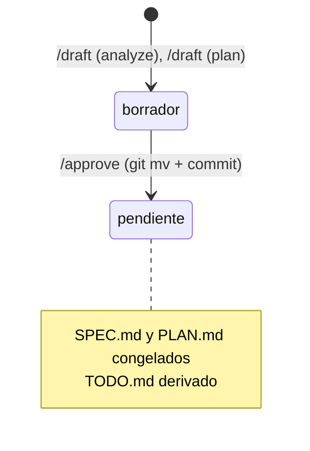

# Aprobar: congelar y pasar a pendiente

Lo corre `/mindstack:approve` cuando la persona leyó SPEC y PLAN y dijo que están. Desde acá `SPEC.md` y `PLAN.md` son inmutables: el hook `plan-immutable.sh` bloquea Edit/Write/Bash sobre ellos en cualquier carpeta que no sea `0-draft/`, y el check de CI `plans-immutable.sh` rechaza un PR que los modifique.

## Pasos

1. Verificá que la carpeta esté en `docs/plans/0-draft/<slug>/` con `SPEC.md`, `PLAN.md` y `CHANGELOG.md`. Si falta algo, pará.
2. Verificá el PLAN: `tipo:` está y es uno de los de la tabla de `plan.md`; cada línea de "Estado final" es verificable; cada tarea tiene `rol:` y verificación; Done es un bloque bash no vacío; `fecha_inicio` y `fecha_fin` están. Si algo falla, decilo y no sigas: se corrige con `/mindstack:draft`, no acá.
2b. Si el SPEC tiene "Diagnóstico": Reproducción no puede estar vacía ni ser `NO`, y el PLAN tiene "Causa raíz: confirmada" y la tarea 1 con rol `qa`. Si no, pará: un fix sin reproducción no se aprueba.
3. Si quedan Preguntas abiertas en el SPEC, listalas y confirmá con la persona que las acepta como riesgo.
4. Generá `TODO.md` desde `../templates/TODO.md`: una línea por tarea del PLAN, mismo número, mismo rol, misma verificación, todas sin tachar.
5. `chmod a-w docs/plans/0-draft/<slug>/SPEC.md docs/plans/0-draft/<slug>/PLAN.md`. Es cosmético (git no guarda ese bit) pero frena un `>` distraído en la sesión local.
6. `git mv docs/plans/0-draft/<slug> docs/plans/1-pending/<slug>`.
7. Un commit propio: `plan(<slug>): approve`. Solo esos archivos.

Terminá diciendo: quedó en `1-pending/`; el siguiente paso es abrir un worktree con ese slug (`claude -w <slug>`) y correr `/mindstack:orchestrate` ahí.

## Qué no

- Aprobar sin que la persona lo haya pedido en esa sesión. Un plan aprobado "de paso" es un plan que nadie leyó.
- Pushear. El push a main lo hace la persona, o lo declara `/mindstack:orchestrate`.
