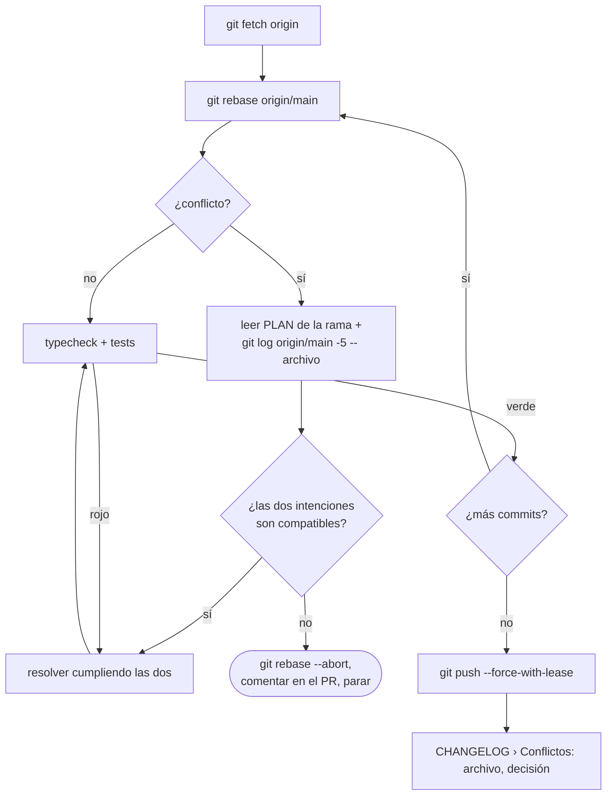

# Conflictos: poner la rama al día

Lo corre `/mindstack:conflicts <slug|#pr>`. Lanza al agente `conflict-resolver`. Termina con la rama rebaseada sobre `main`, la suite verde, push con `--force-with-lease` y la sección Conflictos del CHANGELOG escrita.

Rebase y no merge: el PR queda lineal y cada conflicto se resuelve en el commit que lo causó, con menos contexto cada vez.

## Reglas

- Un conflicto es dos intenciones; resolverlo es cumplir las dos. Nunca "el mío" o "el de ellos" entero sin leer.
- Incompatibles (uno borra lo que el otro usa): no inventar. Abortar, comentar en el PR qué choca, parar.
- Suite después de cada commit resuelto. Rojo = se resolvió mal, no "ya estaba así".
- No tocar archivos sin conflicto. No modificar tests para que pasen después del rebase.
- `--force-with-lease`, nunca `--force`. Es el único push forzado del flujo.
- Cada archivo tocado: fila en `CHANGELOG › Conflictos` con la decisión, y el mismo resumen como comentario del PR.
