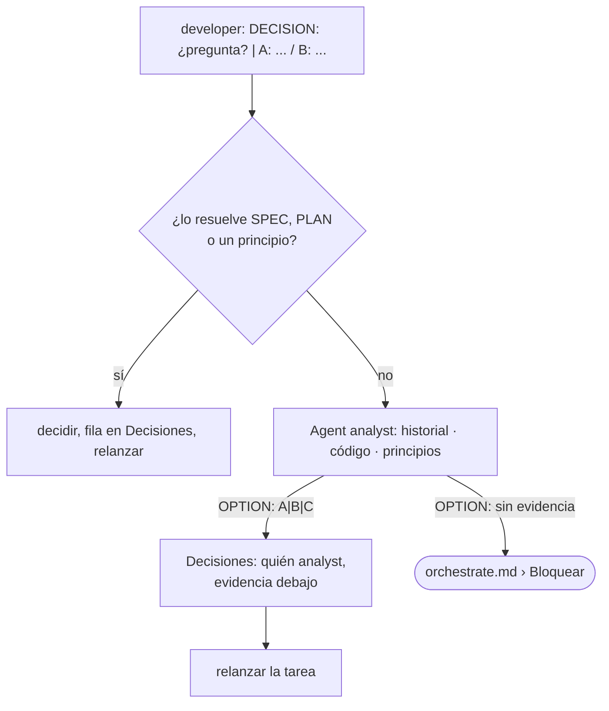

# Decidir sin la persona: cuando el dev no puede decidir solo

Un dev que adivina una ambigüedad produce código que nadie pidió; uno que pregunta cada una interrumpe veinte veces por tarea. Entre las dos: un `analyst` busca la respuesta en lo que ya existe. Si la evidencia alcanza, decide; si no, recién ahí la persona. Se usa en implement, ante una `DECISION:` del developer.



## Formato de la pregunta

La última línea del developer:

```
DECISION: ¿el reintento usa idempotency key del proveedor o una propia? | A: la del proveedor (menos código, depende de que exista) / B: propia en la tabla pagos (más código, no depende del proveedor)
```

Una pregunta, dos o tres opciones cerradas, cada una con su consecuencia. Sin opciones cerradas no hay decisión posible: se relanza al developer pidiéndolas.

## Resultado

- **`OPTION: <letra>`**: el orquestador escribe en `CHANGELOG › Decisiones` una fila con quién `analyst`, la decisión, la alternativa descartada y el principio; debajo, la evidencia. Relanza la tarea.
- **`OPTION: sin evidencia`**: Bloquear. El motivo en `BLOCKED.md` es la pregunta, con las opciones y lo que el analista encontró y no alcanzó. Al retomar, fila en Decisiones con quién `person`.

## Qué no

- Lanzar al analista por algo que el SPEC o el PLAN ya dicen. Primero se relee.
- Tres analistas con el mismo prompt: se equivocan juntos y un voto al azar bloquea de más. Uno que puede decir "no alcanza" es más honesto.
