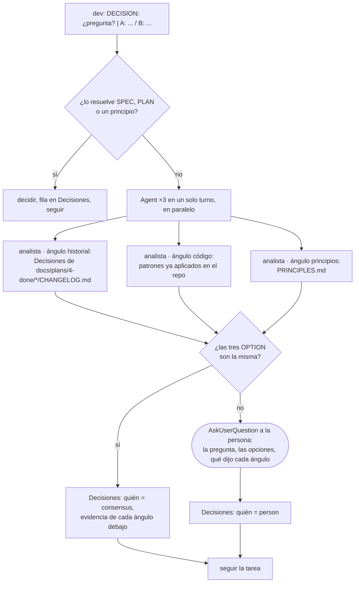

# Consenso: cuando el dev no puede decidir solo

Un dev que adivina una ambigüedad produce código que nadie pidió. Un dev que pregunta cada ambigüedad a la persona la interrumpe veinte veces por tarea. Entre las dos cosas, esto: tres analistas independientes buscan la respuesta en lo que ya existe; si coinciden, se decide; si no, recién ahí la persona.



## Formato de la pregunta

El dev la deja como última línea de su turno, o la escribe antes de lanzar los agentes si corre en la sesión principal:

```
DECISION: ¿el reintento usa idempotency key del proveedor o una propia? | A: la del proveedor (menos código, depende de que exista) / B: propia en la tabla pagos (más código, no depende del proveedor)
```

Una pregunta, dos o tres opciones cerradas, cada una con su consecuencia. Sin opciones cerradas no hay consenso posible.

## Los tres ángulos

Mismo agente (`analyst`), mismo prompt base, distinto ángulo. Se lanzan en un solo turno para que corran en paralelo y no se contaminen:

| Ángulo | Qué busca | Dónde |
|---|---|---|
| `historial` | una decisión igual o parecida ya tomada, y qué principio la respaldó | `docs/plans/4-done/*/CHANGELOG.md` sección Decisiones, y `3-in-review/` si hay |
| `código` | cómo se resolvió el mismo problema en otro módulo del repo | `grep`, `graphify query`, los tests existentes |
| `principios` | qué opción cumple más principios y cuál rompe alguno | `${CLAUDE_PLUGIN_ROOT}/PRINCIPLES.md` |

Cada analista termina con `OPTION: A` (o B, o C) y dos renglones de evidencia. No puede proponer una opción nueva ni abstenerse: si no encuentra nada, elige por el principio más cercano y lo dice.

## Resultado

- **3/3 iguales**: el dev escribe en `CHANGELOG › Decisiones` una fila con quién `consensus`, la decisión, la alternativa descartada y el principio; debajo, una línea por ángulo con su evidencia. Sigue.
- **No coinciden**: `AskUserQuestion` con la pregunta, las opciones y, por cada ángulo, qué eligió y por qué. La persona decide; fila con quién `person`. Si la sesión no es interactiva (`$CI`), el dev termina con `BLOCKED: consenso sin acuerdo sobre <pregunta>` y el loop para.

## Qué no

- Lanzar consenso por algo que el SPEC o el PLAN ya dicen. Primero se relee.
- Un solo analista. Uno confirma lo que el dev ya pensó; tres con ángulos distintos no.
- Dos de tres. El desacuerdo es la señal de que hace falta la persona.
