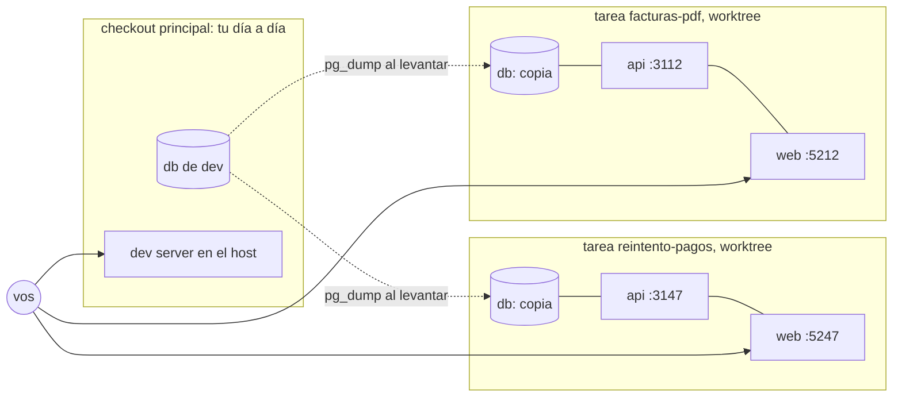

# Entorno por tarea: localhost, no público

Cada tarea corre en su propio entorno local, aislado, con una copia de tu DB de desarrollo. Vos abrís `http://localhost:52xx`, probás la feature, pedís cositas en la misma sesión, y recién después el orquestador (fase review). Sin `git pull`, sin cambiar de rama, sin que tu entorno principal se entere.

**No se sube a ningún lado.** El entorno de una tarea vive en tu máquina. Un preview deploy público es otra decisión, con sus costos (secretos, acceso, datos); si algún día entra, se documenta acá y lo levanta el orquestador (fase implement) en vez de `env-up.sh`. Hoy no existe y no hace falta para el flujo.

## Qué hace `env-up.sh`

`${CLAUDE_PLUGIN_ROOT}/scripts/env-up.sh <slug> [db]`, desde el worktree de la tarea. Necesita un `docker-compose.yml` con puertos por variable de entorno (`${API_PORT:-3000}`); cómo escribirlo lo dice `mindstack:docker-ci`.

| Paso | Qué | Por qué |
|---|---|---|
| puertos | `n = cksum(slug) % 100`; api `3100+n`, web `5200+n`, db `5500+n`, grafana `3300+n`; los escribe en el `.env` del worktree | estables entre levantadas, distintos entre tareas; dos tareas a la vez no chocan |
| `DATABASE_URL` | apunta a `localhost:5500+n` en el `.env` del worktree; Compose la pisa con host `db` adentro | tests y dev server del host pegan a la DB de la tarea, no a la tuya |
| seed | `pg_dump` de la DB del checkout principal a `.seed/00-dev.sql`; Postgres lo carga solo la primera vez que inicializa el volumen | probás con tus datos, no con una DB vacía; si tu DB de dev no corre, avisa y arranca vacía |
| `db` | `docker compose -p <slug> up -d db` | al arrancar el loop: solo la DB, liviano |
| todo | `docker compose -p <slug> up -d --build db api web` | al terminar el loop: api y web buildeados desde la rama, lo mismo que iría a producción |

Cada tarea es un proyecto de Compose aparte (`-p <slug>`): red, volúmenes y contenedores propios. Idempotente: correrlo de nuevo rebuildea api y web y no toca la DB. `env-down.sh <slug>` lo baja y borra volúmenes y seed; lo corre el orquestador (fase finalize).

| | Checkout principal | Entorno de una tarea |
|---|---|---|
| quién lo levanta | vos | el orquestador (fase implement): `db` al arrancar, todo al terminar el loop |
| api y web | en el host, dev server con hot reload | en contenedor, build de la rama |
| db | la tuya, persistente | copia de la tuya al levantar; se tira con `env-down` |
| puertos | los de siempre | `3100+n`, `5200+n`, `5500+n` |
| observabilidad | sí, si querés | no: es lo único pesado y no hace falta para probar una feature |
| cuándo se baja | nunca | el orquestador (fase finalize), después del merge |

Claude no trabaja adentro de los contenedores: edita en el worktree y el contenedor corre el resultado. Para hot reload mientras iterás, el dev server del stack en el host lee el `.env` del worktree, que ya apunta a la DB y los puertos de la tarea.

## Dónde queda la URL

`PLAN.md` está congelado, así que la URL no va ahí. Va a `CHANGELOG › Cambios` como fila de `developer`: "entorno levantado: `http://localhost:5247`". el orquestador (fase implement) la deja en pantalla al terminar y `PR.md › Cómo probarlo` la repite.

## Sin Docker

El flujo no exige Docker: exige un comando para levantar y una URL para probar. Si el proyecto no tiene `docker-compose.yml`, el orquestador (fase implement) se saltea `env-up.sh` y el `developer` deja en `CHANGELOG › Cambios` cómo se levanta (el comando del stack) y dónde probar. Lo que se pierde sin Compose es el aislamiento de la DB entre tareas; con una sola tarea a la vez no importa.

Costo real con Docker: una imagen por rama (capas cacheadas, un minuto la segunda vez), un Postgres idle de 50 MB y el tamaño de tu dump. Diez tareas a la vez caben en una máquina de desarrollo.
