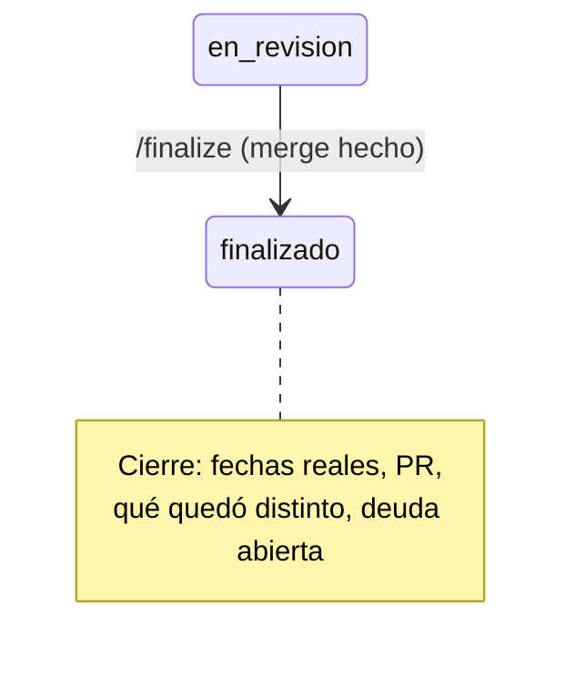

# Finalizar: cerrar la tarea

Lo corre `/mindstack:finalize <slug>` en el checkout principal, en `main`, después del merge. Termina con `CHANGELOG › Cierre` escrito y la carpeta en `4-done/`.

## Pasos

1. Verificá: estás en `main`, al día (`git pull`), y la carpeta está en `docs/plans/3-in-review/<slug>/`. Si el PR no está mergeado (`gh pr view <n> --json state`), pará.
2. `CHANGELOG › Cierre`:
   - Inicio real: fecha del commit `plan(<slug>): implement`. Fin real: fecha del merge. Al lado, las planificadas del PLAN.
   - PR: #n.
   - Qué quedó distinto de lo planeado: resumen de Decisiones, en dos o tres líneas.
   - Deuda que sigue abierta: cada issue de Deuda técnica, con su vencimiento.
3. Si hay compose: `${CLAUDE_PLUGIN_ROOT}/scripts/env-down.sh <slug>`.
4. `git mv docs/plans/3-in-review/<slug> docs/plans/4-done/<slug>`.
5. Commit `plan(<slug>): finalize`. Solo docs. El push a main lo hace la persona.
6. Si hay `graphify-out/`: `/graphify . --update --no-viz`, para que el grafo del principal vea lo mergeado.
7. Worktree: `git worktree remove .claude/worktrees/<slug>` si la persona lo pide; si no, decí que queda.

Terminá con el Cierre en pantalla: es el resumen que la persona lee para saber qué pasó y qué deuda quedó.
