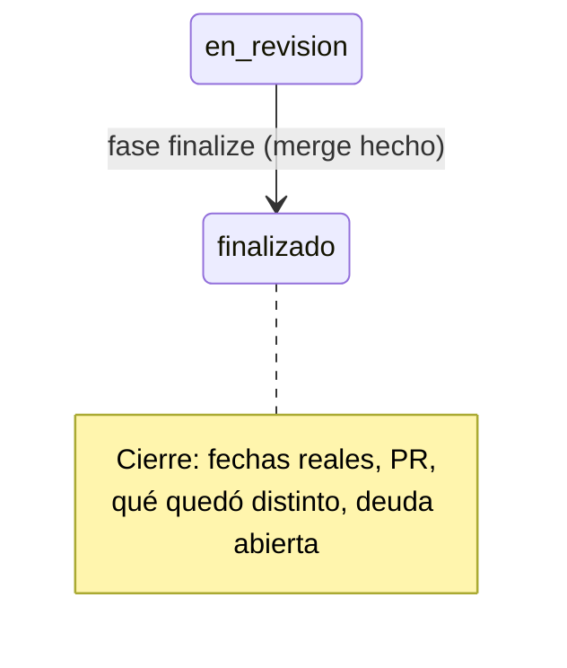

# Finalizar: cerrar la tarea

Lo corre el orquestador cuando `/mindstack:orchestrate` se invoca en el checkout principal, en `main`, con la carpeta en `3-in-review/` y el PR mergeado o cerrado. Termina con `CHANGELOG › Cierre` escrito y la carpeta en `4-done/`.

## Pasos

1. Verificá: estás en `main`, al día (`git pull`), y la carpeta está en `docs/plans/3-in-review/<slug>/`. `gh pr view <n> --json state,mergedAt`:
   - `MERGED`: seguí.
   - `CLOSED` sin merge: la tarea se cierra igual, con su memoria. Traé la carpeta desde la rama: `git checkout worktree-<slug> -- docs/plans/3-in-review/<slug>` (y las hijas `<slug>-n` si las hay). El código no entra; la carpeta sí.
   - `OPEN`: pará.
   Si hay tareas hijas (`padre: <slug>` en `1-pending/`, `2-in-progress/` o `3-in-review/`), se finalizan juntas con el padre: mismo Cierre, mismo commit.
2. `CHANGELOG › Cierre`:
   - Inicio real: fecha del commit `plan(<slug>): implement`. Fin real: fecha del merge. Al lado, las planificadas del PLAN.
   - PR: #n, con la URL de `PR.md`. Estado: mergeado / cerrado sin merge y por qué.
   - Iteraciones: una línea por hija, con su slug y qué agregó.
   - Qué quedó distinto de lo planeado: resumen de Decisiones, en dos o tres líneas.
   - Deuda que sigue abierta: cada issue de Deuda técnica, con su vencimiento.
3. Si hay compose: `${CLAUDE_PLUGIN_ROOT}/scripts/env-down.sh <slug>`. Baja el stack de la tarea y borra sus volúmenes y seed (`skills/workflow/references/environment.md`).
4. `git mv docs/plans/3-in-review/<slug> docs/plans/4-done/<slug>`, y lo mismo para cada hija desde la carpeta donde esté.
5. Commit `plan(<slug>): finalize`. Solo docs. El push a main lo hace la persona.
6. Si hay `graphify-out/`: `/graphify . --update --no-viz`, para que el grafo del principal vea lo mergeado.
7. Worktree: `git worktree remove .claude/worktrees/<slug>` si la persona lo pide; si no, decí que queda.

Terminá con el Cierre en pantalla: es el resumen que la persona lee para saber qué pasó y qué deuda quedó.
