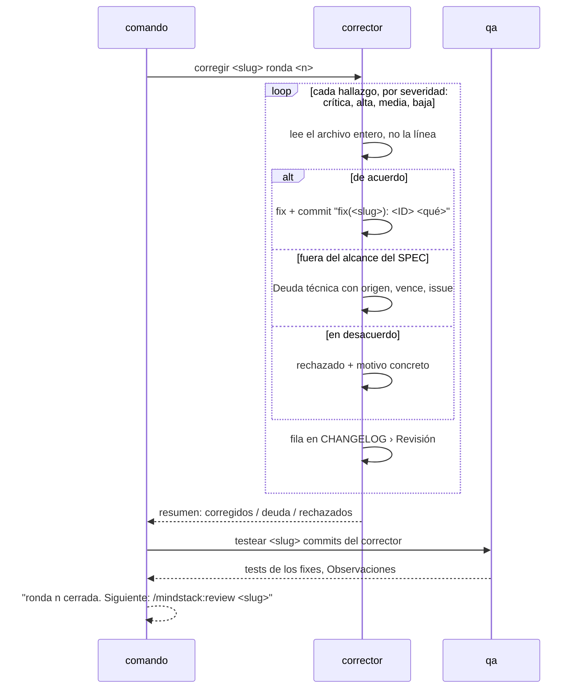

# Corregir: cerrar una ronda

Lo corre `/mindstack:fix <slug>`. Requiere los tres `REVIEW-*.md` de la ronda actual. Lanza al agente `fixer`, después al agente `qa` sobre lo que el corrector cambió, y termina sugiriendo `/mindstack:review` de nuevo.

## Reglas

| Regla | Por qué |
|---|---|
| Cada hallazgo tiene un resultado en `CHANGELOG › Revisión`: `corregido <sha>` · `deuda #issue` · `rechazado: motivo` · `fuera de alcance: motivo` | un hallazgo sin respuesta es una ronda que no cierra |
| Crítica y alta no pueden ser deuda | si bloquean el PR, se corrigen o se discute con la persona |
| Deuda lleva Origen (el ID), Vence (fecha) e Issue | sin issue es olvido; sin vencimiento es para siempre |
| Un commit por hallazgo, con el ID en el mensaje | el revisor de la ronda siguiente ve qué cambió por qué |
| El corrector no agrega hallazgos ni toca fuera de los que hay | lo que ve de paso va a Observaciones |
| El corrector no escribe tests; `qa` los escribe después | la misma separación que en el loop |
| Rechazar requiere motivo concreto, no "no hace falta" | el motivo va a Decisiones si cambia algo del PLAN |

## Después

La ronda cerró cuando todos los hallazgos tienen resultado y `qa` corrió. El comando termina diciendo cuántos corregidos, cuántos a deuda, cuántos rechazados, y que el siguiente paso es `/mindstack:review <slug>` para la ronda siguiente. Si no quedó ninguna crítica ni alta y todo lo demás es deuda aceptada, la persona puede ir directo a `/mindstack:pr`.
