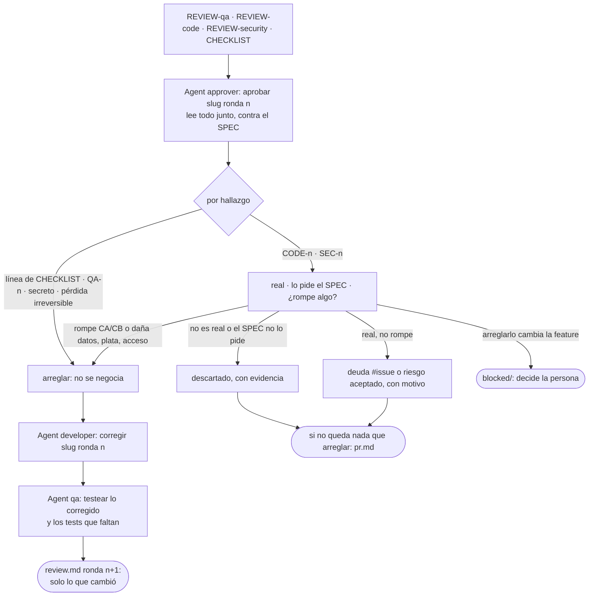

# Corregir: el approver decide, developer y qa arreglan

Lo corre el orquestador (fase fix). Requiere los `REVIEW-*.md` y `CHECKLIST.md` de la ronda actual. Un `approver` lee todo junto y decide qué se arregla; `developer` y `qa` arreglan solo eso; vuelta a review sobre lo que cambió. La tarea no se traba en hallazgos que no la cambian.

## Pasos

1. `Agent approver`: "aprobar <slug> ronda <n> de <rondas_revision>". Escribe su decisión por hallazgo en `CHANGELOG › Revisión` y las deudas en `CHANGELOG › Deuda técnica`, y termina con la lista para corregir y una de tres:
   - `APPROVAL: pr` → `pr.md`.
   - `APPROVAL: blocked <ID>` → `blocked` (`orchestrate.md › Bloquear`), con las opciones que dio el approver como motivo.
   - `APPROVAL: fix <n>` → sigue.
2. `Agent developer`: "corregir <slug> ronda <n>", con los ítems `· developer` de la lista. Si no hay, se saltea. Si termina con `BLOCKED: …` → `blocked`.
3. `Agent qa`: "testear <slug> correcciones ronda <n>", con los ítems `· qa` de la lista y los archivos que el developer dijo que cambian comportamiento.
4. Vuelta a `review.md`, ronda siguiente, sobre lo que cambió: los archivos que tocaron developer y qa, y los IDs que se mandaron a arreglar.

## Reglas

| Regla | Por qué |
|---|---|
| Uno decide, mirando todo junto | un analista por hallazgo no ve que tres hallazgos son el mismo, ni que el SPEC ya contestó; un consenso por cada uno es caro y termina en `blocked/` cuando empata |
| El SPEC es la autoridad: lo que no pide, se descarta | la feature es la que la persona aprobó, no la que imagina el revisor |
| Se decide por consecuencia, no por severidad | una crítica en un panel interno puede ser un riesgo razonable; una media que rompe un `CA-n` no |
| Lo pedido y probado no se negocia: línea de checklist y `QA-n` se arreglan; la cobertura la exige el CI del proyecto | que esté hecho y testeado es el contrato; el criterio es para lo demás |
| Secreto en el repo o pérdida de datos irreversible: siempre se arregla | no se deshace con un revert ni se ve a tiempo en el PR |
| Todo lo que no se arregla tiene motivo en `CHANGELOG › Revisión` y aparece en el PR | la persona lo ve al mergear, que es donde mira el cambio entero |
| Deuda lleva Origen (el ID), Vence (fecha) e Issue | sin issue es olvido; sin vencimiento es para siempre |
| Lo decidido en una ronda no se rediscute en la siguiente | si no, la revisión no converge |
| Sin commit: los arreglos quedan en el working tree con el resto del código | el commit se hace en la fase pr, cuando la revisión pasa |
| El developer no discute lo que el approver mandó arreglar; si no se puede, `BLOCKED` | el que aplica no es juez |

## Después

La ronda cerró cuando cada hallazgo tiene decisión y `qa` corrió. El orquestador sigue con `review.md` en el mismo turno. El tope es `rondas_revision` (`config.sh`): en la última, el approver cierra lo suyo como deuda o riesgo aceptado, y solo queda abierto lo que no se negocia.
