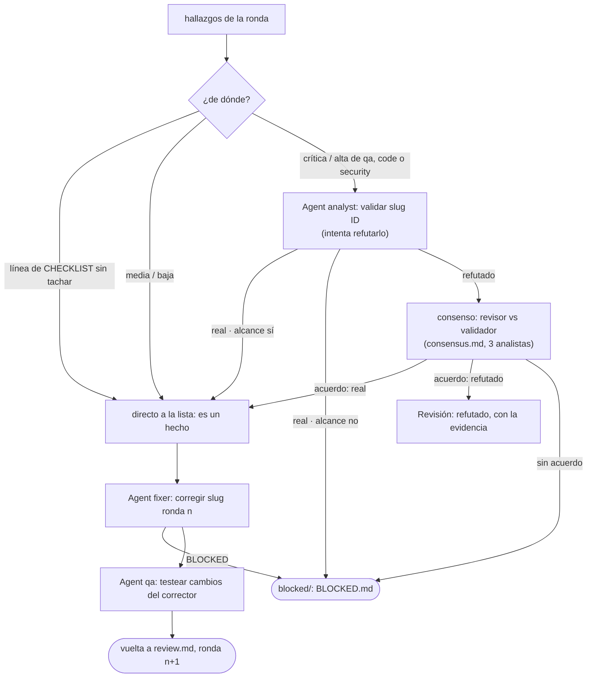

# Corregir: validar y cerrar una ronda

Lo corre el orquestador (fase fix). Requiere los `REVIEW-*.md` y `CHECKLIST.md` de la ronda actual. Primero valida cada hallazgo que bloquea, después lanza al `fixer` con lo validado y a `qa` sobre lo que cambió, y vuelve a la fase review. Un hallazgo no llega al corrector sin que alguien más que su revisor lo haya mirado.

## Validar

1. Por cada hallazgo **crítica o alta** de `REVIEW-qa.md`, `REVIEW-code.md` y `REVIEW-security.md`: un `Agent analyst` con `validar <slug> <ID>`. Todos en un solo turno, en paralelo.
2. Según el `VERDICT`:
   - `real · alcance: sí`: a la lista del corrector, con el arreglo del analista.
   - `real · alcance: no`: crítica y alta no pueden quedar como deuda, así que es de la persona → `blocked`, con el ID y la cita del SPEC (Qué no se hace).
   - `refutado`: el revisor y el validador no coinciden. Consenso (`consensus.md`) con la pregunta "¿`<ID>` es un fallo real?" | A: real (lo que dice el revisor) / B: refutado (lo que dice el validador). 3/3 iguales decide; si no, `blocked`.
3. Fila en `CHANGELOG › Revisión` por cada uno: ronda, rol, ID, severidad, resultado `validado` · `refutado: evidencia` · `bloqueado: motivo`.

Las líneas sin tachar de `CHECKLIST.md` y los hallazgos media y baja no se validan: los primeros son hechos (no hay código, no hay test o está rojo), los segundos no bloquean el PR.

## Corregir

1. `Agent fixer`: "corregir <slug> ronda <n>", con la lista: IDs validados, líneas de la checklist con su `falta:`, media y baja.
2. Si termina con `BLOCKED: …` → `blocked`.
3. `Agent qa`: "testear <slug> cambios del corrector": los archivos que el corrector dijo que cambian comportamiento, y un test por cada línea de checklist que corrigió, que nombre su id.
4. Vuelta a `review.md`, ronda siguiente.

## Reglas

| Regla | Por qué |
|---|---|
| Crítica y alta se validan antes de corregir | un revisor que se equivoca manda al corrector a romper algo que andaba; el corrector ya no rechaza por su cuenta |
| Revisor y validador no coinciden → consenso, no voto del corrector | el que aplica el fix no es juez de si hace falta |
| Cada hallazgo tiene un resultado en `CHANGELOG › Revisión`: `validado` · `refutado: evidencia` · `corregido` · `deuda #issue` · `bloqueado: motivo` | un hallazgo sin respuesta es una ronda que no cierra |
| Crítica y alta no pueden ser deuda | bloquean el PR: se corrigen o los decide la persona |
| Deuda lleva Origen (el ID), Vence (fecha) e Issue | sin issue es olvido; sin vencimiento es para siempre |
| Sin commit: los fixes quedan en el working tree con el resto del código | el commit se hace en la fase pr, cuando la revisión pasa |
| El corrector no agrega hallazgos ni toca fuera de los que hay | lo que ve de paso va a Observaciones |
| El corrector no escribe tests; `qa` los escribe después | la misma separación que en el loop |

## Después

La ronda cerró cuando todos los hallazgos tienen resultado y `qa` corrió. El orquestador sigue con `review.md` en el mismo turno. El tope es de 5 rondas: lo cuenta `review.md`.
