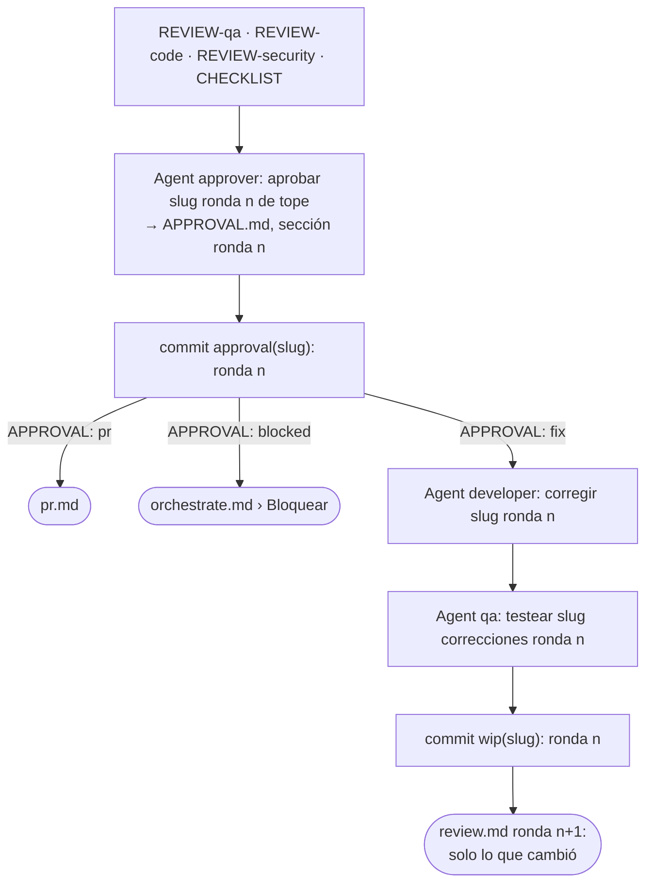

# Corregir: el approver decide, developer y qa arreglan

Lo corre el orquestador (fase fix), siempre después de review. Requiere los `REVIEW-*.md` y `CHECKLIST.md` de la ronda actual. Qué decide el approver y con qué criterio vive en un solo lugar: `agents/approver.md`. Acá, solo cómo se orquesta.

## Pasos

1. `Agent approver`: "aprobar <slug> ronda <n> de <rondas_revision>". Al volver, commit `approval(<slug>): ronda n` solo con `APPROVAL.md` y `TECHNICAL_DEBT.md` (el código sigue sin commitear). Según su última línea:
   - `APPROVAL: pr` → `pr.md`.
   - `APPROVAL: blocked <IDs>` → `orchestrate.md › Bloquear`, con las opciones que dio el approver como motivo.
   - `APPROVAL: fix <n>` → sigue. Si llega `fix` en la última ronda (`n` = `rondas_revision`), se trata como `blocked` con esos IDs.
2. `Agent developer`: "corregir <slug> ronda <n>". Si `APPROVAL.md › Ronda n › Para corregir` no tiene filas de `developer`, se saltea. `BLOCKED: …` → Bloquear.
3. `Agent qa`: "testear <slug> correcciones ronda <n>", con los archivos que el developer dijo que cambian comportamiento. Si no hay filas de `qa` ni archivos, se saltea.
4. Commit `wip(<slug>): ronda n` (`git add -A`, local). Vuelta a `review.md`, ronda siguiente, sobre lo que cambió (`review.md` paso 2).

## Reglas

| Regla | Por qué |
|---|---|
| Uno decide, mirando todo junto | un juez por hallazgo no ve que tres hallazgos son el mismo, ni que el SPEC ya contestó |
| El developer no discute lo que el approver mandó arreglar; si no se puede, `BLOCKED` | el que aplica no es juez |
