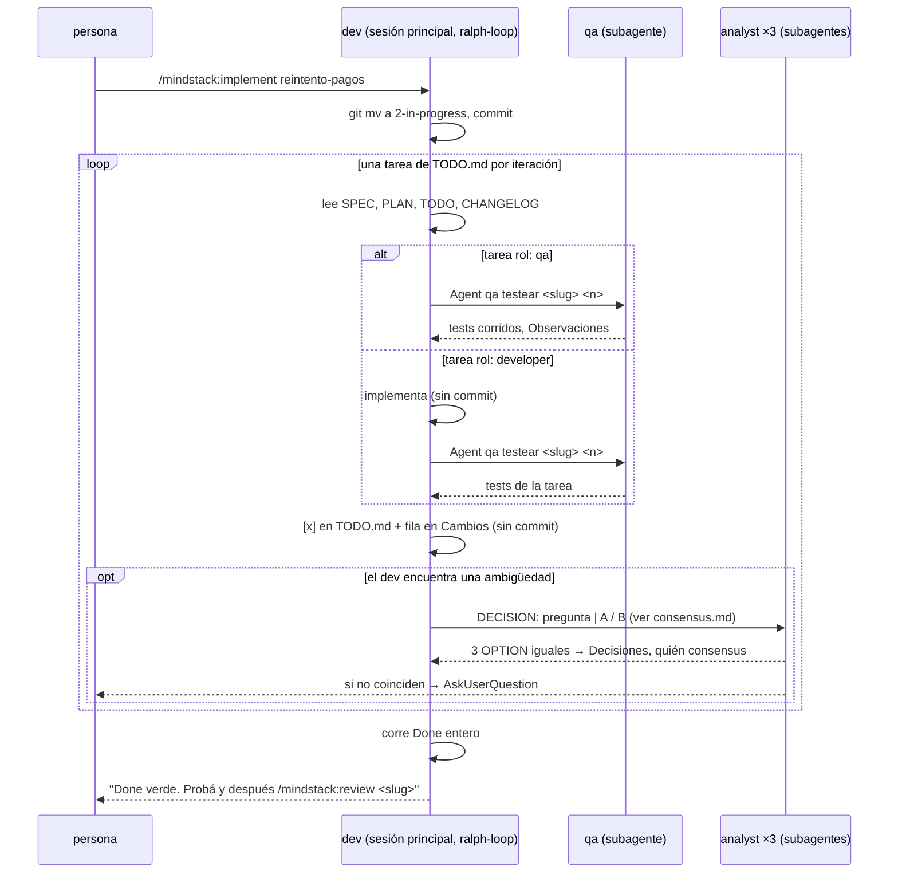

# Implementar: el loop

Lo corre `/mindstack:implement <slug>` en un worktree. Requiere la carpeta en `docs/plans/1-pending/<slug>/` y el plugin `ralph-wiggum` habilitado (`/ralph-loop`). Termina con todas las tareas tachadas en `TODO.md`, Done verde y la carpeta en `2-in-progress/`. **No abre el PR.**



## Dónde estás

```!
pwd
git worktree list 2>/dev/null | head -1 | awk '{print $1}'
ls docs/plans/1-pending/ 2>/dev/null || true
```

Tres líneas: tu directorio, el checkout principal, las tareas pendientes. Si las dos primeras son iguales, no estás en un worktree.

- Carpeta no está en `1-pending/`: pará. El estado es la carpeta y solo `/mindstack:approve` la pone ahí.
- No estás en worktree y `$CI` está vacío: pará. Este comando corre en una sesión abierta con `claude -w <slug>`.
- `/ralph-loop` no existe: pará y decí que falta habilitar `ralph-wiggum`.

## Arranque

1. Rama de la tarea (`rama:` del PLAN); si no existe, crearla desde HEAD. Es la única rama que el flujo crea, y la crea porque el PLAN la nombra.
2. `git mv docs/plans/1-pending/<slug> docs/plans/2-in-progress/<slug>`, commit propio `plan(<slug>): implement`.
3. Si hay `graphify-out/`: `/graphify . --update --no-viz`.
4. Si hay `docker-compose.yml` y `$CI` está vacío: `${CLAUDE_PLUGIN_ROOT}/scripts/env-up.sh <slug> db`. Levanta solo la DB de la tarea, aislada, con copia de la tuya (`skills/workflow/references/environment.md`). Sin compose, el stack dice cómo se corre; nada se levanta todavía.

## El loop

```
/ralph-loop "Cargá la skill mindstack:workflow y leé agents/developer.md del plugin: sos ese rol. Tarea: docs/plans/2-in-progress/<slug>/. Leé SPEC.md, PLAN.md, TODO.md y CHANGELOG.md. Hacé la próxima línea sin [x] de TODO.md, en orden. Si su rol es qa, lanzá el agente qa con 'testear <slug> <n>' y no escribas tests vos. Si su rol es developer, implementala y después lanzá el agente qa con 'testear <slug> <n>'. Al terminar: [x] en TODO.md y fila en CHANGELOG › Cambios con evidencia (comando y salida). No commitees: el código queda en el working tree hasta que pase la revisión. Lo que veas y no sea de esta tarea va a Observaciones; lo que dejes a propósito va a Deuda técnica con issue y vencimiento; una elección discutible va a Decisiones con el principio de references/PRINCIPLES.md. Si una decisión no la resuelve ni el SPEC ni el PLAN ni un principio, no adivines: seguí references/consensus.md de la skill. Cuando todas las líneas de TODO.md tienen [x] y el bloque Done de PLAN.md pasa entero, escribí <promise>PLAN DONE</promise>." --max-iterations 30 --completion-promise "PLAN DONE"
```

Reglas dentro del loop:

| Regla | Por qué |
|---|---|
| Una tarea por iteración. Si no cierra en una, partila en `na` y `nb` en `TODO.md` y anotalo en Decisiones | el PLAN no se toca; el TODO sí |
| El dev no escribe tests. Las tareas `qa` y los tests de cada tarea `developer` los hace el agente `qa` | el que implementa testea lo que pensó, no lo que el código hace |
| No modificar un test existente para que pase. Si estaba mal: Decisiones | un test que se ajusta al código no prueba nada |
| No bajar umbral de cobertura ni desactivar lint | el Done cambia debajo del loop |
| Sin refactors grandes. Lo que molesta y no es de la tarea va a Observaciones o Deuda | un refactor es otra tarea con su SPEC |
| **Nada se commitea durante el loop.** Código, `TODO.md` y `CHANGELOG.md` quedan en el working tree del worktree hasta que la revisión pasa; el commit lo hace `/mindstack:pr` | lo que está commiteado parece terminado. Un commit por tarea a medio revisar es un historial de estados que nadie validó; el worktree aislado es la red mientras tanto |
| La misma tarea falla tres iteraciones seguidas: parar y decir por qué, no insistir | tres fallos es una ambigüedad o un bloqueo, no mala suerte |

## Al terminar

- Done pasó entero: dejalo en la salida con comando y resultado.
- Si hay compose y `$CI` vacío: `env-up.sh <slug>` levanta api y web de la rama en `localhost`, en los puertos de la tarea. Fila en `CHANGELOG › Cambios`: "entorno levantado: `http://localhost:52xx`". Sin compose: el comando del stack para levantar y la URL, en la misma fila. Es local; no se publica en ningún lado (`skills/workflow/references/environment.md`).
- La carpeta se queda en `2-in-progress/`. Terminá diciendo: Done verde, la URL donde probar, y que la revisión arranca con `/mindstack:review <slug>` cuando la persona probó.

Lo que la persona pida después en la sesión ("el botón dice Guardar, no Enviar") se hace acá con las mismas reglas: sin commit, fila en Cambios, tests al agente `qa`.
