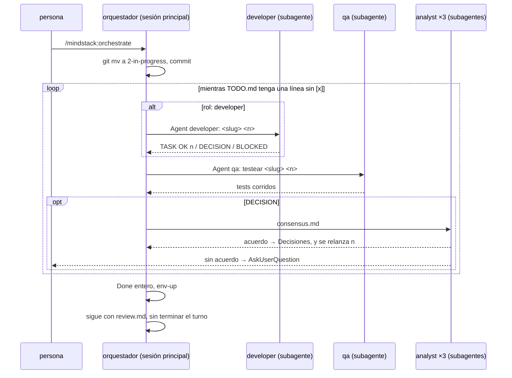

# Implementar: el loop

Lo corre el orquestador (fase implement) en un worktree. Requiere la carpeta en `todolist/1-pending/<slug>/`. Termina con todas las tareas tachadas en `TODO.md`, Done verde y la carpeta en `2-in-progress/`, y **el orquestador sigue en el mismo turno** con la fase review. No abre el PR.



## Dónde estás

```!
pwd
git worktree list 2>/dev/null | head -1 | awk '{print $1}'
ls todolist/1-pending/ 2>/dev/null || true
```

Tres líneas: tu directorio, el checkout principal, las tareas pendientes. Si las dos primeras son iguales, no estás en un worktree.

- Carpeta no está en `1-pending/`: pará. El estado es la carpeta y solo el plan terminado la pone ahí.
- No estás en worktree y `$CI` está vacío: pará. Este comando corre en una sesión abierta con `claude -w <slug>`.

## Arranque

1. Rama de la tarea (`rama:` del PLAN); si no existe, crearla desde HEAD. Es la única rama que el flujo crea, y la crea porque el PLAN la nombra.
2. `git mv todolist/1-pending/<slug> todolist/2-in-progress/<slug>`, commit propio `plan(<slug>): implement`.
3. Si hay `graphify-out/`: `/graphify . --update --no-viz`.
4. Si hay `docker-compose.yml` y `$CI` está vacío: `${CLAUDE_PLUGIN_ROOT}/scripts/env-up.sh <slug> db`. Levanta solo la DB de la tarea, aislada, con copia de la tuya (`skills/workflow/references/environment.md`). Sin compose, el stack dice cómo se corre; nada se levanta todavía.

## El loop

Lo hace la sesión principal, sin plugin de loop: lee `TODO.md`, lanza un subagente por tarea y vuelve a leer. Cada `developer` arranca con contexto vacío (lee SPEC, PLAN, TODO, CHANGELOG y nada más), así que treinta tareas no ensucian a la que sigue; la sesión principal solo acumula la última línea de cada uno.

```
mientras TODO.md tenga una línea sin [x]:
  n = la primera sin [x], en orden
  rol developer → Agent developer "<slug> <n>"
      TASK OK n      → Agent qa "testear <slug> <n>" → siguiente
      DECISION: ...  → consensus.md → la respuesta queda en Decisiones → relanzar n
      BLOCKED: ...   → parar, decir qué
  rol qa        → Agent qa "testear <slug> <n>" → siguiente
  la misma n falla tres veces → parar, decir por qué
Done entero; rojo → Agent developer con el log, como una tarea más
```

**No se termina el turno entre tareas ni al final del loop.** Un resumen de "voy por la 3 de 8" no es una parada: la persona no lo pidió y frena todo. Las únicas paradas son las de la tabla de `orchestrate.md`.

Reglas dentro del loop:

| Regla | Por qué |
|---|---|
| Una tarea por subagente. Si no cierra en una, el developer la parte en `na` y `nb` en `TODO.md` y lo anota en Decisiones | el PLAN no se toca; el TODO sí |
| El dev no escribe tests. Las tareas `qa` y los tests de cada tarea `developer` los hace el agente `qa` | el que implementa testea lo que pensó, no lo que el código hace |
| No modificar un test existente para que pase. Si estaba mal: Decisiones | un test que se ajusta al código no prueba nada |
| No bajar umbral de cobertura ni desactivar lint | el Done cambia debajo del loop |
| Sin refactors grandes. Lo que molesta y no es de la tarea va a Observaciones o Deuda | un refactor es otra tarea con su SPEC |
| **Nada se commitea durante el loop.** Código, `TODO.md` y `CHANGELOG.md` quedan en el working tree del worktree hasta que la revisión pasa; el commit lo hace el orquestador (fase pr) | lo que está commiteado parece terminado. Un commit por tarea a medio revisar es un historial de estados que nadie validó; el worktree aislado es la red mientras tanto |
| La misma tarea falla tres veces seguidas: parar y decir por qué, no insistir | tres fallos es una ambigüedad o un bloqueo, no mala suerte |

## Al terminar

- Done pasó entero: dejalo en la salida con comando y resultado.
- Si hay compose y `$CI` vacío: `env-up.sh <slug>` levanta api y web de la rama en `localhost`, en los puertos de la tarea. Fila en `CHANGELOG › Cambios`: "entorno levantado: `http://localhost:52xx`". Sin compose: el comando del stack para levantar y la URL, en la misma fila. Es local; no se publica en ningún lado (`skills/workflow/references/environment.md`).
- La carpeta se queda en `2-in-progress/`. Una línea con Done verde y la URL donde probar, **y en el mismo turno** seguí con `review.md`. La persona prueba cuando quiere; no se la espera.

Lo que la persona pida después en la sesión ("el botón dice Guardar, no Enviar") se hace acá con las mismas reglas: sin commit, fila en Cambios, tests al agente `qa`.
