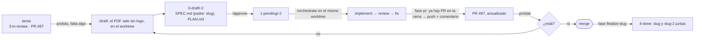

# Iterar sobre un PR: la tarea hija

Probaste el PR en `localhost` y querés cambios. No se edita el SPEC ni el PLAN de la tarea (están congelados) ni se "arregla de paso": se abre una **tarea hija** que hereda la rama y el PR, pasa por el mismo flujo, y pushea al mismo PR. Cada iteración queda con su propio SPEC, PLAN, TODO y CHANGELOG; el PR acumula.

## Qué hace `/mindstack:draft "<qué falta>"` en el worktree de una tarea con PR

La tarea es la del worktree (la rama ya existe y tiene el PR).

1. Verificá: la carpeta `<slug>` está en `3-in-review/` y `PR.md` tiene `pr:` y `url:`. Si no hay PR, no es una iteración: es seguir trabajando en la misma tarea antes de `fase pr`.
2. Slug hijo: `<slug>-2`, `<slug>-3`, … (el siguiente libre).
3. `analyze.md` con el pedido, acotado, y **pará con el SPEC escrito** como siempre: la persona lo lee, comenta, y pide el plan en palabras. Detalle del alcance: el "Cómo funciona hoy" es el estado del PR, no de `main`; el alcance es lo que falta, no la tarea entera; los casos borde son los nuevos. `padre: <slug>` en el frontmatter del SPEC y del PLAN; `rama:` la misma que el padre.
4. `plan.md` igual que siempre. El Done es el mismo del padre más lo nuevo.
5. `approve.md`: `git mv` a `1-pending/<slug>-2`, commit. Se hace en la rama de la tarea, no en `main`: la hija vive y muere con el PR.
6. La persona corre `/mindstack:orchestrate` en el mismo worktree; la tarea activa pasa a ser la hija (la de `1-pending/` con `padre:` igual a la del worktree).
7. `pr.md` detecta que la rama ya tiene un PR abierto: commit único del código de la iteración (`feat|fix(<slug>-2): <título>`), push, y `gh pr comment` con el resumen de la iteración (qué cambió, rondas de revisión, deuda). No abre otro PR. Escribe `pr:` y `url:` del padre en el `PR.md` de la hija.
8. Probás de nuevo. Si falta algo, otra iteración. Si está, mergeás y `fase finalize <slug>` mueve padre e hijas a `4-done/` juntas.

## Qué no

- Editar el SPEC o el PLAN del padre "porque es chico". Están congelados; el hook lo bloquea; y la hija existe justamente para que el cambio tenga su propia memoria.
- Hacer el cambio en la sesión sin tarea hija. Lo que pidas después del PR es una iteración, con revisión; antes del PR, es parte de la tarea.
- Abrir un segundo PR. Un PR por rama; la iteración lo actualiza.
