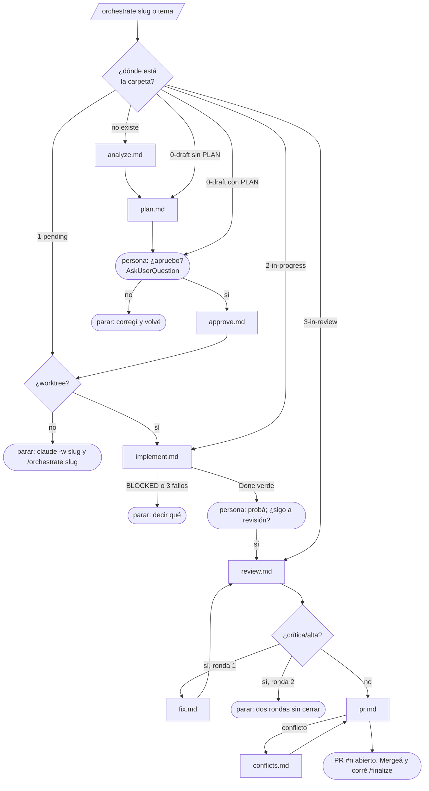

# Orquestar: el flujo entero sin invocar cada comando

Lo corre `/mindstack:orchestrate <slug|tema>` en la sesión principal. Hace lo mismo que la persona haría comando por comando, leyendo las mismas referencias, y se detiene en los puntos donde hace falta una persona. **Nunca mergea ni finaliza.**

## Reglas

| Regla | Por qué |
|---|---|
| El estado es la carpeta. El orquestador detecta dónde está y sigue desde ahí; no asume | se puede cortar y retomar en otra sesión |
| Lee `references/<fase>.md` y hace exactamente eso. No tiene lógica propia | una sola fuente para el modo manual y el orquestado |
| Aprobar solo con `AskUserQuestion` explícita y respuesta afirmativa | un plan aprobado sin lectura es un plan que nadie leyó |
| Implementar solo en worktree. Si no está, para y dice cómo abrirlo | el checkout principal no se toca |
| Antes de revisar, pregunta a la persona si probó | lo que la persona quiere cambiar después de ver la feature es más barato acá que como ronda |
| Máximo 2 rondas revisar↔corregir | dos modelos discutiendo un `media` hasta que se acaba el presupuesto |
| Nunca mergea, nunca finaliza, nunca pushea a `main` | el merge es el único punto donde una persona ve el cambio entero |
| Cada parada dice: estado actual, qué falta, qué comando sigue | la persona retoma sin leer el historial |

## Commits y push

Invocar `/mindstack:orchestrate` es el pedido explícito de todos los commits y push que las fases por las que pasa declaran (`aprobar`, `implementar`, `revisar`, `corregir`, `pr`, `conflictos`). Lo dice la `description` del comando; si la persona no quiere eso, usa los comandos de a uno.
