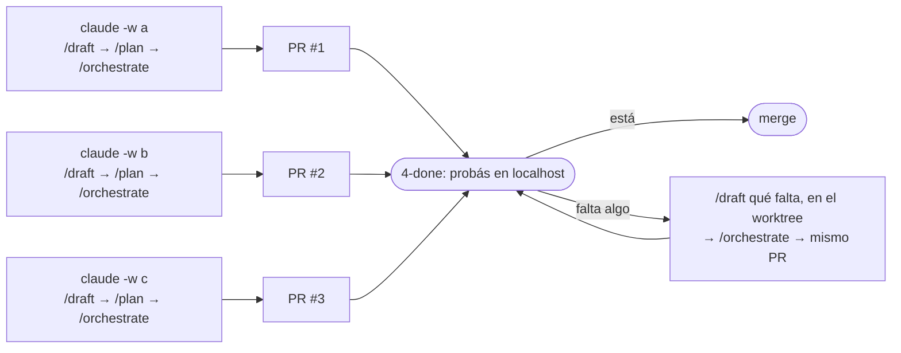
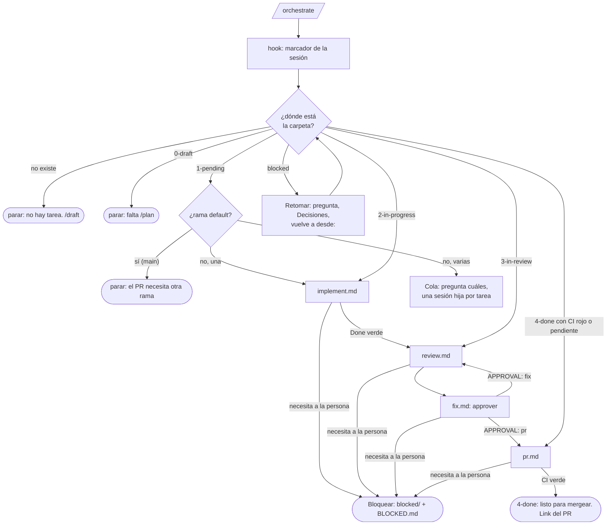
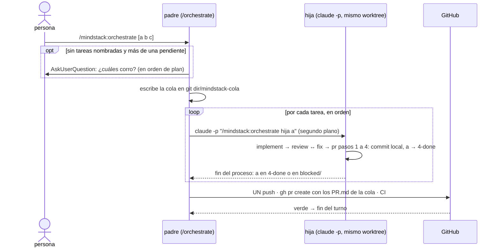

# Orquestar: el flujo entero sin invocar cada comando

Lo corre `/mindstack:orchestrate`. Es el único que ejecuta las fases implement, review, fix, pr y conflicts (con la decisión del analista dentro de implement): no son comandos, son referencias que lee en orden. **Termina en una de dos salidas: la tarea en `4-done/` (todo commiteado, PR abierto, CI verde: lista para mergear) o en `blocked/` con `BLOCKED.md` (necesita a la persona).** Nunca mergea.

## El modelo de uso

Dos formas de correr varias tareas:

| | Paralelo | Cola |
|---|---|---|
| Cuándo | sabés que no dependen entre sí y querés rapidez | dependen, o te da igual cuánto tarde: la dejás un fin de semana |
| Worktrees | uno por tarea (`claude -w a`, `claude -w b`) | uno solo, con varias tareas escritas ahí (`/draft` una, plan, `/draft` otra, plan) |
| PRs | uno por tarea | **uno para todas** |
| Cómo corre | un `/orchestrate` por worktree, a la vez | un `/orchestrate`, que las corre en orden, cada una en una sesión nueva (§ Cola) |

Cada worktree es un PR: el borrador con vos (`/draft`, comentarios, "generá el plan"), y después el orquestador solo. Varias tareas son varios worktrees, cada uno con su sesión; lo que necesita diálogo lo hacés de a uno, lo demás corre en paralelo. Desde `1-pending/` el orquestador no te pregunta nada: lo que necesita una persona va a `blocked/` y te enterás por el aviso al abrir `claude`. Vos aparecés al final: probás, y mergeás o iterás.

## Responsabilidades

Es responsable de que el resultado esté: la tarea de `1-pending` a `4-done` con CI verde, o en `blocked/` con el motivo. No es suyo: escribir SPEC y PLAN (`/draft`, `/plan`), decidir lo que el analista no pudo, mergear.

## Reglas

| Regla | Por qué |
|---|---|
| El estado es la carpeta. El orquestador detecta dónde está y sigue desde ahí; no asume | se puede cortar y retomar en otra sesión |
| Una iteración (`padre:` en el PLAN) corre igual; en `fase pr` detecta el PR del padre y lo actualiza en vez de abrir otro | iterar sobre un PR es el mismo flujo, no uno aparte |
| Lee `references/<fase>.md` y hace exactamente eso. No tiene lógica propia | una sola fuente para el modo manual y el orquestado |
| No planifica: arranca desde `1-pending/`. En `0-draft/` para y dice que falta el plan | el plan es el contrato; se escribe en la conversación de `/draft`, con la persona |
| Trabaja sobre el directorio y la rama en que está, sin mirar su nombre. En la rama default (`main`) para | el worktree y la rama los maneja la persona (`claude -w`, orca, a mano); el PR necesita una rama que no sea `main` |
| Varias tareas pendientes en el worktree: Cola, aunque la persona nombre una sola (corre esa) | el contexto no crece con cada tarea |
| No espera a que la persona pruebe: imprime la URL del entorno y sigue a revisión | la autonomía es el punto. La persona prueba cuando quiere en `localhost`; lo que quiera cambiar lo pide en la sesión antes de `fase pr` o después como tarea nueva |
| Al arrancar corre `bash ${CLAUDE_PLUGIN_ROOT}/scripts/config.sh` y usa esos topes y modelos (`SKILL.md › Configuración`). Los topes se cuentan desde la última vez que la tarea salió de `blocked/` | cada proyecto sabe cuánto le cuesta una ronda |
| Toda parada que no es done es `blocked/` con `BLOCKED.md` | la persona lee un solo archivo y no confunde "trabajando" con "me rendí" |

## Un solo turno

El orquestador corre de `1-pending` a `4-done` **en un turno**, y solo tiene dos formas de terminarlo:

| Salida | Qué dice |
|---|---|
| `4-done/` con CI verde | el link del PR: listo para mergear |
| `blocked/` con `BLOCKED.md` | el motivo en una línea y que el detalle está en `BLOCKED.md` |

Todo lo demás es seguir: terminar una tarea, terminar el loop, una fase completa, levantar el entorno, esperar a CI. Un "listo con implement, ¿sigo?" o un resumen de avance es un error del orquestador. No pregunta con `AskUserQuestion` en el camino (solo al retomar una tarea bloqueada): una pregunta en una sesión que nadie mira es una tarea trabada que no se ve.

**Lo garantiza un hook, no el prompt.** Al tipear `/mindstack:orchestrate`, el hook `UserPromptSubmit` (`hooks/orchestrate-start.sh`) deja un marcador de esta sesión, con el prompt, en `$(git rev-parse --git-dir)/mindstack-orchestrating/<session_id>`: el git dir del worktree, nunca se commitea. Mientras exista, el hook `Stop` (`hooks/orchestrate-stop.sh`) no deja terminar el turno si una tarea de la cola (`mindstack-cola`, que el orquestador escribe siempre) no llegó a `4-done`, o si todo está en `4-done` y el CI del PR no está verde. Si una de la cola está en `blocked/`, deja parar, pero antes exige que lo terminado esté subido como PR draft: le devuelve qué falta y el modelo sigue. En una de las dos salidas, borra el marcador. Una hija de cola termina antes (§ Cola), y el padre puede terminar el turno mientras una hija corre: lo despierta el fin del proceso. Las sesiones de `/draft` o las manuales no tienen marcador y no se ven afectadas. Si rebota `rebotes_exige_blocked` veces seguidas sin avance (mismo `HEAD`, mismo `git status`, mismo motivo, como un check que queda pendiente para siempre), le exige pasar la tarea a `blocked/`; a las `rebotes_deja_parar` lo deja parar, para no quemar tokens en un loop.

**Esperar a un agente no es parar.** Los `Agent` corren en segundo plano: su resultado llega como aviso, y el aviso solo entra con el turno terminado. Para esperar, terminá el turno: el hook de parada ve en el transcript los agentes y Bash en segundo plano sin aviso y te deja parar sin contar rebote. Nada de `sleep`, `Monitor` ni loops con `grep` para esperar: gastan tokens y el aviso llega igual.

## Cola

Varias tareas en `1-pending/` de la misma rama, en una rama y un PR. El orquestador de la sesión (el padre) no implementa: lanza una sesión nueva por tarea, en orden, y espera. Cada hija arranca con el contexto vacío y el padre suma una línea por tarea, así que la cola puede durar horas sin que nada crezca.

1. **Qué tareas.** En la rama default (`main`), parar: el PR necesita otra rama. `hija <slug>`: sos una hija de cola (paso 4). Si hay una cola cortada (`mindstack-cola` con tareas sin terminar), esa cola. Si no, una tarea en curso o bloqueada, esa. Si la persona nombró slugs, esos, en ese orden. Si no nombró y hay una sola pendiente, esa, sin hijas: el flujo de siempre en esta sesión (la cola se escribe igual, con una línea). Si hay varias, `AskUserQuestion` (multiSelect) con las pendientes del worktree en el orden en que llegaron a `1-pending` (`git log --diff-filter=A -- todolist/1-pending`); el orden es el de la lista, y es la precedencia: una tarea ve el código de las anteriores. Es la única pregunta del padre.
2. **La cola, escrita, siempre**: también con una sola tarea (la pendiente, la que está en curso o la que se retoma). Un slug por línea en `$(git rev-parse --git-dir)/mindstack-cola`. El hook de parada la usa para saber qué tareas son de este turno: una bloqueada de otro turno no cuenta.
   Se escribe apenas se sabe qué corre en el turno. Las paradas de antes (en `main`, sin tarea, falta el plan) no la escriben, y el hook de parada las deja pasar. Si ya existe con tareas sin terminar (una cola cortada por un crash), se retoma esa cola, como cola.
3. **Una hija por tarea.** `claude -p --permission-mode <el modo de esta sesión> "/mindstack:orchestrate hija <slug>"` (`auto` si la sesión corre en modo auto; si no, `acceptEdits`, y la lista de permisos de `/install` cubre `git` y `gh`) con `run_in_background`, en el directorio del worktree. Al terminar el proceso, el padre se despierta: borra los marcadores de hija que hayan quedado (`grep -l 'orchestrate hija' $(git rev-parse --git-dir)/mindstack-orchestrating/*`) y mira la carpeta de la tarea.
   - `4-done/<slug>`: siguiente de la cola.
   - `blocked/<slug>`: la cola frena (las siguientes se apoyan en su código). Las ya terminadas se suben: push y `gh pr create --draft` con sus `PR.md` y una línea "bloqueada: <slug>, ver BLOCKED.md". Fin del turno.
   - Otra (la hija murió a mitad): relanzarla una vez; si vuelve a pasar, Bloquear con `desde:` donde quedó.
4. **La hija** corre este mismo flujo para su tarea con dos diferencias: no pregunta nada y su fase pr llega hasta el paso 4 (`pr.md`): Done, `git mv` a `4-done`, Cierre, `PR.md`, backlog, commits locales. **No pushea**: un push por tarea sería una corrida de CI por tarea. El entorno lleva el nombre del worktree (`basename $(git rev-parse --show-toplevel)`), no el de la tarea: una DB para toda la cola.
5. **Al final, el padre** hace la fase pr desde el paso 5 para toda la cola: un push; el body del PR es la concatenación de los `PR.md` de la cola, en orden, en un archivo del git dir (no se commitea); `gh pr create` (o, si ya hay PR draft de una cola frenada, `gh pr comment` + `gh pr ready`); CI. Un CI rojo del cambio es `developer ci` sobre la tarea que el log señala, con el mismo tope `rondas_ci`.

Retomar una cola frenada: el padre hace los pasos 1 a 3 de Retomar (preguntas, Decisiones, `git mv` a `desde:`), reescribe `mindstack-cola` con la destrabada primero y las pendientes que seguían, y la relanza como hija (`hija <slug>`): no la implementa él, así su contexto no crece. Después sigue como cola.

## Bloquear

Pasa a `blocked/` todo lo que necesita una persona:

Esta tabla es la única lista de motivos; las fases solo dicen "→ Bloquear".

| Desde | Motivo |
|---|---|
| implement | `BLOCKED:` de un developer; la misma tarea falló `fallos_por_tarea` veces (quedarse sin turnos cuenta como fallo); analista sin evidencia (`consensus.md`) |
| fix | `APPROVAL: blocked` (`agents/approver.md`: arreglarlo cambia la feature, una línea `no verificable`, o la última ronda con algo que no se negocia abierto); `BLOCKED:` del developer al corregir |
| review, fix, pr | un agente que no es developer se queda sin turnos dos veces seguidas |
| pr | CI rojo ajeno al cambio; última ronda de CI (`rondas_ci`); conflicto con intenciones incompatibles |
| Cola | una hija muere dos veces a mitad (`desde:` donde quedó) |

1. `BLOCKED.md` en la carpeta, desde `../templates/BLOCKED.md`: `desde:`, ronda, PR si hay; cada motivo citando un `CA-n`, `CB-n`, un ID de hallazgo o una tarea del TODO, con opciones cerradas y una recomendada. Corto: es lo único que la persona lee.
2. `git mv todolist/<estado>/<slug> todolist/blocked/<slug>`, commit `plan(<slug>): blocked`. En una hija de cola, hasta acá: el push y el PR draft son del padre.
3. Si la rama ya tiene PR: push, `gh pr ready --undo` (vuelve a draft: nadie lo mergea por error) y `gh pr comment` con los motivos. Si no hay PR, el commit queda local; el aviso de sesión lo encuentra en el worktree.
4. Terminar el turno con el motivo en una línea.

## Retomar

`/mindstack:orchestrate` con la carpeta en `blocked/`:

1. Mostrar `BLOCKED.md` y preguntar con `AskUserQuestion`, un motivo por pregunta, con sus opciones.
2. Cada respuesta: fila en `CHANGELOG › Decisiones`, quién `person`, citando el motivo.
3. Borrar `BLOCKED.md`, `git mv` de vuelta a la carpeta de `desde:`, commit `plan(<slug>): unblocked`.
   Si una respuesta cambia lo que la feature hace (un `CA-n`, un `CB-n`, una pantalla), no se vuelve a `desde:`: el SPEC congelado ya no es el contrato.
   - `desde:` 2-in-progress o 3-in-review (el código no está commiteado): reabrir como `analyze.md › Reabrir`, y terminá diciendo que sigue `/mindstack:draft` (corregir el SPEC) y el plan. El código hecho queda en el working tree como punto de partida del PLAN nuevo; el hook de parada deja terminar con la tarea en `0-draft/`.
   - `desde:` 4-done (el código ya está commiteado y en el PR): vuelve a `4-done/` y lo que cambia es una iteración (`iterate.md`), con su SPEC.
4. Seguir desde esa fase, en el mismo turno. Los topes de rondas se cuentan de nuevo desde acá.

## Commits y push

No pide permiso entre fases ni dentro de ellas. Invocar `/mindstack:orchestrate` es el pedido explícito de todos los commits y push que declaran las fases por las que pasa (prefijos: `git.md`). Si el host pide confirmación por cada `git`, falta `/mindstack:install` (permisos en `.claude/settings.json`). Quien no quiera eso usa `/draft`, `/plan` y `/rebase`, que son paso a paso.
